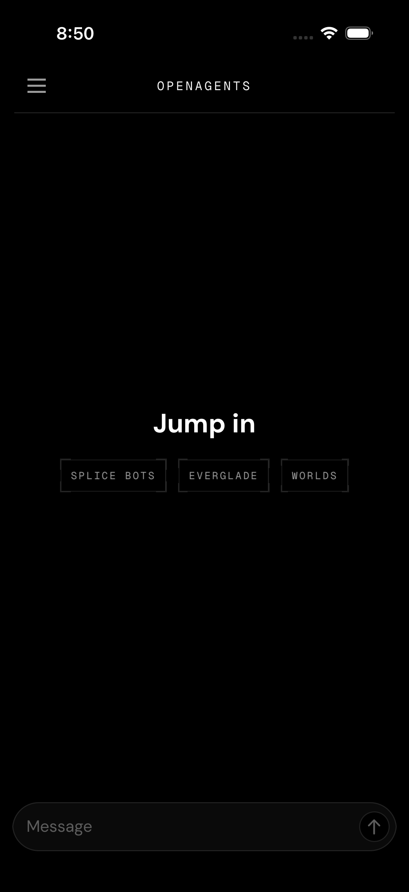
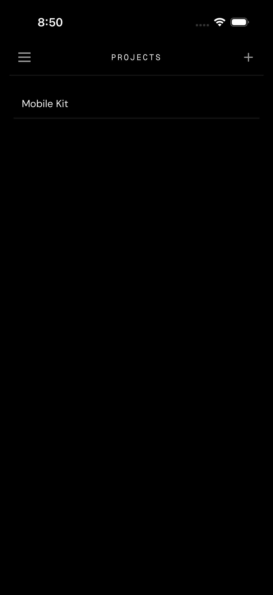
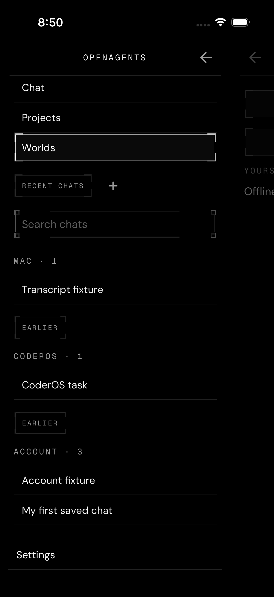
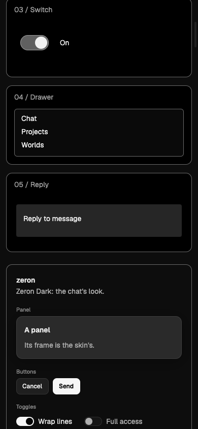
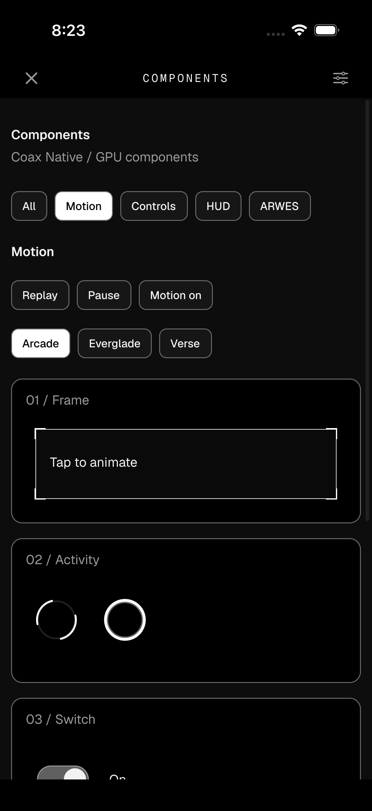

# Native mobile workspace, 1090

The shared Coax application owns page selection and synchronization. UIKit
supplies a foreground elapsed-time tick and projects the existing components.
There are no new server routes, credential paths or execution commands.

- Titles stay at the screen's center; trailing actions form one group. Creation
  uses the plus glyph. Refresh controls are removed from the mobile UI.
- The composer contains its native text editor and Send/Stop. Model/effort,
  mic and the unused new-chat/clear-draft menu are hidden. Provider defaults
  remain in the existing turn contract; the [router](../../router/README.md)
  is separate work.
- Worlds is a child of the main workspace. Its existing Coax builder, native
  document picker and streamed world player remain in use. Its menu dispatches
  through the main Coax navigation, including the return to Chat.
- The sidebar clips a fixed-width content pane. Its reveal container animates;
  UIKit autoresizing cannot squeeze the text. History rows truncate to one
  line, retaining their complete accessibility labels.
- History, projects, saved chats, worlds and read-only account sections refresh
  every 10 foreground seconds. Selected computer conversations follow idle as
  well as running sessions. Failed reads retry after a delay with the same
  cursor. Usage refreshes every 30 seconds; the optional balance every minute
  while open. Writes, private-key views, profile drafts and earlier transcript
  pages are excluded from automatic replacement. Uncertain writes keep their
  explicit recovery path.

The shared project review from main (`37fcaa23ed`, #13604) is included. Its
larger retained field walk exposed an account-reset stack overflow before
upload. The app reserves 8 MiB of stack inside the existing 32 MiB carrier;
the complete initial/login and transcript oracle, and the installed Projects
flow, pass with that allocation.

## Verification

- Shared app/transitive checks: **620 pass** after integrating main's project
  review. The focused Worlds routing and draft-preservation checks pass.
- Extras: **194 checks pass; 123/123 changed mutants killed**, no exclusions.
  Nine frozen DOM frames cover the closed menu, loading, balance and every
  unavailable state; non-reduced motion checks cover removal and balanced
  component trees. Frame goldens came from the independent WebAssembly engine.
- SDK checks cover centered titles with two trailing actions, single-line
  rows, fixed history width during reveal, composer size/caret preservation,
  actual elapsed-time delivery and native project field editing.
- The installed workspace walkthrough passes: composer → Projects → Worlds →
  history → Chat. The integrated project walkthrough passes draft edit,
  publication, agent chat and saved-chat reopening. Fixture data is disposable;
  the Worlds fixture intentionally answers unavailable for private world lists.
- The exported archive matches all 20 tested Starter resources and passes the
  four-framework native link gate. Both live signed feed envelopes match the
  generation-1 package. Fresh install and relaunch show no redundant update.
  Normal pre-push passes, including changed mutation checks; no bypass was used.

## Release

Source: `d60947b1ed5da3af2b793f6ff0b1a3fc7c13fe96`.
Runtime: `a4052bf0caf3cf851594591e96e1ff4d906a983a807901f57956bb3161b47ea9`.
The 19,807,255-byte IPA uploaded successfully with Apple delivery
`6c504b5e-4e34-4f65-9651-bb6d5962a5bc`. Generation 1 matches the IPA's 20
resources. All five dSYMs are retained. Frozen artifacts, exact logs and
`release.json` are under `~/.openagents/releases/openagents-ios-1090/`.

Apple's build-upload record is **PROCESSING**, with no errors or warnings.
Owner assignment is queued as the one-off user launchd job
`com.openagents.testflight.1090`. It runs the existing SDK adapter against
this build and the existing Owner group, retries unsuccessful attempts at
60-second intervals and stops after verified assignment. Its configuration
and `testflight-assignment.log` are in the release folder. It grants no
group-wide access and creates no groups or testers.

| Composer | Projects |
| --- | --- |
|  |  |

| Worlds | History |
| --- | --- |
|  |  |

## Gallery repair, 1089

The drawer and reply demonstrations are separate cards. Navigation wraps with
distinct 44-point targets; paired controls wrap on narrow screens. Web and
native default to grayscale, using the shared Arcade palette. Palette tokens
live below the native exports so the Metal gallery links without duplicate
host symbols. The app's Settings → Components path opens Metal directly.

Build **1089** is VALID / IN_BETA_TESTING in Owner. Its generation-1 package
matches all 20 exported IPA resources; both public feeds return its exact
signed envelope. Four world libraries pass the native link gate and all five
dSYMs are retained. Frozen artifacts are in
`~/.openagents/releases/openagents-ios-1089/`.

The targeted web publication updates only `/components-gpu` and its index,
keeping production's host, shader and font identities. It uses module
`components.ded424199e82.wasm`, under the shared release lock and generation
preconditions. The remote full-release attempt was stopped before publication:
build hosts intentionally have no production credentials. The headless live
capture below verifies the repaired WebGPU page.

Gallery checks: 127 gallery/transitive and 23 native-palette checks pass;
two installed UI checks cover Settings, sections, scrolling and background
resume. Phone layout checks cover 320, 390 and 430 points. Tools, component
and normal pre-push gates pass without an allowlist increase.

| Production WebGPU | Installed Metal |
| --- | --- |
|  |  |
