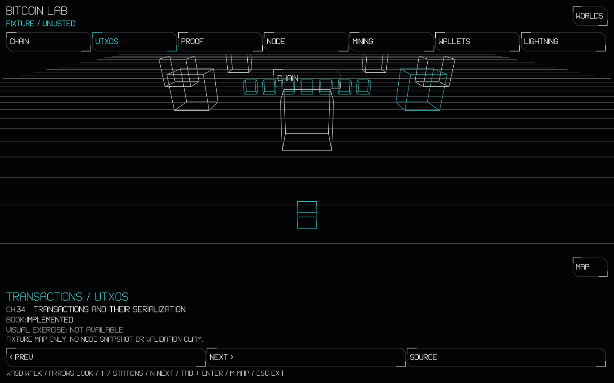
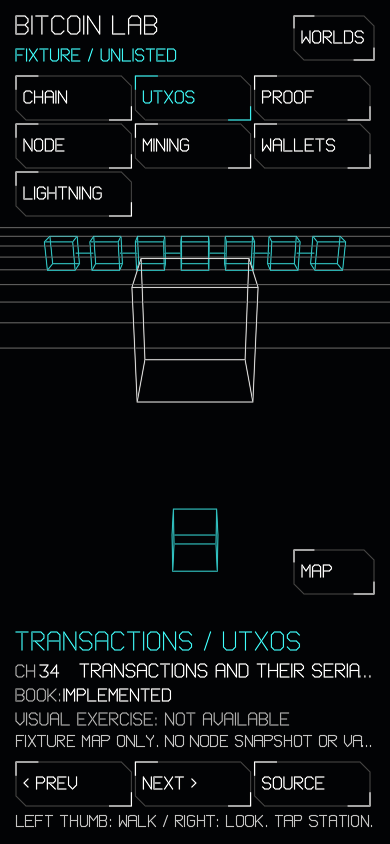

# Bitcoin Lab 01: Linux qualification

2026-11-04, coderos-4080, Linux x86-64, RTX 4080. Implementation:
[`9d476375260fcb5e347b534f661166f807c5855a`](https://github.com/OpenAgentsInc/openagents/commit/9d476375260fcb5e347b534f661166f807c5855a),
rebased on `284b5814d7`. No Mac, physical touchscreen, public deployment or
node service is claimed. [Design and bounds](../verse/bitcoin-lab.md).

The compiler is the existing qualified native binary, SHA-256
`54308753598854075405f995a04eb94f64eeb85f231ee6840a42e77afe6d2e80`.
Commands below run from an isolated worktree. The local server uses
`--build true` so it does not launch the whole site's build; the realm's
Wasm is built explicitly.

## Commands and observed results

| Command | Result |
| --- | --- |
| `coax/bin/coax test apps/openagents-web/bitcoin-lab.coax` | 400 checks passed, including the imported shared engine and UI checks; authority execution coverage checked. |
| `coax/bin/coax mutate aethyr/render/adoption.coax --root-only --jobs 16` | 35/35 killed, zero survivors. |
| `coax/bin/coax mutate coax/web/realm-discovery-policy.coax --library --root-only` | 30/30 killed, zero survivors; includes slug length and ASCII boundaries. |
| `coax/bin/coax test coax/web/discovery-realms.coax --only 'unlisted directory'` | Parsed projection and escaped-slug checks passed. |
| `coax/web/tool.sh bitcoin-lab-native` | 375 compiled chapter/layout frames; peak 11,616 vertices, no refusal; state 134,592 bytes, arena 3,590,944 bytes. |
| GCC `-fsanitize=address,undefined` build of that native tool | The same 375-frame sweep passed with no sanitizer report. |
| `bun test coax/web/realms.test.ts` | 25 tests passed. Stale Everglade module/ruleset fixtures were updated to the current registry; no validation rule was weakened. |
| `python3 coax/web/tests/realm_discovery_oracle.py` | Independent JSON/set and HTML checks passed: all 15 unlisted roots and their children excluded by deployment's actual discovery section; all 125 source/status/exercise rows match the book. Planned source links name real criteria rows. |
| `coax/web/tool.sh bitcoin-lab-map --check`; `bun coax/web/realms.ts --check` | Generated chapter and realm files current. |
| `coax/web/tool.sh wgsl-module --site --check` | All site modules current. |
| `coax/web/check-visuals.sh apps/openagents-web` | Passed; the table lives inside the hidden fallback main, with all visible UI drawn in Coax. |
| `python3 coax/book/check-structure.py --registry` | All registries passed; Bitcoin remains 100 implemented, 3 partly implemented, 22 planned. |
| `coax/web/tool.sh wasm-size budgets apps/openagents-web/wasm-budgets.txt apps/openagents-web/build.sh` | Build modules and budget registry agree. |

Native sanitizer reproduction:

```sh
coax/bin/coax c coax/web/bitcoin-lab-native.coax --library > /tmp/bitcoin-lab-native.c
gcc -std=c11 -O1 -g -D_DEFAULT_SOURCE -fsanitize=address,undefined \
  -fno-omit-frame-pointer -Icoax/platform /tmp/bitcoin-lab-native.c \
  coax/platform/tool-native.c -lpthread -lm -o /tmp/bitcoin-lab-native
/tmp/bitcoin-lab-native
```

## Actual browser journeys

```sh
coax/web/wasm.sh apps/openagents-web/bitcoin-lab.coax \
  apps/openagents-web/bitcoin-lab-face.c apps/openagents-web/build/bitcoin-lab.wasm
coax/web/serve.sh apps/openagents-web --listen 127.0.0.1:8832 --build true
coax/web/tool.sh bitcoin-lab-check http://127.0.0.1:8832 /tmp/bitcoin-lab-12802
coax/web/tool.sh gpu-recovery http://127.0.0.1:8832/worlds/bitcoin-lab \
  --size 390x844 --require-hardware
coax/web/tool.sh realm-perf http://127.0.0.1:8832 --only bitcoin-lab \
  --rounds 1 --out /tmp/bitcoin-lab-12802/perf.tsv
```

Muted headless Chromium reports **hardware nvidia lovelace**. Desktop
1440×900 and phone 390×844 journeys enter the actual realm, force garbage
collection, walk spawn → Chain → spawn, select stations with keys and real
pointer events, advance chapters, verify noindex and the 125-row fallback,
capture pixels, and exit to Worlds. The phone also walks forward and back
with actual touch gestures. UI selection leaves walking released.





These PNGs encode the actual GPU-rendered RGBA8 offscreen texture; they do
not reconstruct the page in HTML. Direct headless canvas presentation was
not usable for screenshots on this Linux Chromium setup (SwiftShader lost
its device; the hardware path omits its canvas from compositor screenshots).
The driver uses the existing offscreen capture facility and reads the GPU
pixels before encoding PNG. This is a capture limitation, not Mac evidence.

Device-loss qualification replaced the real GPU device in **96 ms**, with
identical before/after state SHA-256. An induced engine trap saved and
restored the identical state SHA-256, then drew again. The viewport option
avoids the recovery tool's tiny default window, where a chapter UI has no
visible world region.

The hardware frame report holds 60 FPS at desktop DPR 1, desktop DPR 2 and
phone DPR 3; each case has more than 250 sampled frames, p95 16.7 ms and no
frame over 33 ms. See the retained [browser log](bitcoin-lab-12802/browser.txt),
[recovery log](bitcoin-lab-12802/recovery.txt) and
[frame report](bitcoin-lab-12802/perf.tsv).

## Limits

`coax/web/tool.sh tools-check` was run before push. It reports 20 pre-existing
non-Coax files without a Firm reason or port-list entry; none belongs to this
change. The retained [report](bitcoin-lab-12802/tools-check.txt) identifies
them. New logic and drivers here are Coax; the Python set/status oracle has
Firm reason 2. No unrelated file was given a false exemption to clear the gate.

This slice has fixture geometry and chapter navigation only. No cryptographic
exercise, Bitcoin graph, own-node snapshot or new protocol is qualified.
Step 02 remains [#12803](https://github.com/OpenAgentsInc/openagents/issues/12803).
