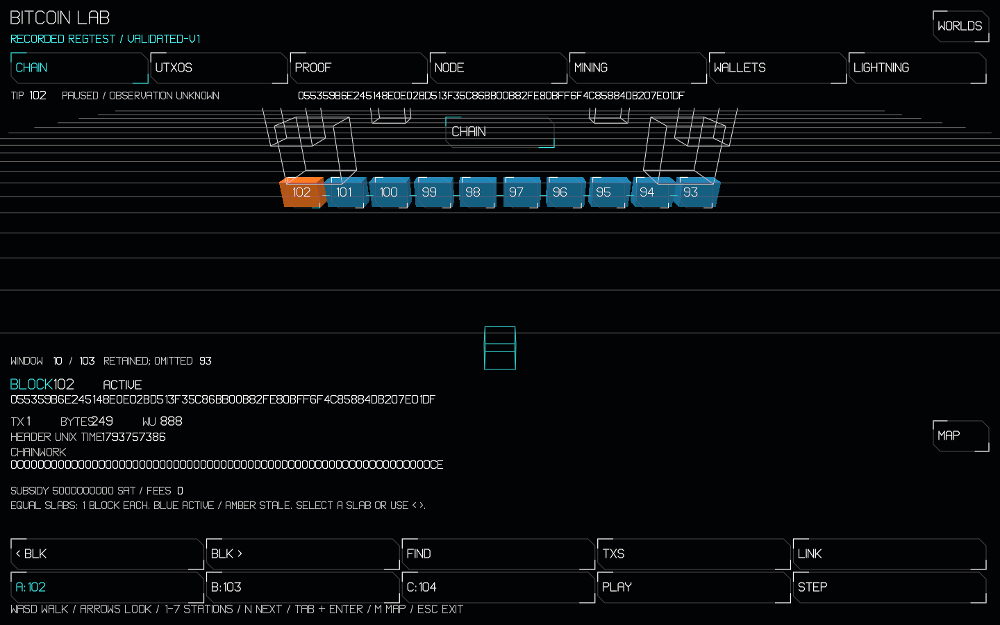
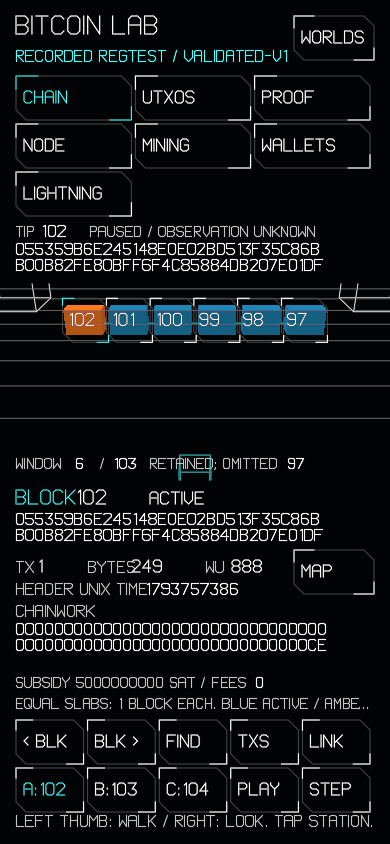
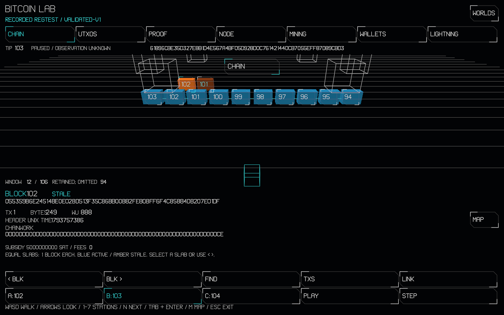
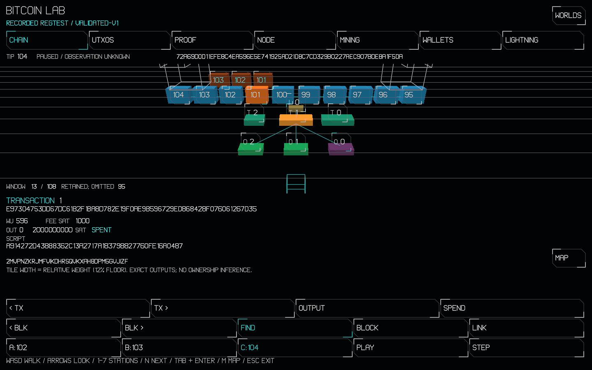

# Bitcoin Lab: recorded blocks on Linux

This milestone advances #12803/#12804 after #12802. Both issues remain open
for their full live-source and explorer criteria. The realm stays unlisted.

Tested implementation: [`b04fbc603d`](https://github.com/OpenAgentsInc/openagents/commit/b04fbc603dcf6ed77cf4f978f2ebad240a6c7b50). The qualified owned sources were unchanged by rebasing on main.

The source is the retained Core 32.1 / Electrs regtest recording, rebuilt
from empty genesis through validated chainstate, indexed atomically and
published only after CoinsCache flush + append/fsync + acknowledgement.
The old published pow-only HTTP API and mempool contract are unchanged.
The Lab HTTP protobuf/spec is an alpha design, not an implemented endpoint.

Qualification used Linux/NVIDIA Lovelace and compiler SHA-256
`54308753598854075405f995a04eb94f64eeb85f231ee6840a42e77afe6d2e80`.

| Check | Result |
| --- | --- |
| Independent raw-block/Core/Electrs oracle | All 103/106/108 retained blocks, txids, weight, outpoints, output/spend states, exact-script balances and retained reference answers agree |
| Native validated recording | A: attach 102; B: detach 2 / attach 3; C: detach 3 / attach 4 |
| ASan + UBSan native recording | Pass; all three JSON snapshots and journal byte-identical to oracle-qualified output |
| Physical-file journal recovery | 663 cuts recover the last complete V/X/coins/index frame |
| Coax realm checks | Initial 403/403; after UI changes, all 7 changed realm checks and 3 data-model checks pass; unchanged engine checks reused |
| Native frame sweep | 1,356 chapter/block/transaction/layout frames; peak 28,458 vertices including scene mesh; no budget refusal |
| Desktop + phone headless journeys | Solid scene, actual mouse/touch slab picks, exact graph/outpoint facts, A/B/C reorgs, stale selection, hash links and complete text fallback pass |
| GPU loss / trap recovery | Device recovered in 85 ms; state digests identical after device loss and after trap rescue |
| Walking performance | 60.0 FPS, p95/max 16.7 ms, at desktop DPR 1, desktop DPR 2 and phone DPR 3 |
| Protocol generation/compatibility | Pinned protoc 29.3 / Python protobuf 5.29.3; 30 tool tests, owned/external schemas, source pins, published compatibility/migration and consumer profiles pass |

Authority mutation gates pass with **167/167 killed, zero survivors**:
metadata 52/52, view 61/61, connector 54/54. The connector gate ran all 752
baseline checks before mutation; exact-capacity, corrupted-cursor and both
fork-direction checks are included. No mutant is declared equivalent. Logs
are alongside this file.

The initial complete 403-check realm result and subsequent focused results
are retained instead of repeating passing unchanged engine checks. See
[#12802's prior baseline](bitcoin-lab-12802.md) for unchanged discovery,
chapter-status and engine adoption checks. The current global `tools-check`
reports 21 pre-existing unrelated files without reason headers; the new
Python independent oracle has its Firm reason 2 header.

Bounds: 8 fixed steps, 70,000 total vertices, 3 draws, 5,000,000 arena bytes;
physical HUD capacity 72,000 vertices and mesh capacity 4,096 vertices. State
is 271,656 bytes, arena 3,728,008 bytes and release Wasm 267,525 bytes (budget
270,000). The added immutable recording accounts for the larger Wasm budget.
Release Wasm SHA-256: `74e79e170f4b62a39a7129b4483b6c5ada8c99e1611e5159d6d46903404b9ba2`.
The visible preview uses those exact bytes and the qualified shared host.

The shared host now binds store-only procedural meshes when pipelines are
created, even with no fetched assets, and mirrors accessibility during
deterministic clip frames. It uses the existing scene/depth/HUD passes.
All qualification browsers were muted and headless. Captures are actual
NVIDIA WebGPU RGBA8 readbacks, encoded as PNG without pixel editing.






The requested visible app runs from a separate local preview directory,
outside the development worktree. Its loopback server is the user service
`openagents-bitcoin-lab-blocks.service`. The default Wayland browser disables
WebGPU on this host; the app window uses its own X11 Chromium profile and the
same Vulkan/ANGLE settings qualified above. No system configuration changed.

Reproduction commands (from the repository root; recorder/oracle/projection
commands are in `bitcoin/lab/README.md`):

```sh
coax/bin/coax test apps/openagents-web/bitcoin-lab.coax --only 'Bitcoin Lab'
coax/bin/coax test apps/openagents-web/bitcoin-lab-blocks.coax --library
coax/bin/coax test coax/lib/bitcoin/validated-index.coax --library --only 'validated index:'
coax/bin/coax mutate coax/lib/bitcoin/validated-index-meta.coax --library --root-only --jobs 16
coax/bin/coax mutate coax/lib/bitcoin/validated-index-view.coax --library --root-only --jobs 16
coax/bin/coax mutate coax/lib/bitcoin/validated-index.coax --library --root-only --jobs 24
coax/web/tool.sh bitcoin-lab-native
coax/web/tool.sh bitcoin-blocks-check http://127.0.0.1:8833 /tmp/bitcoin-lab-blocks
coax/web/tool.sh gpu-recovery http://127.0.0.1:8833/worlds/bitcoin-lab --size 390x844 --require-hardware
coax/web/tool.sh realm-perf http://127.0.0.1:8833 --only bitcoin-lab --rounds 1 --out /tmp/bitcoin-lab-blocks/perf.tsv
coax/web/tool.sh bitcoin-lab-map --check
coax/web/tool.sh wgsl-module apps/openagents-web/gpu/bitcoin-lab.coax apps/openagents-web/bitcoin-lab.wgsl apps/openagents-web/gpu/bitcoin-lab.module --check
bun coax/web/realms.ts --check
coax/web/tool.sh tools-check
```

The sanitizer build used `coax c bitcoin/lab/record.coax --library
--run-steps 100000000`, the usual tool-native/process/file/socket/entropy
hosts from `coax/platform/`, and GCC with `-O1 -g
-fsanitize=address,undefined -fno-omit-frame-pointer`. It rebuilt all three
recorded states with `ASAN_OPTIONS=detect_leaks=0`; the output files and journal
were compared byte for byte with the independent-oracle input. Later
connector edits added checks only; its production procedures are unchanged.
