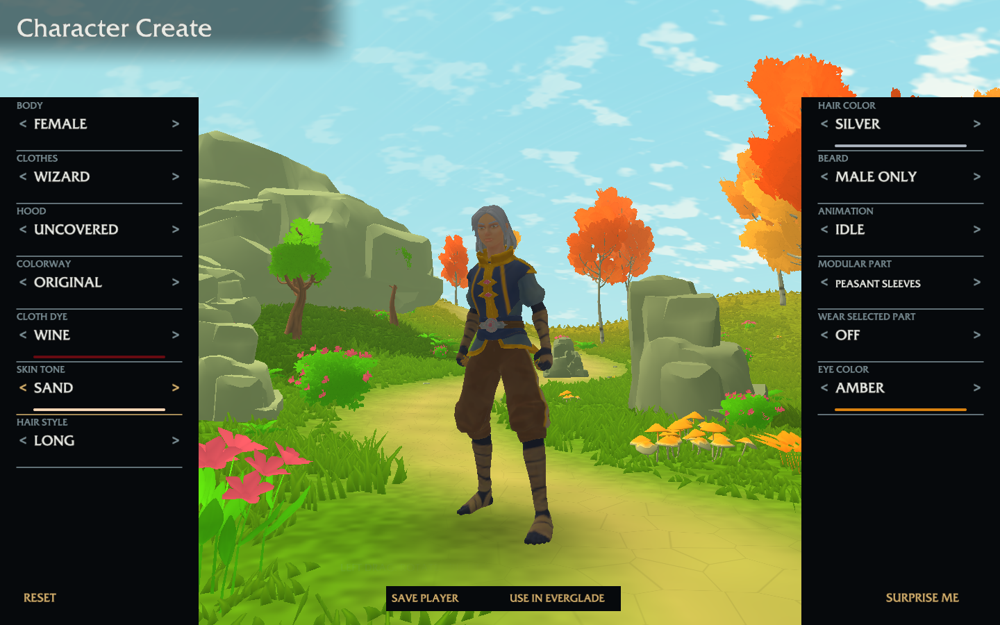
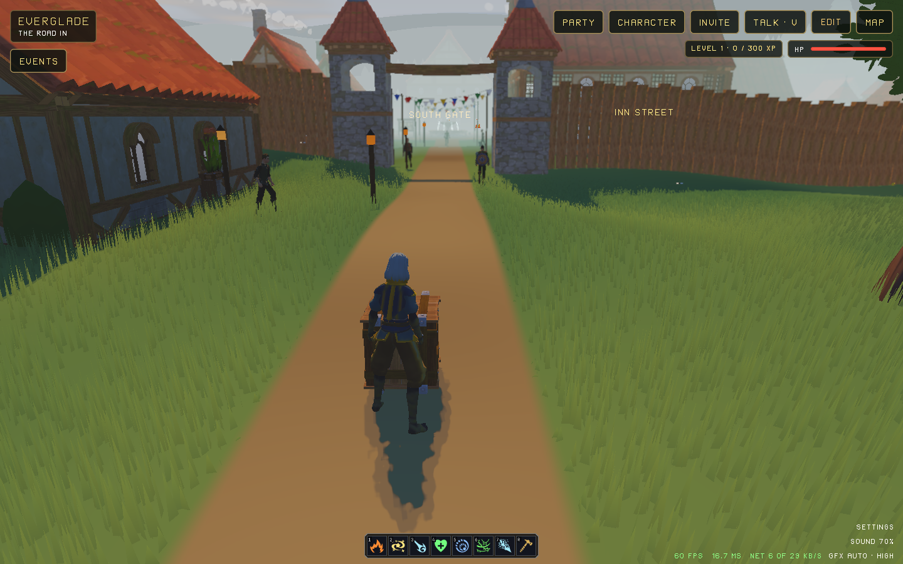

# Character Create player profile → Everglade

The explicit Save Player record is browser-local, separate from the draft. Use
in Everglade waits for storage acknowledgement before navigation. Both surfaces
parse the shared CC2 codec. The active local actor wears the chosen modular
pieces and colors on the existing Everglade controller; multiplayer LOOK remains
its existing published format.

Validation on this Mac, hardware Apple Metal WebGPU:

- Shared codec round trip and corrupt-byte refusal passed.
- Creator checks passed, including pending snapshots, failed acknowledgements,
  saved-profile loading and preservation of a different working draft.
- Everglade appearance parsing and bounded modular draw/palette checks passed.
  Existing remote/NPC palette layout checks passed after reusing the original
  player palette block. The custom body does not extend any joint-read bounds.
- Production compilation checks passed with the normal renderer carrier both
  before and after rebasing onto main, preserving the new arrival HUD behavior.
  Final Everglade Wasm: 2,035,185 bytes (budget 2,150,000); creator Wasm:
  613,855 bytes (budget 625,000).
- The wardrobe tool admits its output with production `pack_read` before writing.
  The independent Python oracle verifies all 76 garments, all 15 added texture
  layers, topology, skin weights, joint bounds, original mesh/catalog references
  and byte-identical original images. Its receipt is committed beside the pack.
- A headless browser refusal test intercepted only the explicit profile storage
  write: Retry Save appeared and Use in Everglade did not navigate.
- New mobile/desktop button background coverage checks passed. Generated shaders,
  host JavaScript syntax, tools-check and whitespace checks passed.

Reproduce the browser journey (isolated Chrome storage, muted/headless):

```sh
coax/web/tool.sh coax/web/room/local.coax --room 8847 --page 8817 --static
coax/web/tool.sh coax/web/tests/player-appearance.coax \
  http://127.0.0.1:8817/worlds/character-creator
```

The page requires the standard host-services, host-packs, host-layers,
host-media, host-sockets and host-audio build companions. Their existing
`coax/web/build-*.coax` tools build them. Build the normal one-seat room worker
with `coax/web/tool.sh coax/web/room/worker.coax apps/openagents-web/build/everglade-room.wasm`.
The player intentionally does not step without an admitted room seat.

## Complete browser journey passed

`coax/web/tests/player-appearance.coax` passed with a female wizard, Wine dye,
Silver hair and Amber eyes. It clicked Save Player, verified the exact 56-byte
record and draft isolation, clicked Use in Everglade, verified eight matching
modular parts and all selected values, reloaded the destination, joined its
normal one-seat room, held forward and observed displacement plus walk/run
clip frames. The browser was isolated, headless and muted; the owner's draft
and active profile were untouched.

The normal room worker was built at 1,068,228 bytes. The native development
room build also passed its compilation checks and zero-field startup check.



