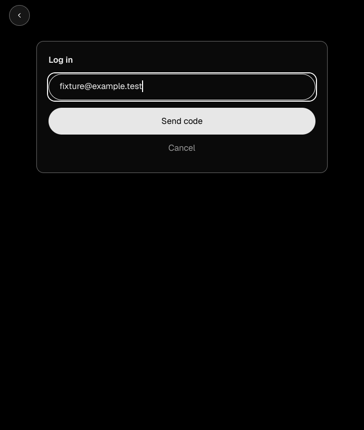
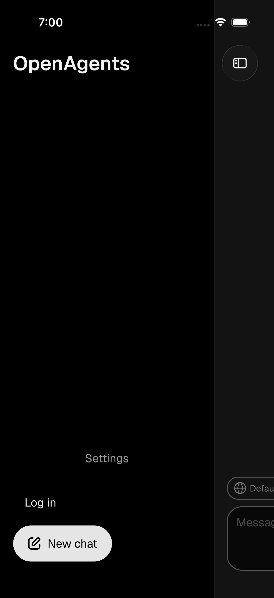
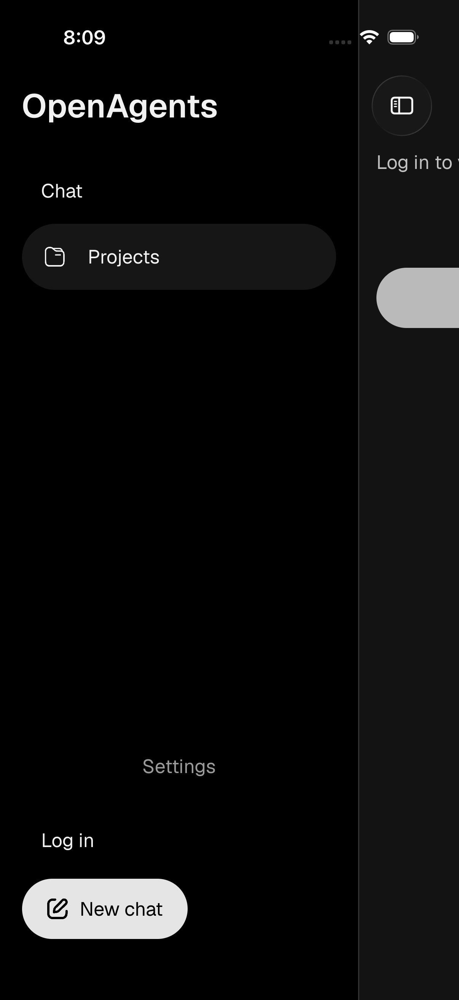
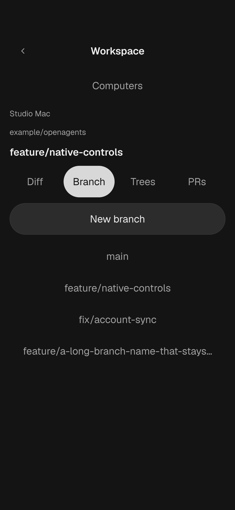
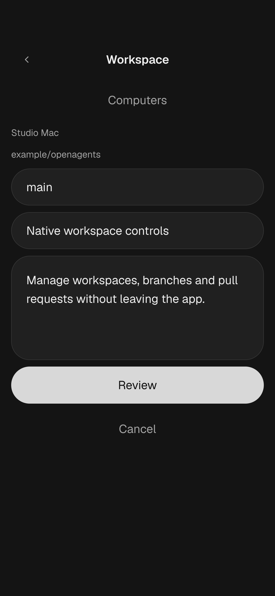
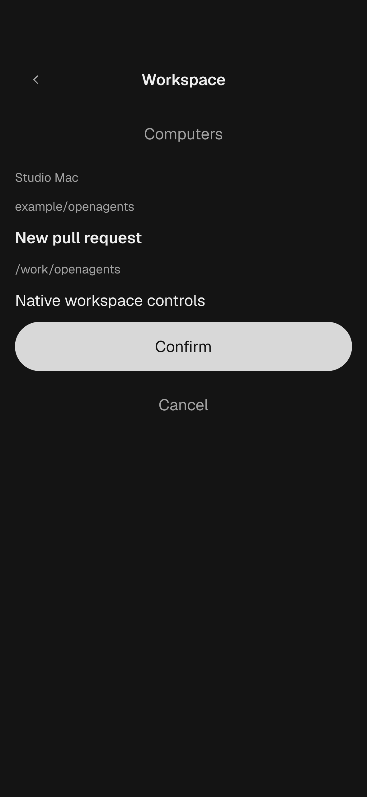

# Compiled GPU app qualification, 2026-11-16

Issue [#13645](https://github.com/OpenAgentsInc/openagents/issues/13645) remains
open. This record covers the shared compiled page and desktop SDK foundations,
not completion of the desktop replacement, all backend effects or physical
accessibility ceremonies.

## Linux page on Vulkan

The actual iOS/shared page and app core compile through
`coax/native/linux-build.coax`, with the same component atlas and shader
source as the Apple app. The qualification entry is
`apps/openagents-desktop/native/gpu/tests/linux.coax`; its controlled outbox
answers contain no account, credential store, network login or paired agent.
The C entry performs SDK calls only, through committed row IDs.

The real Vulkan pipeline rendered Settings and login, activated their rows,
accepted a committed email value and detached focus on blur. It settled the
actual drawer animation before pressing the page revealed underneath.
`UiApp.busy` now exposes that existing motion fact to the SDK driver.

Both ordinary and fully instrumented C/Coax builds pass, with
`-fsanitize=address,undefined`, `ASAN_OPTIONS=detect_leaks=1` and
`UBSAN_OPTIONS=halt_on_error=1`. The renderer here is Mesa Lavapipe, a software
Vulkan implementation; this is not a physical GPU performance measurement.
This first fixture did not qualify active text input, keyboard traversal or
live account/agent services. The subsequent active-editor record is below.

Normal and instrumented PNGs are byte-identical, SHA-256
`75eb724ca0afe0e4faf8e2e03142e247b133dbb886e371a9f96b66331a43998a`.
The picture contains only the disposable `example.test` fixture address.

The build is a Coax tool; the C compiler and Wayland/Vulkan/ATK headers and
link libraries come from the existing native SDK environment. Generated C
and headers are written directly by the compiler, preserving crypto table
lines larger than the process observer's line limit. Compiler/linker flags
use the shared, checked `nc_flags` argv reader, with no shell interpretation.

## Active canvas editor on Linux

The actual shared page now receives committed text, provisional transactions,
paste and named keys through the same callbacks installed on the Wayland host.
The Vulkan fixture asserts that preedit never enters the login draft, commit
replaces it once, Backspace and undo work, a one-character paste undoes alone,
Tab/Shift-Tab leave and return to the field, and blurred fields reject input.
It renders the library's existing composer body and uses the SDK's shared
focus-ring painter. The SDK explicitly constructs Coax ownership state after
allocation; raw zero-filled storage is not a Coax constructor.

Ordinary and ASan/UBSan/LSan builds pass. Their new PNGs are byte-identical:
SHA-256 `89170f2b7c75582cc6d28271b9b65b866ef651625547b27696208649bc02fda1`.

The real Wayland protocol/descriptor tests additionally assert buffered
preedit/commit delivery, UTF-8 byte cursor boundaries, hidden/reversed cursor
ranges, whole-transaction refusal, prior-field replies, cancellation and a
distinct paste callback. Existing v1 receipts retain their exact rows; new
SDK assertions do not change that published shape. Normal and sanitizer
runs pass. The new cursor admission procedure kills all 34 changed mutants.

`coax/native/gpu-editor-check.coax` is an explicit suite root for the component
checks (114 passing). Its changed-procedure gate kills 748 of 775 mutants;
27 surviving mutations have reviewed equivalence proofs beside the source,
and no unclassified survivor remains. The compiled-page check runs separately
(945 passing). The web suite discoverer does not
select files directly under `components/` or the iOS folder; an empty suite
selection is not evidence that those tests ran. The shared buffer now refuses
oversized replace/mark operations before changing undo or redo. The active
body reserves enough primitives for every wrapped line, selection, caret and
clip scope instead of the short chat composer's fixed-height budget. Coax tests
also cover selection, owner retirement, atomic capacity checks, horizontal
single-line scrolling and cut only after clipboard acceptance.

An initial combined suite also pulled the app's unchanged authority closure
into interpreted UI mutation; that run was stopped within ten minutes and
is not cited as passing. Component checks and app checks now run separately;
the changed Wayland admission procedure retains its own full mutation gate.

The source was rebased onto the native sidebar hotfix (TestFlight 1400).
The shared AppKit control check and ten identity/file/resident-carriage SDK
checks pass on the rebuilt library. Fixed authored geometry fixtures retain
the original three-skin composer goldens and add scrolling, selection,
composition underlines, clip edges, blink and pointer bounds. The original
transcript/menu frame tests remain unchanged; both also fail on unchanged
main `f89f502554`, independently of this editor extraction.

These controlled observations do not qualify a third-party compositor/IME,
Orca's active text/selection support, a physical GPU's performance or live
Linux account and agent services. The GTK application remains until those
replacement gates pass.

## Accessibility and Apple SDKs

### iOS 1400: native sidebar activation

The floating control was a bare `UIControl` wired to
`primaryActionTriggered`; a finger tap did not produce that action. It is
now a `UIButton`, retaining the same glass appearance. The open drawer also
records the visible control in its live semantic table, so the accessibility
bridge retains the actual button while the drawer is open. Login opened from
Settings now obtains Back's frame from its committed row even when the
underlying Settings page has no sidebar control.

The new Coax Back regression fails on the previous implementation. All 907
app checks pass after the fix. An actual XCUITest on an isolated iPhone 17 Pro
simulator taps the native menu, opens/closes it repeatedly, visits Settings,
opens login, taps Back and returns home. It passes with no failures; this
tests the UIKit event path rather than calling `oc_activate` directly.

Screenshot SHA-256:
`d493169869348d0bba4a00ab36ba8853917bb97e13d572265e5b53f3c1dc227c`.
The isolated app has no account or paired computers. Archive, package gate
and export pass; upload accepted with delivery
`13f947a0-90bb-4ad9-9a0a-74eb32fa818c`. The dSYM is retained as
`a65283d9d69a321586bfaf7cafba90dc`. Apple reports `VALID` and
`IN_BETA_TESTING`; assignment to the internal Owner group is verified.

The Linux [ATK/AT-SPI record](../../../apps/shared/host/linux/ACCESSIBILITY.md)
covers retained roles/states/text/actions, atomic refusal, structural and
state notifications, retirement and a separate actual D-Bus reader. Its
normal and sanitizer SDK tests pass. The actual shared Vulkan host with
`UI_ATSPI` compiles against generated Wayland input/text and real SDK headers.

The hidden Mac target passes Settings/login, native text insertion, held and
committed IME input, one native editor in accessibility and blur. Its package
links neither JavaScriptCore nor WebKit and contains no JS/Wasm/HTML or old
native projection. Ten standalone Apple SDK tests cover identity custody,
file storage and bounded resident-service carriage. A read-only probe of the
installed Mac service authenticated and decoded DescribeEnvironment and
16 session summaries; that read-only probe started no turn. The subsequent
explicit `--inspect-resident-turn` check passes against the installed service:
one marker-only Claude turn, GUI closed while busy, a new GUI/core opened
with the same public rejoin reference, and the exact assistant reply received.
The test requests no tools, changes no files and prints no transcript,
credentials or session reference. Its Coax observer refuses a mismatched
host and never mistakes an echoed user prompt for the assistant's reply.
The whole app root passes 1,328 checks after main's early-Send/slot fixes.

The account/device drawer checks pass in debug and release, including
ASan/UBSan. Backend nesting checks: GPU 40, surface 29, frame 62 and app
gallery 288 passed. The independent native SDK utility has nine passing checks.
Passing unchanged gates were not repeated for this record.

The older generic gallery has two hit-count assertions that fail unchanged
on earlier commit `5ba21554b7`; those assertions were retained. The compiled
OpenAgents qualification uses its actual page rather than that older gallery.

Real iPhone and VoiceOver/Orca/passkey ceremonies remain in `NEEDS_OWNER.md`;
the native SDK and software Vulkan observations do not certify those exits.

## GPU Projects page

The shared Projects fixture suite passes 613 checks, including actual canonical
create/read/edit/knowledge codecs, revision binding, cursor scope, logout,
hidden-read cancellation and exact replay after an unknown write. It checks
all eight page variants and visible-only realization of a 200-source library.
The source reader reaches the last byte without realizing an entire document.

`projects/qualify.coax` passes normal and ASan/UBSan debug/release builds of the
actual compiled page: regular-page drawer navigation, single/multiline editor
handoff, retained save ownership, sidebar reopening, large text, keyboard
reveal and idle settling. Logs for this worktree are
`/tmp/oa-gpu-project-flow-complete.log`,
`/tmp/oa-gpu-project-screen-native-debug.log` and
`/tmp/oa-gpu-project-screen-native-release.log`.

This is one G4 screen family, not completion of #13645. Provider Usage,
world-library adoption, G3 composition gaps and production desktop migration
retain their own exits. No physical iPhone or third-party Linux IME/Orca
acceptance is inferred from these fixtures.

The normal `check.sh only coax/native/app-core-check.coax origin/main` gate
passes after adding action-boundary coverage. Its changed-procedure gate
covers 656 mutants: 648 killed, eight proved equivalent, zero surviving.
The separate native frame suite is registered through `--native-link` and
passes `check.sh only`; it does not replace the core policy gate. The Linux
canvas-editor adapter passes all 1,017 checks, including actual Project
name/reference input, provisional composition and Return as a newline.
The actual UIKit test also passes repeated drawer taps, regular-page Projects,
Settings/login Back and typing an email through the native editor. The hidden
Mac SDK build and current compiled Nostr Settings normal/sanitized page
qualification pass. Physical passkey and phone appearance exits remain.

`app-input-check.coax` separately mutation-qualifies the closed editor roles:
20 mutants killed, no survivors or equivalents. The public drive editor may
edit the declared Project fields and composer, but never the private custody
field. A controlled full-page drive check verifies Project field edits do not
change the composer and that a private field cannot fall through to it.
The driver/app suite passes 995 checks before the final short-viewport fixture.

### TestFlight 1401

The signed archive and exported IPA pass the installed package audit: no
JavaScriptCore, WebKit, JS, Wasm, HTML or removed projection symbols. App Store
Connect accepted the upload on 2026-11-16 with delivery
`6521b6f4-7cfd-443a-bfe4-036e5a5af5ca`. The archived arm64 dSYM UUID is
`871BED89-9EB1-3F6E-AA47-EB9AABE1FF39`. Upload acceptance is not TestFlight
availability; the subsequent App Store Connect check reports VALID and
IN_BETA_TESTING, and the assignment command verified build 1401 in Owner.

The final UIKit run uses Foundation's launch-argument domain to isolate its
saved email preference, and passes against the previously populated simulator.
It exercises actual sidebar taps, Projects as a regular page, disabled creation
while logged out, Settings/login Back and native email typing. Its result is
`/tmp/oa-gpu-project-ui-1401-launch-domain.xcresult`.

## GPU Usage and account connection (1402)

Settings → Usage is a shared GPU page with provider-reported usage windows,
multiple Claude accounts, Connect, the existing browser/code login flow and
Default for new conversations. Tokens remain on the computer. Account-listed
hosts use the existing account gateway; paired/local-only hosts keep their
explicit provider enablement and grant scope. Ordinary chat pairing does not
silently grant account management.

The authorization code is entered only in the native secure editor. The public
core, semantic rows and driver contain a marker and presence facts only. Before
sending a mutation the SDK retains the exact existing PaRequest in protected
storage. Reopening recovers public metadata; an explicit Check replays the same
command and code. A correlated-but-unknown receipt keeps ownership. Nostr and
Claude fields and pending stores have distinct owners/namespaces.

Validation for this change:

- Shared model/view: 822 checks passed. Core changed-procedure gate: 202 mutants
  killed, zero survivors. Provider SDK gate: 127 mutants, 115 killed, twelve
  proved equivalents for opaque stack erasure/unreachable decoder branches,
  zero survivors. Public/private editor admission: 15 mutants killed. Local
  profile selection/correlation: 37 mutants, 28 killed, nine equivalent opaque
  erasure/unreachable branches, zero survivors.
- Actual GPU Usage page passes debug/release and ASan/UBSan: regular Settings
  navigation, public/private field separation, large type, keyboard reveal,
  drawer destinations and exact scroll geometry through 512 account cards.
  Nostr Settings' actual compiled-page normal/sanitized checks also pass.
- Fourteen standalone SDK tests pass, including Nostr backup/restore, private
  files and Claude code substitution, storage-before-send, missing input,
  malformed/unknown receipts and same-byte retry after reopening. The hidden
  Mac SDK editor/accessibility qualification passes.
- The real UIKit test passes repeated sidebar taps, Projects, email typing,
  login Back, Usage opening/Back and returning to the sidebar. Result:
  `/tmp/oa-gpu-usage-ui-1402.xcresult`. No owner login or private key is used.
- A real isolated owner-only Unix socket passes disabled-provider refusal,
  enabled provider dispatch with command correlation and the unchanged chat
  profile. It starts no provider login or agent turn. Command:
  `TMPDIR=/tmp coax/web/tool.sh coder/tui/local-provider-smoke.coax`.
- Components, tools, wire and layer checks pass without an allowlist increase.

The local socket extension is built/tested in source. The owner's installed
resident daemons were not restarted or replaced during this change. This is
not production desktop adoption. G3 composition, the world library, Project
file attachments, desktop default migration and physical-phone acceptance
remain open under #13645. The owner asked to stop after this Usage release;
resume only on further instruction.

The UIKit fixture is logged out and has no computer or account credentials:

### TestFlight 1402 delivery

The accepted build was generated, archived and uploaded from the separate fixed
release checkout at `ed3736938b`, after the Usage change landed on main. The
archive confirms `com.openagents.app`, version 1.0.0, build **1402**. Archive,
export and the no-JavaScript/no-WebKit/no-old-projection package audit pass.
App Store Connect accepted delivery `81c55de6-c318-4332-8bb6-9ab037ff5031` on
2026-11-16. The arm64 dSYM UUID is
`6FAE2113-83DF-3D78-BBB6-724CC32DB0D4`; the symbols keeper uploaded it.
Artifacts are `/tmp/oa-gpu-usage-1402-frozen/` and the release log is
`/tmp/oa-gpu-usage-1402-frozen-release.log`.

An earlier mutable-checkout preparation overlapped a rebase and generated a
1401 archive. Apple rejected that discarded attempt as a duplicate; it was
not accepted or distributed. Do not use `/tmp/oa-gpu-usage-1402/`. The separate
fixed-checkout delivery above is the 1402 release. Rebase and release generation
must not run concurrently in one checkout.

At handoff the accepted 1402 build is still `NOT_YET_LISTED` in App Store
Connect; Owner assignment is pending. Processing was not waited on. The
[issue handoff](https://github.com/OpenAgentsInc/openagents/issues/13645#issuecomment-6920823389)
contains the assignment commands, source map, validation and remaining work.
The main-green watcher remains down under existing pipeline issue #13637;
the state check reports zero open red entries. This release cites the explicit
local gates above, not an unobserved after-landing pass.

## Direct workspaces and synchronized chat library (1407)

Source `5651b2c4c5` replaces the Claude-prompt shortcuts with a regular shared
GPU Workspace page: inspect changes/diffs, page branches/worktrees/open PRs,
create/switch a branch, create/remove a worktree, push and create/edit a PR.
Review and confirmation show the selected computer/repository/path and target.
The additive [workspace contract](../../protocol/native-workspaces-and-chat-library-v1.md)
keeps the published runtime unchanged. Every remote write is a typed command,
with a Git state digest, validity window and durable exact-once claim. An
interrupted claim remains unknown and cannot execute twice. Dirty/busy/locked
worktrees are protected; removal is restricted to service-created worktrees
and never removes the adopted root or a branch. GitHub calls explicitly name
the validated origin repository. Credentials stay on the computer.

Pin, rename and archive now synchronize through the account API. The shared
Coax client performs field-wise three-way merge and CAS retries. One durable
record keeps base, current local state and exact pending bytes coherent.
A lost acknowledgement advances the base without erasing later local edits.
Guests retain local preferences; account boundaries fence late responses.
Both native Apple clients use the same coordinator; this does not claim the
older browser client or Linux shell has adopted that Apple coordinator.

Qualification on 2026-11-16:

- Real API/Postgres suite: **23 checks passed**, including two independent
  clients converging on pin + rename + archive, lost old acknowledgements,
  replay, conflict and separate-account isolation. CLI authentication's
  **72 checks** also passed. This ran on a build host, never on the Mac.
- New workspace wire: **792 mutants, 786 killed, six proved equivalents,
  zero survivors**. Library sync: **451 mutants, 428 killed, 23 proved
  equivalents, zero survivors**. Workspace policy: **21/21 killed**; SDK:
  **51/51 killed**; changed local transport: **72 mutants, 63 killed, nine
  proved equivalents, zero survivors**. Markers document unreachable
  typed-state boundaries or opaque stack erasure, not unchecked behavior.
- Shared Workspace flow: **520 checks**; native Git snapshot: **144 checks**;
  signed device seal: **714 checks**, including new-profile carriage and
  correlated refusals. Frozen wire bodies/identities remain unchanged.
- Disposable real Git repositories passed branch creation/switch, worktree
  creation/removal, dirty/busy/root/stale refusals, exact replay/conflict,
  interrupted-command recovery and a real push to a local bare origin.
  An independent gh fixture checked create/edit argv; no owner PR was created
  merely to test a write.
- **17 native SDK tests passed**: Nostr/private-storage/provider regressions
  plus Workspace persistence, malformed replies and exact retry after reopen.
  **Five UIKit navigation tests passed**, including Workspace opening/Back.
  The macOS GPU build/headless editor qualification passed.
- Actual Mac resident service upgraded, with prior executable preserved.
  Full-size live repository reads, branch paging (16 rows + next cursor),
  GitHub PR reads and a **signed relay workspace read** passed. Both exact
  existing local environment enrollments enabled the new profile.
- Tools, wire, components and layer gates passed with no allowlist increase.
  Main pre-push passed; its remote suite job reached the 120-second hook
  budget, so the explicit unit results above are the cited suite evidence.

Remaining rollout/acceptance boundary: CoderOS was offline on Tailscale and
its recorded SSH endpoint timed out; it has not been upgraded. Its exact
service/profile rollout must happen after it reconnects. No owner phone or
second physical device has accepted these screens yet. Workspace selection
manages Git worktrees; it does not silently change an existing Claude chat’s
working directory or provision hosted runners. Model/effort, attachments and
microphone controls remain hidden.

The GPU captures below use the actual page and a public disposable fixture,
not owner repository or conversation content:

### TestFlight 1407 upload

Frozen source: `5651b2c4c58074a880ab1b2f6ac7089b976bce28`.
Archive/export/package inspection passed for `com.openagents.app`, 1.0.0
(**1407**), with no WebKit/JavaScript runtime. Apple accepted delivery
`b5591e36-5eba-4efd-bd18-c8428ea015b5`. IPA SHA-256:
`03452711c3571fe65e599f93a05d9159b97c82de2a3dd1eaf0b70bb55ce8d5f7`.
The symbol keeper retained dSYM UUID `53B782FB-8A7E-3FDB-BB8D-0FC43666DC49`.
Archive, IPA and matching generated Coax C/header are retained together at
`/tmp/oa-openagents-1407-release/`; log: `/tmp/oa-openagents-1407-release.log`.
App Store Connect reports VALID and IN_BETA_TESTING; the assignment tool
verified **1407 in Owner**.

Follow-up qualification places the unchanged GitHub-origin predicate in the
`#authority` policy unit: **90 mutants, 85 killed, five proved equivalents,
zero survivors**. The original and relocated predicate bodies compare equal
with whitespace/comments removed (preserving string literals); this changes
verification ownership and adds grammar/property checks, not released behavior.
The initial 21-mutant policy result above refers to the write/scope rules before
this relocation.

### Production API and resident delivery

Cloud Build `7ee4502b-16c6-415a-8f00-912754ec0837` succeeded. The immutable
image `us-central1-docker.pkg.dev/openagentsgemini/cloud-run-source-deploy/oa-api@sha256:42043ea6838e5c8ba7b080befeba9a5bef43155da4602709bad181906799e3da`
passed migration and verified health/revision/image checks on staging
`oa-api-staging-00242-rcd`, then production `oa-api-00172-fjj`, both at 100%
traffic. Source is the same frozen `5651b2c4c5`; the prepared compiler output
was emitted with the checked compiler on this Mac. This was production
compilation, not running the API/Postgres test suite on the Mac.

Production now recognizes GET `/api/chat/library/v1` and POST
`/api/chat/environment/workspace/v1`; unauthenticated probes return 401.
Account isolation and signed request behavior are covered by the tests above.
The Mac resident executable SHA-256 is
`535444a4e6c40ff19212af7702393f5ae9ad26a9ef8bcdbd96e6f62881a06218`;
launchd points to its immutable version folder, with the prior executable
preserved. The service was idle (zero busy sessions) before replacement.
CoderOS remains offline; its upgrade and owner phone acceptance remain the
explicit actions in `NEEDS_OWNER.md`.
