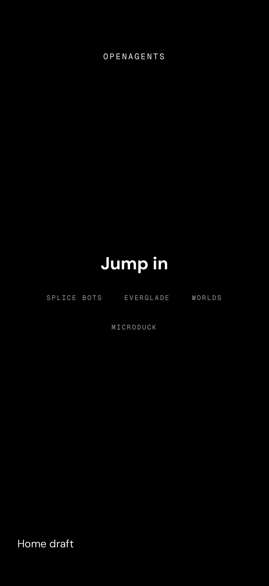
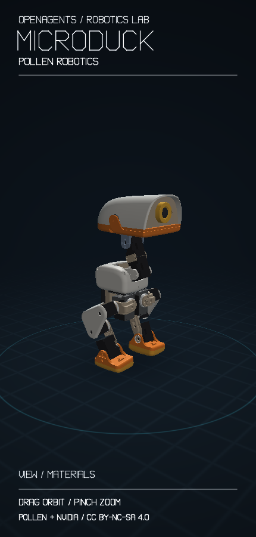
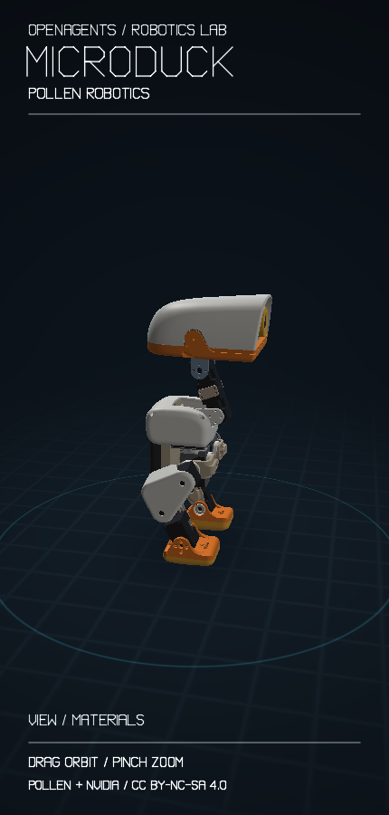
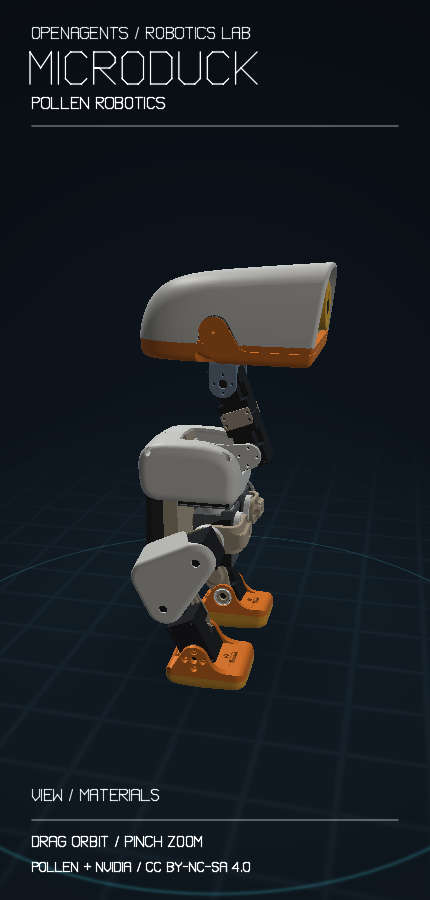

# Microduck on iOS — November 15, 2026

Home's **Microduck** button opens the existing Coax viewer in the native Metal
host. Drag orbits; pinch zooms. The one floating menu has Front, Side, Top,
Normals, Reset, License and Close. The existing Arcade component overlay and
grayscale mobile captions are retained. The Arcade issue sequence is paused
after the completed Nostr foundation, #13628.

## Shared implementation and assets

The [web viewer and source record](../../../metaverse/microduck/README.md)
remain the source of truth. This adds an installed producer for the same Coax
scene, shared engine camera, VPK1 importer and shader. Native addresses use the
existing portable face-address contract; the browser still uses Wasm offsets.
No second camera, model parser, component set or WebView was introduced.

The signed inventory contains three immutable objects: the assembly and two
existing fonts. Its installed producer identity is checked before opening.
The assembly downloads from the existing public world-assets bucket into the
verified world cache, rather than being bundled with the application:

- VPK1: **50,927,404 bytes**, SHA-256
  `44a2b852208c8a29d17851e2a99401d257c2f711bc59cf92fe8b4a4c20bd681e`.
- Expanded geometry: **861,777 vertices / 796,802 triangles**, from the pinned
  70-node / 38-mesh assembly in the shared asset registry.
- The Apple host now supports the existing optional `pack-gate-v1` contract.
  The shared Coax SHA-256 implementation checks the complete pack before the
  parser or GPU upload. Producers without that optional gate retain their
  existing behavior.

The model and derived pictures are **CC BY-NC-SA 4.0**, credited to Pollen
Robotics and NVIDIA DLI. The source record above includes provenance and the
license. This is the same static research viewer: joint animation, physics
and robot control are outside its implemented scope.

## Observed checks

- The installed Home/navigation program rendered a visible native **Microduck**
  button, emitted the correct installed-viewer action and restored an unsent
  chat draft after closing it. The existing drawer/Projects/world-shortcut
  journey passed with this added step (0.264 seconds).
- `NativeWorldTests.testMicroduckRendersActualGeometryOrbitPinchAndRefusesAnAlteredPack`
  passed against the actual assembly and native producer on the iOS simulator.
  Metal readback changed more than 1,000 interior pixels for normals, orbit
  and pinch independently; captions were excluded from that comparison.
  Altering byte 10,000 of a copied pack produced the expected SHA-256 refusal.
- `NativeWorldDownloadTests.testMicroduckSignedInventoryStreamsAndReopensOffline`
  downloaded all required objects through the real public delivery path into
  a fresh cache, verified the pack's exact size/digest and matched the bundled
  producer fingerprint. Reopening with an offline/503 network fixture made
  **zero network requests** and returned the verified cache.
- The actual-render/input regression for the four existing world producers
  passed. Four existing world library/editor/chat program checks passed;
  the floating-menu check was updated to inspect the existing nested Arcade
  overlay and passed with the download test (two checks, 4.6 seconds).
- Coax Home/action checks preserve the selected chat draft. Camera pinch,
  pointer cancellation and native menu recipes have shared checks. The
  installed-world admission change killed **39/39** changed mutants. The
  engine digest checks include the published SHA-256 `abc` vector and output
  capacity rejection.
- `tools-check`, `wire-check` and `layer-check` passed. The updated web viewer
  compiled to **33,478 bytes**, and the muted shared headless browser opened
  the same model using the hardware Apple Metal 3 WebGPU adapter. Existing
  web golden checks passed without changing their expected receipts.

The full Coax suites also passed: viewer **98 checks**, native world host
**109**, engine host core **240**, archive audit **12**. Their changed
mutation checks ended with **zero survivors**: viewer **134 mutants / 130
killed / four equivalents**; native world host **75/75**; engine host core
**11 / 10 / one equivalent**; archive audit **7/7**. The installed-world
admission's separate **39/39** result above remains unchanged.

The initial push's suite job exceeded the hook's 120-second wait. Its report
exposed a missing assertion for pinch cancelling an active drag, an impossible
failure branch after the digest's exact 32-byte capacity check, and the SDK
entry point being treated as compile-time code. The follow-up supplies the
active-drag fixture, documents the unreachable branch with its bounds proof,
and separates the archive tool's SDK driver using the existing `suites-host`
pattern. Its checked catalogue projection now shares the installed profiles.
Only the failed checks were repeated; the actual accepted archive again
passed all five producer link audits. These qualification changes leave
1094's installed runtime and released portable resources unchanged.

Home is a UIKit test-window capture. The model images are actual native Metal
readbacks at 430 × 900; the UIKit floating menu is outside those readbacks.
They do not claim physical-iPhone acceptance or accessibility/power measurements.

## Delivery

Build **1094** archived/exported and App Store Connect accepted its upload
without errors on November 15 at 19:38 UTC. Apple processing is separate and
was not waited on. While the source push was finishing, the build became
**VALID** and was assigned to the existing **Owner** group; membership and
**IN_BETA_TESTING** were verified.

- Delivery UUID: `85eb4466-562e-4586-93d7-51e1feebe2be`.
- IPA: **21,132,120 bytes**; SHA-256
  `6ad29271cd0e56dd8ffbc9d1e80edabf74d0f19daecffe8dc90cb6e18312b1cc`.
- Installed runtime:
  `e90a305ba47225e2d97dabaeb4ac6214734bcdf8df48a2275ade0b84c8c1f74e`.
- Microduck producer:
  `1aef3627382f4c7e8de7ece490eaf61e175a304b7276d00981980430bfc2e995`.
- The IPA includes all five producer frameworks and **zero `.pack` or `.glb`
  files**. Link checks found no missing native exports. All six application/
  producer dSYMs were retained in the shared symbols bucket.
- Signed generation **1**, all **21** portable resources/inventories, was
  published under this new runtime. The signed envelope and every object
  matched the frozen archive byte-for-byte through both `updates.openagents.com`
  and the existing Cloud Run fallback. Existing runtimes were not repointed.
  The bundled configuration and feed use the same installed runtime, preserving
  the existing identical-package update suppression.

The archive, IPA, frozen `Starter`/`Generated` directories, manifest, signed
envelope and runtime are kept at
`~/.openagents/releases/openagents-ios-1094/`. The model's three immutable
inventory objects were published separately to the existing world-assets
bucket; the live native download check above exercised that public path.

The first release attempt stopped before archiving because a clean remote
slot lacked the converter's output directory. The shared converter now creates
its output parent; the next clean-host generation produced the exact pinned
pack and the accepted archive. No failed build was uploaded.
