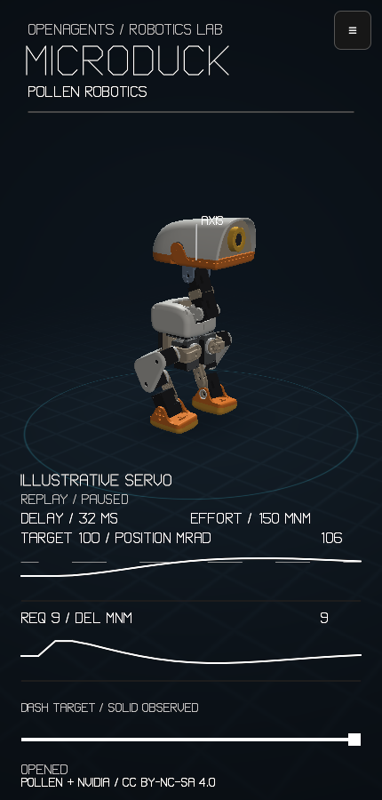
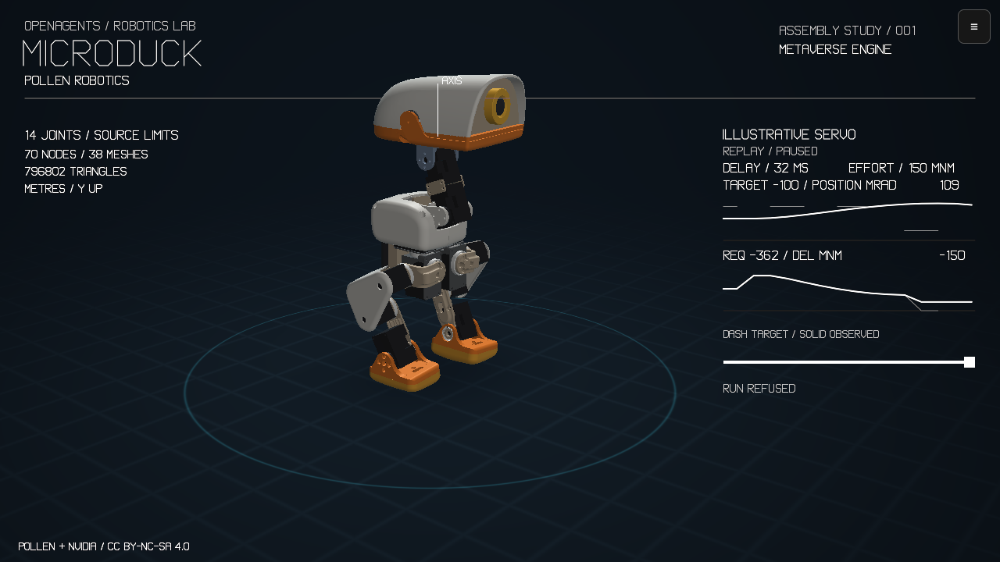

# Microduck saved experiments — #13641

**Saved runs** in the viewer menu offers Save, Open latest, Share file,
Open file, Play/Pause, Beginning, backward/forward 0.2 seconds and
**Branch + continue**. The shared grayscale slider scrubs a saved run.
Scrubbing changes its presentation cursor; Save/Share during replay exports
the original complete artifact. Branching retains the full queue at the
cursor and starts a distinct run linked to that artifact's identity.
Live target changes are recorded at their actual simulation tick. Parameter
changes start a new experiment. Runs stop at 4,096 additional 2 ms steps;
at most 32 target commands fit. The displayed graph retains 256 sampled rows,
while the recipe and trace cover every simulation step.

The versioned [SLR1 contract](../../protocol/servo-run-v1.md) stores exact
initial/final snapshots, all 16 queue words, cursor/counters, source/profile
identities, target commands, end reason and lineage. RXE1 and SLV1 keep
their published bytes. Camera, explosion and selection are not simulation
state. The reader verifies the complete bounded replay before publishing
the new run or pose, including the actual source joint's exact limit/stand
words. Files contain inert experiment data.

Save/Open latest uses the existing shared byte-storage effect. Its one
Coax codec now owns both envelope directions. Native storage remains under
the shared OpenAgents world-state directory; web storage is IndexedDB.
The generic [document effect](../../protocol/document-effect-v1.md) projects
the existing native picker or share ceremony and a browser file input or
download. **File offered** distinguishes a download offer from a completed
byte-storage Save. Both hosts retain the request owner and ignore stale
callbacks. No app-private file picker, hash, servo or slider was added.

## Numerical evidence

[native-numerical.oarun](native-numerical.oarun) is the actual native Metal
consumer's 1,100-byte artifact, extracted from XCTest. It branches at tick 2
with a nonempty delay queue, changes the target at tick 102 and ends at tick
152 with position `0.10737260767507809`. The actual browser file-input path
opens and re-exports every byte identically under
`servo-native-wasm-f64-v1`. The complete declared queue and trace pass the
Wasm reader's recomputation. A corrupted queue byte then refuses without
altering that admitted artifact. [Source receipt](native-numerical.json),
[browser observation](cross-browser.txt).

- Artifact identity: `5bf4eb38cb84f3c7b95eb3e2caf82909d1c0370484070599864a89d3c1fdd5b5`.
- Whole-file SHA-256: `8edaa9188839d079790de1efeff8159257a81cd5182a1b4fbfb6fc1254efdf7d`.
- Trace: `6597f1c92f12a7400e9262c071795006e4d263e23a35e245149bf207a0808308`.

The independent Python/struct/hashlib oracle agrees with the separate
canonical golden record. Root mutation checks: run 233 mutants, 232 killed,
one proved equivalent; wire 227, 221 killed, six equivalents; document effect
1,360, 1,355 killed, five equivalents; shared storage 258, 255 killed, three
equivalents. All have zero surviving mutants. Equivalence reasons are next
to the affected source sites. The targeted viewer and HUD shader checks pass.

Actual browser Save/Open, file import, source-bound restore, lineage and
malformed-file refusal were driven through the installed consumer. At the
run's capacity, export measured 33.6 ms and Open latest 22.6 ms on this Mac;
a near-end pointer seek measured 22.1 ms for the down/up pair. These are
observations, not a phone frame-time guarantee. [Capacity receipt](browser-capacity.txt).

## Assets and offline scope

The native test first downloads the real signed inventory's model, checks
its 50,965,060-byte digest, reopens the verified cache through a transport
whose network would fail, and executes/save/reopens/branches in the actual
Metal producer with page networking disabled. The cache makes zero requests
on reopening. The source pack remains
`fc21cb95595d665bb83dc5b90c373dcf197f5b45b34b376c0d110b044bb408b5`.

The browser now streams that same immutable public object rather than
requiring `/private/`. The existing public asset bucket has read-only GET/HEAD
CORS for anonymous browser consumers; existing rules are retained. The
model still passes the whole-pack gate before GPU upload. The model and
derived pictures retain Pollen Robotics + NVIDIA DLI / CC BY-NC-SA 4.0.

After the real first download, a warm browser viewer passes actual CDP
network blocking: the uncached network probe rejects, `navigator.onLine` is
false, IndexedDB Open latest preserves the artifact, and replay advances.
[Receipt](browser-offline.txt). [offline.coax](offline.coax) reuses the
checkout's existing muted headless page and restores its network state.
This qualifies an already-loaded viewer and stored run, not a fresh browser
launch without network. Physical iPhone airplane-mode, picker/share and
VoiceOver acceptance remain owner checks.

## Delivery

Build **1301** was uploaded, accepted as **VALID**, and verified in the
**Owner** group with internal status **IN_BETA_TESTING**. The exact archive
source is tag `openagents-ios-1301-source`
(`445f5024a1c95a9868cb2cf3ba3fcf84eea63217`), preserved independently of
later documentation and web-publisher changes. [Archive receipt](archive.json)
records the IPA, runtime and producer hashes. No model pack is bundled.

The matching signed generation 1 is published. Both configured public
endpoints were downloaded independently: all 21 objects (15,515,719 bytes)
match the archive inventory and the entire envelope matches the frozen
archive package. CryptoKit independently verified its Ed25519 signature
with the public key in that archive's Native.plist. Thus the first feed
generation equals the installed package. [Public receipts](public-updates.json).
The earlier Microduck preflight using 1160 was interrupted before
archive/upload; a concurrent sidebar release owns that number.

The [public viewer](https://openagents.com/demo/microduck/) serves the same
shared implementation from isolated runtime
`/demo/microduck/builds/20261116T000327Z/`. An actual fresh public-page render
downloaded the model and drew 70 parts / 2,390,406 indices. The public SDK's
file picker admitted the native numerical artifact byte for byte, Save and
Open latest preserved it, corrupt data refused without mutation, and replay
advanced from tick 2 to 152. [Public observation](public-browser.txt).

The single-page publisher reuses the existing SDK stager, compiles its one
module remotely, uploads the versioned runtime first, then replaces only
`demo/microduck/index.html`. It never replaces room versions or main-site
runtime paths. The full website release correctly refused an unrelated
Everglade content-version mismatch; that gate remains intact. Preview-name
policy mutation killed all 27 mutants. The main uploader now preserves
independent `demo/` and `demo-releases/` objects, while scoped pin cleanup
retains its existing behavior; both cases were checked independently.

The [assembly film](../microduck-film-13643/README.md) is already published.
Its walking is authored kinematic animation. This workbench's numerical
experiment remains a fixed-base illustrative single-joint servo; neither
feature demonstrates trained locomotion or physical actuation. Scoped agent
tools and comparison overlays remain #13642.
