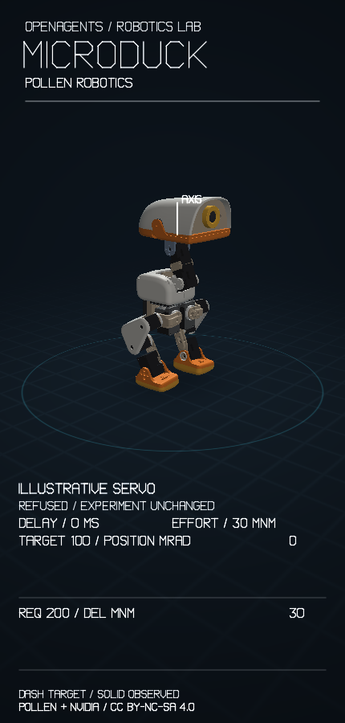
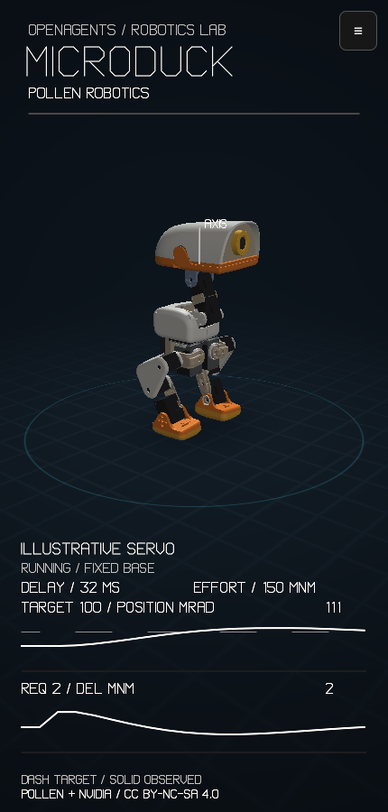

# Microduck illustrative servo — #13640

Home → Microduck → menu → Illustrative servo drives the selected source joint
using the existing Psionic `rsa_begin` / `rsa_step` path. Baseline, Delayed and
Limited presets, target/delay/effort changes, pause/reset and a negative-inertia
refusal expose a compact filmed experiment. The base/other joints stay fixed.
This is an authored teaching profile, without measured motor, whole-body,
balance, learning or physical-hardware claims.

The [SLV1 companion](../../protocol/servo-lab-v1.md) freezes source identity,
units, complete parameters, held targets, 2 ms steps, revisions, finite result
and real telemetry. RXE1 remains unchanged. The app composes the numerical
owner with the engine's FrameClock and RBA1 pose; neither engine nor Psionic
acquires the other's domain. New shared `components/kit/plot.coax` emits
display-list series; the existing world GPU backend projects those lines.
White solid observed/delivered and gray dashed commanded/requested series
come from admitted values. The 256-row ring samples every 20 ms. Large stalls
and hidden/resumed frame deltas add no hidden simulation or catch-up.

Independent checks cover the exact 200 mNm request / 150 mNm delivery example,
0/2/16-step queues, reversal, complete actuator restore, closed source limits,
atomic parameter refusal, ring eviction/ordering and equal sampled traces at
30/60/120/144 render partitions. The packet matches all 312 independent stdlib
struct bytes and its tagged SHA-256; dense read/re-encode checks cover every
field, source byte, integer endpoint and nonfinite binary64 word.

Owned authority mutation: servo **158 / 158 killed / zero survivors**; SLV1
**187 / 185 killed / zero survivors / two proved equivalents** (an unreachable
guard over a closed Coax enum). Integrated numerical/viewer/component suites
pass. Native actual Metal rendering passes in **0.922 seconds**, including
first-step forces, delayed zero output, 30 mNm clipping and byte-for-byte
accepted-state preservation on refusal. Existing articulated poses, selection,
explosion, reset, normals, orbit/pinch and altered-pack refusal also pass.
The unchanged account/chat/world regression results are retained in
[#13639's qualification](../microduck-workbench-13639/README.md).

Actual muted headless WebGPU rendering uses the Apple Metal 3 adapter.
The pictures below show real observed traces and geometry, not synthetic HUD
waves. The source geometry remains streamed/cached under its unchanged
immutable digest; no pack is added to the app. The viewer grows from 53,715 to
67,996 Wasm bytes, with a 72,000-byte budget for the servo/codec/plots.
Pollen Robotics / NVIDIA DLI model and derived pictures: CC BY-NC-SA 4.0.

## Delivery

App Store Connect accepted **1097** on November 15 at **21:54 UTC**, with no
upload errors. Delivery UUID: `22dde31b-e3e4-4dda-82ce-d90a7745395a`.
Processing and Owner assignment are separate; development does not wait for
them, and this receipt does not imply tester availability.

- IPA: **21,200,894 bytes**, SHA-256 `3d538a3d7e17106a436b2d74fbc348d6ae840e2b3902f88584b6f193e83f8713`.
- Installed runtime: `3c137bf9b6001ec9fc8f0b78cee194bbb4d2ec1db783276547a1ea6b12aca124`.
- Microduck producer: `796efeef7b760749979f8e53bb3546d53897b6671042d1d389da2fe8f0378c8f`.
- All five producers pass the stripped archive link audit; six dSYMs are kept.
- The IPA includes zero `.pack` / `.glb` files. All 21 portable resources were
  frozen from the actual archive. Signed generation **1** is published for this
  runtime; both public update endpoints returned the exact envelope and all
  resource bytes/digests. CryptoKit verified the signature with the bundled
  public key. Earlier feeds and immutable assets remain available.

[Archive receipt](archive.json), [public delivery receipt](public.json). Frozen
Starter/Generated sources, IPA, signatures and receipts are retained under
`~/.openagents/releases/openagents-ios-1097/`. The generation source tag
`openagents-ios-1097-source` retains the product tree before the documentation
rebase. Latest main's Liquid Glass changes are included.
Physical iPhone VoiceOver/power/frame-time checks remain in `NEEDS_OWNER.md`.
Persistent save/replay (#13641) and scoped agent commands (#13642) follow in
sequence; they are not represented as completed by these live plots.
