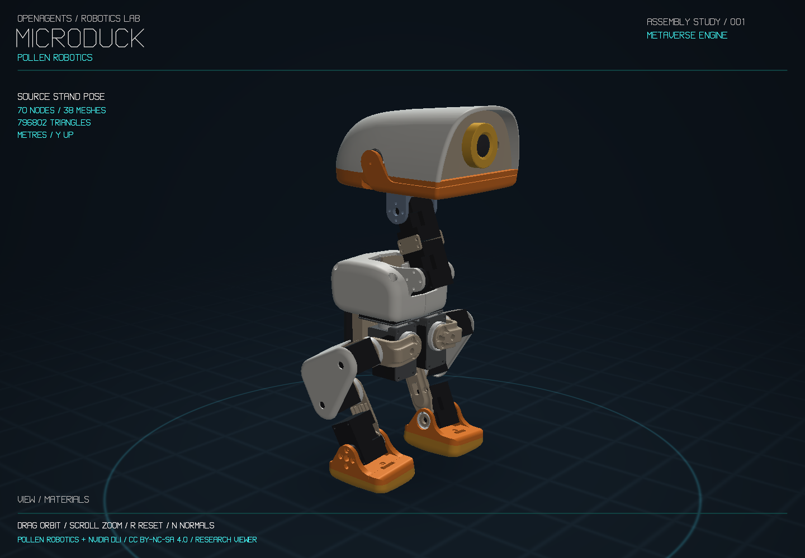

# Microduck viewer receipt — November 15, 2026

The [standalone viewer](../../../metaverse/microduck/README.md) imports a pinned
official workshop assembly, converts it through the shared Metaverse Engine
glTF importer and VPK1 writer, and renders it in WebGPU. The source, rights,
registry IDs, exact hashes and reconstruction commands are in that README.

The source assembly is 70 nodes / 38 distinct meshes. Expanded engine geometry
is 861,777 vertices / 796,802 triangles. A complete 50,927,404-byte pack is
accepted by its SHA-256 before upload. No original source model is committed
under the app. The shared registry retains the immutable source snapshot,
licence evidence, workshop notice, content objects and collection lock.

## Observed result

Headless Chrome on this Mac reported the hardware Apple Metal 3 adapter.
At 1440×1000 the actual browser host reported `sceneReady: true`, one indexed
scene draw and 2,390,406 indices. The load marks reached `pack-admitted`,
`pack-buffers`, `pack-layers`, `scene-first-draw` and `scene-ready`.
The full model is visible with the source base colours and metre coordinates.
Dispatching **N** switched the visible robot to normal colours and changed the
view probe to 1; **R** restored materials and probe 0. Both images were inspected.

The robot geometry and this derived screenshot are **CC BY-NC-SA 4.0**.
Attribution: Pollen Robotics, assembly/presentation materials from NVIDIA DLI;
OpenAgents flattened the assembly into its static mesh layout and supplied
the viewer, camera, diagnostic and studio lighting. See the source links and
[licence](https://creativecommons.org/licenses/by-nc-sa/4.0/).

## Checks

- Viewer: **96 checks passed**. Its changed-procedure mutation pass reported
  **308 mutants, 299 killed, zero survivors, nine marked equivalents**. The
  equivalents have local reasons: overwritten scratch words, equal-valued
  camera branches, and the unused sans flag at caption sizes ≥9 CSS pixels.
- Shared registry: **114 checks passed**; the licence recognition change
  reported **six mutants, six killed, zero survivors**.
- Viewer shader graph: **20 checks passed**, and the committed WGSL was
  generated from the Coax shader and checked by the browser's WebGPU compiler.
- The converter checked the original GLB hash and read its generated pack back
  through `pack_read` before writing it. A separate hash check matched the
  registry definition object, original GLB object and generated pack.
- The registry verified the immutable source snapshot's inventory.
- `tools-check`, `layer-check`, the Wasm budget inventory and `git diff --check`
  passed. The release Wasm remains below its 40,000-byte budget.

Checks ran through `coax/remote/check.sh only ... origin/main` on the build
hosts; the actual viewer Wasm, shader generation and model conversion were
also built there. The server uses `--build /usr/bin/true`; capture uses the
repository's shared, muted headless browser.

Main's page bundle at `f68e6eb967` was unavailable: its attempted page build
failed the existing `feed/index.html` visual check. Shared browser dependencies
were fetched from the nearest stored ancestor,
`bac999b3ac9cb9920b09f8bb8f4a00d74ede4e08`; only the new viewer and its shader
were rebuilt for this task. The unrelated feed page was not changed.

## Scope

This receipt qualifies this static inspection viewer. It does not establish
robot joint semantics, animation, contact/dynamics, controller execution,
learning, a trained skill or physical transfer. It uses material base colours
and normals rather than the source's full PBR material model. The screenshot
is an engine capture, not an upstream render or a physics rollout.
