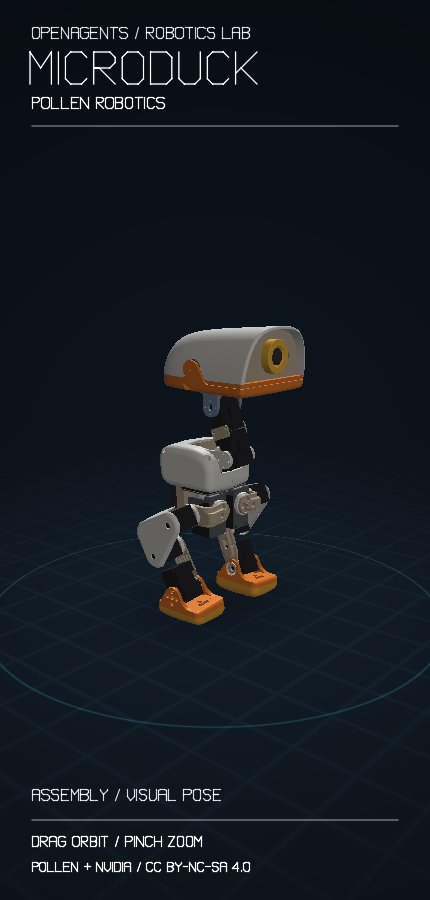
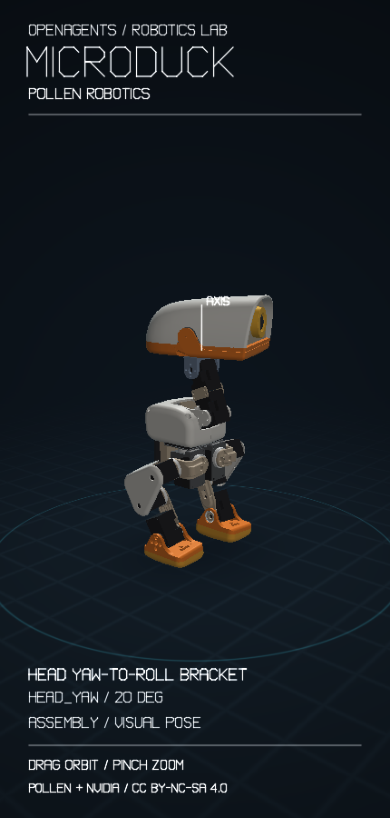
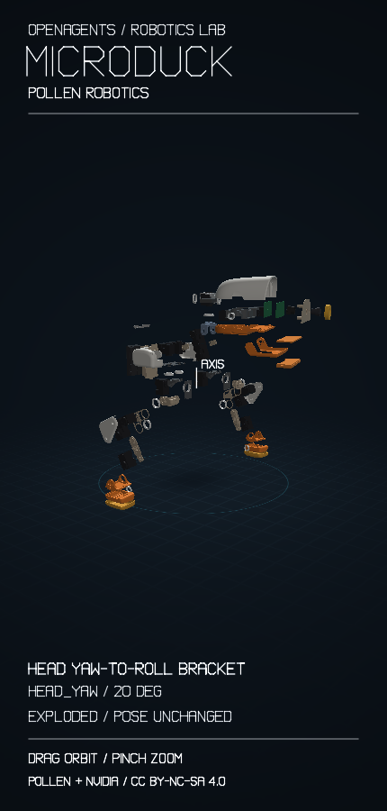
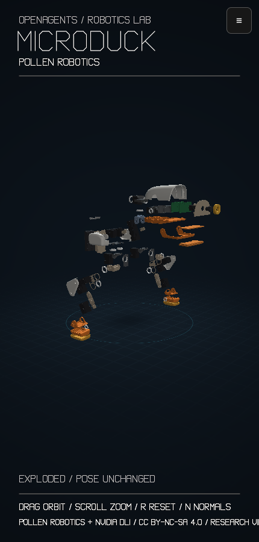

# Articulated Microduck workbench — #13639

Home → Microduck now supports tapping/naming parts, selecting the source's
14 simulated joints, bounded five-degree pose changes and reversible explosion.
The native Metal and browser WebGPU paths share Coax state, hierarchy, picking,
pose palette and a compact inspection-menu recipe. Controls and captions are
white/grayscale. This is visual articulation, without a dynamics, trained
walking or physical-actuator claim. The Arcade queue remains paused.

## Source and implementation

The [viewer source record](../../../metaverse/microduck/README.md) pins the
Pollen/NVIDIA geometry, components description, matching MJCF and model terms.
The unchanged 48-byte vertices are accompanied by RBA1 part receipts and joint
bindings. The shared importer retains source-node identity, hierarchy, rest
transforms, bounds and exact mesh runs; the renderer submits one draw per part.
It also covers a nonmesh parent, a reused mesh and an independent sibling.

The [RBA1 contract](../../protocol/rigid-assembly-v1.md) and
[inspection-menu contract](../../protocol/view-menu-v1.md) each have one codec
and registry identity. The latter is a local presentation capability, projected
into the existing accessible native menu and browser keyboard controls.
The engine does not acquire account, filesystem or physical motor authority.
Picking uses transformed part bounds, rather than exact surface triangles;
the named picker reaches hidden/internal parts. Pose validation publishes all
angles and transforms together. Explosion leaves them unchanged and pulls the
camera back to the pinned assembly's wide preset; leaving it restores the prior
zoom. Pinch/orbit still work. Reset restores the original camera and stand.

The new pack is **50,965,060 bytes**, SHA-256
`fc21cb95595d665bb83dc5b90c373dcf197f5b45b34b376c0d110b044bb408b5`.
It is published as an immutable world-assets object. Its source geometry is
not bundled in the application. The older 1094 pack and runtime feed retain
separate identities. The browser module is 53,715 bytes; its budget moves from 40,000 to 60,000 to include validated
RBA1 reading, rigid poses/picking, palette submission and the inspection recipe.

## Observed verification

- The independent Python/struct/XML oracle reads pinned original data, without
  executing vendor code. All 14 mechanical parents/limits, 70 named parts,
  mesh ranges, rest transforms and bounds over **861,777** converted vertices
  match. Regenerating through the shared text base64 codec preserves the exact
  pack digest above.
- Independent RBA1 byte fixtures cover complete fields, source identities,
  signed zero and every nonfinite float position. Header/name/count/graph/range,
  duplicate/canonical-carrier and atomic-refusal checks pass. Metadata parsing
  has an explicit error result and rejects malformed source fields before
  publishing a candidate.
- Authority mutation is clean: assembly **300 / 294 killed / six equivalents**;
  RBA1 **359 / 349 / ten**; metadata **187 / 184 / three**. Each equivalent has
  a local bounds/dataflow explanation. Picking was separated from decoding;
  the same body also passed the earlier combined assembly check (**316 / 310 /
  six equivalents**). The final decoder check completes in six seconds rather
  than pulling the physics query's native fallback checks into every mutant.
- The native SDK suite passed **13 tests in 13.697 seconds**. Actual Metal
  readback shows selected head motion, explosion and reset; reset changes zero
  interior pixels from the original stand. Geometry-tap selection agrees with
  the named part picker. Normals/orbit/pinch still change real model pixels,
  and an altered pack is refused before upload. The affected render test was
  repeated after pulling the camera back for explosion and passed in 0.760 s.
- The real public download path installed the new immutable pack in a fresh
  cache, verified its producer/size/digest, and reopened with the network
  unavailable using **zero network requests**. Four existing world producers
  rendered/took input; the native world/editor/chat program checks passed.
- Actual muted, headless WebGPU rendering used the hardware Apple Metal 3
  adapter. Head and leg poses, named menus and explosion were exercised at
  wide and phone sizes. Final framing was checked in a fresh page, so a kept
  development page's older Wasm cannot stand in for the rebuilt producer.
- `tools-check`, `wire-check` and `layer-check` pass without adding allowlist
  entries. The shared importer and viewer suites pass; the independent wire
  profile matches all 1,564 bytes of its frozen reference.

These are simulator Metal readbacks and actual browser renders. They do not
claim physical-phone VoiceOver, performance, power or hardware acceptance.
The UI's explicit accessibility path is the existing native menu's labelled
buttons and selected state; the browser provides keyboard-focusable controls.
The source model and derived pictures are **CC BY-NC-SA 4.0**, credited to
Pollen Robotics and NVIDIA DLI.

## Delivery

App Store Connect accepted build **1095** on November 15 at 21:19 UTC,
without upload errors. Delivery UUID:
`e0d4e53d-bdd6-475b-86e7-7eb14883df88`. App Store Connect now reports `VALID` / `IN_BETA_TESTING`; membership in
the existing **Owner** group was verified. Development continued during
processing.

- IPA: **21,178,726 bytes**, SHA-256
  `218a7a7ea560d8470b8709f3862be23ce8c2c7ae3b94f957df8ce543c0d6c614`.
- Installed runtime:
  `d45c310a7c3bccb439fcff0366b0319a08ac0c52a8271bda454d096982475d36`.
- Microduck producer:
  `a598dfabb0a23fc8bac09905e8c7c78b9c93fe70c08a5b8f257cf53a743d36c9`.
- The actual IPA has **zero `.pack` / `.glb` files**. All five stripped
  producers pass the archive link audit; all six dSYMs were retained.
- All **21** portable resources were frozen from the actual archive and
  checked against the release manifest. The bundled configuration, producer
  inventory and feed package agree on their respective runtime identities.

The archive, frozen Starter/Generated directories, manifest, signed envelope,
IPA and receipts are retained at
`~/.openagents/releases/openagents-ios-1095/`. Signed generation **1** is published under this installed runtime. CryptoKit
verified its Ed25519 signature with the bundled public key. The envelope and
all **21** artifact sizes/digests/bytes matched the frozen archive through both
`updates.openagents.com` and the Cloud Run fallback. The earlier runtime feeds
were preserved. [Archive receipt](archive.json), [public delivery receipt](public.json).
