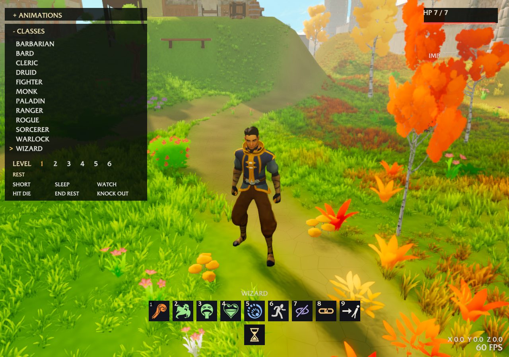

# Actions, cover, visibility, grappling and movement modes, 2026-11-08

Issue: [#13040](https://github.com/OpenAgentsInc/openagents/issues/13040), the
actions, movement and visibility part of the Everglade levels 1–6 slice
(#13030). Source: SRD 5.2.1, SHA-256
`8974902d109d6e63672d7c490bde9ccf052410503d9cfa768237154fbc5e3d87`, pinned in the
[ledger](../../dnd/srd-compliance-ledger.md). Opportunity attacks, Disengage, Dash
and Speed through physical movement were done earlier (see their evidence).

## What changed

- **Cover** (p.15), `aethyr/rules/srd/cover.coax`. The world admits cover as
  facts from one creature (or any origin) to another. A living creature on the
  grid line between attacker and target gives Half Cover against attacks.
  Degrees never add; the most protective counts. Half adds 2 and Three-Quarters
  adds 5 to the AC an attack must reach (`rs_roll_attack`). Total Cover refuses a
  weapon attack (`rs_strikes_fit`), a stat-block attack (`rs_stat_mode`), a spell
  aimed at a creature and each chosen target (the cast request). An area skips a
  creature behind Total Cover, and a Dexterity save adds the cover bonus, both read
  from the world's facts with the caster as the origin.
- **Visibility** (p.11, Rules Glossary). Terrain rectangles mark Lightly and
  Heavily Obscured squares (and Difficult, climbing and swimming surfaces). Seeing
  into a Heavily Obscured square is Blinded for it, both ways, so an attacker in
  one is unseen (Advantage) and a target in one is unseen (Disadvantage)
  (`rs_attack_sight`). Dodge's benefit needs the dodger to see the attacker, so it
  lapses against an attacker in heavy obscurement.
- **Hide** (p.183). Concealment is now a rules decision (`rs_hide_concealed`):
  Heavily Obscured, or Three-Quarters or Total Cover from every enemy that is up,
  plus the world's out-of-sight fact. A hidden attacker keeps its Advantage for
  the roll and gives itself away after it (the unhide moved after the attack roll).
- **Search, Study, Influence, Utilize** (pp.182–184), `actions.coax`. Search is a
  Wisdom check; Perception finds each hidden enemy whose Hide total it meets,
  with Disadvantage when every enemy sought is Lightly Obscured, and a Blinded
  searcher fails. Study is an Intelligence check. Influence: a willing creature
  complies and an unwilling one refuses with no check; a hesitant one checks
  against 15 or its Intelligence, with Advantage when Friendly or charmed by you
  and Disadvantage when Hostile; a failure waits 24 hours for the same urging.
  Utilize spends the action only for an object that needs one.
- **Grapple and Shove** (Unarmed Strike, Grappling, Grappled), `grapple.coax`.
  Either replaces the first attack of the Attack action; Extra Attack's others
  follow with the weapon, at the creature beside if the target is down. The DC is
  8 + Strength modifier + Proficiency Bonus (a Monk may use Dexterity); the target
  saves with its better of Strength and Dexterity. The target is within 5 feet,
  no more than one size larger, not your charmer and not behind Total Cover; a
  grapple needs a free hand and holds one creature. Shove pushes 5 feet straight
  away into an open square on the grid, or knocks Prone. A grapple ends when the
  grappler is Incapacitated or the two are more than 5 feet apart, including by a
  push, and escaping is an action: Athletics or Acrobatics, the better, against
  the escape DC. Dragging costs 5 extra feet a square unless the held creature is
  Tiny or two sizes smaller, and the held creature follows into the square left.
- **Movement modes** (Climbing, Swimming, Jumping), `movement-modes.coax`. A
  climbing or swimming surface costs 5 more feet a square without that Speed,
  added to crawling's and Difficult Terrain's. The grid step, the opportunity
  step check and continuous walking (`rs_walk_cost`) pay the same price. A Long
  Jump reaches the Strength score in feet after 10 feet on foot, half standing;
  landing in Difficult Terrain takes DC 10 Acrobatics or the jumper is Prone. A
  High Jump rises 3 + Strength modifier feet, half standing. Step of the Wind
  doubles both for the turn, and the Thief's Jumper uses Dexterity if higher.
- **Ready** (p.184) and **Simultaneous Effects** (p.188), `ready.coax`. Ready
  spends the action and names a trigger creature (or any) and a response: one
  attack, a move up to Speed, or an action-time spell. A readied spell is cast
  when readied (slot spent) and held by Concentration; releasing it uses the
  Reaction. An unused Ready ends at the readier's next turn start, and a held
  spell dissipates. When several readied answers fire at once, the turn owner
  orders them.
- **Recovery choices** (Short Rest, Simultaneous Effects), `rest-queue.coax`. A
  controller can queue its Short Rest choices (Hit Dice while hurt, slot levels,
  Sorcery Points) in its own order. They apply once when a Short Rest ends with
  nobody there to choose: finished on its hour, or granted by an interruption
  before the damage lands.
- **Experimental**. Every class's bar ends with HIDE, GRAPPLE, SHOVE and READY,
  in the hotbar style (new pictogram icons in `realms/5e-mmo/hotbar/`). For each
  press, the walls become cover facts: a monster with no line to you is behind
  Total Cover, and with none seeing you, you can hide. HIDDEN, SPOTTED or IN SIGHT
  rises over you. GRAPPLE and SHOVE take the monster ahead within 5 feet; GRAPPLED,
  PRONE or RESISTS rises over it. A grappled monster can't move, comes along as
  you walk at half pace, and is let go at a wall or when you are Incapacitated.
  READY answers the next monster that moves within reach with one attack.

## Checks

| Command | Result |
| --- | --- |
| `coax test --library aethyr/rules/srd/actions-checks.coax` | 415 checks pass |
| `coax test --library apps/openagents-web/fivelab.coax --only experimental` | 86 of 1025 pass |
| `coax test --library apps/openagents-web/fivebar-test.coax` | 447 checks pass |
| `coax test --library apps/openagents-web/class-kit.coax` | 411 checks pass |
| `coax test --library aethyr/rules/srd/{monster,hp-interaction,short-rest,world-timing,turn-order,concentration}-checks.coax` | 460, 504, 472, 416, 416 and 460 pass |

`actions-checks.coax` runs each rule through the shared battle: cover against
AC across a sweep of ACs, Total Cover refusing attacks and spells, an area sparing
a creature behind Total Cover, a hidden attacker's extra die, a dragging step's
price and the grappler's lapse.

The checked Lab Wasm build is 2,609,769 bytes (2,594,021 on main before), and
2,618,248 after the rebase onto `a54ec180dc`, which added the environment frame.
The budget rises from 2,602,000 to 2,645,000: the shared battle compiled into the
Lab now carries cover, grapple, movement-mode and Ready rules, which Experimental
plays.

The other builds that compile the shared battle, measured after the rebase onto
`82961a04b8`: One-Shot 319,685 (budget 330,000), the 5E MMO 1,722,641
(1,740,000), Everglade 2,192,011 (2,250,000) and Everglade II 663,839 (680,000).
The offline room worker is 1,210,275; main was already 1,199,435, over its
1,180,000 budget, so the budget rises to 1,235,000.

Every new or changed `#authority` unit kills every mutant, with no equivalent-mutant exemptions
(`coax mutate aethyr/rules/srd/ENTRY.coax --library --unit aethyr/rules/srd/UNIT.coax`; [log](mutation.txt)):

| Unit | Entry | Mutants killed |
| --- | --- | --- |
| `cover.coax` | `actions-checks` | 222 of 222 |
| `grapple.coax` | `actions-checks` | 333 of 333 |
| `movement-modes.coax` | `actions-checks` | 132 of 132 |
| `ready.coax` | `actions-checks` | 264 of 264 |
| `actions.coax` | `actions-checks` | 217 of 217 |
| `rest-queue.coax` | `actions-checks` | 139 of 139 |
| `strike-admission.coax` | `strike-reaction-checks` | 57 of 57 |
| `stat-attack.coax` | `monster-checks` | 206 of 206 |
| `condition-rolls.coax` | `condition-roll-checks` | 93 of 93 |
| `opportunity-movement.coax` | `opportunity-movement-checks` | 51 of 51 |
| `monk-features.coax` | `class-monk-checks` | 80 of 80 |
| `command-halt.coax` | `help-checks` | 46 of 46 |
| `effect-lifecycle.coax` | `effect-lifecycle-checks` | 40 of 40 |
| `rest-damage.coax` | `long-rest-resources-checks` | 74 of 74 |
| `short-rest.coax` | `long-rest-resources-checks` | 236 of 236 |
| `walk-budget.coax` | `world-timing-checks` | 78 of 78 |

## Not done

- Experimental has no NPC to persuade, no object to use and no lore to study, so
  Influence, Utilize, Study and Search have no slot there; they run in the engine
  with checks. Monsters don't hide, and Experimental doesn't make Search checks.
- Climbing, swimming and jumping costs run on the grid and in continuous walking,
  but Experimental marks no climbing or swimming surface, and its jump stays the
  world's own (not the Long or High Jump distances).
- Shove's push doesn't happen in Experimental (only Prone); the grid engine
  pushes. A readied move and a readied spell have no Experimental control.
- An area's cover is read from the caster, not the area's point of origin, and
  creatures between never give cover against a spell's save.
- Light and obscurement come only from terrain rectangles the world admits; no
  world places them yet.
- Readied triggers are creatures (or any creature); a world reports the deed.
