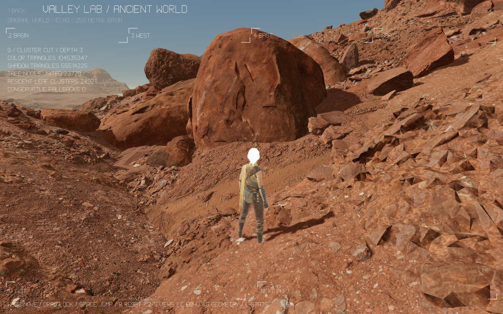

# Valley World: exact source clusters and independent pass visibility

This continues the [original source world](../valley-lab-world-2026-11-06/README.md)
at `f255037e9c97e990a26fc9c01830f8943b979fe0`. The 250 metre navigable basin,
27,501 placements, 334-joint original Echo, source contact surface, material
maps and original fallback geometry remain intact.

## Geometry milestone

The deterministic Coax builder partitions all 130 unique source meshes into
**24,921 leaves**, each with at most **64 distinct vertices / 124 triangles**.
Its **49,712-node** binary forest owns every one of the 1,705,175 unique source
triangles exactly once. Parents contain exact contiguous original index ranges
and conservative local AABBs. They are not simplified approximations. Ordinary
indexed draws retain the GPU's indexed vertex reuse.

VWH1 is a separate versioned suffix after the unchanged VWD1 catalogue, with
model/range bindings, tree records and the exact original position affines.
The suffix is **3,819,380 bytes**; the catalogue including Echo is **15,106,200
bytes**. The whole private pack is **1,565,719,372 bytes**, SHA-256
`2066386e413e390eadc06aa9ae1b22fe115d645fe400fbf1393790c0930d699a`.
The pack remains outside Git at
`~/.openagents/aethyrforge/valley-lab/world/valley-world.pack`, staged through
the existing private-build symlink. All 242 other geometry/texture payloads
are byte-identical to the previous pack. The original Echo rig and VWD1
prefix are unchanged.

All VWH1 words are little-endian. Counts/offsets/indices are U32; positions and
affines are IEEE F32. This identity is separate from VWD1 and VPK1.

| Record | Bytes and fields |
| --- | --- |
| Header, 32 bytes | `VWH1`, version 1, model count, node count, instance count, model offset 32, node offset, instance offset |
| Model, 24 bytes | First source index word, index count, first node, node count, root node, leaf count |
| Node, 48 bytes | First source index word, index count, left node, right node, lower XYZ, upper XYZ, height, leaf vertex count |
| Instance, 52 bytes | Model ordinal, then the original row-major 3×4 position affine |

Tables are contiguous with no trailing bytes. Leaves precede parents in each
model; child indices are global and precede their parent. The final node is the
root. A leaf has both child words `0xffffffff`, height zero and 1–64 vertices;
a parent has zero leaf-vertex count. The reader admits at most 512 models,
262,144 nodes and 32,768 instances. It checks exact source ownership, enclosing
parent bounds, height, finiteness and the VWD1 bindings before publishing a tree.

The CPU reference traversal transforms six view planes into each instance's
local coordinates. F64 interval tests use outward padding that retains the
magnitudes of cancelling F32 transform/projection terms. Fully contained source
spheres bypass node decoding. Intersecting nodes descend at most three levels;
fully contained parents emit their complete original ranges. Adjacent ranges
and consecutive identical instance draws merge without changing source order.

Each pass has 32,768 scenery draw slots plus two reserved Echo records. A draw
overflow discards the partial cut and rebuilds a complete full-source list.
Missing or structurally unusable hierarchy metadata retains original whole-mesh
draws; a whole-pack identity failure still refuses the pack. The 32 MiB host byte
carrier avoids enlarging Echo's rig arena and is included in the byte account.

## Default and controls

The default selects camera and shadow visibility independently. Off-camera
casters remain in the shadow pass. The optional legacy browser
[shadow-list v1 ABI](../../verse/realm-host.md) executes the Coax-selected
shadow records; existing producers keep their existing shared-list behavior.

**G** cycles the measured pass cut, cluster traversal, and a genuinely unculled
407,418,897-triangle reference in each pass. **L** shows the current mode, colour
and shadow triangle counts, visited nodes, resident leaves and fallback count.
WASD/thumbs, jump, reset, Echo inspection and the four basin waypoints remain.

The deeper cluster cut saves additional triangles, but its extra CPU traversal
and draw calls are not a consistent frame-time win over the simpler pass cut.
It remains an explicit diagnostic. The faster pass cut is the default.



| Walking viewpoint | Previous production union, both passes | Default, both passes | Cluster cut, both passes |
| --- | ---: | ---: | ---: |
| Basin | 297,287,238 | 165,028,665 | 160,049,572 |
| West | 221,087,726 | 131,341,147 | 128,093,487 |
| East | 135,411,636 | 75,236,004 | 71,312,642 |
| North | 143,004,680 | 82,503,373 | 79,306,225 |

The default removes **40.6–44.5%** of the previous production scenery index
traffic, including the shadow pass. The local serial 30-frame observations in
`production-comparison.log` separate the old union, default and deeper cut.
They are host observations, not a sustained FPS target or GPU timestamp claim.
The unculled reference is a stronger image oracle, not the old production cost.

## Verification and reproduction

- `source-oracle.log`: independent Python/struct reader visits every indexed
  source corner, checks leaf vertex ceilings and bounds, tree ownership,
  parent unions and all 27,501 matrix/model bindings. It also hashes and compares
  every unchanged geometry/texture pack entry. The earlier full source/material
  oracle at `f255037e9c` remains the receipt for the unchanged SDK imports and
  Pillow texture parity; those expensive unchanged checks were not repeated.
  After bounding the builder's position view before the matrix/material tail,
  rebuilding produces an identical catalogue (`builder.log`, followed by `cmp`).
- `hierarchy-mutation.log` and `pack-mutation.log`: **294/294** and **13/13** root mutants killed,
  without equivalent annotations. Format checks include malformed topology,
  orphan nodes, unequal nested bounds, exact capacities, nonfinite transforms
  and source-range bindings. Builder and selection fixtures cover shared
  corners, both cluster ceilings, odd promotion, clipped bounds, nonuniform
  negative scale, cancellation and bounded output.
- `unculled-images.log`: actual muted headless Metal WebGPU at a 1280×800 viewport checks
  every RGBA byte of the 2× supersampled 2560×1600 render at four **walking camera** waypoints. Both cuts match the
  unculled complete source reference exactly, including rendered shadows and
  HUD. Fixed zero-time steps retain the walking camera; orbit mode is not used
  as a substitute. The earlier original-union comparison is also retained.
- `navigation.log`: original Echo keyboard/thumb movement, jump, exact idle
  reset, four source views and desktop/phone GPU replacement pass. This was
  recorded with the deeper cut before the contained-sphere fast path; input,
  pose and terrain code did not change afterward.
- `entry.log`: final default enters through the parent lab's N/header touch,
  captures all four views on desktop/phone and returns to the parent.
- `recovery.log`: complete frame pixels and exact session state survive real
  device replacement with the admitted hierarchy and contained-sphere path.
- `world-checks.log`: source traversal, desktop/phone/high-DPR budgets, mode
  controls and the physical 32,768-plus-two-record boundary pass.
- Final Wasm is **116,938 bytes**, below the existing **120,000-byte** profile. The explicit
  legacy 8 GB frame byte account remains; this does not qualify shared GPU
  registry admission or native host parity.

The inspector image is a 1280×800 display copy of the complete admitted 2560×1600
readback, with **G** selecting the deeper cut and **L** displaying real counters.
Its shape and complete hierarchy admission are checked in `inspector.log`.

```sh
coax/web/tool.sh aethyr/tools/valley-world-clusters.coax WORLD_DIR OUTPUT_CATALOG
# Preserve the old catalogue/pack for the oracle; promote OUTPUT_CATALOG to world.catalog.
coax/web/tool.sh aethyr/tools/valley-world-pack.coax bundle SOURCE_DIR ECHO_PACK WORLD_DIR
python3 aethyr/tools/valley_world_clusters_oracle.py WORLD_DIR
coax/bin/coax test verse/valley/source-clusters.coax
coax/bin/coax test verse/valley/world-select.coax
coax/bin/coax mutate verse/valley/world-hierarchy.coax --root-only
coax/bin/coax mutate verse/valley/world-pack-policy.coax --root-only
coax/web/tool.sh coax/web/valley-cluster-check.coax http://127.0.0.1:8895/
coax/web/tool.sh coax/web/valley-cluster-check.coax http://127.0.0.1:8895/ --recover
```

## Fidelity boundary and next work

This is a source-preserving cluster/culling foundation, **not Nanite parity**.
It still draws the original Unreal fallback meshes and keeps the full pack,
textures and geometry resident. No new geometric detail or residency saving
is claimed. Texture/lighting/material limits in the earlier receipt still
apply. Source-order clustering is intentionally deterministic, not a spatial
meshlet optimizer.

The next geometry steps are higher-detail ordinary source meshes, boundary-safe
parent approximations with conservative projected error, content-hashed geometry
pages and a complete resident-root fallback. Occlusion, a depth pyramid,
GPU traversal/compaction and indirect draws remain separate measured work;
the tiny compute/synchronization proof must precede that GPU path. The
[Valley Lab plan](../../verse/2026-11-05-valley-lab.md#build-the-virtualized-geometry-system-in-visible-steps)
remains the capability roadmap.
