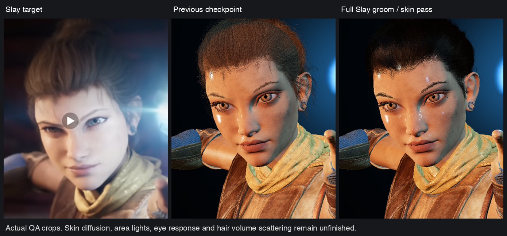
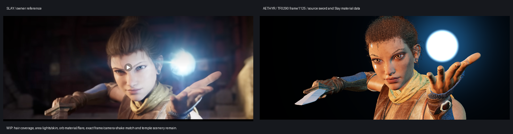

# Slay facial performance and fixed-shot progress — 2026-11-06

Issue #12962 remains open. The owner extended its face-only request with the
Slay trailer shot at 0:57: narrowed eyes, raised left palm, blue orb and sword.
This record qualifies source transport/playback components, not visual parity.

## Skin, face and hair checkpoint

The main Slay groom is **different from Valley's groom**. Native SDK arrays
contain116,850 main-hair curves and2,401,356 points; the eyebrows retain the
same1,489 curves/18,839 points. The private Slay package now contains all
2,301,856 segments, without decimation, replacing the492,907 Valley segments.
The independent oracle checks every original endpoint, converted radius,
curve U and generated index, as well as the actual packed GPU groom bytes.
The main-hair SDK byte digests differ; eyebrow SDK bytes are identical.

Direct hair light now evaluates strand-tangent reflection (R), transmission
(TT), and internal reflection/transmission (TRT) instead of GGX/Lambert on
camera-facing ribbons. Source brown/pepper, roughness, specular and backlight
settings come from Slay's MI_EchoGroom. This is a single-fiber model with an
interim ambient term. It lacks the native groom's volume multiple scattering,
deep opacity, tangent breakup and simulated motion; it is visibly too dark.

The head now uses the source highpass R/G specular modulation and ORM.R mask,
with the native .08 conversion from material Specular to dielectric F0.
The unused Slay MatID texture slot31 now carries T_Head_highpass_S. The8K
source PNG is retained byte-exact in the private package; the existing4K
array upload resizes it through the browser SDK. Valley's legacy binding is
unchanged. Key, fill, wrap and orb evaluate separate half-vectors and GGX
responses; the fill retains its source.5 specular scale. Previously every
light multiplied a single highlight calculated for the key direction.
Skin remains too orange/glossy: regional roughness, proper rectangular-light
integration, skin diffusion, eye refraction and source grading remain open.

The native face audit confirms additive local-space/reference-pose flags and
exactly18 facial tracks, with no omitted head/neck tracks. At body124 these
facial locals already match reference locals within4.51e-7m translation and
8.89e-6 quaternion-component error. The additive flag therefore does not
explain the fixed-frame appearance mismatch. Nearby1125/1132/1137/1142/1147
captures show the source performance advancing; no invented squint or gaze
offset is applied. Exact trailer-frame/camera-shake matching remains open.

The full groom's vertex binding is187,564,308 bytes, beyond WebGPU's default
128MiB storage binding. The opt-in `coaxial_storage_limit_v1` requests that
exact limit through the SDK on initial open and replacement; absent/zero
keeps default limits. Unsupported adapters refuse. The full groom explicitly
raises this lab's vertex-work budget from21m to50m; its4.6GB aggregate budget
still passes the desktop/phone/DPR scalar cases. This is a desktop source
detail profile, not a mobile-device qualification.

Current checks:53 shader/helper checks, independent full source/groom oracle,
13/13 package-gate mutants and1/1 storage-limit mutant. Muted headless Metal
captures of five source frames, return to walking and isolated face pass
with no console errors. Wasm91,934 bytes remains within96,000. See
[the surface receipt](surface-checks.txt). The current full-groom60s diagnostic
recovers in16,145ms with identical state/pixels, then passes ambient walking
and the390x844 viewport. It does not qualify the default10s deadline. The
unchanged599558 indexed module without storage/blend opt-ins also passes on
the new host. The older admission mutation
results below apply to unchanged admission implementations at5d4baa60c1.

The local view is `http://127.0.0.1:8894/worlds/valley-canyon?pack=valley-slay`.
It starts paused at TF0290 sequence frame1125: body124, face4. P plays/pauses,
comma/period step, J returns to the shot; F selects isolated face performance,
brackets select clips, T restarts, B restores neutral and R returns to walking.
The camera is the source 40mm/24.889999mm filmback, 2.4 aspect. Source handheld
camera shake is now available in the [handheld source profile](../slay-camera-2026-11-06/README.md),
using `?pack=valley-slay-handheld`. The source actor transform track is disabled;
applying its serialized keys again would double-transform the animation root.

## Source transport

SDK reads use the clean private SlayData project and the installed UE5.8 SDK.
They load data-only packages and do not run source Blueprint events or save
source packages. The 1,023,634,576-byte private VPK has SHA256
`4799fce88387284363fcceb957a8c31d1efbe3b76dac54ec405f32961cd88ce4`.
ECP3 binds the unchanged rig, full EFC1 morph/face source and SHS1 v2 fixed-shot
samples. CPU state retains a checked face projection and the admitted shot;
GPU storage retains sparse position/normal deltas. No licensed source payloads
are committed. The comparison image is a QA observation, not training data.

The full independent SDK/glTF comparison checks all564,903 sparse deltas and
GPU CSR records bit-for-bit, all143,750 curve samples bit-for-bit, all18,400
facial local transforms and27,000 shot body locals as exact float32 values.
Signed-zero differences are ignored for local-transform numeric comparison.
See [the receipt](source-oracle.json). The oracle is
`aethyr/tools/slay_asset_oracle.py`; source packing/playback is Coax.

Twenty source clips contain131 raw curves each.125 bind actual mesh morphs.
`blendParent1`, `tongueOut`, `jawFwd`, `CTRL_rigLogic_OnOff`,
`mouth_cornerPull_cor` and `mouth_stretch_cor` are named in SDK receipts but
have no mesh morph target; no invented mapping is applied.16 FACIAL tracks
bind both mesh reference skeletons. `facial_c_skull` and `facial_c_chin` are
unweighted source skeleton leaves absent from both mesh reference skeletons.
Body poses are retained separately, so face layering never accumulates on
itself or changes the locomotion/collision decision. Ambient source segments
are TF0130[4..22], TF0145[3..21], TF0250[19..40], every8s with.15s fades.

## Checks and limitations

- EFC1 admission:402/402 mutants killed; SHS1 v2:190/190;
  ECP3/legacy rig admission:246/246; whole-package SHA:13/13. No equivalents.
- Source frame round trip produces identical image hashes; the neighboring
  frame differs. Body/face/camera playback advances on the same source clock.
- Current Canyon checks:10/10, including walking, jump taps, non-inverted
  mouse/touch/arrow look, conservative collision and desktop/phone/DPR budgets.
- Ambient timing and non-face local-pose preservation checks pass.
- Current Wasm is91,934 bytes within96,000. The original80,000 budget was
  raised explicitly for shared facial playback and the source-shot view.
- **Earlier default GPU recovery failure, now superseded:** both new shot and face observations exceeded
  the legacy host's10-second replacement deadline under the observed machine
  load. Earlier face-only recovery passed before the shot extension; that
  result does not qualify this package. [The shot failure is retained](shot-gpu-red.txt).
  A separately labeled60s diagnostic recovered in9,697ms with identical
  pixels/state, then passed ambient locomotion and the390x844 phone viewport.
  [Its receipt](diagnostic-gpu.txt) does not qualify the unchanged default10s fence.
  The [retained-source fix and visible-capture record](../valley-recovery-2026-11-06/README.md)
  now qualify the unchanged default deadline with Coax 0.52: face recovery in
  9,032 ms and source-shot recovery in 8,289 ms. The latter makes the private
  source unavailable after its first request and verifies no second request.
  Both retain exact producer state and measured GPU pixels. These observations
  replace the recovery limitation only; the cinematic differences below remain.
- **The full Slay groom puts default recovery back over the deadline.** The
  combined pack (full groom plus the TF0290 camera template, 1,023,634,576
  bytes, sha256 `5807c40f…dc0c`) fails the default 10 s face and shot
  recovery checks. The labeled 60 s diagnostic recovers in 11,811–14,190 ms
  with identical state at load averages of 6–8. Frames, the legacy host and
  both world viewports pass. Tracked in
  [#12975](https://github.com/OpenAgentsInc/openagents/issues/12975); the
  realm deadline stays at 10 s.

The source project disables bloom. The source orb mesh and its original texture layers now use Coax panning,
normal distortion, source Fresnel/tint/HDR/desaturation arithmetic and an
additive colour draw. Its halo/flare remains analytic; source curl-noise
vertex displacement and the original Niagara flare are not yet ported. Key/fill/wrap samples drive an interim direct-light
model. Proper area-light integration, regional skin scattering, eyes/refraction,
strand coverage/shading, source orb texture/flare and temple scenery
remain. These differences are visible in the comparison and prevent claiming
an exact shot recreation or closing the issue.

Slay render source extension:101,672 UV pairs,25,547 sword vertices,
134,418 sword indices and35 bundled textures pass the independent source-byte
oracle. The sword follows the source `prop_01` track through the existing
`groom.prop_01` palette entry135; its mesh inverse bind is the same. Slay's
head instance uses Desat=.3 and Tint=(.921582,1,.871367), unlike Valley's .2
and(.9,1,.949020). Its actual textures replace Valley counterparts in this
private package.35 mipmapped4K RGBA8 layers reserve approximately3.13GB of
GPU texture storage; the lab's explicit aggregate budget is4.6GB. A phone
viewport observation on this Mac does not qualify mobile hardware memory
or performance. A separate mobile/source-detail profile remains necessary.

The orb extension adds559 exact source vertices,2,880 indices and1,114,112
original RGBA texels, including independent checks of the full packed GPU
streams. Its world hand quaternion matches independent double precision over
all200 frames within1.93e-7. [SHS1 v2](private-shot-format.md) explicitly versions
that new quaternion metadata and validates its unit length before publication.
Distortion remains linear and normal-mapped; the energy texture decodes sRGB
before bilinear filtering, matching the native SDK texture flags.

The opt-in legacy browser `coaxial_draw_blend_v1` keeps ordinary geometry
opaque, selects straight-alpha additive colour for the orb and source-over
coverage for strand colour. Translucent colour depth-tests without depth
writes; shadow coverage remains shader-owned. The unchanged599558 indexed
module without this export and the parent lab pass on the new host. The
actual orb GPU comparison adds colour to171,054 supersampled pixels and
darkens none; the scene remains ready on return to ordinary walking. Hair
colour uses continuous coverage instead of stochastic opaque colour samples;
its shadow keeps separate stochastic coverage. The new single-fiber R/TT/TRT pass follows after this coverage correction;
deep opacity, multiple scattering and sorted/OIT hair remain unfinished.

The pixel budget bounds the base raster before the explicit3x portrait
supersampling: the1280x800 observation captures3840x2400 physical pixels.
The additive operation currently occurs in the legacy display-mapped target;
full linear-HDR compositing, the source material-time phase,
exact reference frame selection and cinematic background remain open. The
handheld profile imports the exact source camera template; its recovery and
mobile cost limitations are retained in that separate record.

## Skin pass and face view, 2026-11-06

- The exported `T_toksvig_macro` is zero in every sampled texel, in both the
  PNG and a fresh TGA re-export, so it is only a small Toksvig correction. The
  head's roughness is about 0.1–0.2, as in the source. `MF_PerPartRoughnessModulation`
  only scales it by 0.85–1.2 per region (plus 0.25 on the chest). Its region
  masks `T_Head_Skin_001/007/008/009_R` are not exported yet.
- The pinpoint "wet" highlights came from shading TF0290's 64 x 64 cm
  RectLight key as a point. The key and the orb now widen roughness with
  Unreal's sphere-light `New_a2` term. TF0290 itself animates the key to
  32 x 64 cm at 325.83 cm (`SLAY_KEY_SIZE` 0.0783615); the wrap, fill and kick
  are 256 x 256 cm panels (`SLAY_SOFT_SIZE` 0.418081).
- Skin uses subsurface-profile style lighting: two specular lobes at 0.75x
  and 1.30x roughness, mixed 0.85, plus wrapped diffuse that carries red past
  the terminator and bends diffuse normals toward the geometric normal.
- The H and F face views now use the TF0290 hero frame's lights and the Slay
  skin profile, moved to Echo, through a longer lens (4.2 at 1.58 m). Before,
  they used Valley's single generic sun at 0.65 m with a wide lens.
- T or the on-screen REPLAY button replays the shot; playback stops on the last frame.
- Still open: orange albedo balance, eye shading, hair volume scattering, and
  the per-region roughness masks.
- The shot pack carried the key, wrap and fill but not `Echo_Kick`
  (intensity 2, colour 1/0.9647/0.956, specular scale 0.5). Its static source
  rotation is in `verse/valley/slay-lights.coax`, checked against the pack's
  axis conversion, and it now lights skin, cloth and hair.
- Colour check at the cheek: ours is sRGB 194/132/107 against 154/137/142 in
  the YouTube trailer still. The head texture's mean is 109/66/40 and the
  TF0290 rig is warm (key 1/0.552/0.402, wrap 1/0.402/0.2016). The trailer
  frame carries its own grade, bloom, depth of field and compression, so it is
  not a colour reference. The Temple post-process volume has no colour
  grading (exposure bias 1.8, AO, DOF only); the cool SkyLight cubemap
  `HDR_CaptureLighting` (tint 216/241/255) is not ported yet.

## Orb Rect Light and candela balance

Unreal renders TF0290 locally (`UnrealEditor -game` with the
AutomatedLevelSequenceCapture, 1280 x 800, frames 1115-1126). Its frame 1125
lines up with ours, so patch colours can be compared directly. Single-flag
renders of the same frame located the cool light on her face:

| Cheek nearest the orb (sRGB) | Full | No specular | No sky light | No rect lights |
|---|---|---|---|---|
| Unreal | 182/194/204 | 181/191/199 | 178/192/203 | 154/116/113 |

The blue is diffuse light from a rect light. Lumen GI and the sky barely
change it. The source is the orb's own `Rect Light` in `TF0290_Lighting`, a
1 x 1 cm panel animated to 0-4.71 cd with a ~48 cm attenuation radius and
52.3 degree barn doors, aimed back at her face from 16 cm beside the orb. Our
pack did not carry it. The rig lights are all in candelas (the sequence sets
their units), so with Unreal's inverse-square falloff and attenuation window
the orb light reaches her face at roughly 30 times the key.

- Shot format SHS1 v3 adds meta 44..53 per frame: the rect light's position,
  linear colour times candelas, attenuation radius and aim.
  `aethyr/tools/slay_asset_oracle.py` recomputes all 2,000 values from the
  source samples.
- The shader lights skin, cloth and hair with it, using Unreal's
  `(1-(d/r)^4)^2/(d^2+1 cm^2)` falloff, the panel's cosine and a 52.3 degree
  cone for the barn doors. Key, wrap, fill and kick use the same falloff at
  their rig distances, scaled so the key keeps its calibrated power
  (`verse/valley/slay-lights.coax`).
- The face view (H) turns the hero rig about the vertical so it sits where it
  did relative to the shot camera, rect light included.

Seven face patches at frame 1125 (sRGB, Unreal / before / now):

| Patch | Unreal | Before | Now |
|---|---|---|---|
| Cheek, key side | 216/143/106 | 227/139/80 | 218/123/66 |
| Cheek, orb side | 182/194/204 | 191/117/82 | 187/213/220 |
| Forehead | 207/205/209 | 219/151/106 | 207/218/222 |
| Nose | 189/192/203 | 199/141/127 | 188/205/216 |
| Chin | 202/132/105 | 226/136/78 | 218/128/79 |
| Neck | 182/117/73 | 212/149/72 | 199/127/53 |
| Scarf | 139/93/60 | 225/155/70 | 215/137/55 |

The summed absolute error falls from 831 to 373. Still open:

- The hand and the wrist bracer next to the orb clip to white. Unreal
  ray-traces this light's shadows. Ours now shadows it with 20 capsules on the
  orb hand (forearm, palm spans, finger and thumb segments) that Echo's bone
  store carries each frame after the palette and morph weights. Fully white
  pixels on the fingers fall from 3,127 to 2,190 (Unreal 586, partly spread by
  its depth of field); the bracer is unchanged at 1,480 (Unreal 149) because
  the palm does not stand between it and the light.
- The orb side reads slightly green-cyan (G about 15 levels high).
- Hair scattering: see "Hair dual scattering and blonde" below. The temple
  background and the cool sky cubemap are not ported.
- The shot pack is 1,023,642,576 bytes, sha256 `bcff9de8…cc3f`.

## Hair dual scattering and blonde

Unreal renders of frame 1125 with hair terms switched off show where the
groom's light comes from. Crown means, sRGB:

| Render | Crown | Hairline |
|---|---|---|
| Unreal, full | 52/54/66 | 70/57/63 |
| No hair sky lighting | 44/50/63 | 65/53/60 |
| No R (specular) | 51/53/65 | 69/55/61 |
| No local and global scattering | 29/41/56 | 36/40/53 |
| No rect lights at all | 36/43/58 | 41/44/57 |
| Ours before | 23/17/13 | 35/22/16 |
| Ours now | 66/46/35 | 92/56/38 |

- Dual scattering carries most of Unreal's hair light. The shader now follows
  `HairStrandsDeepTransmittanceDualScattering.ush`: global scattering times
  the fiber lobes plus local scattering, for every light.
- The average front and back scattering is Unreal's hair LUT
  (`HairStrandsLUT.usf`: Specular 0.5, backlit 1, separable R, energy-matched
  TT absorption), integrated at roughness 0.4 for 16 absorptions by 4 light
  angles and held in the shader as two 64-entry tables.
- Unreal reads each strand's hair count toward the light from deep shadow
  maps, which are not ported. `SLAY_HAIR_COUNT` = 0.3 is one mean count for
  every strand; it gives the closest brightness of the values tried (0, 0.3,
  0.5, 0.7, 1, 2, 3).
- Our hair is warmer than Unreal's. Unreal's hair stays blue-grey with every
  rect light off, and its dark skin and scarf also carry more blue than ours.
  That points at the level's blue height fog and ambient rather than the hair
  BSDF; it is open.
- G, or the HAIR button above REPLAY, swaps the source brown groom for the
  sample's blonde hair colours (`MI_Hair_Cards_Blonde`: darkened root, mid and
  tip blended at its 0.55 root-tip bias, its straition colour on 15% of
  strands). It works in the shot, the face view and the inspect view.

### Frame cost

The first version of the hair term and the hand capsules ran per pixel and
cut the frame rate to a third. Headless Chrome at 1280x800, DPR 2:

| Shader | Walk | Face | Shot |
|---|---|---|---|
| Before the capsules and hair term | 7.4 fps | 20.4 | 6.9 |
| Per-pixel capsules and per-light LUT tables | 1.8 | 6.2 | 2.0 |
| Per-vertex capsules and LUT averages, fitted LUT | 7.1 | 19.9 | 6.4 |

- The capsule visibility and the LUT averages now come from the vertex
  shader. The averages are sampled at the view angle, not at each light's
  angle as UE does.
- The LUT is evaluated as a fitted polynomial (within 0.0007 of every entry
  above the first absorption row); `hair-lut.txt` keeps the table.
- The pictures match the per-pixel version within 2 levels on the hair and
  4 on the fully white finger count.

### Hair LOD and per-vertex hair light

Removing draws one at a time showed the groom is the whole frame cost: 13.8
million vertices (2.3 million strand segments) a frame. Without it every view
ran at 60 fps; with it, 4 to 7.

- Strand LOD, as Unreal's groom LOD: the CPU measures the head's height on
  screen and the vertex shader keeps that share of whole strands (by a hash of
  each strand's seed), widening the kept ones by the inverse share so coverage
  holds. The share falls with the head's on-screen area below 300 pixels,
  never under 2%, and is half in close views, where strands are still under a
  pixel wide and half of them at twice the coverage look the same.
- The shadow map takes at most a quarter of the strands.
- Hair is lit per strand vertex (all five Slay lights, fiber lobes and dual
  scattering); a hair pixel adds only the key light's shadow map lookup.
  Before, every hair pixel also ran the skin and cloth lighting and discarded
  it.

Headless Chrome, 1280x800 at DPR 2:

| View | Before | Now |
|---|---|---|
| Face close-up (start view) | 5.8 fps | 41.7 |
| Full body (H) | 19 | 60 |
| Walk | 7 | 60 |
| Slay shot | 5.4 | 41.1 |

Hair colours in frame 1125 match the per-pixel version within 2 levels.

### Facial expression transitions

Sampling the face weights every quarter shot frame showed three snaps:

- The shot's face clip (source 1121 to 1159) switched on at frame 120 and off
  at frame 158 in one frame, from a neutral face to an expression and back
  (summed weights about 5.2 and 5.4 in one step). It now holds its first frame
  before that range and its last frame after it, as Unreal does (see below).
- Looping clips (the F view) jumped from their last frame to their first. The
  last 0.4 s (at most a third of the clip) now blends into the head of the
  clip, and the loop resumes past that head.
- Changing clips with `[` or `]` dropped to neutral and faded in. A new clip now
  crossfades from the face on screen over 0.25 s.

The one remaining fast change in the shot, at frame 134, is a blink in the
source (eye close goes from 0 to 1 within a frame and reopens by frame 140).

### Whole-shot comparison with Unreal

Unreal rendered all 200 source frames of TF0290 (1001 to 1200, 1280x800), and
our page captured every second frame through 1165 (the last frames are only the
blade against black, which the capture tool refuses as flat). Our capture tool
started at Unreal's 1001.

- Before 1121 Unreal shows her focused, narrowed-eye expression from 1001: it
  holds the clip's first frame. Ours showed the rest face, eyes wide and aimed
  by the rest pose, then eased in over 1109 to 1121 as her hand came up. Ours
  now holds the first frame too, and after 1159 the last (the snarl), as Unreal
  does.
- Head and camera motion, measured by phase correlation of a face crop against
  frame 1081: within 3 pixels of Unreal through 1129 (both drift 19 pixels left
  and 12 up as she reaches), and frame to frame within a few pixels through the
  grab at 1147.
- Still different: Unreal draws the temple behind her, depth of field and
  motion blur on the final shoulder and bracer pass; our skin has more
  specular sheen on the cheeks.

### Skin sheen

Unreal minus Unreal with specular off (frame 1125, the face) gives a soft,
even sheen: mean 0.024 linear, 99th percentile 0.23. Ours was 0.006 mean in
sharp glints on the cheek and forehead: no reflection of the surroundings, and
the key light's highlight broken up by the pore normals at roughness near 0.15.

- Skin now adds environment specular (split-sum `pbr_environment`, warm white,
  `SLAY_SKIN_ENV` 0.7).
- The direct-light lobes use a normal half way to the geometric one and a
  roughness of at least 0.4 (`SLAY_SKIN_SPEC_ROUGH`), so the pores no longer
  break the key into wet glints.
- Result: mean 0.025, 99th percentile 0.17, max 0.54 (Unreal 0.63). The shadow
  cheek moved from 229/152/96 to 230/165/116 (Unreal 226/151/109).
- Depth of field is not the cause: blurring our specular by a 4 to 6 pixel
  disc leaves its mean unchanged. The camera focuses at 1.15 m on a head at
  1.32 m, f/2.4.

### Head twitch at 1070 to 1076

TF0290_Echo's `head` key swings about 4 degrees to her left and back over source
frames 1070 to 1076 while `neck_01` and `neck_02` stay smooth. Unreal plays it:
its face jumps 13 pixels right at 1073 to 1075 and comes back by 1076, and so
did ours.

- `slay-shot-pack.coax` replaces the head rotation at 1070 to 1076 with an
  eased slerp from 1069's rotation to 1077's.
- After the change, the face moves -3, -3, -4, -4, -3, -3, -2, -1, 0, +2 pixels
  over 1068 to 1077: one smooth turn.
- The pack's digest changed, so `canyon-pack-policy.coax` pins
  `a2d937dbe5deed4ec3e1085ddae039160cadae2f9d585cefd3fba14c422b4a56`.

### Lips and creases

At frame 1125, Unreal's lips are darker, with a dark seam and a shadow under
the lower lip. Ours were 20 percent brighter, with a bright dotted seam: the
skin's environment specular spiked at grazing angles in the creases.
M_Head_Echo's AmbientOcclusion (ORM.r to the power 1.6, remapped to 0.25..1)
was unused.

- `cv_echo_head_ao` computes that AO term. It occludes the skin's
  environment specular through Lagarde's specular occlusion, and the 0.08
  ambient.
- Unreal's ray-traced shadows darken creases even under direct light, and our
  shadow map can't resolve them. Skin light is scaled by
  `min(1, 1.1 * AO)` (`SLAY_SKIN_CONTACT`), which leaves open skin unchanged.
- Measured on a 130x85 crop of the mouth (sRGB, ours then Unreal):

  | Area | Before | Now | Unreal |
  |---|---|---|---|
  | Seam | 83 | 33 | 38 |
  | Crease under the lower lip | 106 | 84 | 72 |
  | Lower lip | 181/116/120 | 155/93/98 | 145/92/99 |
  | Upper lip | 187/145/154 | 179/134/143 | 167/125/133 |

- `MF_PerPartRoughnessModulation` (mouth x0.9, upper lip x1.1, chin x0.96 from
  the `T_Head_Skin_00x_R` masks) is not ported yet; its effect is small.

### Depth of field and skin blur

The shot now runs a post pass (`vc_post_fs`) after bloom. The scene pass
writes linear light plus an aux target that marks skin.

- Depth of field uses each frame's lens from the shot: focal length (meta
  12), f-number (13) and focus distance (34) on a 24.89 mm sensor. The circle
  of confusion is the thin-lens value, capped at 14 px at 1280 wide. The
  gather is a single pass: 48 Vogel taps, widened by nearer neighbours' blur
  so foreground edges spread over sharp areas.
- Skin pixels get a depth-aware, per-channel Gaussian (1.6/0.75/0.4 mm for
  red/green/blue), which stands in for Unreal's subsurface profile.
- At dpr 2, the shot runs at 35.6 FPS, against 37.4 without the pass.

### Inside the mouth

At the snarl (frame 1152), the teeth (slot 10, `M_TeethNew`) showed as a
flat white band. Unreal's ray-traced shadows leave the inside of the mouth
dark red.

- Every light and the ambient reach the teeth at 6 percent
  (`SLAY_MOUTH_OCCLUSION`).
- Shadowed skin, and the teeth, get the key's light back as a red-weighted
  scatter term (`SLAY_SSS_BLEED_R/G`, `SLAY_MOUTH_BLEED`). Shadowed creases
  turn warm instead of taking only the cool fill.
- The contact term now scales every light, not only the total.
- Still open: our lips part a little wider than Unreal's at 1150 to 1154. The
  nostril rim stays grey-blue because the fill casts no shadow.

### Spell orbit (M)

M starts a seven-second camera move from the film's cut of TF0290. TF_Edit
shows source frames 1126 to 1152 (a 125-frame offset); later frames are
unfinished handles where her jaw hangs open. Echo plays those 27 frames in
slow motion, ending on the snarl. The camera pulls back
2.6 times, then turns once around her head. Her back and the orb face the
camera mid-clip, and the move ends on her chest and orb hand. P pauses, T
restarts, and , and . step one frame. `spell_camera` is a pure function with
a test, and the depth of field focuses on the camera's pivot. The wasm budget
rises to 104,000 bytes for the lens uniforms and this camera (101,376 bytes).
