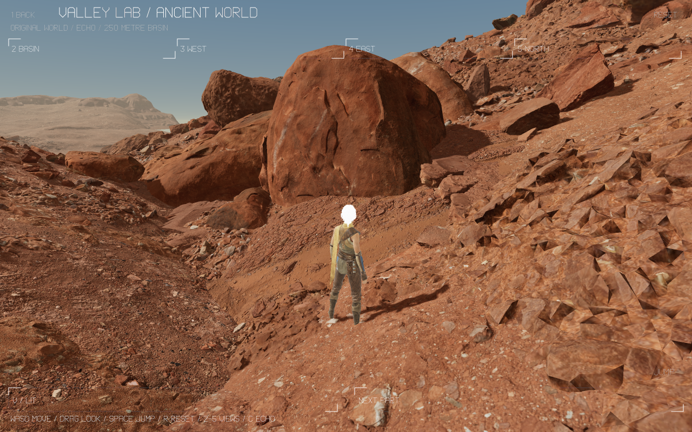

# Valley Lab: a 250 metre source world with Echo

`N WORLD` in Valley Lab opens `/worlds/valley-world?pack=valley-world`.
The unlisted realm composes a large Ancient World slice with the original
Valley Echo body rig. The Slay inspector remains separate on `P`.

## Original source and reproduction

Read-only Unreal 5.8 SDK exports start with the nine daylight L0 HLOD actors
`MainGrid_L0_X[-1..1]_Y[-1..1]_DL44BCB661`. The cut also retains nearby original
placements from larger daylight cells in a 300 metre context, plus structural
ground in a 500 metre context. The roughly 250 metre playable heightfield spans
`[-112,144]` metres on both horizontal axes. Its original composition contains:

| Source property | Count |
| --- | ---: |
| World-partition actors / selected components | 18 / 1,003 |
| Original placements / component material overrides | 27,501 / 141 |
| Mesh types / scenery materials | 130 / 90 |
| Unique fallback vertices / triangles | 1,001,889 / 1,705,175 |
| Triangles over every original placement, before culling | 407,418,897 |
| 2K texture layers, including 32 Echo layers | 240 |

The source is Valley of the Ancient. Licensed meshes, rigs, textures, raw SDK
metadata and packs stay outside Git under `~/.openagents/aethyrforge/valley-lab/`.
The export adapters load a data-only project without executing the downloaded
game's scripts or saving source packages.

`valley-world-export.py` reads the scene through the SDK. `-worldextend` inventories
larger source cells. Save that inventory as `world-all.json`, then run
`coax/web/tool.sh aethyr/tools/valley-world-select.coax INPUT OUTPUT` to choose the
cut in Coax. `valley-world-assets.py` exports bounded mesh batches with
`-worldstart=N -worldend=M -worldpart=N`; each command stays under 15 minutes.
`valley-world-flags.py` reads authored component overrides, visibility, collision
and original light directions. `valley-world-merge.coax` joins batches by complete
source identity, including batches whose local mesh order differs. Geometry
sidecars remain relative to their own exported glTF rather than being renamed.

`valley-world-pack.coax` owns coordinates, matrices, materials, sampled ground,
texture resizing and the streaming VPK writer. Its `scene`, `layers` and `bundle`
modes take source, original Echo pack and destination directories; `layers` also
takes start/end indices. The complete bundle is staged at
`~/.openagents/verse/private-build/web/valley-world.pack` through a symlink.

The pinned bundle is **1,561,899,992 bytes**, SHA-256
`9057c55b78b295f04f50a07e19133f528e88e576c0f737fb3f2501e5aa1a807e`.
Its 116,686,256-byte vertex/matrix/material payload and 50,173,080-byte index
payload retain the original Echo/Canyon prefixes. The original 10,142,528-byte
Echo body rig is unchanged. Both geometry buffers fit the standard 128 MiB
storage binding limit. No browser storage-capacity extension is needed.

## Traversal and rendering

WASD/left thumb moves Echo, Shift walks, Space/JUMP jumps, right drag/thumb looks,
R/RESET restores an idle Echo on source ground, and 2–5/the tabs visit basin,
west, east and north. V cycles lit/albedo/normals/roughness; C/H inspect Echo.
`1 BACK` returns to the parent lab. Reset and waypoints restore walking after
inspection. Original body clips advance on the shared 64 Hz player controller.

Ground is a 257 by 257 one-metre top-surface heightfield rasterized from original
transformed triangles. **3,080 of 66,049 samples are uncovered**; missing cells
remain explicit sentinels. Movement refuses holes and the bounded outer edge.
Spawn selection requires a gentle five-metre patch across both triangles of
each cell. It does not accept a flat corner whose adjacent triangle is steep.

Original matrices, inverse-scale normal transforms and authored UVs feed the
renderer. Material ports recover tint, saturation, contrast, normal tiling and
strength, and the source S-curve roughness branch. The layered butte uses
world-scaled colour layers, splats, colour controls and its authored overlay.
The original CF daylight direction is recovered in `source-lighting.json`;
light and shadow bases use that direction. Off-camera casters within the sun
projection are retained. Consecutive identical meshes batch conservatively.

This explicitly tracked legacy profile declares an **8 GB** frame byte account,
3 billion submitted vertices including index/shadow traffic, and 65,542 draws.
The account includes retained pack, texture mips, geometry, state, HUD and
viewport; it is not a claim about peak process/decoder memory. The observed
desktop frame accounts for about 7.15 GB. The shared frame-pacing rule permits
at most two unfinished GPU frames. The optional
`coaxial_gpu_recover_ms_v1` ABI applies this Coax profile's bounded 60-second
replacement window; other realms retain their existing 10-second default.

## Verification

- `source-oracle.json`: every fallback position, normal, UV and index agrees
  byte-for-byte with SDK glTF. All 27,501 transforms and component bindings are
  checked independently; the affine vertex error bound is below **18 micrometres**.
  All 240 resized texture layers agree pixel-for-pixel with Pillow LANCZOS.
- `catalog-mutation.log`: 54 catalog checks pass; **143/143** root mutants killed.
  `pack-mutation.log`: **13/13** exact identity mutants killed.
  `host-mutation.log`: **1/1** recovery policy mutant killed. The legacy adoption
  gate killed **50/50** mutants on its unchanged source.
- Native checks cover unsigned glTF index widths, source triangle rasterization,
  bounded streaming hash chunks, reordered SDK batches, coverage refusal, stable
  spawn, reset/idle/input clearing, conservative visibility and shadow casters,
  and desktop/phone/high-DPR frame budgets.
- `browser.log`: actual muted hardware WebGPU on this Mac passes keyboard
  walking/jump, exact reset, real phone thumb movement and JUMP taps, four
  distinct views, the 334-joint Echo, and byte-identical pixels after GPU loss
  on desktop and a 390-pixel phone viewport. The recorder waits for each GPU
  frame rather than mistaking a burst of refused callbacks for paid frames.
  The 90-frame serial route took 6.36 s desktop and 4.62 s in the phone viewport;
  this is a local full-detail capture measurement, not a sustained FPS target.
- `navigation.log`: parent N/header touch entry and return pass on the complete
  source-context build.
  The module remains below its 120,000-byte Wasm budget.

The shared Slay shader regression also passes neutral restoration, distinct
source facial frames, paused pixels and exact recovery pixels (`slay-regression.log`).
That diagnostic uses a test-only 60-second recovery window: the original
10-second default timed out, while the measured complete reload took 10.835 s.
Slay's product deadline is unchanged. This qualifies the shared shader change,
not a fix to Slay's existing cold-recovery deadline.

The PNGs are display-resolution copies of actual GPU readback, including the HUD.
The underlying raw RGBA crop hashes are in the browser record. No visible
browser or sound was used.

Other views: [west](desktop-west.png), [east](desktop-east.png),
[north](desktop-north.png), [phone basin](phone-basin.png),
[phone west](phone-west.png), [phone east](phone-east.png),
[phone north](phone-north.png).

## Fidelity boundaries

This is original source composition and fallback geometry, not procedural
lookalikes. **Unreal image parity is unfinished.** Nanite's full internal source,
Lumen, virtual texture streaming, atmosphere/exposure, complete material and
strata functions, layered world-normal graphs, and exact triangle/overhang
collision remain unqualified. Texture derivatives are 2K. Cut edges remain
visible outside the admitted slice. Source HLOD components have collision
disabled; the lab supplies its explicit sampled contact surface.

The shared GPU registry/native-host parity and a sustained frame-rate target
are separate unfinished gates. This large local inspection profile does not
complete every Valley Lab roadmap milestone or claim the original experience
is fully reproduced.
