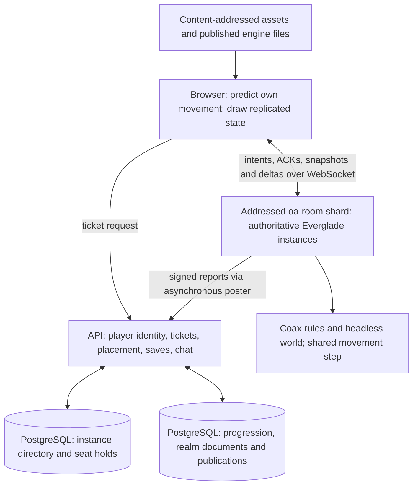

History: see everglade/ARCHITECTURE.md.

# The Metaverse Engine and the Metaverse: MMO architecture gap analysis

Date: 2026-11-04. Source snapshot:
[`3370a41ddc0c5e957c6eef4c548e5484d0b4966b`](https://github.com/OpenAgentsInc/openagents/tree/3370a41ddc0c5e957c6eef4c548e5484d0b4966b).
GitHub issue states were read on 2026-11-04, around 16:25 UTC; #12776,
#12778 and #12789 were rechecked around 16:35 UTC.

## Assessment

The OpenAgents Metaverse Engine has a substantial foundation for authoritative multiplayer: checked
fixed-step movement, explicit input handling, replay primitives, entity
lifetimes, collision queries, content identity and bounded rendering. The OpenAgents Metaverse
adds a working Everglade server, signed seats, instances, prediction,
acknowledged delta replication, interpolation and operational measurements.
The next useful milestone is a **reliable, recoverable 16-player instance**
whose offline and remote hosts play the same game.

The largest remaining gaps are integration and distributed correctness:

1. Complete the single simulation and presentation path, including the
   remaining interactions. Make the gameplay drift gate mandatory
   once its remaining failures are resolved.
2. Enforce interest and visibility in every live output path. The interest
   module exists, but the current sender does not use its picks.
3. Separate connection, session, character and process generations. A
   replicated entity's lifetime counter does not fence an old connection or
   a former server owner.
4. Make progression writes acknowledge durable acceptance, and have the
   server own persisted WANTED. Define what a process crash may lose.
5. Add readiness, admission control and proactive draining with fenced
   ownership. Scaling a fleet must preserve the identity of a room.

Persistent worlds, cross-owner transfers, transactional inventory and large
same-location populations require further contracts and evidence. They are
appropriate later milestones when the product needs them. The existing
six-shard configuration and a local 256-player test establish useful
instance capacity; neither establishes 256 mutually interacting players in
one encounter.

Priorities below are proposed sequencing: **P0** protects correctness of the
current shared game, **P1** strengthens its operation, capacity and reuse,
and **P2** adds capabilities required by a broader persistent-MMO product.

## Evidence and interpretation

The comparison uses [the MMO research](../research/mmo.md), all 101 entries
in the [Metaverse Engine chapter registry](../../aethyr/book/chapters.json), the
[book plan](../../aethyr/book/PLAN.md), chapter status and scope statements,
and the existing [book appendix](../../aethyr/book/appendix-mmo-gap-analysis.md).
The networking chapters 86–101 and the relevant core, world, Forge and
shipping chapters supply the architectural detail. Their claims were checked
against the implementation paths cited below, the multiplayer specification,
the launch runbook, and issue bodies and discussions.

The initial review used `eeeea52fac`. Movement and status changes that
arrived during the review were inspected through `3370a41ddc` and are
included below; the book registry and chapter prose did not change between
those snapshots.

This is a source and evidence review. It does not claim a fresh production
load test, deployment, failure-injection run or hardware qualification.
Measurements below retain their original workload and commit. Recommendations
and proposed acceptance checks are identified as work to do.

Three distinctions govern the assessment:

- **Implemented code, adoption and qualification are separate facts.** A
  checked module unused by the room sender provides a foundation, not an
  end-to-end guarantee. A native arithmetic check does not qualify browser
  presentation or server recovery.
- **A teaching draft can describe a feature already delivered elsewhere.**
  The registry records 14 implemented, 32 partly implemented and 55 draft
  chapters. Those are teaching-profile counts, not a percentage of engine
  completion. In particular, networking code has advanced beyond the current
  prose.
- **Issue closure records a delivery scope.** The individual issue and the
  current source take precedence over stale checkboxes in a parent epic.
  An issue comment describing work in progress is not proof it is on main.

External references below are primary engineering accounts or official
documentation, checked during this review. The recommendations do not depend
on reconstructing Blizzard's undisclosed current topology, a universal WoW
tick rate, or the research document's newer WoW branch claims.

## What the current system contains

The architecture already separates several responsibilities:

The diagram shows the remote path. Offline Everglade still executes a
separate page simulation at the reviewed commit; the local-worker convergence
is [#12784](https://github.com/OpenAgentsInc/openagents/issues/12784).

### Core Metaverse Engine strengths and limits

| Book area | Existing capability | MMO implication and remaining boundary |
| --- | --- | --- |
| 1–5: clock, construction, input, replay | Integer frame clock; bounded paid steps; declared defaults; one consumption of each press; external-event gate; strict math and seeded random streams. | Good prerequisites for prediction and reproducible debugging. The Grid's native/Wasm replay is qualified; complete Everglade server recovery and replay are additional integrations. |
| 6–10: entities, queries, movement, camera | Generation-checked handles, durable IDs within the store's scope, deferred spawn/despawn, checked ground and capsule contacts, shared controller and a camera that only reads the player. | Shared rules reduce client/server disagreement. A local EntityId counter does not define a fleet-wide identity or transfer protocol. |
| 11–16: drawing and budgets | Shared renderer admission, bounded frame work, content-hashed assets; material, pose and UI consolidation in progress. | Client crowd rendering has a useful foundation. A vertex budget does not bound replication bytes, simulation CPU or input age. Grid renderer qualification does not imply whole-Everglade image qualification. |
| 17–37: advanced physics | Existing rigid/contact helpers; the consolidated batched, multi-material and differentiable solver sequence remains draft. | Useful for later game and agent profiles. Completing every advanced solver is unnecessary for an instanced target-based MMO. Server collision and gameplay correctness remain required. |
| 38–50: large worlds and networking models | Whole-pack realm loading; floating-origin space camera; existing presence and small-game lockstep consumers. Shared streaming, presence and lockstep chapters remain drafts. | Content streaming, small deterministic sessions and distributed authoritative simulation solve different problems. None supplies cross-owner world handoff automatically. |
| 51–55: Forge | Versioned documents, stale-write refusal, invertible edits, asset-pack admission, engine/content pins for made-realm publications, isolated forks. | Strong authored-content consistency. Runtime room state, hand-built Everglade releases and persistent inventory need their own version/ownership contracts. |
| 56–64: adoption | Grid session replay and cross-realm inventories; many realms share movement and camera modules. | Adoption is uneven. Made realms retain private movement (#12721); realm rebuild chapters remain drafts even where current gameplay works. |
| 65–80: audio, world systems and AI | Offline deterministic synthesis; some spatial/live sound, effects, senses, followers, navigation and scatter modules. | Important player experience and NPC substrates. Navigation/senses adoption, crowd avoidance, remote decision budgeting and some shared world systems remain incomplete. |
| 81–85: shipping | Versioned AESV saves, fallback slots, progress revisions, frame measurements, existing native/browser paths and some accessible controls. | Save containers detect corruption; they do not authenticate gameplay or prove economic durability. Shared lifecycle, hot-reload migration and broader accessibility remain work. |
| 86–101: multiplayer | Everglade-specific authoritative server and client, with substantial current networking functionality. | A reusable `aethyr/net/` API is still planned. Porting another realm currently requires Everglade-specific integration rather than selecting a qualified shared profile. |

The core contracts are documented in [INVARIANTS.md](../../INVARIANTS.md),
especially fixed clocks, event admission, strict math, entity flushes, asset
identity and published contracts. Proposed networking work must preserve them.

### Scale has three independent dimensions

| Dimension | Current evidence or configuration | What remains unproved |
| --- | --- | --- |
| Total population | Source config: 6 shards × 2 placed rooms × 16 seats = 192 configured seats. The process supports 16 Everglade rooms. | Sustained fleet capacity with current gameplay, launch bursts, failures and mixed network conditions. Configuration is not observed concurrent usage. |
| World size | A realm loads an asset pack; chapter 38 plans cells, residency budgets and load-boundary publication. | A large streamed world with bounded memory, navigation, persistence and server ownership across geography. |
| Interaction density | One room has 16 seats; the raid has up to 60 standing raiders, plus event actors, townsfolk and effects. | Hundreds or thousands of players mutually interacting in the same encounter. Adding independent rooms does not increase this bound. |

The [launch runbook](2026-11-04-everglade-launch-runbook.md#step-4-capacity-3-rooms-a-shard-12717)
records a local 256-player/16-room run at `6a846432d2`, with ACK p95 below
40 ms and 10.9 seconds of tick work per minute, and an earlier production
32-player/shard result at `f0d97831c8` with tick p95 3.9 ms. Those workloads
predate the latest replication changes and do not qualify a larger raid.

## Reconcile the book and issues before planning work

The appendix is explicitly based on `9d2e7598ef`. Several changes landed
after that baseline. Reusing its gap table unchanged would misdirect work.

| Topic | Older book/appendix statement | Evidence at this review's source snapshot |
| --- | --- | --- |
| Replication, chapters 91–93 | Per-kind records; townsfolk thresholds; no acknowledged baseline or byte budget. | `edd9601102` and `67b4f62448` implement wire v3, generic `s` rows, acknowledged bases, repeated removals, priorities, a row budget and LIFE/WARP. [#12783 is closed](https://github.com/OpenAgentsInc/openagents/issues/12783#issuecomment-6635714404). |
| Version check, chapters 88/98 | `WIRE_VERSION` exists but is never checked. | The hello version is checked; incompatible pages are refused; new pages reload once. [#12788 is closed](https://github.com/OpenAgentsInc/openagents/issues/12788). This is rejection and recovery, not a dual-version rolling upgrade. |
| Diagnostics, chapter 99 | Queue age, message bytes, join bursts and ACK timing are missing. | `b35943120f` adds room vitals and an admin view. [#12791 is closed](https://github.com/OpenAgentsInc/openagents/issues/12791#issuecomment-6634588227). Some counters still approximate the old relevance rule. |
| Interest, chapter 97 | No shared indexed interest implementation. | `room-interest.coax` and block plumbing exist (`b4826d83b2`, `aa9b488b2c`). The live `wire_seat_frame` still uses its own distance/all test. [#12789 remains open](https://github.com/OpenAgentsInc/openagents/issues/12789). |
| Effects, chapter 94 | No effect start/duration on the wire. | Effect rows and `net_effects` exist. `3370a41ddc` wires them into `st_fill_room`, including named causes and seconds left. Broader source/branch convergence remains under open #12776. |
| Movement timing, chapters 89–90 | One input credit per tick, with separate credit for skipped host ticks. | `d14d704b62` credits elapsed server time, `fa1fecdcb9` bounds inputs beyond earned steps, and `3370a41ddc` puts heading in 0.1 mrad units. Current full-raid latency qualification remains separate. |
| Offline host, chapter 95 | Local worker host planned. | Still absent at the reviewed commit. A cross-issue comment describes a worker integration, but its named files are not in this source snapshot. #12784 remains open. |
| River, chapter 87 and host header | Swimming is described as not server-owned. | `room-world.c::world_step` now handles per-seat swimming; boats remain separate. Inspect the body and current tests before treating a header comment as a gap. |
| Raid stables | Previous drift runs saw no room collapse. | The snapshot includes `eeeea52fac`, which changes the siege collapse. The previous failed drift result is historical; full current drift acceptance still needs its own evidence. |

The book should be updated with those implementation facts while retaining
its promotion standard: worked trace, runnable example, refused case and
independent check. Closing an implementation issue alone does not justify
promoting a chapter to implemented.

## Comparison with the MMO practices

Status here means **present** in an adopted path, **partial** where a
material contract or integration remains, and **future** where the reviewed
code does not provide the MMO capability. It is not a certification score.

| Research area | Best-practice requirement | Metaverse Engine/Verse assessment | Main gap or next proof |
| --- | --- | --- | --- |
| 1–2: capacity and evidence | Define population, geography and interaction density separately; distinguish disclosures from inference. | Partial: useful measurements and bounded rooms; older status prose persists. | Publish a current workload/commit/host/latency capacity record and keep claims scoped. |
| 3: system boundaries | Separate gameplay, placement/control, durable state and content delivery. | Present in the broad architecture: room host, API/directory, PostgreSQL and asset delivery. | Prove dependency outages stay local; avoid sharing authority just because services share infrastructure. |
| 4: login/admission | Authenticate, place, authorize, establish baseline, then activate; rate-limit expensive entry. | Partial: signed, expiring, room/shard-bound tickets and 20-second directory holds. | Endpoint admission limits, ready capacity, explicit session ownership and observable refusal/retry behavior. |
| 4: reconnect | Preserve character/session independently of transport; reject obsolete owners. | Partial: quiet-socket detection, rejoin and recent local position restore. | Grace hold, input generation, process generation, cooldown/effect continuity and restart recovery. |
| 5: headless authority | Server decides accepted movement, combat and world state. | Present for much of Everglade; shared Coax movement/rules and native headless world. | Remaining interactions, persisted WANTED and offline/online parity. One-Shot still needs authority migration. |
| 5–6: scheduling | Explicit dependencies, independent cadences, bounded work and overload policy. | Partial: fixed clocks, a 30 Hz room tick, input banks and event caps. | Cadence/queue-age proof, overload semantics and isolation among rooms on one host. |
| 7: interest | Indexed candidates, visibility permissions, hysteresis and nonspatial subscriptions. | Partial: checked module exists; live sender has not adopted it. | Integrate all state/metadata/cue paths and prove raw-wire privacy, including snapshots. |
| 8: replication | Acknowledged baselines, lifecycle, quantization, priority and recovery. | Present in wire v3 for the Everglade profile. | Critical effects under budget, explicit discontinuities, bounded full snapshots and reusable descriptors. |
| 8: slow clients | Bound queue bytes and age; avoid obsolete state delaying useful state. | Partial: 256 KiB cap, 3-second age close, reduced state when output is behind. | Demonstrate graceful recovery from a weak link and define freshness limits by message class. |
| 9: transport | Select delivery semantics per information class; distinguish byte and gameplay ACKs. | Present: WebSocket/TCP plus separate processed-input ACK and state HEARD. | Quantify loss-induced stalls; add transport abstraction before considering datagrams. |
| 10: movement timing | Predict local movement, reconcile from accepted input, interpolate remote state. | Present, with adaptive buffering and correction smoothing. | Residual lift/collision/rule divergence and all-network-profile gameplay proof. |
| 10: combat fairness | Specify range/sight checkpoints, age, target loss and action order. | Present for the documented Everglade cast profile (#12790). | Maintain these rules through queue/reconnect changes and broaden scenario coverage. |
| 11: dense crowds | Measure real interaction and fan-out, not idle connections. | Partial: raid and load harnesses exist; generic row budgeting landed. | Current mixed-combat capacity curve, target/effect costs, phone frame times and explicit overload behavior. |
| 12: partitioning | Keep tightly coupled play under clear owners; transfers require recoverable cutover and fencing. | Present for independent room partitioning; future for transfers. | Process fencing is needed now for deploy overlap; geographic/entity migration is later work. |
| 13: durable progression | Acknowledged writes, retry-safe effects, conflict rules and explicit recovery objectives. | Partial: signed vitals and revision-based saves; vitals can be lost. | Persist completion receipts, reject old owners and define room recovery/checkpoints. |
| 13: economy | Atomic valuable-state mutations, operation identity, version guards and audit/reconciliation. | Future: Everglade explicitly has no trading/economy. | Establish the contract before introducing transferable loot, balances or rewards across owners. |
| 14: shared services | Chat/social/search/analytics should not synchronously stall combat. | Present in much of the layout: chat/API work and asynchronous report posting. | Bound outage/retry queues and prove behavior during dependency failures. |
| 14: fleet lifecycle | Ready/allocated/draining states; graceful retire; compatible rollout. | Partial: addressed shards and placement; deploy replaces all shards in parallel. | Proactive drain, ready-world probe, ownership generations, staged rollout and rollback evidence. |
| 15: observability | Whole-action latency, tails, queues, serialization, join and recovery metrics. | Substantial present functionality from #12791. | Align metrics with v3/interest, add durable-save and ownership/recovery measurements and presentation timing. |
| 15: testing/security | Real gameplay under shaped networks; adversarial bounds and failures at commit/cutover. | Partial: Coax checks, raw sockets, browser pairs, drift, bots and rate limits. | Mandatory integrated gate plus save/deploy/reconnect fault matrix and visibility assertions. |
| 16: social placement | Prefer communities and groups, reserve capacity and explain separation. | Partial: `?with=`, room links and ticket holds. | Invite reservations and explicit full-room choices; cross-room party/guild services later. |
| 17: engine reuse | Stable command/replication/ownership/persistence contracts usable by many realms. | Partial: strong core; multiplayer currently organized around Everglade. | Extract a qualified shared profile after converging both hosts; adopt it in a second realm. |

## Detailed gaps and acceptance evidence

### G1. One simulation must feed one presentation state

**Priority: P0 for the multiplayer experience. Tracking: #12784, #12776,
#12778; #12746 and #12721 for adoption beyond Everglade.**

[Chapter 87](../../aethyr/book/ch087-server-and-client-share-one-step.md)
correctly requires shared code and world data. The actual movement helpers
are shared, but the page still owns offline gameplay and switches sources
feature by feature. `eg_heard` refuses talk, door, boat and board interactions
as `unbuilt`; server-owned swimming already exists and should be preserved.
The status fill now reads effect cause/duration from v3, closing that
particular adoption gap in `3370a41ddc`. The remaining two-source structure
still makes each new feature an integration risk.

The [reopened epic](https://github.com/OpenAgentsInc/openagents/issues/12718#issuecomment-6630316736)
records why isolated feature checks were insufficient: the room had working
networking while players saw camera snaps, walking-in-place NPCs, invisible
effects and the wrong hotbar. Later fixes substantially improve those
symptoms. They do not remove the structural risk of two simulations.

Finish the local-worker host from [chapter 95](../../aethyr/book/ch095-offline-is-a-local-server.md):
one room simulation and initialized state, compiled for both hosts; the page
always sends intents and draws replicated state. Keep platform effects in
hosts and rules/scheduling decisions in Coax. Delete replaced offline
branches and record the change in the adoption inventory.

Acceptance requires the same scripted route and raid to agree in offline
and remote modes at local, 100 ms and 250 ms shaped-network profiles.
Compare state **and what is drawn**: movement, corrections, lift, NPC
motion/clip, persistent effect geometry, status cause/time, levels, hotbar,
destruction and respawn. Distinguish permitted visual delay from simulation
disagreement. Measure worker CPU and page frame time on a phone-class
throttle. A second realm adopting the shared path is the reuse proof.

### G2. Interest is a server permission decision

**Priority: P0 for visibility; P1 for CPU scaling. Tracking: #12789.**

[The interest module](../../coax/web/room/room-interest.coax) supplies hashed
spatial cells, separate entry/exit radii, owner lists, block/reveal rules,
priority and health-only party hooks. At this snapshot,
[`wire_seat_frame`](../../apps/openagents-web/everglade-wire.coax) still scans
`WIRE_SLOTS` for each seat using `q == me || all || distance <= view`.
[`eg_send`](../../coax/web/room/room-everglade.coax) does not call `im_pick`.
Module comments describing intended integration should not be read as
evidence the sender enforces it.

Integrate interest before encoding, and audit every additional channel:
names, WANTED, levels, effects, casts/cues, initial snapshots and removal
messages. Hiding a body after receipt does not withhold its position.
Epic's [Replication Graph](https://dev.epicgames.com/documentation/en-us/unreal-engine/replication-graph-in-unreal-engine)
explains why shared spatial candidate lists also reduce per-entity/per-client
CPU. Riot's [fog-of-war account](https://www.riotgames.com/en/news/demolishing-wallhacks-valorants-fog-war)
illustrates the security value of withholding information at the server.

Blocking must have an explicit gameplay rule. Withholding a blocked actor's
body and attached effects while allowing that actor to damage the recipient
could create invisible combat. Decide which interaction, collision and
public hazard facts remain necessary, then enforce the chosen rule together
with visibility. This is a design question arising from #12789's requested
privacy behavior, not evidence of a tested exploit.

Acceptance: inspect raw frames for a blocked/hidden actor at join, during
play, after reveal/revocation and across reconnect. Cross the hysteresis band
repeatedly and assert bounded lifecycle churn. Exercise a health-only
subscription and prove it omits transform/private fields. Compare picks with
an independent exhaustive oracle, and measure candidate visits as distant
population grows. The current party hook is room-local; cross-room parties
need a shared service rather than direct access to another room's internals.

### G3. Complete the replication and slow-client contract

**Priority: P1, with critical status visibility included in P0 gameplay
acceptance. Tracking: #12776/#12789; additional follow-up scope beyond closed
#12783.**

Wire v3 has the important baseline mechanism: generic field masks and
quantized values, deltas from acknowledged history, whole-tick HEARD,
repeated removals and full snapshots. It also adds entity LIFE and WARP,
and resets interpolation across them. This aligns with the baseline rule in
Glenn Fiedler's [snapshot compression implementation](https://gafferongames.com/post/snapshot_compression/).

There are still limits worth making explicit:

- `WIRE_BUDGET = 1000` is a row-selection budget, not a strict cap on total
  connection bytes. Removals, metadata, events, framing and full snapshots
  require separate accounting. Snapshot sends deliberately lift the ordinary
  budget.
- The sender guarantees the receiving player's row. The current selection
  loop does not separately reserve every effect owned by that player, as
  [chapter 92](../../aethyr/book/ch092-priority-under-a-budget.md) requires.
  High priority must have a stated bound under the actual worst case.
- WARP currently detects a move exceeding 3 m in a tick. Explicit simulation
  discontinuities would also cover short teleports and distinguish them
  from legitimate fast motion.
- LIFE changes from the previous tick's sampled slot/id and wraps modulo
  one million. A seat replaced entirely between samples needs an explicit
  new lifetime even if its numeric ID is unchanged. Specify wrap behavior
  too; the core entity store already retires a generation that would wrap.
- Reduced sends above the behind threshold and a 3-second close bound
  contain slow clients. They do not establish the chapter's stronger claim
  that a 64 kbit/s client recovers without being closed. A TCP byte stream
  cannot retract obsolete bytes already handed to the transport.

Specify budgets for state, critical lifecycle/status, cues and join bursts.
Give deferred entities a measurable maximum age. Coalesce replaceable state
before committing it to the socket, and define snapshot/reconnect recovery
when a baseline or output age is exceeded. Preserve reliable lifecycle and
authoritative outcomes separately from expendable audiovisual cues.

Acceptance: with a full raid and weak link, verify own-state and own-effect
freshness, no starvation, bounded actual bytes and queue age, correct table
after a missing multipart frame, and recovery after throttling ends. Test
seat reuse and both short and long teleports. These are proposed stronger
checks; #12783's recorded load and NPC-motion improvements remain valid for
their original scope.

### G4. Fence connections, characters and simulation owners

**Priority: P0 for reconnect and deploy correctness. Tracking: #12792,
#12797; persistence integration also needs this contract.**

There are several identities to keep distinct:

| Identity | Current role | Required scope |
| --- | --- | --- |
| Player/account | Ticket PID; account-linked progression. | Stable across sockets and devices according to the character policy. |
| Seat/connection | Local seat slot and socket. | Replaceable transport attachment to one active character session. |
| Replicated entity LIFE | Resets a client's interpolation when an entity lifetime changes. | Entity lifecycle within the room/history profile. |
| Character/session generation | Incomplete. | Reject obsolete commands and duplicate control after rejoin. |
| Room/process generation | Incomplete. | Fence old reports and durable writes after restart, replacement or transfer. |

`rl_replace_stale` marks an old connection kicked, while `rl_heard` has no
corresponding kicked check. `eg_left` removes the creature immediately on
disconnect. `rv_back` can restore a recent position from process memory,
but does not retain the full live character with conditions and cooldowns.
A new socket is therefore not yet a resumed authoritative session.

Add a server-issued session generation and resume identity, a bounded
disconnect grace, and a defined policy for an actively connected second
device/tab. New control must invalidate old input, pending casts and save
rights. A current ticket authenticates identity and placement; its expiry
alone does not prove exclusive ongoing control across all rooms.

Fencing must be enforced at the protected recipient: the room command
handler, placement directory and persistent-state writer. A token retained
only in an old process does not stop that process from writing after a
pause. This is the failure addressed by
[fencing-token designs](https://martin.kleppmann.com/2016/02/08/how-to-do-distributed-locking.html).

Acceptance: reconnect within grace retains one body, HP, cooldowns and
effects; after grace it follows the documented leave policy. Delayed frames
from the old socket have no effect. Resume an old server after a new owner
is active and prove its directory reports and state writes are refused.
Replicated LIFE/WARP checks and these ownership checks must both pass.

### G5. Progression needs a durable acknowledgement boundary

**Priority: P0 for existing progression. Tracking: #12793, #12794. Persistent
world recovery and a transactional economy are further scope.**

[`room-vitals.coax::rm_vitals_due`](../../coax/web/room/room-vitals.coax)
sets `sent = true` while constructing the signed body, before the API
accepts it. The host's asynchronous poster has no durable retry/completion
protocol for that write. If the request fails and the values do not change,
the record can remain treated as saved. The asynchronous boundary is useful
for protecting the tick, but it needs a bounded queue with receipts.
The 64-entry vitals table also replaces its oldest entry when full; the
retry design must prevent unaccepted progression from being silently evicted.

Have the poster return a result tied to a specific report/version. Mark
only that version accepted; preserve newer unsent changes. Retry with
bounded backoff and jitter, and reconcile an ambiguous timeout with the
recorded outcome. Distinguish HTTP transport success from application-level
acceptance of every requested row. If the API partially accepts a batch,
the receipt must identify the accepted subset or the batch must be atomic.

The API currently merges HP by report time and XP by maximum. Repeating an
unchanged report is compatible with that merge, but it does not replace
exclusive ownership. Concurrent sessions starting from the same XP can
produce conflicting cumulative totals; a maximum is not an additive reward
ledger. Wall-clock ordering also needs bounds and ownership generations.

Separately, [`player.c::room_state`](../../coax/web/api/player.c) accepts
WANTED from the page. Server-owned WANTED can therefore be reset through a
client-originated persisted value, as #12794 documents. Move it to the signed
server report and refuse client writes to that field.

The general save layer has useful independent guarantees: AESV versions,
CRC, previous-good fallback, world identity and stale-revision refusal.
[Chapter 81](../../aethyr/book/ch081-save-and-come-back.md) explicitly leaves
retry-once effects and conflict merging unfinished. A CRC or revision
container does not make its payload authoritative gameplay.

Define durability separately for HP/XP/WANTED, character position, active
encounters, world destruction and authored edits. At this snapshot position
restore is a local-memory note, and room world/raid state is not a durable
checkpoint. Even after #12793, a crash before the next report can lose
recent progress. State an acceptable loss window and recovery time, then
measure them; use durable journaling where the required loss window is zero.

Acceptance: reject reports for 30 seconds, accept them again and retain all
acknowledged progression; commit then lose the response; drop a poster
request; change the value while an earlier report is in flight; crash/restart
both before and after acceptance; submit old-owner reports. Confirm that a
page posting WANTED zero cannot change the server-owned value.

Everglade's spec excludes an economy. Before adding transferable items,
trade or valuable rewards, put the invariant in one transactional owner:
operation ID, expected version, atomic debit/credit/transfer, recorded result
and audit trail. If derived views need events, commit an outbox record with
the mutation and make consumers duplicate-safe. These are recommendations,
not capabilities established by the current room code. PlayFab's
[idempotent inventory API](https://learn.microsoft.com/en-us/xbox/playfab/economy-monetization/economy-v2/tutorials/idempotent-transactions-and-retries)
illustrates why retries must retain one logical operation identity. All
monetary features must retain this repository's Bitcoin-only policy; the
existing Spark wallet is a separate boundary, not an MMO inventory ledger.

### G6. Deploy ownership and ready capacity need explicit state

**Priority: P0 for safe room replacement. Tracking: #12797; #12788 is a
completed prerequisite.**

[`deploy.sh`](../../coax/web/room/deploy.sh) replaces all six shard services
in parallel, uses min instances zero and max instances one, and checks
`/health` after deployment. The host does not install a SIGTERM handler.
The directory accepts timestamp-ordered room reports without a process
generation. An old and a new revision can therefore disagree about the
owner while both are alive. Best-effort session affinity supplies no
ownership protocol; Google's [WebSocket guidance](https://docs.cloud.google.com/run/docs/triggering/websockets)
explicitly says subsequent connections can reach different instances.

There is an important refinement to #12797's acceptance text. Cloud Run
documents **10 seconds between SIGTERM and SIGKILL**. Waiting for a long
raid to finish after SIGTERM is not a viable drain protocol. Initiate drain
before replacement: stop new placement, let encounters finish or checkpoint
under an explicit deadline, make final accepted saves, then retire the
revision. The signal handler performs only bounded final work and applies
the forced-stop policy. [Cloud Run's container lifecycle](https://docs.cloud.google.com/run/docs/container-contract#lifecycle)
also documents startup probes; use readiness that verifies a usable world,
required content and compatible rules rather than a listening socket alone.

Model `starting → ready → allocated → draining → retired` explicitly in
placement, with a monotonic ownership generation. Separate starting workers
from assigning rooms and retiring live owners, as illustrated by
[Agones scheduling/allocation](https://agones.dev/site/docs/advanced/scheduling-and-autoscaling/).
This is a lifecycle model to implement in the existing Coax/GCP stack, not a
recommendation to adopt Kubernetes or another hosted realtime service.

The v3 handshake now prevents silent incompatible decoding. Its runbook
requires room and page releases back to back and coordinated rollback.
For stronger continuity, pin compatible engine/content/rules/wire versions
per session and route new sessions to the new version while compatible old
encounters finish. Binary rollback must not assume persistent schemas or
accepted writes roll back with it.

Acceptance: deploy one shard with active bots and a raid, refuse new seats
on the draining revision, prove one current owner, and verify the documented
reconnect/progress outcome. Exercise cold start, failed readiness, old/new
protocol mismatch, rollback and forced shutdown. A health check after the
replacement cannot substitute for these checks.

### G7. Admission and group placement are part of gameplay

**Priority: P1 before a larger launch. Tracking: #12795, #12796.**

The directory has a useful transactional placement lock and 20-second seat
holds. At capacity, the API answers 503; the page retries with doubling
waits without jitter. Post-join frame/byte limits protect an established
socket, not ticket issuance or connection churn. Add per-player/address
limits, a bounded retry contract and refusal metrics at those earlier
boundaries. Retries can amplify an overloaded dependency; AWS documents
the mechanisms in [timeouts, retries and jitter](https://aws.amazon.com/builders-library/timeouts-retries-and-backoff-with-jitter/).

An INVITE or `?with=` is best effort today: a full destination can fall back
to another room. Hold a seat for the invited player, count it against
capacity and explain when the requested group cannot fit. Room-local
invites are the immediate need. Durable parties, guild affinity and
cross-room subscriptions are separate later services. ArenaNet's
[megaserver design](https://www.guildwars2.com/en/news/introducing-the-megaserver-system/)
treats party, guild and language affinity as placement inputs; utilization
alone does not measure whether people can play together.

Acceptance: 250 arrivals against the configured 192 seats keep ticket asks
under a declared rate; reconnect reservations and invites do not overbook;
the final free seat cannot displace a held invite; and a full friend's room
produces an explicit choice. If queue length/wait estimates are shown,
implement a bounded expiring queue that can actually produce those facts.
Stateless retries alone cannot tell how many distinct people are waiting.

### G8. Measure and control interaction density

**Priority: P1 for present rooms; larger-encounter targets require an early
product and engineering milestone. Tracking: #12778 and the next capacity
qualification; #12791 is delivered measurement infrastructure.**

The current harnesses already go beyond idle sockets: load bots walk and
cast, raid bots fight, two-browser checks observe shared play, and drift
compares presentation under shaped networks. Preserve that investment.

Current evidence also shows why one fast server number is insufficient.
The [#12791 raid record](https://github.com/OpenAgentsInc/openagents/issues/12791#issuecomment-6634588227)
reports a 16-player local fight at tick p95 about 1.5 ms, but input-to-ACK
p95 grew to about 528 ms as the input queue filled. That is a historical
failure: `d14d704b62` replaces per-tick credit and `rm_eg_owe` with elapsed
monotonic-time credit, retaining the bank and per-tick execution caps.
`fa1fecdcb9` keeps at most four additional inputs beyond earned credit and
counts dropped excess. The movement commit records a limited walk trace
with prediction error at most 9 mm; it does not establish a fresh full-raid
ACK-latency result.

The room tick is 30 Hz while core walking uses its own fixed 1/64-second
profile. The engine must state how movement substeps, input upload, combat,
replication, AI, visual drawing and persistence relate; they do not need
one universal rate. Preserve and qualify the new elapsed-time credit,
excess-input policy, finer heading quantization and physical time together
under mixed combat, clock skew and stalls. Simply executing faster client
input rates would create a speed advantage.

For capacity, publish a curve over seats, rooms, raiders, pets, persistent
effects, simultaneous area spells and destruction. Include p50/p95/p99
simulation time, oldest input age, action-to-ACK and action-to-presentation,
relevant entities, serialization, total output bytes, client frame times
and dropped/refused work. Record compiler/build, hardware, duration and
network profile with every point.

The wire v3 completion record reports roughly 20.6 KB/s per client in one
16-player local raid. It is not a worst-case budget. For intuition only,
`N × k × f × s` gives 2,265,600 payload bytes/s for 16 recipients, 118
entities, 30 Hz and an assumed 40 bytes/update, before compression and
protocol overhead. Label estimates and measurements separately.

Declare overload behavior: protect admitted encounters, reject new work
early, lower expendable update frequency, preserve critical outcomes and
count refused work. Existing event/cast caps contain work, but a dropped
cosmetic cue and a dropped gameplay result have different consequences.
Parallel pathfinding or serialization may help after profiling; independent
rooms are the first isolation boundary. A bigger VM or more workers does
not partition a dense fight automatically.

### G9. Connect diagnostics to mandatory gameplay and failure gates

**Priority: P1; correctness cases above belong in their P0 changes.
Tracking: #12778/#12718 and follow-ups beyond closed #12711/#12791.**

[`room-stats.coax`](../../coax/web/room/room-stats.coax) and the
[runbook](2026-11-04-everglade-launch-runbook.md#during-a-raid-the-room-vitals-to-watch-12791)
already report useful tick tails, queue age, byte types, joins, reconnects
and ACK timing. The live relevance counter still uses older player/zone/
beast/folk rules; once indexed interest is integrated, derive counters from
the actual picks and actual sent rows, including withheld categories.
Label process-wide histograms as process-wide and add worst-room and
worst-seat attribution where needed.

Add metrics for last durably accepted progression revision and age,
unacknowledged/failed/retried saves, current room generation, ownership
refusals, ready/draining capacity, reservation success, recovery duration
and lost-progress window. Client presentation timing must complete the
server-side action path, with explicit clock-estimation uncertainty.

The deploy script runs drift but only makes failure fatal with
`OA_ROOM_DRIFT_GATE=1`; it can also skip it. Resolve and record the remaining
failures, then make this the normal deployment requirement. A new failure
should name the broken probe rather than accept a broad bypass.

Add failure injection at each ownership/durability boundary: after commit
before receipt, poster saturation, dependency outage, duplicate/reordered
report, old-owner resume, disconnect during a cast, partial snapshot,
slow consumer, cold start and deploy overlap. Use bounded Coax harnesses
and local/headless checks; keep per-command runs below 15 minutes and shard
longer matrices. Reuse recorded passing evidence on unchanged inputs rather
than repeating whole gates.

### G10. Turn Everglade networking into an engine contract

**Priority: P1 for a second authoritative realm; P2 for persistent-world
extensions. Tracking: #12746, #12610 and new shared-contract scope.**

The core engine and product implementation have different maturity.
`aethyr/net/` is absent at this snapshot; wire state and the room simulation
live under `apps/openagents-web/` and `coax/web/room/`. That placement is
reasonable while proving one game, but a reusable engine needs explicit
extension points for commands, world stepping, replicated fields,
visibility, persistence and policy.

Extract only after the single-host path is stable. Use Coax schemas and
shared descriptors to generate/admit encoding, decoding, inspection and
compatibility tests. Keep recipient privacy explicit; an engine must not
replicate every struct field by default. Let realms select timing,
collision, fairness and durability profiles without copying the sender.

The [Metaverse protocol](openagents-verse-protocol.md#108-openagentsverserealmv1)
contains a target `realm.v1` session contract, and the
[multiplayer spec](2026-11-03-everglade-multiplayer-spec.md#36-frames)
calls text frames a bootstrap mapping. The reviewed `proto/openagents/verse/`
contains common/presence alpha schemas, not an implemented `realm.v1`
session schema. The room wire uses its own Coax codec. The closed #12717
scale issue therefore must not be treated as proof of current protobuf
realm-wire conformance. Formalize and test the mapping and new version in
`proto/` and the protocol spec before claiming that integration. Published
contracts retain their identity; old Rust/chamber descriptions are design
history, not code to restore wholesale.

An appropriate extraction proof is a second server-authoritative realm,
such as One-Shot, using the same admission, session lifecycle, command
pipeline and replication infrastructure with its own game rules. Keep
self-asserted presence and opt-in small-game lockstep as explicitly different
profiles; their trust assumptions do not qualify authoritative MMO play.

## Persistent-MMO extensions beyond the current launch

The earlier appendix intentionally excludes these at current room scale.
They remain part of a comprehensive engine comparison, with explicit
triggers for doing the work.

| Capability | Current basis | Trigger and missing contract |
| --- | --- | --- |
| Streamed world residency | Chapter 38 design; content identity, budgets and floating origin already exist. | When worlds exceed whole-pack residency: cell manifests, async completion at step boundaries, simulation/sleep/draw tiers, navigation and persistent IDs across unload. |
| Cross-room character travel | Grid gate/page navigation and placement. | When gameplay/possessions must continue between owners: reserve destination, freeze/capture cutover, transfer last accepted command and state, durably choose one owner, fence old writes, resume or recover. |
| One geography across owners | Independent authoritative rooms. | When one continuous map exceeds one owner: border read replicas, interaction routing, cross-border combat rules and failure recovery. Content streaming alone supplies none of these. |
| Long-lived world state | Authored documents/edits are durable; room simulation is in memory. | When towns/encounters must survive process loss: versioned checkpoints/journal, external-decision capture, restore and reconciliation with character progression. |
| Transactional inventory/economy | Save revisions and signed vitals; separate Spark wallet. | Before transferable value: atomic mutations, operation IDs/results, concurrency guards, audit and reconciliation. Never introduce money systems excluded by repository policy. |
| Regional service | One configured room region, `us-central1`. | When latency/geographic availability requires it: region placement, durable replication, explicit recovery point/time and split-brain prevention. A battle active in two regions is a separate problem. |
| Social platform | API chat, block/report/kick, best-effort room affinity. | When groups span sessions/maps: durable parties/guilds, privacy, reservations, presence subscriptions and independent outage behavior. |
| Agent NPCs at population scale | Senses/memory, followers, navigation and replay-ticket primitives; realm-specific NPC calls. | When model decisions control shared actors: async budgets, deterministic admitted intents, expiry/cancellation, quotas and fallback. Inference must not block the combat tick or bypass authority. |
| Cross-host quality | Native/browser evidence, shared renderer and some accessibility. | Before promising equivalent MMO clients: current host lifecycle, touch/network suspension, recovery, crowd frame budgets, remapping, captions and accessible live UI on each supported target. |

Amazon's [New World architecture account](https://aws.amazon.com/blogs/gametech/the-unique-architecture-behind-amazon-games-seamless-mmo-new-world/)
describes state moving between simulation hubs and a separate instance pool.
It demonstrates that continuous geography needs ownership infrastructure;
it supplies no capacity guarantee for our implementation. Dynamic
partitioning should follow measured interaction structure, after the smaller
handoff/recovery contract works.

WebTransport/QUIC datagrams are another conditional extension.
[RFC 9221](https://www.rfc-editor.org/rfc/rfc9221.html) defines unreliable
QUIC datagrams, and the [WebTransport specification](https://www.w3.org/TR/webtransport/)
exposes stream/datagram APIs. Browser support, hosting ingress, congestion
behavior and fallback need their own qualification. Preserve WebSocket as
the current measured profile and separate delivery semantics from transport
so a future experiment need not rewrite gameplay. Transport replacement
does not resolve the present authority, durability or presentation gaps.

## Open-issue map

These individual issues were open when read; recommendations here do not
create, close or edit any issue.

| Issue | Scope and current assessment | Gap |
| --- | --- | --- |
| [#12718](https://github.com/OpenAgentsInc/openagents/issues/12718) | Reopened multiplayer umbrella. Individual issue state and current evidence supersede stale child checkboxes. | G1–G10 |
| [#12776](https://github.com/OpenAgentsInc/openagents/issues/12776) | One presentation state. Status now consumes effect cause/duration; broader path convergence and branch removal remain. | G1, G3 |
| [#12778](https://github.com/OpenAgentsInc/openagents/issues/12778) | Drift harness exists; complete all-profile acceptance and mandatory gating remain. | G1, G8, G9 |
| [#12784](https://github.com/OpenAgentsInc/openagents/issues/12784) | Same server in an offline worker; named worker/tick files absent at reviewed commit. | G1, G10 |
| [#12789](https://github.com/OpenAgentsInc/openagents/issues/12789) | Indexed interest module and block inputs exist; sender adoption/raw-wire proof remain. | G2, G3 |
| [#12792](https://github.com/OpenAgentsInc/openagents/issues/12792) | Session generation, grace hold and stale-frame rejection. Entity LIFE does not complete it. | G4 |
| [#12793](https://github.com/OpenAgentsInc/openagents/issues/12793) | Durable report receipts and retries. Needs precise per-version/batch acceptance and ambiguous-outcome tests. | G5 |
| [#12794](https://github.com/OpenAgentsInc/openagents/issues/12794) | Server-owned persisted WANTED; client room-state currently accepts it. | G5 |
| [#12795](https://github.com/OpenAgentsInc/openagents/issues/12795) | Invite reservations and explicit full-room behavior. | G7 |
| [#12796](https://github.com/OpenAgentsInc/openagents/issues/12796) | Admission limits, jitter and observable waits. Queue estimates require real queue state. | G7 |
| [#12797](https://github.com/OpenAgentsInc/openagents/issues/12797) | Readiness, drain and ownership generations. Add proactive drain before Cloud Run's short signal window. | G4, G6 |
| [#12746](https://github.com/OpenAgentsInc/openagents/issues/12746) | One-Shot server authority; useful second consumer for a shared profile. | G1, G10 |
| [#12721](https://github.com/OpenAgentsInc/openagents/issues/12721) | Made-realm shared walker/clock adoption, including Forge's canvas. | Core adoption, G10 |
| [#12610](https://github.com/OpenAgentsInc/openagents/issues/12610) | Book completion umbrella; its original counts are historical. Use the current registry and promotion rules. | Teaching/adoption follow-through |

Relevant **closed** delivery issues are
[#12705](https://github.com/OpenAgentsInc/openagents/issues/12705) (server),
[#12711](https://github.com/OpenAgentsInc/openagents/issues/12711) (original smoke/load scope),
[#12714](https://github.com/OpenAgentsInc/openagents/issues/12714) (moderation/edits),
[#12717](https://github.com/OpenAgentsInc/openagents/issues/12717) (instance scale),
[#12783](https://github.com/OpenAgentsInc/openagents/issues/12783) (v3 replication),
[#12788](https://github.com/OpenAgentsInc/openagents/issues/12788) (version refusal),
[#12790](https://github.com/OpenAgentsInc/openagents/issues/12790) (cast rules), and
[#12791](https://github.com/OpenAgentsInc/openagents/issues/12791) (vitals).
Preserve their delivered work and original evidence; track additional
acceptance as follow-up scope.

Important additional work is not fully captured by an open issue's present
acceptance: an overall crash-loss/recovery policy, recipient-enforced
persistence fencing, complete critical-effect/bandwidth guarantees,
formal realm-wire conformance, a reusable multiplayer engine profile and
future cross-owner transfers/economy. G4–G10 specify the missing contracts
without treating them as already assigned or implemented.

## Recommended delivery sequence

| Milestone | Work | Evidence needed to advance |
| --- | --- | --- |
| 1. Correct shared game | Finish #12784/#12776; integrate #12789; close known authoritative-persistence bypass in #12794; preserve the latest v3 and siege fixes. | Offline and room gameplay/presentation agree; snapshots and live raw frames obey visibility; client WANTED cannot change authority. |
| 2. Recoverable room | Implement #12792/#12793 and ownership fencing; define crash-loss and restore objectives. | Disconnect, old-socket, failed-save, lost-receipt and process-restart matrix; accepted state reconciles once under one owner. |
| 3. Safe fleet lifecycle | Complete #12797/#12796/#12795; pin versions and ready capacity; proactive drain and staged rollout. | Launch burst plus active-room replacement, failed readiness and rollback; no split ownership, overbooking or silent friend separation. |
| 4. Qualified current capacity | Finish #12778; reconcile v3 metrics; strengthen replication freshness and slow-client behavior; make gameplay drift fatal by default. | A recorded current-build 16-seat raid and fleet workload under specified hardware/networks meet latency, tick, bandwidth, recovery and phone-frame bounds. |
| 5. Reusable Metaverse Engine multiplayer | Extract the proven Coax contracts and adopt a second authoritative realm; reconcile book statuses and examples. | Two games use the same session/command/replication infrastructure without copied policy paths; host and protocol profiles have explicit checks. |
| 6. Persistent-MMO profile | Add durable world state, inventory/social domains and recoverable transfers as the product demands them. | Restore, ambiguous transactions and owner-cutover failure tests; declared region/recovery and value-consistency guarantees. |
| 7. Larger dense encounters | Define the required same-location player/activity target early, then optimize measured hotspots or introduce new gameplay/ownership boundaries. | A realistic single-encounter capacity curve, including client presentation and documented overload behavior. |

These milestones refine the research's development order around what has
already landed. They keep current authority and player-visible correctness
ahead of wider capacity claims, and make every later MMO claim depend on a
specific workload, ownership contract and recorded result.

## Review verification

The document's 20 local links and anchors, fenced-block balance and final
newline were checked. No product code or book status was changed, and no
production test or deploy was run for this review.

The required `coax/web/tool.sh tools-check` ran at `eeeea52fac`
and reported 20 existing tracked tools without a `Firm reason:` header or
port-list entry. They include `coax/web/api/test_room_stats.py`,
`coax/web/room/cast-proof.sh`, `coax/web/room/local.coax` and the
`verse/tools/humans/` tools. This document introduces no tool files and does
not repair or waive those baseline failures.
