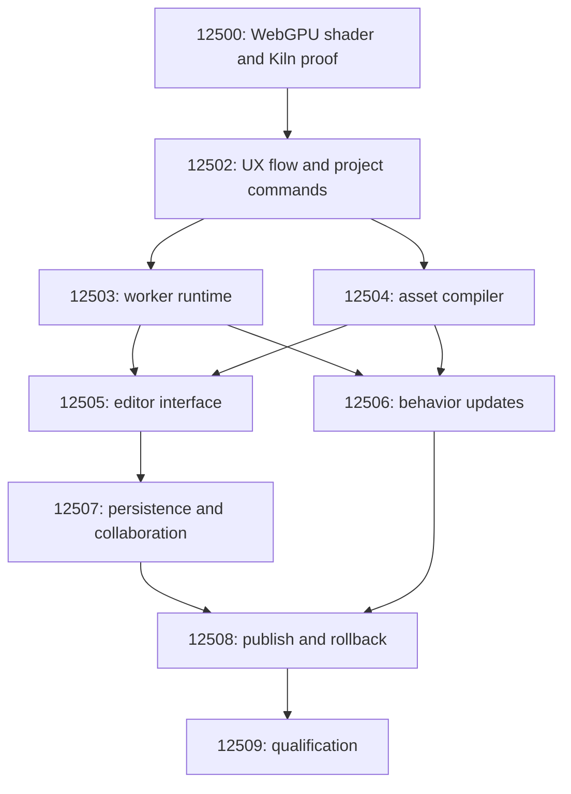

# Browser editor implementation plan

- **Status:** Phase 0 and the Phase 1 scene-command proof are implemented locally, 2026-10-22. #12502 still tracks moving raw asset drafts into the shared transaction/undo contract. Phases 2–5 remain planned. Public deployment is outside this proof.
- **Architecture:** our TypeScript editor and runtime, Effect for asynchronous orchestration, direct WebGPU, editable WGSL, and selective Wasm CPU kernels. Browser-first with no Rust-only constraint is the owner's explicit direction for this work.
- **Decision:** [Owned renderer, WebGPU, and Effect](../audits/2026-10-22-owned-renderer-webgpu-and-effect.md).
- **Goal:** make one Haunted House change through Kiln or the editor, see it in a running game, understand and repair errors, save the editable project, and explicitly publish a chosen version.
- **Delivery order:** acceptance gates below determine progression. Set dates after the first demo supplies real iteration measurements.
- **Product scope:** one authored Haunted House experience establishes the engine/editor contracts. Existing Rust games continue independently until a qualified replacement is chosen.

## Milestones and issues

| Phase | Issue | Prerequisites | Exit milestone |
| --- | --- | --- | --- |
| 0: working proof | [#12500: Haunted House WebGPU shader hot reload and Kiln](https://github.com/OpenAgentsInc/openagents/issues/12500) | None | A real Kiln WGSL edit changes the same walk; invalid edits retain the working pipeline and player state |
| 1: authoring contract | [#12502: creator flow, project commands, and undo](https://github.com/OpenAgentsInc/openagents/issues/12502) | #12500 | A clear creator journey and shared, versioned manual/Kiln commands with reversible changes |
| 2: reusable runtime | [#12503: worker WebGPU runtime](https://github.com/OpenAgentsInc/openagents/issues/12503) | #12502 | Reusable rendering, frame scheduling, bounded resources, and device recovery |
| 2: incremental content | [#12504: asset compilation](https://github.com/OpenAgentsInc/openagents/issues/12504) | #12502 | Source assets produce versioned outputs; changes rebuild only affected resources |
| 3: creator interface | [#12505: first browser editor flow](https://github.com/OpenAgentsInc/openagents/issues/12505) | #12503, #12504 | Select, place, edit, inspect errors, undo, and reopen a local editable project |
| 3: gameplay iteration | [#12506: TypeScript behavior hot reload](https://github.com/OpenAgentsInc/openagents/issues/12506) | #12503, #12504 | Compatible behavior edits preserve state; incompatible or failed edits use explicit recovery |
| 4: durable projects | [#12507: persistence and collaboration](https://github.com/OpenAgentsInc/openagents/issues/12507) | #12505 | Save/reopen and shared authoring work through existing identity and session services |
| 4: explicit releases | [#12508: publish snapshots and rollback](https://github.com/OpenAgentsInc/openagents/issues/12508) | #12507, #12506 | A selected version runs independently; drafts stay private and rollback restores a prior package |
| 5: qualification | [#12509: iteration, performance, and recovery](https://github.com/OpenAgentsInc/openagents/issues/12509) | #12508 | Reproducible end-to-end acceptance, supported browsers, and measured resource/performance budgets |

- Native GitHub blockers and the OpenAgents project board mirror these prerequisites.
- #12500 supplies the WebGPU proof. #12502 now supplies the creator flow and reversible scene commands; its remaining asset-command work still gates #12503 and #12504. Later follow-ups wait on their listed prerequisites.
- Issues in the same phase can satisfy their own contracts using fixtures. Phase 3 integrates the Phase 2 outputs; neither Phase 2 issue secretly depends on the other.
- The plan is the issue directory; no additional umbrella issue is needed to begin.

## Phase 0: Haunted House WebGPU shader hot reload through Kiln

- **Issue:** [#12500](https://github.com/OpenAgentsInc/openagents/issues/12500), implemented in [`apps/haunt-preview`](../../apps/haunt-preview/README.md).
- **Verification:** [browser results and timing](verification/2026-10-22-haunted-house-webgpu/README.md). The real Rust/Wasm Kiln workspace and Pylon agent drive an OffscreenCanvas WebGPU worker; no Rust build runs for shader edits.
- **Deliver a complete small loop before generalizing the engine.**
  - Render two connected Haunted House spaces, or a room and corridor, directly in WebGPU.
  - Reuse original geometry, palette, decorations, and first-person movement intent from [the existing game](games/the-haunted-house.md). Full game parity is outside this demo.
  - Include enough lantern/toon/paper shading to make a material or postprocessing change meaningful.
  - Keep one editable WGSL asset separate from the host bundle.
- **Connect real Kiln edits.**
  - Open the private preview beside a real Kiln workspace.
  - Forward a shader save and an agent-produced edit to that preview, without a remote build or repository publish.
  - Carry project/preview identity, request and edit revision, asset/source hash, result, and diagnostics. Validate the sender and target; a generic JavaScript execution tool is unnecessary.
  - Separate model response latency from shader-save-to-visible latency.
- **Preserve the working game.**
  - Compile a candidate shader and pipeline asynchronously and validate bindings/interfaces before replacing anything live.
  - Adopt successful results at a frame boundary. Keep player position, view, and the current walk for valid and invalid shader edits.
  - Keep the working pipeline during syntax, interface, and pipeline errors; repair without reopening the preview.
  - Reject stale completion results and bound resources over repeated edits and teardown.
  - Handle device loss separately; a pipeline from the lost device cannot serve as the fallback.
- **Use a narrow browser bootstrap.**
  - Target a preview worker and OffscreenCanvas on a declared supported configuration; record a temporary main-thread accommodation if necessary.
  - Show an understandable unsupported-capability result.
  - Draw the actual demo through WebGPU. A WebGL-rendered house with a WebGPU overlay is insufficient.
- **Exit evidence:** one reproducible local recording of edit → visible change → syntax/interface failure → continued walk → repair, plus overlapping-edit checks.
- **Initial timing target:** investigate warm p95 at or below 500 ms from shader save to first visible frame over at least 30 edits on the recorded reference setup. Record actual results, frame stalls, and any miss; this is an engineering target, not a measured capability or universal GPU guarantee.
- **Unblocks:** #12502. A full project service, editor, asset importer, or public deployment is not a prerequisite.

## Phase 1: creator flow and project commands

- **Issue:** [#12502](https://github.com/OpenAgentsInc/openagents/issues/12502).
- **Implemented scene proof:** [creator flow and command contract](../../apps/haunt-preview/README.md#creator-flow), with [browser and real Jev results](verification/2026-10-22-haunted-house-commands/README.md). Direct actions bypass inference; one batched Jev decision interprets prose and uses those same commands. Kiln stores the editable scene through its existing WASI/OPFS path.
- **Remaining in #12502:** route raw WGSL asset drafts and their undo/redo through the shared transaction history. Scene-object and lighting undo work now; advanced source editing still uses Phase 0 validation and **Original**.
- **Top priority within this phase: Kiki's clear UX flow.**
  - Produce a compact screen/interaction sketch for open → select → change → see → understand an error → repair/undo → save → explicit publish.
  - Show one clear next action and progressively reveal advanced controls.
  - Use this flow to choose command and UI boundaries before adding panels.
- **Define the owned project representation.**
  - Versioned serializable documents, stable entity/asset IDs, material references, explicit compatibility rules, and source assets.
  - Keep simulation state, GPU handles, Three objects, and Effect values outside saved project data.
- **Extract the Phase 0 bridge into shared commands.**
  - Inspect, apply a grouped transaction, write a draft, validate/preview, inspect/capture diagnostics, undo, and redo.
  - Share these operations between manual controls and Kiln.
  - Distinguish draft revision from accepted runtime revision; handle duplicate requests and stale base revisions explicitly.
- **Exit evidence:** round-trip a project and interleave manual/Kiln changes with meaningful undo/redo and rejected stale writes.
- **Unblocks:** #12503 and #12504.

## Phase 2: reusable runtime and incremental assets

- **Runtime issue:** [#12503](https://github.com/OpenAgentsInc/openagents/issues/12503).
  - Extract the demo into a worker runtime that initially owns simulation and rendering together.
  - Batch input, resize, and edit messages; use packed transforms, mesh/material batches, dirty buffer ranges, explicit passes, and bounded caches.
  - Keep Effect around asynchronous jobs and lifetimes; keep inner loops allocation-conscious.
  - Add pause/resume, teardown, capability checks, and lost-device reconstruction from retained state.
  - Expose accepted revision, CPU preparation/submission timings, resource counters, and GPU timing where supported.
- **Asset issue:** [#12504](https://github.com/OpenAgentsInc/openagents/issues/12504).
  - Retain original sources and content hashes; track dependency edges and compile only affected outputs.
  - Support the Haunted House source geometry, palette, and cards, plus a documented glTF/GLB mesh and image subset.
  - Perform import/decode work in workers and transfer bulk buffers.
  - Reject invalid or unsupported content and late job results while retaining the accepted output.
  - Keep binary assets in the object store, separate from Kiln's small text-patch workflow.
- **Exit evidence:** the same Haunted House walk uses the reusable runtime; an asset changes independently; both components pass their contract/lifecycle checks with bounded resources.
- **Unblocks:** #12505 and #12506 after both Phase 2 issues close.

## Phase 3: editor interface and behavior updates

- **Editor issue:** [#12505](https://github.com/OpenAgentsInc/openagents/issues/12505).
  - Implement the Phase 1 flow: hierarchy/selection, picking, basic transforms, focused properties, import/placement, WGSL editing, diagnostics, and undo/redo.
  - Keep text and controls in accessible DOM UI, with keyboard and focus checks.
  - Preserve editor selection and the runtime walk during compatible changes.
  - Distinguish draft, accepted preview, and locally saved snapshot states.
  - Provide local save/export and reopen. Add the publish control only when its action works in Phase 4.
- **Behavior issue:** [#12506](https://github.com/OpenAgentsInc/openagents/issues/12506).
  - Transform and resolve TypeScript modules in a compiler worker, with source maps and bounded dependencies.
  - Define initialize/update/dispose behavior and state-version compatibility. Keep simulation state outside replaceable modules.
  - Contain mutations with commands, transactions, or checkpoints; restoring a function reference cannot undo arbitrary effects.
  - Separate type diagnostics from fast preview where safe; validate runtime contracts before replacement.
  - Bound active listeners, timers, and imported module revisions. Use checkpointed preview restarts for incompatible replacements or stalled code.
  - Keep user-game code in an isolated preview environment, outside editor/account authority.
- **Exit evidence:** complete the manual/Kiln authoring loop and update one patrol/light behavior; valid edits preserve compatible state and failures follow the declared recovery path.
- **Unblocks:** #12507 after the editor; #12508 also requires the behavior issue.

## Phase 4: durable projects and explicit publishing

- **Persistence issue:** [#12507](https://github.com/OpenAgentsInc/openagents/issues/12507).
  - Save source assets and project documents with stable identity and recoverable revisions.
  - Use existing identity/permissions, Loro documents in `coder-sync` rooms, and NIP-HOST grants.
  - Define actor-scoped undo, unsent local edits, reconnect, duplicate handling, revocation, and understandable conflicts.
  - Keep each player's simulation/checkpoints separate from collaborative authored state.
  - Prove save/reopen and two test sessions editing the same project without silent overwrites.
- **Publishing issue:** [#12508](https://github.com/OpenAgentsInc/openagents/issues/12508).
  - Build a runnable browser package from exact project, source, behavior, material, and runtime revisions.
  - Adapt [livehost](../../crates/livehost/README.md) objects, manifests, signed tenant channels, and rollback.
  - Add working publish/version/rollback actions to the editor, using the same authority checks as other commands.
  - Implement JavaScript/worker packaging, cache/CORS/CSP behavior, and validation. Existing Wasm packaging helpers do not automatically package this runtime.
  - Keep private edits independent of public pointers. A failed build/upload/publish must leave the previous published version usable.
  - Declare which updates preserve a published player's run and which require an explained restart.
- **Exit evidence:** publish a selected snapshot to a local/test tenant, edit a private draft without changing it, open the published game independently, and restore a prior version.
- **Unblocks:** #12509.

## Phase 5: qualification and measured optimization

- **Issue:** [#12509](https://github.com/OpenAgentsInc/openagents/issues/12509).
- **Verify the complete creator journey:** open → manual/Kiln change → error/repair → undo → behavior change → save/reopen → publish → rollback.
- **Declare support and budgets:** record browsers, devices, scene fixtures, resolution, cold/warm conditions, sample counts, median/p95 edit latency and frame time, startup, memory, and package sizes.
- **Qualify recovery:** repeated edits/open/close, resource pressure, resize/pause/resume, device loss, capability errors, reconnect, permissions, and private/public isolation.
- **Measure the limiting work:** separate model latency, import/compile work, CPU preparation/submission, GPU passes, and publish latency.
- **Optimize from evidence:** compare equivalent Rust/Three fixtures where available; add GPU visibility work, Rust kernels, or other optimizations only for identified bottlenecks. A second production renderer is unnecessary for acceptance.
- **Exit milestone:** the first owned browser editor/game package has reproducible receipts and explicit supported budgets. Record remaining owner-only activation separately from code completion.

## Scope and verification rules

- The initial plan has nine issues: the existing demo and eight follow-ups. It adds no implementation assignments or automatic execution.
- Each implementation issue uses its own focused tests and local browser evidence. The checks above are future acceptance work; this planning task runs documentation and issue-graph checks only.
- Use `openagents browser run -- CMD` for browser verification and scratch resources or dedicated test accounts. Follow the repository's account and cleanup rules.
- Keep original Haunted House content and asset attribution; port shader interfaces deliberately rather than assuming GLSL is interchangeable with WGSL.
- Native/mobile rendering parity, authoritative multiplayer, a general node IDE, an asset marketplace, and a public launch event are later scope decisions.
- Follow-up issues should be added for concrete defects or measured bottlenecks discovered at a gate, rather than precommitting to speculative performance systems.
