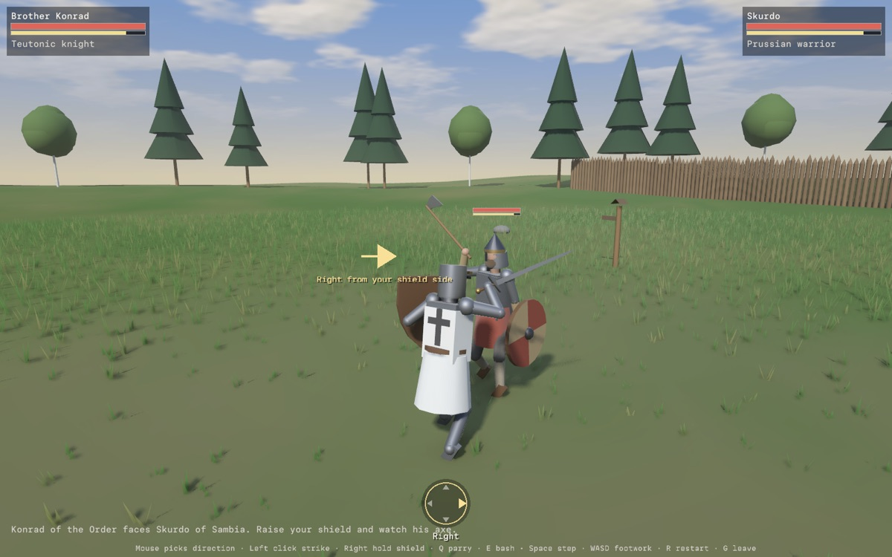

# Prussian duel

The Prussian duel is a one-on-one melee demo in Verse. You play Brother
Konrad, a knight of the Teutonic Order, against Skurdo, an Old Prussian
warrior from Sambia, on an open meadow in about 1240, during the Northern
Crusades. It tests directional sword-and-board fighting: stamina, shield
blocks and bashes, timed parries and ripostes, feints, footwork, and armour
by hit zone.

Open it with `verse --duel`, or render a frame offline with
`cargo run -p verse --features capture --example duel_capture -- OUT.png
[SECONDS]`. The code is in
[`verse-zone-duel`](../../crates/verse-zone-duel/src/lib.rs).

For a version played with your hands in front of a camera, see
[Hand Duel](hand-duel.md).

## Controls

| Input | Action |
| --- | --- |
| Move the mouse | Picks the next blow's direction: up for an overhead cut, left or right for a cut from that side, down for a thrust. The mark at the bottom of the screen shows it. |
| Left click | Strikes in the chosen direction. During a windup, a click in a new direction is a feint. |
| `1` to `4`, or the arrow keys | Strike overhead, from the left, from the right, or thrust. |
| Hold the right mouse button | Raises the shield. |
| `Q` | Parries with the sword. |
| `E` | Shield bash. |
| `C` | Pulls a windup back into guard. |
| `W`, `S` | Step toward or away from the opponent. |
| `A`, `D` | Circle to the left or right. |
| `Space` | A quick step the way the movement keys point, or back when none are held. |
| `R` | Starts the fight again. |
| `G` | Returns to the plaza. |

The knight always faces his opponent, turning at a human rate. The camera
looks over his right shoulder.

## Rules

Both fighters run the same rules; Skurdo only chooses his own commands. The
fight steps at a fixed 240 Hz from a seed, so a seed and the same commands
replay the same fight.

- **Blows.** Every blow has a windup, a release, and a recovery. The
  sword's overhead takes 0.55 s to wind up, side cuts 0.46 s, and a thrust
  0.4 s; the axe is a little quicker. The body steps into the release, so
  the blow carries its momentum. A miss leaves a longer recovery than a
  hit, and a blow stopped by a shield or a parry rebounds.
- **Hit detection.** Points along the striking part of the weapon sweep
  small spheres through the `physics` crate's capsule queries against the
  defender's shield (a thin solid of its own outline) and body zones (head,
  torso, arms, and legs as capsules), every step. The earliest contact
  decides what the blow met, so a shield in the way stops the blade before
  the body behind it. The poses that draw the fighters are the poses that
  strike.
- **Shield.** A raised shield covers the front and turns toward the side a
  blow comes from once its bearer has seen it: 0.1 s for the knight, and a
  human reaction time for Skurdo. It swings out to its own side faster than
  it reaches across the body, and it can't reach behind the weapon
  shoulder. Holding it up costs stamina; a block costs more, by the blow
  and the weapon (the axe bites shields 1.4 times harder), and pushes the
  blocker back. A blow that costs more stamina than the blocker has breaks
  the guard: the blocker staggers and can't raise the shield for a moment.
  A shield hanging at the side still catches blows, at a higher cost.
- **Parry and riposte.** A parry catches a blow that arrives from 0.06 s to
  0.26 s after it starts, from within about 77 degrees of the parrier's
  facing. A parried attacker recovers slowly and loses stamina; the
  parrier gets 0.85 s to riposte with a quicker windup, more force, and a
  better chance to beat armour. A bash can't be parried.
- **Feints.** Changing direction during a windup costs 12 stamina and keeps
  half the windup's progress. Pulling a windup back into guard costs 8.
- **Stamina.** Blows, parries, bashes, and quick steps cost stamina; it
  returns 0.6 s after the last effort, more slowly while moving. Below 25 a
  fighter is winded: slower windups, weaker blows, and a worse chance
  against armour.
- **Armour and wounds.** A blow that reaches a body zone makes an armour
  save behind the scenes: a d20 plus the armour's bonus, less the weapon's
  edge, at 20 or more turns the blow, and a natural 1 finds a gap. Mail
  turns most cuts but much less of a thrust; a great helm turns nearly
  every cut. A turned blow does a little blunt damage, and one to the head
  rings the helm. A blow that gets through rolls the weapon's dice, scaled
  by the zone (the head takes 1.6 times, the arms 0.6), the armour's
  remainder, the body's momentum, and a riposte. It staggers by zone and
  starts a bleed, worst for a thrust to the body. A wound to the weapon arm
  weakens later blows; one to a leg slows the feet.

| Zone | Knight | Prussian |
| --- | --- | --- |
| Head | Great helm over a mail coif | Spangenhelm with a nasal |
| Torso | Mail hauberk over a padded gambeson | Short mail shirt over a padded wool coat |
| Arms | Mail sleeves and mittens | Padded sleeves |
| Legs | Mail chausses | Wool trousers and leg wraps |

### Deviations from the combat model

The duel follows [Verse's combat model](combat-model.md) where it fits: real
time, seeded dice behind the scenes, and outcomes shown as callouts rather
than rolls. It departs from it in three places, for this zone only:

- Geometry decides whether a blow lands, not a d20 attack roll against AC.
  The armour save takes the attack roll's place in deciding whether the
  blow does harm.
- Blows have no global cooldown. Their windups, recoveries, and stamina pace
  the fight instead.
- Health and stamina don't return between blows; bleeding takes health
  over time instead of damage-over-time debuffs.

## The opponent

Skurdo sees a blow only once it starts, and he answers after a reaction time
drawn from his own dice, between 0.16 s and 0.42 s and most often near
0.29 s. He mostly turns his shield to the blow, sometimes times a parry to
its arrival with a human error of up to 0.07 s, and sometimes steps back. A
feint after he has read the first blow costs him a fresh reaction. Into a
slow overhead he may thrust first.

He keeps just outside your reach, circles, and steps in to strike where your
shield is not: the backhand when it covers your shield side, the forehand
when it covers your sword side, the overhead or thrust otherwise. He thrusts
at once into a recovery or a stagger, takes a riposte when he parries, and
feints now and then. He backs off to get his breath when winded, and presses
closer and more often when you are winded or badly hurt.

## Historical notes

From the 1230s the Teutonic Order fought the Old Prussians, the Baltic
people between the Vistula and the Neman, in a war that lasted into the
1280s. The demo shows two fighters of that time, with no gore beyond the
flash of a hit.

- **The knight** wears a flat-topped great helm, which came into use early
  in the 13th century, over a mail coif; a mail hauberk over a padded
  gambeson; mail chausses; and the Order's white surcoat with a black cross.
  He carries a single-handed arming sword and a heater shield with the same
  cross.
- **The Prussian** wears a riveted conical helmet of the spangenhelm type
  with a nasal, a short mail shirt over a padded wool coat, wool trousers,
  and leg wraps. He carries a bearded axe and a round linden shield with an
  iron boss. Mail was costly, so a warrior with a mail shirt was well off.
- **The meadow** is open ground with a timber palisade in the distance, as
  around the Order's early timber forts and the Prussians' hillforts, and a
  wooden waymarker.

The names are invented. The Prussian's equipment is a reasonable composite;
surviving finds from 13th-century Prussia are fewer than from the Order.

## What's simplified

- Fighters are built from simple shapes, posed procedurally, with two-bone
  limbs. Animation reads clearly but has no weight shifts beyond lean,
  twist, and lunge.
- Blades don't bind or meet each other in flight; a parry is a timed window
  rather than a blade-on-blade contact.
- The shield covers by turning toward the blow; the defender doesn't choose
  where it goes.
- No grappling, half-swording, kicks, or falls short of defeat.
- Skurdo carries an axe whose thrust is a short jab with the head's top.

## What's next

- Blade-on-blade contact for parries and binds.
- More blows: low cuts at the legs, a thrust to the face, and the axe's hook
  on a shield's rim.
- The web page (`?zone=duel`) and the phone hosts.
- A choice of opponent: a Prussian with sword and spear, or a second knight.
