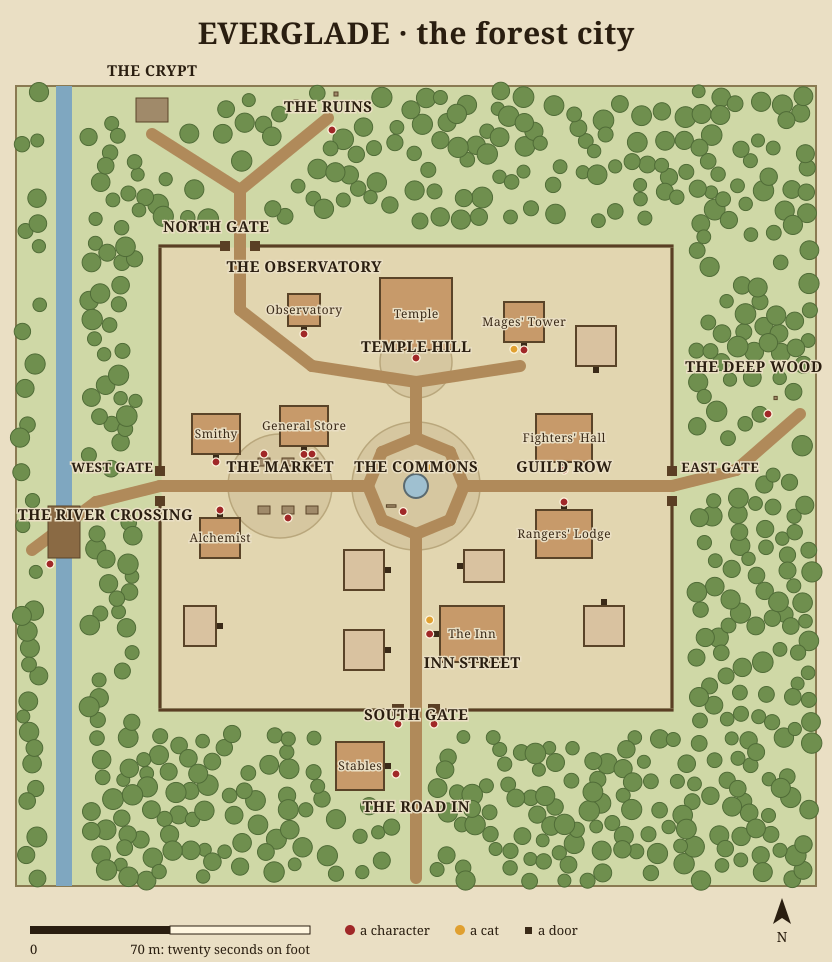

# Everglade, the forest city

Status: plan and blockout, October 28, 2026 (eg-design); the forest and
its paths, October 29 (eg-forest); the kit buildings and seven
interiors, October 29 (eg-buildings); its people, who talk and remember
you, October 29 (eg-people). The city is
walkable at https://openagents.com/realms/everglade (not on the galaxy until
eg-launch; `/verse/galaxy?realms=all` shows it). The order of the work after
this is in [realms-port.md](realms-port.md).
The previous Everglade, on the Rust engine, is kept for parity in
[`verse/everglade/previous/`](../../verse/everglade/previous/README.md): its map and specifications.

Everglade is a conventional MMORPG hub in the woods: where players gather,
get quests and set out from. It is the same for everyone and players can't
change it, so quests and characters can rely on it. Only an admin can,
in edit mode or by voice (below), and every change is kept as the realm's
published edits. The brief is the
Everglade section of `~/work/aethyr-demo/docs/realms.md`; the shape and the
paper map come from the old OpenAgents Everglade (`0b401561a0^:docs/verse/everglade.md`),
a glade around a commons grown into a small town. This plan keeps its
commons, fountain, observatory and market stalls and drops the workshop and
the Agent Studio (they can come later as one building).



One source holds the layout: [`verse/everglade/plan.coax`](../../verse/everglade/plan.coax).
The realm draws it, its checks walk it, and
[`verse/everglade/map.py`](../../verse/everglade/map.py) draws the map above
and the walking times below from the same numbers. Change the city there,
then run the checks and the map:

```sh
coax/bin/coax test --library verse/everglade/plan.coax --steps 200000000
python3 verse/everglade/map.py docs/verse/everglade-map.svg
python3 verse/everglade/map.py --times
```

## Scale

- Metres. North is +z and the fountain is the origin. The axes are the
  engine's (yaw 0 faces +z, a quarter turn faces +x), so +x is **west**:
  seen from above with north up, +x is to the left, as on the map.
- The ground is 208 m square (104 cells of 2 m); you may walk 200 m of it.
- The palisade encloses 127 m east to west and 115 m north to south. Its
  timber walls are 4.5 m high and 0.8 m thick; the gate towers are 7 to
  7.5 m.
- Streets and trails are 3 m wide. Buildings keep at least 2 m from each
  other and from the palisade; props at least 1 m from anything.
- You walk at 3.5 m/s and run at 7.5 m/s (`verse/player.coax`): the city
  is half a minute's walk across, and the farthest trail end under a minute
  from the South Gate. That keeps a hub dense enough to meet people in and
  small enough to learn in one visit.
- The ground is `verse/terrain.coax`'s heightfield, with the bowl's rim
  moved out to 80 m (`Ground.rim_from`, `rim`): gentle hills inside the
  walls, flat under every building and square, rising into the forest
  past the trails' ends.

## The city

| Place | Where | Size | What it is for |
| --- | --- | --- | --- |
| **The road in** | South, from the edge of the world to the South Gate | 3 m road, 42 m | Where you arrive. It passes the stables. |
| **Stables** | Beside the road, west of it, outside the gate | 12 × 12 m, 6 m | Mounts later; the stable hand. |
| **South Gate** | The palisade's south wall | 6 m gap, two 3 m towers | The main gate; two guards. |
| **The palisade** | Round the city | 4.5 m walls, four gates | Keeps the city a place; every way out is a gate. |
| **Inn Street** | South Gate to the commons | 3 m street, 44 m | The way in: the inn and houses. |
| **The inn** | Inn Street, east side | 16 × 14 m, two storeys | The common room with a hearth, rooms upstairs; where parties meet. The innkeeper and the inn's cat. |
| **The commons** | The middle | paved, 32 m across | The fountain (6.6 m across: a carved basin and a column with an upper bowl whose water falls in eight streams, docs/verse/water.md "The fountain"), the quest board and the town crier; the ring street round it. The errand cat waits by the fountain. |
| **The market** | West of the commons, on Market Street | paved, 26 m across | Six stalls in two rows either side of the street (3 × 2 m each), three sellers. |
| **General store** | The market's north side | 12 × 10 m | Supplies; the shopkeeper. |
| **Smithy** | North-west of the market, by the West Gate | 12 × 10 m | Arms and tools; the smith. |
| **Alchemist** | South-west of the market | 10 × 10 m | Potions; the alchemist. |
| **Guild Row** | East of the commons | 3 m street, 52 m | The fighters' hall (14 × 12 m) on the north side and the rangers' lodge (14 × 12 m) on the south side, facing each other. Where you pick a class and train. |
| **Mages' tower** | North-east, on Mages' Lane off the temple's forecourt | 10 × 10 m, 14 m tall | The third guild, set apart near the stars; the archmage and the guild's familiar (a cat). |
| **Temple Hill** | North of the commons, up the Temple Walk | forecourt 18 m across | The temple (18 × 18 m, 12 m) for healing and lore; the priest. |
| **The observatory** | North-west of the temple, on Stargazers' Lane | 8 × 8 m, 18 m tall with its dome | Lore and the view over the forest; the astronomer. |
| **North Gate** | The north wall, near the observatory | 5 m gap | Out to the ruins and the crypt. |
| **East Gate** | The east wall, at Guild Row's end | 5 m gap | Out to the deep wood. |
| **West Gate** | The west wall, at Market Street's end | 5 m gap | Out to the river crossing. |
| **The deep wood** | East, by the Deep Wood Trail | waystone | The woodwarden; the first quest area past the trees. |
| **The ruins** | North-west, at the end of the Ruins Trail | three broken pillars | The ruin scholar. |
| **The crypt** | North-west, off the North Trail's fork | 8 × 6 m | A crypt door; a dungeon later (the Haunted House is the first one a quest can send you to). |
| **The river crossing** | West, past the West Gate | a 4 m river and a bridge | The ferryman on the far bank. The river runs the length of the world in a carved bed; you cross by the bridge, or wade and swim across in the glade beside it. |
| Houses | Six plots round the streets | 8 to 10 m a side | Homes for the city's people (eg-people), filler that keeps the streets streets. |

## Walking times

At a walk (3.5 m/s), by the streets, then straight to the door
(`python3 verse/everglade/map.py --times`). Running takes under half as long.

| Place | From the South Gate | From the fountain |
| --- | --- | --- |
| The Inn | 20 m, 5 s | 49 m, 15 s |
| General Store | 71 m, 20 s | 28 m, 10 s |
| Smithy | 80 m, 25 s | 50 m, 15 s |
| Alchemist | 69 m, 20 s | 53 m, 15 s |
| Fighters' Hall | 71 m, 20 s | 38 m, 10 s |
| Rangers' Lodge | 63 m, 20 s | 41 m, 10 s |
| Mages' Tower | 95 m, 25 s | 35 m, 10 s |
| Temple | 89 m, 25 s | 21 m, 5 s |
| Observatory | 99 m, 30 s | 39 m, 10 s |
| Stables | 16 m, 5 s | 82 m, 25 s |
| The Road In | 29 m, 10 s | 97 m, 30 s |
| The Deep Wood | 123 m, 35 s | 93 m, 25 s |
| The Ruins | 148 m, 40 s | 81 m, 25 s |
| The Crypt | 168 m, 50 s | 109 m, 30 s |
| The River Crossing | 103 m, 30 s | 96 m, 25 s |
| North Gate | 126 m, 35 s | 69 m, 20 s |

## Kit pieces

Everything is from the three CC0 Quaternius kits aethyr-cpp already packs
(its SCN4 `scene.bin`, read by `verse/tools/pack_realm.py`): Stylized Nature
(SN), Medieval Village (MV) and Fantasy Props (FP). The names are the kits'
meshes. Where a kit has no piece, the line says what is assembled instead.

| Place | Pieces |
| --- | --- |
| Palisade and gates | MV `Roof_Log` stood upright as posts, `Prop_Support` braces; gates `DoorFrame_Round_WoodDark` with `Door_8_Round`; towers `Wall_UnevenBrick_Straight`, `Corner_Exterior_Wood`, `Roof_Tower_RoundTiles`, `Stairs_Exterior_Straight`. No kit has a log wall: posts repeat along each wall. |
| Houses and walls of every building | MV `Wall_Plaster_*`, `Wall_UnevenBrick_*`, `Corner_Exterior_*`, `Window_*`, `WindowShutters_*`, `Door_1_Flat`/`Door_2_Round`, `Roof_RoundTiles_*`, `Roof_Front_Brick*`, `Overhang_*`, `Balcony_*`, `Prop_Chimney`, `Prop_Vine*` on the 2 m grid. |
| Commons | No fountain in the kits: a basin ring of MV `Prop_ExteriorBorder_Straight1/Corner` on `Floor_Brick`, a column of `Prop_Brick*`, water drawn by the engine. Quest board: two MV `Prop_Support` posts, a `Floor_WoodDark_Half1` board, FP `Scroll_1`, `Scroll_2`; the crier's FP `Banner_1`. SN `Bush_Common_Flowers`, `Flower_3_Group` round the ring. |
| Market | FP `Stall_Empty`, `Stall_Cart_Empty`, `FarmCrate_Apple`/`Carrot`/`Empty`, `Barrel_Apples`, `Crate_Wooden`, `Bag`, `Coin_Pile`, `Pot_1`, `Vase_2`/`Vase_4`. |
| General store | FP `Shelf_Arch`, `Shelf_Simple`, `Cabinet`, `Barrel`, `Rope_1..3`, `Pouch_Large`, `Bucket_Wooden_1`, `Lantern_Wall`. |
| Smithy | FP `Anvil`, `Anvil_Log`, `Whetstone`, `WeaponStand`, `Sword_Bronze`, `Axe_Bronze`, `Pickaxe_Bronze`, `Shield_Wooden`, `Bucket_Metal`, `Chain_Coil`; MV `Prop_Chimney2` over the forge. |
| Alchemist | FP `Cauldron`, `Potion_1/2/4`, `SmallBottles_1`, `Shelf_Small_Bottles`, `Bottle_1`, `BookStand`, `CandleStick`. |
| Inn | MV walls, `Stair_Interior_Rails`, `Floor_WoodDark`, `Balcony_Simple_Straight`; FP `Table_Large`, `Chair_1`, `Bench`, `Stool`, `Mug`, `Table_Plate`, `Chandelier`, `Barrel_Holder`, `Bed_Twin1/2`, `Nightstand_Shelf`, `CandleStick_Triple`; the hearth from MV `Prop_Brick*` under `Prop_Chimney`. |
| Fighters' hall | FP `Dummy`, `WeaponStand`, `Shield_Wooden`, `Sword_Bronze`, `Banner_2`, `Bench`. |
| Rangers' lodge | FP `Peg_Rack`, `Rope_2`, `Axe_Bronze`, `Bag`, `Table_Large`; SN `Pine_*` in the yard. No bow in the kits: one is modelled with the eg-buildings work. |
| Mages' tower | MV `Wall_UnevenBrick_*`, `Roof_Tower_RoundTiles`; FP `Bookcase_2`, `BookGroup_*`, `Book_Stack_*`, `Scroll_*`, `CandleStick_Stand`. |
| Temple | MV `Wall_UnevenBrick_*`, `Wall_Arch`, `DoorFrame_Round_Brick`, `Door_4_Round`, `Stairs_Exterior_Platform`; FP `CandleStick_Stand`, `Chalice`, `Bench`, `Banner_1`. |
| Observatory | MV `Wall_UnevenBrick_*`, `Stairs_Exterior_*`, `Balcony_Cross_*`, `Roof_Tower_RoundTiles`. No telescope or dome in the kits: both are assembled (a dome from the engine's sphere is the blockout's). |
| Stables | MV `Roof_Wooden_2x1*`, `Prop_WoodenFence_Single`/`Extension1/2`, `Prop_Wagon`; FP `Bucket_Wooden_1`, `FarmCrate_Empty`, `Bag`. |
| Forest and trails | SN `CommonTree_1/3/4` (+ `_Leaves`), `Pine_1/4/5`, `TwistedTree_2/4/5`, `Bush_Common`, `Fern_1`, `Grass_*`, `Clover_*`, `Flower_*`, `Mushroom_Common`, `Plant_1/7`, `Rock_Medium_1..3`. |
| Ruins | SN `Rock_Medium_*`; MV `Prop_Brick1..4`, `Wall_UnevenBrick_Straight` broken off, `Wall_Arch`; FP `Vase_Rubble_Medium`. |
| Crypt | MV `Wall_UnevenBrick_Door_Round`, `DoorFrame_Round_Brick`, `Door_4_Round`; SN `DeadTree_1..3`, `Rock_Medium_*`. |
| River crossing | The bridge is MV `Floor_WoodDark` boards (4 across by 7 along) and `Prop_WoodenFence_Single` rails, 4 lengths a side (everglade.coax `bridge`), over the engine's timber (`city`: the deck's plank slab, `LOOK_PLANKS`, four beams under it, two rows of three piles under cap beams, `LOOK_WOOD`; its posts and bars stand in for the rails until the pack is in). The rails stop you on the deck, and the piles stop a swimmer under it (everglade.coax `everglade_walls_on`, `everglade_bodies_on`); SN `Rock_Medium_*` on the banks; water drawn by the engine (the water system, docs/verse/water.md). |
| Characters | You are the previous Everglade's Ranger (below, "You: the Ranger"); the people are Quaternius Universal Base Characters dressed in the Fantasy outfits' `Peasant` and `Ranger` (below, "How the people look"); the cats are aethyr's `Custom_Cat`, sitting. |

## Where characters stand

Each character's day starts at a spot in the plan (`EG_SPOT`: x, z, facing).
Every spot is checked to be in the open and reachable on foot.

## The people (eg-people)

`verse/everglade/people.coax` names whoever stands at each spot and gives
them a role, a greeting and what everyone in the city knows of it; the cats
are cats, who talk as cats would. Walk up to one (2.8 m) and press E, or tap
TALK: you type, and the question goes to the site's character chat
(`/api/playtest/npc/ask`) with the conversation so far, the city's controls
(so nobody explains the Haunted House's edit mode) and this visit's stamp.
They remember you: the server keeps every question and answer with the
player key that asked it (`coax/web/api/migrations/0031_npc_memory.sql`), and
a character is told what that player said to it, and what it answered, on
their earlier visits, the last twelve exchanges, oldest first. Nothing one
player said reaches another, and each character remembers only its own
conversations. A browser without a player key is given one when it first
talks.

They keep a day (`verse/everglade/routines.coax`, after the routines in
`previous/generative-agents.md`, without the planning): each has rows of
"at this time of day, go here", and walks the road graph at 1.2 m/s between
them with the walk clip, no physics. Shopkeepers open their stalls in the
morning and walk home at dusk, where they go indoors until dawn; Sable,
Elowen and Quill stroll round the commons; the gate guards walk a beat and
pause at each end; Pip swims across the Lantern Pond after lunch, wading
and swimming by the player's rules (`verse/water-wade.coax`). Where someone
is comes only from the day clock and the route, so every visitor sees the
same town. Talking to someone, or standing in their way, stops them and
turns them to face you; they hurry to catch up after. With the clock held
(golden mode, `daycycle` off) everyone stands at their spot as before.

Their names float just above their heads, fade out between 8 and 11 m, and hide
behind walls and behind a nearer person's name.

| Who | Where |
| --- | --- |
| Two gate guards | Outside the South Gate, either side of the road |
| Stable hand | By the stables' door on the road in |
| Town crier | At the quest board on the commons |
| Errand cat | By the fountain |
| Innkeeper, the inn's cat | At the inn's door on Inn Street |
| Shopkeeper | At the general store's door, behind the north stalls |
| Fruit, cloth and trinket sellers | Behind three of the stalls |
| Smith | At the smithy's door |
| Alchemist | At the alchemist's door |
| Fighters' master, rangers' warden | At their halls' doors, facing each other across Guild Row |
| Archmage, the guild's familiar (a cat) | At the mages' tower's door |
| Priest | On the temple's steps |
| Astronomer | At the observatory's door |
| Woodwarden | On the Deep Wood Trail by the waystone |
| Ferryman | On the river's far bank, by the bridge |
| Ruin scholar | Among the ruins |

### How the people look

Every person is a Quaternius Universal Base Character (male or female) in
one of the Fantasy outfits, `Peasant` or `Ranger` (with its second and third
colourways), with or without the Ranger's hood, a head and one of six
hairstyles; `verse/everglade/folk.coax` picks each person's parts, skin,
hair colour, outfit dye and stance (`FOLK_*`, by spot). The 14 parts are
packed once (`"people"` in the manifest, built by `verse/tools/people.py`)
and every person shares them: a part is drawn once per frame for everyone
wearing it, each person's pose and colours a block of rows in the pose
store. The outfits' pale or green cloth takes the person's dye in the
shader (`person_dye`), so a guard's tunic is crimson, the astronomer's deep
indigo with a silver plait, without another texture.

They move with seven clips of the Universal Animation Library 1 and 2,
retargeted to the two bodies (`verse/everglade/people-rig.coax`): idle,
walk, talk, a nod, folded arms, a raised lantern and a spell idle. Alone,
they shift their weight and glance about; within 4 m they turn to face you
and look at you (the neck and head turned through `skin_turn` in
`verse/skin.coax`); when you speak they nod, and they talk while their
answer shows. The ten nearest in view (six on a phone) within 60 m (40 on a
phone) are drawn.

Not yet: the Standard Fantasy outfits are only `Peasant` and `Ranger`, so
the archmage, priest and astronomer wear dyed peasant and ranger clothes.
Robes, a noble's and a knight's dress are in the full "Modular Character
Outfits - Fantasy" pack, not here. The cats are aethyr's static
`Custom_Cat` (`tools/custom_models.py`, in the pack since eg-paint-people),
sitting where their day starts, each its own size; no kit in the workspace
has an animated cat, so they don't move until one arrives.

## The quests (eg-quests)

The quests are data an agent can write, in `verse/everglade/quests.coax`: a
title, what the board says of it, and up to three steps, each one of three
kinds: GO (reach one of the plan's places, within 12 m), TALK (talk to one of
the plan's people) and RETURN (hand it in at the quest board, or to Oswin the
crier). Every quest ends with RETURN. Each also names what the person it
sends you to says when you come (their first line instead of their
greeting), what the character chat is told of it (so Moss knows why you
came), what the board says when you hand it in, and its reward. The checks
hold every step to a real place or person, a talk step's person near the
place before it, and exactly one quest earning the flock.

| Quest | Steps | Reward |
| --- | --- | --- |
| The Waystone's Word | out by the East Gate to the deep wood; talk to Moss by the waystone; hand it in | |
| Older Than the City | up the North Trail to the ruins; talk to Corin; hand it in | |
| Across the River | out by the West Gate to the river; cross the bridge and talk to Old Tam; hand it in | the bird flock |

At the board on the commons press E (on a phone, tap READ THE QUEST BOARD):
a row a quest with NEW, UNDER WAY, HAND IN or DONE, what the picked one asks,
and TAKE IT or HAND IT IN. 1 2 3 or W and S pick, Enter does it, Esc closes.
`#quest-board` starts you there. While a quest is under way its name and
the step you are on show under the title with how far it is, and a QUEST
mark with the distance stands over where it sends you. Several can be under
way at once; the HUD follows the one you last moved on.

Progress is a stage per quest, kept in this browser for its playtest player
(the host's save slot `everglade`, IndexedDB else localStorage) as
`eg-quests 1`, `player=ID` and `q=S,S,S`. A save made for another player
is not read: their quests start new. It is not on the server, so another
browser or device starts afresh.

## The bird flock (eg-companion)

Hand in Across the River and a flock of seven birds follows you, each
trailing a ribbon of its own colour that narrows to nothing. `verse/flock.coax`
is the engine piece: the birds ride a slow ring over and just ahead of you,
each pulled to its place by a critically damped spring, kept apart, under a
top speed (16 m/s) and acceleration (40 m/s²). They step at a fixed 120 Hz
whatever the frame rate, at most a quarter second a frame, so a phone's uneven
frames neither fling nor stall them; the checks run a phone's uneven frames
round a bend and hold every step under those limits, and a runner never more
than 6.5 m from the flock. Each bird keeps its last ten places (one every
0.08 s) for its ribbon. A link to another place has the flock waiting there.

## What players can and can't do

- **Can:** walk, run and jump anywhere the ground is open; go into the
  buildings the plan gives interiors (the inn, the shops, the guild halls,
  the temple; eg-buildings); talk to the characters (eg-people); take quests
  from the board, a character or the inn, and go out by the gates to the
  quest areas and back (eg-quests); earn the bird-flock companion
  (eg-companion); see the whole city from above (MAP); wade, swim and dive
  in the river by the bridge and the ponds; row the ponds' rowboats; cast
  the spell bar's spells (on the water too) and break the
  town's buildings and props (see Spells and destruction); a broken
  building grows back.
- **Can't:** keep anything broken, or break it for anyone else: what a
  spell breaks is your page's alone. Edit anything. No building, placing, removing, painting or
  terrain tools; no player-made objects stay in the city. An admin
  (`admins.conf`, logged in at /login) is the one exception: see Edit mode. Everglade stays
  put so quests can rely on it; making things is the Sandbox's job. A
  spell on the town or its people is a crime: the watch hunt you (see The
  watch). The world ends at its edge, and past the
  trails' ends the forest keeps you to the ways out (the river's glade by
  the bridge is open: you may swim across there).

## The blockout

`/realms/everglade` (module `everglade`, save slot `everglade`) is the plan
as grey boxes at full size, built on the realm host
([realm-host.md](realm-host.md)):

- `verse/everglade/plan.coax`: the layout and its checks.
- `apps/openagents-web/everglade.coax`, `everglade-face.c`, `everglade.wgsl`:
  the realm. It draws the ground and streets (`verse/terrain.coax`), the
  palisade, every building as a box with a gable roof, the props, the
  forest (below), you as the Ranger (below), the people (Quaternius
  characters, above) and the cats (still plain shapes), and each
  place's name as you come near. The free orbit
  (`verse/camera.coax`) follows you and keeps out of the walls; walking is
  `verse/player.coax` among the plan's solids, thumbs `verse/grid.coax`.
- M or MAP lifts the camera over the whole city; `#above` opens there, and a
  place's id in the hash starts you at it (`#commons`, `#market`, `#guilds`,
  `#temple`, `#observatory`, `#inn`, `#road`, `#deep-wood`, `#ruins`,
  `#crypt`, `#river`, `#gate`, `#north-gate`).
- A reload puts you back where you were: your feet, facing, the camera's
  turn, tilt and distance, and the room you were in (eg-pos,
  [realm-host.md](realm-host.md#3-the-save-slot)). A place in the hash wins;
  a kept place now inside a placed piece, in the woods or in another room
  moves to the nearest open ground (`everglade-place.coax`). Under water you
  come back with your breath.

## You: the Ranger (eg-ranger)

You walk Everglade as the character you were in the previous Everglade (the
Rust engine's, removed in the Nuke; [previous/](../../verse/everglade/previous/README.md)):
the hooded green **Ranger**, Quaternius's Universal male Ranger, the
character the owner calls the Ranger Druid. It is taken whole, byte for
byte, from that engine's last pinned Everglade pack
(`assets/verse/everglade/a82df378….vtp` at `853417f2`, checked by its
SHA-256), not rebuilt from the glTFs, so its mesh, proportions, textures and
clips are exactly the old ones:

- **Mesh:** the `Male_Ranger` outfit (hood, tunic, belts, bracer, trousers,
  boots) with the head and neck of `Superhero_Male_FullBody`, and no hair or
  eyebrows (the hood covers them): 5 parts, 31,396 triangles, 27,402
  vertices, 75 joints.
- **Textures:** the old ones at their own resolution, the outfit 512, the
  body's and head's skin 256, the teeth 128 and the eyes 128; each is a
  layer of the realm's 512-texel texture array, the smaller ones repeated
  texel for texel (no resampling).
- **Clips:** the Universal Animation Library's idle, walk, run, jump,
  backpedal, strafe left and right, and the tree-chopping swing, with the
  old engine's seconds and metres per loop.

`verse/tools/pack_realm.py` (manifest `"character"`) copies it into the pack
(32 bytes a vertex: position, normal and layer, uv, four joints and
weights) and writes its rig to `verse/everglade/ranger.coax`. `verse/skin.coax`
plays it as the old engine did (`Motion::of`, `ClipPlayer`): standing below
0.1 m/s idles, below 5 m/s walks, faster runs, off the ground jumps; a
change of clip blends over 0.22 s from the pose it left; a gait advances by
the ground covered (seconds a loop times metres moved over metres a loop),
so the feet keep to the ground; keys are sampled as the old engine did
(linear translation, spherical rotation). Each frame it writes the 75
joints' skinning matrices to a store the shader reads; the GPU skins the
vertices (four joints each) and draws the Ranger in one draw at your feet,
turned to face the way you go. The controller is unchanged: walking,
running, jumping, the camera and their speeds are `verse/player.coax` and
`verse/camera.coax`'s.

The checks: the pack's catalog names the Ranger with its 75 joints; the
controller's state picks idle, walk, run and jump as the old engine did;
the pose at eight joints, three clips and several times matches the old
engine's sampling (worked out in `pack_realm.py` from the old pack) within
a millimetre; and a phone's whole frame, the Ranger's 31,396 triangles
with the trees, stays under 700,000.

What differs from the old Everglade, and why:

- **Backpedal, strafes and the swing are packed but not chosen.** The old
  controller kept facing the camera and stepped backward or sideways; ours
  always turns you to face the way you go, so you never walk backward or
  sideways, and there is no chopping yet.
- **Speeds:** the old controller ran at 6.4 m/s; ours walks at 3.5 and runs
  at 7.5. The clips are the same; the gait follows the ground covered, so
  the run plays a little faster than it did.
- **Light:** the realm's own lighting (sun, sky, fog) and a soft round
  shadow under you, not the old engine's physically based light and cast
  shadows, so the Ranger reads slightly flatter.

## The forest

Past a 6 m apron of open grass round the palisade, everything is woods
(`everglade_in_woods` in `plan.coax`) but the trails, 3 m either side of
their middle, and six clearings where they end: the stables, where you
arrive on the road in, the deep wood's waystone, the ruins, the crypt and
the river's far bank, and the river's glade either side of the bridge
(an ellipse 14 m across and 52 m along it). The woods are open: you walk
among the trees, and each trunk and rock near you stands in your way as a
round body as wide as its mesh (`forest_bodies` in `everglade.coax`), which
the camera also keeps clear of. Anything drawn that looks reachable is: no
invisible wall stands short of visible geometry (the reach check,
`everglade_unreached`, fills from the spawn over the whole map and its test
fails on any patch of open ground left over).

- **The edge:** 100 m from the middle (`EG_BOUND`) a thicket runs all the
  way round, two rows of `Bush_Common_Flowers` whose leaves reach the bound
  and a row of close-set trees behind them, with rocks across the river
  where it runs out (`plant_thicket`). You stop at the brush.

- **Trees:** one every 4.2 m, jittered, wherever the woods are, with a
  metre clear of open ground round each trunk and none in the river (about
  a thousand). Four kinds from Stylized Nature: `Pine_5`, `Pine_4`,
  `CommonTree_3`, `CommonTree_4`, each with its `_Leaves`.
- **Along the tree line:** `Bush_Common_Flowers`, `Fern_1`,
  `Rock_Medium_1` and `_2`.
- **The pack:** `verse/packs/everglade.json`, compiled to
  `realms/everglade/assets/everglade.pack` (8.3 MB: 8,296,120 bytes,
  budget 8,700,000) with `licences.md`; it carries the town's 44 Medieval
  Village and Fantasy Props pieces as well as the forest's, the Ranger
  (1.7 MB of it) and the people's 14 shared parts and clips (2.0 MB). The
  budget was 5 MB before the Ranger and rose by the Ranger's bytes, rounded
  up; it rose from 6,750,000 by the people's, rounded up: 19 people dressed
  from 14 parts, every texture once (512 px JPEG layers), outfits decimated
  to half their triangles and heads and hair to 60%. It rose again from 8,250,000
  by the 13 placeable props and plants of the voice edits' catalogue (596,364
  bytes of mesh, no new textures but a plain white one), rounded up. It also carries 1,024 identity indices (`"identity"`), so
  the city's shapes, drawn from the vertex index alone, share the pack's
  index buffer.
- **The phone:** each frame the trees in view and nearer than 55 m (42 m on
  a phone) are the kit's, at most 80 of each kind (40 on a phone), nearest
  first; the rest are a cone each. The checks hold a phone's kit
  triangles under 700,000 from the road, the gates and the trails, every
  way it looks.

The checks (`plan.coax`):

- **Nothing overlaps:** buildings keep 2 m apart and from the palisade,
  props 1 m; only the stables stand outside the walls; the palisade's pieces
  meet without overlapping.
- **The streets keep clear:** every link of the path graph keeps 0.5 m
  clear of every solid on either side of its 3 m strip.
- **The paths connect:** one network from the South Gate; a link runs
  through the middle of every gate; the river trail crosses on the bridge.
- **Everything is reachable on foot:** a half-metre grid of the world, each
  solid widened by a walker's radius, filled from the road in, reaches every
  door, every character, every path node, every gate, the quest board, the
  stalls, every trail's end and the river's far bank. The river is not in
  the way: in its glade you reach both banks and the water between them;
  past the glade the woods close in on it.
- **The river stays in its bed:** its level falls south at least 8 mm a
  ground row and stands 0.2 m under the ground beside it; the bed is 2.2 m
  under the level at the middle; the river trail climbs onto the bridge's
  deck and off it within the trails' slope.
- **The palisade keeps you in** but for its four gates.
- **The woods keep you to the trails:** no cell in the woods is reachable,
  straight out from each wall the forest stops you inside the apron, the
  far bank is reached by the bridge and every trail stays open to its end.
- **The ground** is level under each building and square, rises into the
  forest, and no street or trail climbs steeper than 1 in 5.

## The buildings

Each building is put together from its footprint in `plan.coax`, in
`building()` in `everglade.coax`:

- **Walls:** the kit's 2 m plaster modules (brick for the smithy, the
  temple, the mages' tower and the observatory), one or more 3.1 m storeys,
  with arched windows along each wall, timber corner posts and a door on the
  side its door faces. Walk-in buildings' doors stand open.
- **Roofs:** `Roof_RoundTiles_6x8` stretched over the footprint with its
  ridge along the long side, and a brick-and-plaster gable at each end; the
  mages' tower has the tower roof and the observatory its dome.
- **The palisade:** rows of logs, with brick towers either side of each
  gate and a log lintel over it.
- **The market stalls** are the kit's stall with crates of apples.
- **Rooms:** the inn, the general store, the smithy, the alchemist, the
  fighters' hall, the rangers' lodge and the temple can be walked into
  (`EG_INTERIOR` in `plan.coax`). Each has a floor and its furniture:
  the inn's tables, chairs, mugs, hearth, benches, barrels and stair; the
  store's shelves and counter; the smithy's anvil, forge and weapon stand;
  the alchemist's cauldron and shelves; the fighters' dummies, racks and
  banners; the rangers' pegs, table and packs; the temple's benches and
  altar. The plan gives each walk-in building four walls with a doorway
  1.9 m wide and checks every room is reachable through it and that the
  wall beside the doorway is shut. `#in-inn`, `#in-store`, `#in-smithy`,
  `#in-alchemist`, `#in-fighters`, `#in-rangers` and `#in-temple` start you
  inside, far enough in that the camera stays in the room.
- **Draw cost:** every kit piece of the town is one instance of one of
  the pack's meshes; the checks hold each mesh's count under its cap and
  the town within 3,061 pieces.

## The river (W3 of the water system)

The river is one body of the water system (docs/verse/water.md, W1 to W3
and W6's ripples), drawn by its shader and read by the swimmer:

- **Its bed:** `everglade_carve_river` in `plan.coax` cuts it into the
  ground after the terrain is built: a level from north (10 m up the
  hills) to south that never rises, the bed a V 2.2 m deep at the middle
  and 0.25 m at its banks 2 m out, climbing one in one to the ground (in
  the south woods, a ravine). The bridge (8 m long, on two piles in the
  stream) spans the cut at the trail's height.
- **Its water:** `verse/everglade/river.coax`, a W1 river along x = 88 from
  the north edge to the south, 6 m wide, on that level, with a 0.45 m/s
  current southward round the bridge's piles and a light chop. The ground
  under it shades as silt, darker the deeper.
- **You in it:** past 0.4 m you wade, past 1.25 m you swim, at half speed
  either way (a sixth less for each level of Exhaustion); afloat you can't
  jump and the current carries you. Hold C to dive. Under water you hold
  your breath for a minute (BREATH shows over the hint); then a level of
  Exhaustion every 6 s, and at the sixth you come to on the nearer bank.
  Surfacing removes them.
- **Swimming across is allowed** beside the bridge: the glade opens the
  river from 40 m south of the crossing to 12 m north of it. Up and down
  the river past the glade the forest closes in on both banks.
- **On the water:** three ducks paddle round their stretch of the glade and
  six lily pads ride on their stems, floating by the physics' buoyancy.
- **Ripples:** a splash where you come into the water and rings as you
  move through it.
- **The ponds:** four still ponds in clearings of the woods, each one
  a W1 pond you can wade, swim and dive in like the river: the Lantern
  Pond west of the town (-77, -11; 6 m in radius, 3 m deep), the Reed
  Pond behind the road in (14, -90; 5 m, 1.6 m), the Thinking Pond in the north
  (28, 73; 5.5 m, 2.5 m) and the Fern Pond in the west woods (-79, 21;
  5 m, 2 m). `plan.coax` `everglade_carve_ponds` cuts a bowl for each
  under a level 0.25 m below the ground round it. `#lantern-pond`,
  `#reed-pond`, `#thinking-pond` and `#fern-pond` start you on the bank.
  A duck paddles round each pond and three lily pads ride on it; a rowboat
  is moored at the Lantern, Thinking and Fern ponds. E boards one, W and S
  row it, A and D turn it, E steps ashore; `#rowboat` starts you in the
  Lantern Pond's. You and the ducks leave a wake.
- **The weir:** 19 m below the bridge the river steps down 0.25 m over a
  sill of stones into a plunge pool 3.8 m deep at its middle, white where
  it falls and churning in the pool, a thin sheet falling over its lip and
  mist off it. `#weir` starts you on the bank above it.
- **Spells on the water:** they strike its surface and raise a splash and
  steam, not scorch; a bolt runs 6 m through the water to you unless you
  are in a boat; what breaks over it falls in, wood floating off on the
  current (docs/verse/water.md, W6 and W8).

## What's next

eg-launch ([realms-port.md](realms-port.md)).

## Spells and destruction (eg-ruleset, eg-spells, eg-destruct)

Everglade plays by the SRD 5e ruleset: realms.json gives it
`"ruleset": "srd5"`, the page carries it (`data-ruleset`, the page facts'
`ruleset=` line) and `verse/rules/srd5.coax` holds the rules a realm with
that ruleset uses: the dice (a seeded SplitMix64), the saving throw and the
spell save DC, damage types, the spells' damage, and an object's armor class
and hit points by material and size (SRD 5.2.1, Breaking Objects: cloth 11,
glass 13, wood 15, stone 17, iron 19; Tiny to Large, fragile 2/3/4/5 or
resilient 5/10/18/27; glass takes double from bludgeoning and thunder,
stone and iron half from fire, poison and psychic do nothing). A realm
without a ruleset gets none of this: no bar, nothing breaks. `realms.ts`
refuses a ruleset it doesn't know.

**The bar** (`apps/openagents-web/everglade-spells.coax`) is the previous
Rust engine's Everglade destruction bar (hotbar.rs DEV_ORDER; meteor.rs's
numbers), along the bottom over the hint, five slots at most:

| Key | Slot | Spell | Cast | Area | Damage |
| --- | --- | --- | --- | --- | --- |
| 1 | METEOR | Meteor Swarm: six meteors with fire trails on a 3.5 m ring, each a 4 m blast | 2.5 s | 3.5 m | 20d6 fire + 20d6 bludgeoning, rolled once a cast |
| 2 | BOLT | Thunderbolt: a branching bolt from 60 m, a flash and the sky's light | 1.2 s | 3.4 m | 20d10 lightning |
| 3 | MEGA | Mega Thunderbolt | 0.5 s | 5.8 m | 100d10 lightning |
| 4 | ORB | Water Orb: gathers over you, thrown on an arc, bursts | 0.6 s | 3 m | 6d10 bludgeoning |
| R | REBUILD | the town stands again (shown once something broke) | | | |

Desktop: press 1 to 4 (or click a slot), a ring follows the pointer onto
the ground or whatever it points at, click to cast; the same key again or
Esc puts the spell away; a drag still turns the camera. Phone: tap a slot,
then tap where it lands; tap the slot again to put it away. Casts reach
140 m (the city is 127 m across); past that the ring goes dull red and the
line says TOO FAR. One line over the bar says how to cast, then what the
cast did (`METEOR SWARM · 20D6 FIRE 71 + 20D6 BLUDGEONING 66 · 23 BROKE`).
No mana and no cooldown, as the old destruction bar; the cast bar shows,
and you may walk while it fills.

**Who has it:** everyone. Visitors and admins both get the bar; the old
engine gave it to its dev builds, but here what a player breaks is only on
their own page, so it costs nobody else anything and is the realm's toy.

**What breaks** (`verse/demolish.coax`): every kit piece of the town
(walls, windows, doors, corners, roofs, log roofs, floors, chimneys,
stairs, stalls, barrels, crates, tables, benches, fences, props: about
3,000) has its SRD AC and hit points by its mesh's material and size.
A blast damages each piece it reaches as an unattended object: full at
its middle, none at its edge. At 0 a piece breaks into chunks (a grid of
its bounds, at most 3 a side, about a metre each; a roof in slabs along its
two slopes) thrown away from the blow, with dust. A raised piece is held
up by the pieces its base rests on (found once, on an 8 m grid); when
fewer than 40% of them stand it comes loose and falls as one rigid body,
turning, and shatters on the ground: so upper storeys fall when the walls
under them go and a roof falls when its walls do. The fire leaves scorch
marks (18 at most, 16 s each) and smoke. Things an admin placed don't
break; the people and the cats aren't hurt; you still can't walk through
a broken building's footprint (next step).

**Frame budget:** at most 260 chunks and 40 falling pieces at once (a phone
130 and 20); a new chunk takes the oldest sleeping one's place. Debris
steps at 60 Hz (rigid.coax bodies, box corners against the ground with
friction and restitution, chunks pushing apart), sleeps once still for
0.6 s or after 12 s, and a sleeping chunk costs nothing to step. Each chunk
draws as the town's own kit piece it broke from, shrunk into its box, so it
shows that texture: plaster or its timber grid, brick and stone, roof
tiles, a beam, planks (six kit groups keep 64 instances each past the
town's for it). Fire and lightning char what they break: its chunks come
out darkened, some nearly to soot, with a plume of dust. A piece hit but still
standing goes dark toward soot by how near it is to breaking, so a blast's
edge shows on the walls left up. A roof comes down once a quarter of the
walls under it are gone (other pieces once half their supports are). A
break opens the way in: each of your walls with a broken ground piece in it
is cut around the gap (a building's solid footprint first into its four
0.4 m sides), so you walk in through the hole and out through another;
stood back up, the town's own walls come back. A blast's fireball swells to
under a third of its radius across (a cart, not the house) and to as little
as 0.4 of that within 18 m of the camera, so a meteor at your feet doesn't
fill the view. Each meteor comes in from beyond the target and off to a
side, low (14 m up from 32 to 38 m out, about 22 degrees) toward you over
1.5 s, so it crosses the view behind you under its top edge: a dark rock leading a ball of fire, a trail of eleven fading
fire balls and four of smoke. The Water Orb and its drips and splash draw
with their own look (everglade.wgsl LOOK_ORB, 16): a deep body lit by the
sun with a moving swirl, the sky along its rim, a hard highlight, and part
see-through where it faces you (a 4 by 4 screen door; the scene pass has no
blend). It flies with four drips trailing, bursts in a low dome of water
with drops, and leaves a wet patch on the ground. Fire and smoke
draw as the shapes' boxes and spheres (700 and 168 slots);
fire and lightning are LOOK_GLOW in everglade.wgsl: unlit, three times
their colour, blooming, no shadow.

**It grows back:** nothing broken is saved or shared. A broken building
(or a 16 m cell of props) stands whole again 60 s after its last damage
once you are 30 m from it (the old engine's rule), R (or REBUILD) stands
the whole town at once, and a reload starts it whole. The shared town is
never wrecked.

## The watch (eg-watch)

Under the SRD ruleset the town has a watch: the six patrol characters plus
six new guards walking beats (Inn Street, the commons, the market, Guild
Row to the West Gate, the East Gate, the North Gate lane; verse/everglade/watch.coax).
They wear the ranger kit's leathers dyed crimson and carry the Fantasy
Props bronze sword and wooden shield (sheathed and on the back on their
beat, in hand when they hunt you); the kits have no plate armour.

- **Crime:** a spell's blast that reaches a building piece or a person. A
  guard who sees it (34 m, line of sight past the town's walls) or hears it
  (Meteor Swarm and the Mega Thunderbolt 85 m, Thunderbolt 60 m) turns on
  you; WANTED shows under your HP.
- **Combat** (verse/rules/srd5-combat.coax, SRD 5.2.1): a guard is AC 16,
  11 HP, +3 to hit for 1d6 + 1; a commoner AC 10, 4 HP; you a 5th-level
  Ranger, AC 15, 44 HP. A swing is d20 + 3 against your AC; a natural 20
  crits, a natural 1 misses. A spell's blast does its SRD damage to anyone
  in it, a Dex save (DC 15) for half: a light hurt knocks one down, a heavy
  one kills.
- **Townsfolk** flee and cower; three brave ones (the smith, the
  fighters' master, the rangers' warden) fight back. R or REBUILD stands everyone up,
  and they come back at dawn. A fallen guard is replaced after 40 s.
- **Thrown:** a blast throws everyone it hits (Meteor Swarm, the bolts, the
  Water Orb's splash): out from it and up, harder the nearer and the bigger
  the spell, as the debris is thrown. The body tumbles whole about its
  pelvis under gravity, bounces off the ground (the bridge's deck too),
  walls and Walls of Stone, slides to rest and rolls onto its back; then the
  fall clip's lying pose blends in. Only then do they lie knocked down or
  dead, and one who lives gets up where they came down. R and the dawn
  stand them up.
- **Reach is 3D:** a sword reaches 1.5 m from one body's span (feet to head)
  to the other's, height included. Levitating, on a roof, thrown up by a
  Wind Wall or held by Reverse Gravity, you are out of it: a guard below
  stands under you, shouts COME DOWN AND FACE ME! and throws spears (SRD
  Guard, Spear 20/60 ft, +3, 1d6 + 1 piercing, disadvantage past 20 ft);
  the brave wait.
- **The bridge:** guards and townsfolk walk on the deck at the deck's
  height, as you do (`everglade_walk_height`). A chase or a walk back over
  the river goes by the bridge (onto its deck from an end, never over the
  rails) unless that is over 120 m out of the way.
- **Your own spells** hurt you too: in a blast (in 3D: your span to it) you
  take its damage, a Dex save for half, and it knocks you back and up; a
  Meteor Swarm on yourself kills you.
- **You** die at 0 HP: you topple over backwards (the Ranger kit has no
  death clip), or a blast throws your body; the view darkens, YOU DIED, and
  you stand at the Road In whole, on the ground, no longer wanted, with
  Levitate, Feather Fall, Reverse Gravity, the gust, any throw, swimming and
  any rowboat ended. Out of every guard's sight for 18 s, the watch stand
  down.
- **Over water:** levitating or falling over a pond or the river you stay in
  the air; you swim only when your feet come down to its surface, and no
  rowboat is offered from above.

### The heat (WANTED 1 to 5)

Under your HP, WANTED shows five stars, lit up to your level. Every
crime adds 1 heat, downing a hunter adds 2, and killing one adds 4.
Hurt the hunters' own spells do to the town adds nothing. At 8 heat you
are at level 2, at 18 level 3, at 32 level 4, and at 50 level 5. Each
new level calls a wave in by the gate nearest you (South, West, East or
North). No more than 12 hunters are ever out at once. All stat blocks
are SRD 5.2.1.

1. The watch.
2. Two more guards and two Veterans (Multiattack: two blows).
3. A Veteran and two Mages: Fire Bolt and Ray of Frost (it slows you to
   two thirds), Hold Person (a Wisdom save, or you can't move until you
   break free), and Fireball.
4. Two Knights and a Priest. The Priest heals the hurt among them, and
   casts Guiding Bolt (your next attacker has advantage) and a Spiritual
   Weapon that follows you.
5. An Archmage (Lightning Bolt down a 100 ft line, Cone of Cold) and three
   Gladiators.

The casters keep 8 to 15 m from you. Each spell leaves the caster's hand
after a short glow and flies, so you can step out of a bolt's way. The
Fireball, the Lightning Bolt and the Cone of Cold allow a Dexterity save
for half, and they throw you with the same physics as your own blasts. A
Fireball throws the townsfolk too. The reinforcements wear the kit's
leathers dyed by rank, and a Gladiator wears peasant's cloth. The casters
are hooded and carry no sword or shield.

From WANTED 4, staying up out of reach (levitating, or on a roof) no
longer keeps you safe. The Mages and the Archmage cast what finds you in
the air. Magic Missile sends darts that turn after you wherever you go
and always hit, for 1d4 + 1 force each. A Mage sends three darts (four
at WANTED 5) and the Archmage five, at most once every 7 s each. At
WANTED 5 they also cast Earthbind. On a failed Strength save (+4) you
can't rise, and you sink 60 feet a round to the ground. It lasts a
minute, or until its caster is knocked down. Their bolts lead you,
aimed at where you will be when they arrive. A Fireball still lands
where you were, so you can move out of it. The company casts Magic
Missile or Earthbind at most once every 3.5 s between them. A bar over a caster's head
fills while they cast, in the spell's colour.

The heat clears when you die, or when you stay out of every hunter's
sight long enough: 18 s at level 1, plus 9 s for each level above it
(54 s at level 5). Then the reinforcements walk back out
of their gate.

### The captain's plan (eg-guards-coordinate)

While you are wanted, the guard captain decides who of the (up to four)
nearest melee hunters does what: **press** (as before), **flank left** or
**flank right** (round to your side, then in), **call** (stand off and shout
GUARDS! TO ME!; after 3 s one more guard comes in by the gate nearest you,
at most once every 30 s), **cut off** (stand between you and the gate
nearest you) or **under** (wait under where you will come down, levitating).
The plan is a typed decision through our Decisions API: the decision.v1
contract at `/api/v1/systemone` (the route the guards' ambient choice uses;
`/api/v1/decisions` is not served on openagents.com), one choice question
per guard over those six roles, read as the enum its probabilities pick.
It is asked at most every 8 s (8 a hunt, 24 a visit), one at a time, with a
4 s deadline on the page's monotonic clock. A role holds 10 s; a guard who
gets no nearer its spot for 1.5 s presses on. No answer, a late, refused or
malformed one, a 401/429 (no more this visit) or a new hunt leaves every
guard pressing: the escalation above, unchanged. Clips never ask; the
`#PLACE+float+captain` hash stages a hunt with you levitating and rehearses
the plan in the page. Code: `verse/everglade/captain.coax` (request,
decoder, lifecycle, checks), `watch.coax` (`watch_role_goal`,
`watch_calling`), `everglade-guard-ai.coax` and the face's `captain_out`.

Hostility is your page's alone, like a broken building: each player has
their own watch, and the beats are a function of the shared clock, so
everyone sees the guards in the same place until one of them is hunted.
A still page (goldens, reduced motion) has a watch that never moves or
turns.

## Edit mode (admins only, eg-edit)

An admin gets EDIT beside MAP at the top right (B on a keyboard); nobody
else does. Edit mode is the Haunted House's (`realm.coax` draw_edit), in
`apps/openagents-web/everglade-edit.coax`: EDITING over the middle with what
just happened, and along the bottom the hotbar CRATE, BARREL, BENCH, FENCE,
STALL (1 to 5 place one in front of you), UNDO (Z), REDO (Y), ORIGINAL and
DONE (B or Esc). Click or tap a placed thing to pick it; its row moves it
LEFT, RIGHT, AWAY and NEAR (the arrows), TURNs it (R), makes it BIGGER or
SMALLER (+ and -) or DELETEs it (Delete); Esc lets go. Click or tap one of
the city's people or cats to pick them, and DELETE takes them away (REMOVED
MARTA). On a phone the hotbar is two rows and the picked thing's row is two
rows of four. A change that would put a thing past the edge, in the woods,
in a building or in another thing is refused and says why. Placed things
are walls from the ground they stand on; a bench or anything else no
higher than a step can be stood on, and the soft shadow falls on its top
(everglade.wgsl shade_shadows_at). The list is published a
moment after the last change and at once on DONE. ORIGINAL asks twice, then
puts the designed city back for everyone (`POST
/api/playtest/world/everglade/reset`); UNDO after it brings the edits back
and publishes them again. Edit mode and voice edits share one list, one
undo and one redo. A removed person is a `p SPOT` line in the list; a
quest whose giver is gone (Moss, Corin, Old Tam) is off the quest board,
and one under way can't be handed in until they're back
(`verse/everglade/quests.coax` eg_quest_open).

## Voice edits (admins only, eg-edit)

An admin sees one HOLD TO TALK button at the bottom middle (hold V on a
computer, press and hold on a phone). The mic is open only while it is held.
The voice host hears the sentence and the page sends it to
`POST /api/playtest/realm/everglade/edit`, which checks admin_who and asks
Gemini for one edit under a response schema of the realm's catalogue
(`migrations/0045_realm_voice_edit.sql`): place 1 to 6 of crate, barrel,
bench, fence or stall in front of you; remove (the nearest placed thing
or person, a person or cat by name, or with `all` many at once: "remove
these crates", "get rid of those benches", "clear this", every one near
and the whole row the nearest was placed with: migration
`0046_realm_voice_remove.sql`, every field always answered and a name
kept only for one person: `0047_realm_voice_fields.sql`); or undo. No words are matched. While the
server answers, what was heard shows; then the result (PLACED 4 CRATES,
PLACED A BARREL, REMOVED MARTA). A sentence with no edit in it (a
question, small talk) gets a short answer, shown and spoken ("what time is
it": the time in Chicago; `migrations/0056_voice_edit_chat.sql`); only when
there is no answer either does it show DIDN'T CATCH THAT: '...'. Sentences said while one is with the
server wait their turn in the order said (six at most); none replaces
another. The line shows the last result, then the sentence with the server
and how many wait after it ("PLACED 2 BARRELS · 'turn it around' · 1 MORE
WAITING"). The planner is `gemini-2.5-flash` with its thinking off
(`0054_voice_edit_fast.sql`; npc.c `OA_EDIT_MODEL`): each try has 4 s
(`OA_EDIT_TIMEOUT_MS`), a failed or stalled one is tried once more, and
`verse.voice_edits.ms_taken` keeps the time both took. One at a time
means one with the model, so the next sentence goes the moment the last
is answered. The page does the edit
(`verse/everglade/edits.coax`, `apps/openagents-web/everglade-voice.coax`):
a row starts clear of you (your radius, a margin and half the thing) and
goes further out where it doesn't fit, saying how many didn't; it refuses
a place in a building, the woods or another thing; and publishes the edits as
Everglade's world (`POST /api/playtest/world/everglade`, admin site session
only). Everyone sees them. `POST /api/playtest/world/everglade/reset` puts
the designed city back; every version is kept in the realm's log. A golden
shot (goldens.ts, host.js golden mode) reads the published world as
nobody's edits (it is still fetched, so the page settles as it always
does): it is the designed city, so edits made while testing can't hold a
release back. The
switch is per realm: `"voice": "everglade"` in `apps/openagents-web/realms.json`.

### The verbs and the catalogue (eg-voice-verbs, eg-voice-catalogue, eg-voice-fallback)

After the owner's log of 2026-10-29 ("put pumpkins on the stall" made a
stall, "put a building in front of me" made a stall, "this barrel is
bigger", "place 12 benches all around", "delete this temple building" and
"what else can I put down?" did nothing), `0051_realm_voice_verbs.sql`
gives the selector these edits, each under the schema, no words matched:

- **place** an item, with a count (up to 40), a size ("big crates"), a
  colour, and an arrangement: in front (a row), `ring` (all around you,
  each facing in), `scatter`, `fill` ("fill the field with purple
  flowers"); or `onto` a nearby thing's top: "put six pumpkins on the
  stall" puts them on the counter of the nearest stall (a market stall or
  a placed one), smaller if that is what it takes for all of them to fit
  (PLACED 6 PUMPKINS ON THE STALL).
- **remove**, as before, and the city's buildings: "delete this temple
  building" hides the temple (an admin's edit, kept in the list as
  `b 7`; UNDO, ORIGINAL or "bring back the temple" puts it back). The town
  is laid again without it, its walls and label go.
- **move** ("move these crates": to in front of you; or forward, back,
  left, right, away, closer, by metres), **resize** ("this barrel is
  bigger": 1.5 times; "twice as big"), **rotate** (degrees to your right),
  **restore**, **list** ("what can I put down?": the whole catalogue,
  written and said) and **undo**.
- Something not in the catalogue or the city is said plainly, never
  swapped for another: I CAN'T MAKE A DRAGON, NO PIECE CALLED BOB.

The catalogue (`verse/everglade/edits.coax` EG_EDIT_NAME, the server's in
the same order) is 34 things: crate, barrel, bench, fence, stall, pumpkin,
sack, apple crate, carrots, pot, bucket, lantern, cart, vase, table, chair,
stool, anvil, cauldron, training dummy, weapon rack, banner, coins, sign,
bush, flowers, rock, rock pile, hay pile, stone wall, crops, house, shed
and tower, each with its size for the model. Most are the kits' pieces
(`apps/openagents-web/everglade-items.coax`); the pack gained 12 of them
(the textures they use were already in it; the budget rose by their
596,364 bytes to 8,700,000): the heavier props (the chest, the iron fence, the wall lantern, the
apple barrel) were left out to keep that rise small. Where the kits have
nothing, the engine's shapes draw it: a lantern on a post, a sign, a hay
pile, a stone wall. A house, a shed and a tower are built from the town's
own walls, doors and roofs, square to the city, the door toward you (six
at most).

Flowers and crops are patches: hundreds of small kit plants (Flower_3,
tinted the colour said, white when none; Plant_7 in rows for crops), laid
once per change on a sunflower spiral (1,200 plants at most) and each left
out where it would stand in a building, a prop, a placed thing, a street or
the woods. Each frame draws the nearest 280 (140 on a phone), so a field
stays cheap. Every placed thing's instance is 16 floats held in the page's
state, so the pieces' caps (EDIT_CAPS, 1,432 in all) are kept lean.

## Parity with the previous Everglade (October 30)

From `verse/everglade/previous/`, the things the old Everglade had that this
one lacked, as tasks under engine-everglade-parity:

- **Each house its own paint** (verse-eg-house-paint): a plaster and a roof
  multiplier from two five-colour palettes, picked by the house's number
  (`PLASTER_TINTS`, `ROOF_TINTS`, `house_tint`), as the old `layout::paint`.
- **Butterflies, songbirds and frogs** (verse-eg-wildlife): by day, a butterfly
  over about two in five of the 5 m cells of open ground within 20 m of you (none
  on a street), its two thin wings rolling up and down about its body as they
  beat; and four pairs of songbirds circling 5 to 5.5 m up over the commons and
  the market, two pairs to a ring on opposite sides so one is always on the
  side you face. At every hour a frog at each pond, as the previous engine's
  `Hop` route: four spots a fifth of a radian apart at the water's edge (found
  by stepping in from the rim to the pond's level, a little round from its
  trail's side), sitting 5 s at each, then a 0.5 s leap 0.3 m high to the next
  (`wildlife`, `frogs`). The first shots that showed none (October 30) had
  butterflies too sparse and far, and songbirds 9 m up, over the top of the
  walking camera's frame. Drawn last, in the shapes' slots left over.
- Still to do: wood smoke from chimneys (verse-eg-chimney-smoke), and the
  streets' bunting, window boxes, signposts and ivy
  (verse-eg-street-dressing).
