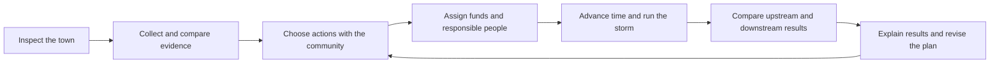

# Community Conservation Cleanup

Status: design draft, 2026-10-20. This document proposes a Blue Rush Studios
game for high school students. The homepage lists the concept under **In the
lab**; the game is not implemented. All costs, thresholds, and timings below
are fictional starting values for playtests, not environmental standards.

A town's creek is in trouble. A factory discharges polluted wastewater in
violation of its permit. Neighbors apply fertilizer just before a rainstorm,
dog waste goes uncollected, and an aging septic tank has cracked. You join
the town's conservation team to find where pollution comes from, work with
community members, and choose solutions that last beyond one cleanup day.

This design follows the overview, core loop, controls, technical architecture,
and milestone format used in [Snap Station](snap-station.md) and
[Grow Little Bunny](grow-little-bunny.md).

## Contents

- [Overview and pillars](#overview-and-pillars)
- [Learning goals](#learning-goals)
- [The town and its community](#the-town-and-its-community)
- [Core loop](#core-loop)
- [The four investigations](#the-four-investigations)
- [Actions, budgets, and tradeoffs](#actions-budgets-and-tradeoffs)
- [Water and weather model](#water-and-weather-model)
- [Progression and success](#progression-and-success)
- [Example session](#example-session)
- [Controls and accessibility](#controls-and-accessibility)
- [Art, audio, and interface](#art-audio-and-interface)
- [Classroom use and assessment](#classroom-use-and-assessment)
- [Technical architecture](#technical-architecture)
- [Testing and playtesting](#testing-and-playtesting)
- [Milestones and scope](#milestones-and-scope)
- [Open questions](#open-questions)
- [Science references](#science-references)

## Overview and pillars

| Item | Proposed design |
| --- | --- |
| Genre | Watershed investigation and community strategy simulation |
| Audience | Grades 9–12, approximately ages 14–18 |
| Session | 25–35 minutes of play, plus a 10-minute classroom discussion |
| Players | One student or a group of 2–4 sharing one device |
| Platform | Browser on school laptops and tablets; no account required |
| Setting | The fictional town of Willow Creek and its connected watershed |
| Goal | Reduce pollution at its sources and demonstrate improvement after rain |

1. **Follow the water.** Every investigation connects a land use practice,
   a route into the creek, and an effect downstream.
2. **Evidence comes before a decision.** Students compare observations,
   sample results, records, and community accounts. Clear-looking water
   alone does not prove that a problem is solved.
3. **People make solutions work.** Residents, businesses, professionals,
   and public agencies have different responsibilities and resources.
4. **Prevent the next problem.** Removing visible waste helps today;
   changing practices and maintaining infrastructure prevents recurrence.
5. **Test, explain, and revise.** A storm reveals weaknesses in a plan.
   Students can retry and explain what changed without a speed penalty.

## Learning goals

By the end of a session, students can:

- Map a source, transport pathway, and downstream impact for each problem.
- Distinguish the factory's direct discharge from runoff across many yards.
- Explain how excess nutrients can contribute to algae growth and lower
  dissolved oxygen, and why pathogen risk needs a separate indicator.
- Compare prevention, treatment, enforcement, education, and maintenance.
- Support an intervention with evidence and identify who can carry it out.
- Explain costs, delays, uncertainty, and who benefits or bears a burden.
- Use before-and-after results to revise a community conservation plan.

The science relationships draw on the [references below](#science-references).
Curriculum alignment with specific state standards remains a teacher review
task; this draft does not claim certification.

## The town and its community

The map shows an upstream wooded reference site, the factory outfall,
residential lawns and storm drains, a dog park, a house with a septic system,
and the downstream creek park. Flow arrows connect these locations. A soil
cutaway shows a possible slower path from the septic system to the creek.

| Community member | Contribution | Constraint or concern |
| --- | --- | --- |
| Student conservation team | Gather evidence, propose actions, compare results | Limited investigation time and town resources |
| Factory manager and workers | Explain operations and arrange treatment repairs | Repair time, costs, and continued employment |
| Environmental inspector | Evaluate discharge records and require corrective action | Needs documented observations and follow-up |
| Neighborhood residents and landscaper | Change fertilizer practices and maintain planting areas | Conflicting advice and lawn expectations |
| Dog owners and park volunteers | Collect waste and organize pickup stations | Convenient supplies and reliable collection |
| Septic homeowner | Share inspection history and arrange access | Cannot afford the full repair without assistance |
| Qualified septic professional | Inspect the tank and drainfield and complete repairs | Appointment and repair lead time |
| Town council and watershed educator | Fund assistance, coordinate projects, explain evidence | Competing uses for the town budget |

Characters respond to a concrete proposal: what happens, who does it, how it
is funded, and who maintains it. No character is a disposable villain.
Factory accountability and support for workers can coexist. The homeowner
receives repair assistance rather than being blamed for lacking money.

## Core loop



During investigation and planning, time is paused. **Run forecast** advances
the simulation by one phase, with confirmation of unfinished work. Students
can inspect the resulting timeline one step at a time. The forecast creates
urgency in the story without requiring fast reading or clicking.

## The four investigations

| Problem | Evidence students uncover | Community response | How students verify it |
| --- | --- | --- | --- |
| Factory wastewater violates its permit | Outfall location, upstream and downstream samples, a fictional permit card, discharge records, and a treatment fault | Submit documented findings to the inspector; require the operator to stop the noncompliant discharge, repair treatment, and fund ongoing monitoring | Compare the outfall record against the scenario's permit conditions and review repeat samples after repair |
| Fertilizer applied before rain | Forecast, application schedule, soil-test card, excess granules near pavement, and drainage arrows | Postpone the planned application; agree on soil-test-based rates and suitable weather; sweep granules from pavement and establish an unfertilized planted creek buffer | Run the same storm and compare nutrient delivery from the neighborhood; check that the revised schedule remains in use |
| Dog waste left in the park | Waste observations, routes to storm drains, resident interviews, and missing bags and bins | Collect and bag existing waste for proper trash disposal; place convenient stations and assign restocking and collection; explain why pickup matters | Inspect station upkeep and compare the park's nutrient and pathogen contributions after rain |
| Aging septic tank is cracked | Inspection history, wet ground, a professional inspection report, and sample patterns | Fund a qualified inspection and repair or replacement as indicated; evaluate the drainfield; arrange maintenance and interim exposure precautions | Confirm completed professional work and track later groundwater and creek results rather than expecting an instant reset |

Students connect each evidence card to a claim on their investigation board.
The factory permit uses an invented discharge condition clearly labeled
**Scenario rule**. Students interpret the supplied condition; they do not
memorize legal limits or treat the game as a compliance tool.

Some tempting actions produce useful feedback:

- A creek litter cleanup improves the park but leaves dissolved pollution
  sources active.
- A fertilizer reminder cannot undo nutrients already washed into the creek.
- Dog waste swept into a storm drain moves the problem downstream.
- Pumping a cracked septic tank alone does not repair the crack.
- Rain gardens and buffers help manage runoff but do not replace factory
  treatment or septic repairs.
- A fine alone does not fix the factory's treatment fault.

## Actions, budgets, and tradeoffs

The starting scenario provides **12 town funding tokens** and **8 community
work slots**. These are game resources, not dollars or volunteer hours.
Investigation and reading are free so students never have to guess because
they cannot afford to inspect evidence. Each project spends its resources
once, starts only after its prerequisites, and names a maintenance owner.

| Project package | Funding | Work slots | Prerequisite and timing |
| --- | --- | --- | --- |
| Factory investigation referral and follow-up | 2 | 2 | Documented evidence; operator funds treatment repair separately; discharge stops before the storm and repair completes in the next phase |
| Neighborhood fertilizer plan | 1 | 1 | Read forecast and soil-test card; prevent scheduled application before the storm |
| Dog park cleanup, stations, and upkeep plan | 2 | 2 | Assign pickup and service roles; active before the storm |
| Septic inspection and repair assistance | 5 | 2 | Professional inspection; work completes after one phase; benefits appear with a further groundwater delay |
| Optional planted creek buffer | 2 | 1 | Resident agreement; partial benefit after establishment, fuller benefit in the follow-up phase |

The four essential packages cost 10 funding tokens and 7 work slots, leaving
room for the buffer. Optional cosmetic park improvements compete for those
remaining resources. The factory's repair obligation is not paid from the
homeowner assistance budget. Costs are visible before commitment; action
cards separate immediate effects, recurring responsibilities, and delays.

Maintenance is represented by an assigned owner and a scheduled follow-up
check, included in the package cost for this scenario. An unassigned package
cannot be marked complete. Later scenarios can introduce recurring budgets;
the first version does not create unexpected resource charges.

## Water and weather model

Each location has separate nutrient, pathogen, and industrial contaminant
loads. Pollutants travel along map connections; the factory can discharge
during dry weather, surface buildup moves during rain, and septic leakage
uses a delayed groundwater connection. The factory scenario models a
generic industrial contaminant rather than suggesting all industries emit
the same substance.

The rules run in discrete phases: baseline, preparation, storm, aftermath,
and follow-up. A reproducible scenario supplies the same weather and source
loads for each retry. For each pollutant and source:

```text
available load = stored load + new release
delivered load = available load × transport fraction × (1 − control fraction)
```

All fractions stay between zero and one. The remaining load stays stored or
enters an explicitly recorded treatment or removal route; it cannot vanish
because time advances. Septic delivery is queued for a later phase. Direct
factory discharge follows its pipe rather than the lawn runoff multiplier.

Creek indicators combine incoming loads and flow at each reach. Nutrient
delivery drives a simplified algae response; oxygen recovery follows with a
lag. A separate pathogen indicator prevents an attractive creek from being
treated as proof of safe water. More flow can lower concentration while
total pollutant delivery remains high; the result view shows both.

The interface labels loads and risks as **model units** and shows indicator
trends with text explanations. They are not laboratory readings, drinking
water determinations, or predictions for a real watershed. Storms do not
wash all pollution away, and planting does not mature instantly.

## Progression and success

The opening guided task traces runoff from one lawn. Students then unlock
the full town with all four problems active together. They can investigate
in any order. A completed plan must:

1. Identify all four sources with at least one supporting evidence card each.
2. Put the four essential response packages into effect within the budget.
3. Meet the fictional factory permit condition at follow-up.
4. Reduce each of the three downstream pollutant loads by at least 50%
   relative to an untreated run with the same weather, at follow-up.
5. Assign a responsible person and follow-up check to every essential action.
6. Submit a claim, supporting evidence, and reasoning about one tradeoff.

The 50% target is a tunable game challenge, not a safety threshold. The
scenario must be balanced so the essential packages can meet it. Ecological
recovery can continue beyond the final turn; students see that distinction.

Feedback reports **Evidence**, **Source prevention**, **Community plan**,
and **Follow-up** separately. A student can explain a sound plan even when
repair delays leave an interim sample elevated. No public leaderboard ranks
students by speed. An incomplete run ends with specific next steps and a
retry from the planning checkpoint.

## Example session

You notice murky water by the park and collect upstream and downstream
samples. Comparing the factory records with its permit reveals a treatment
failure. At the neighborhood, the forecast and fertilizer schedule show
that tomorrow's application would happen just before heavy rain.

Your group funds the four essential packages, refers the factory evidence
to the inspector, and postpones fertilizer application. Residents clean
the dog park and assign someone to service the new stations. The septic
homeowner receives assistance for professional work. You spend the remaining
two tokens and one work slot on a planted creek buffer.

After the storm, neighborhood and park contributions fall. Septic-related
pollution remains elevated because earlier leakage is still traveling
through groundwater. At follow-up, inspection and sample trends show the
effect of the repair. Your final explanation compares the early and late
results and identifies who will maintain each improvement.

## Controls and accessibility

Click or tap a map location to inspect it. Tab moves among locations,
evidence, and action cards; Enter or Space selects; Escape closes a panel.
An equivalent location list provides every map action without dragging.
Evidence links can be selected through buttons as well as pointer gestures.

Use readable text, adjustable text size, visible focus, labeled charts,
screen-reader summaries, captions, and reduced motion. Pollution types use
symbols and names in addition to color. Audio never carries essential clues.
Teachers can keep the simulation paused for discussion at any point.

## Art, audio, and interface

The [homepage preview](assets/community-conservation-cleanup-homepage.png),
captured on 2026-10-20 before deployment, shows the concept alongside the other
Blue Rush games. It uses an existing studio image while the game is in design.

Use an illustrated overhead town with a cutaway view for underground flow.
Keep the Blue Rush coastal palette while giving the creek and neighborhood
their own recognizable landmarks. Students should see a believable town,
with readable evidence and useful choices suited to high school classes.

The main screen contains the town map, forecast, resource counters, and four
investigation folders. Selecting a site opens observations, sample history,
community conversation, and proposed actions. The results screen overlays
before-and-after flow arrows and gives every chart a matching data table.
Optional water and rain sounds remain quiet beneath conversation captions.

## Classroom use and assessment

In a 45–50 minute lesson, reserve about 5 minutes for the opening question,
25–35 for play, and 10 for discussion. Suggested group roles are investigator,
data analyst, community liaison, and planner; rotate roles during the session.
One student can perform every role independently.

The session summary includes the source-pathway-impact map, selected actions,
costs, responsible people, before-and-after indicators, and student reasoning.
Offer a printable report and a local file export. Teachers review explanations;
the first version does not use an AI grader or send student writing to a server.

Discussion prompts:

- Which actions improved appearances, and which reduced pollution at its source?
- Why did one sample remain elevated after the repair was complete?
- Who had authority to act on each problem, and who needed financial help?
- What evidence would you collect before claiming the creek had recovered?
- How would you change the plan if the next storm arrived sooner?

## Technical architecture

Follow the Rust rules and browser split used by the existing games. Proposed
components, not existing crates:

- `conservation-rules`: deterministic scenario state, connected flow paths,
  evidence checks, action prerequisites, project timing, and success checks.
  Keep it independent of graphics, network access, and classroom identities.
- `conservation-web`: browser interface calling the same rules through
  WebAssembly, with accessible HTML controls and tables. Reuse suitable shared
  game contracts; do not require a 3D scene for the first version.
- Versioned scenario data: map, fictional permit, evidence cards, dialogue,
  resource costs, weather, control effects, delays, and learning prompts.
- A future game page at `/games/community-conservation-cleanup`, plus a guide
  alongside the other Blue Rush guides when the game becomes playable.

Save scenario version, phase, evidence, actions, and reasoning locally. Allow
resume, reset, and export. If storage is unavailable, keep the session playable
and offer a download. No sign-in, student names, online chat, hosted classroom
dashboard, or multiplayer service is required for the initial classroom run.

## Testing and playtesting

When implementation begins, verify meaningful model behavior:

- Replaying the same scenario and action sequence gives the same result.
- Loads remain nonnegative and each transport step accounts for the mass
  entering it, including stored, removed, and delayed material.
- Factory loads remain possible without rain; lawn runoff responds to rain.
- A downstream litter cleanup cannot satisfy factory or septic source checks.
- Dog waste removal affects the park's pathogens as well as its nutrients.
- A completed septic repair leaves earlier groundwater contamination in transit.
- Dilution alone cannot satisfy a load-reduction goal.
- The essential packages can win within 12 tokens and 8 work slots, and an
  untreated run fails the follow-up checks.
- Keyboard and touch users can complete all investigations and export results.

Playtest with high school students and an environmental science teacher.
Check whether students can explain the four pathways without prompts, whether
budgets encourage discussion, and whether the session fits a class period.
Ask an environmental educator to review the science and fictional permit
before a classroom pilot. Adjust costs and targets from those observations.

## Milestones and scope

1. **Paper prototype:** one map, four evidence folders, action cards, and a
   teacher-led storm. Validate comprehension and the resource budget.
2. **Rules prototype:** implement the fixed weather scenario, pollution
   pathways, delays, actions, and reproducible result checks.
3. **Browser MVP:** ship all four investigations, community choices, storm
   comparison, accessible controls, local saves, and the printable report.
4. **Classroom pilot:** review science, observe groups, revise pacing and
   feedback, and publish a teacher guide before a wider release.

The MVP includes one town and one repeatable weather sequence. Later options
include new land uses, different storm timing, maintenance budgets, and a
teacher scenario editor. Real water-quality predictions, real enforcement
advice, field sampling instructions, online multiplayer, and a full town
economy remain outside this design's initial scope.

## Open questions

- Should the first pilot focus on environmental science, biology, or civics?
- Does a 25-minute guided session leave enough time for all four investigations?
- Which sample charts need scaffolding for students new to interpreting data?
- Would teachers prefer one combined report or a worksheet for each group role?

## Science references

These sources support the environmental relationships; they do not supply the
game's invented budgets, efficacy values, or victory thresholds.

- [EPA: Basic information on nutrient pollution](https://www.epa.gov/nutrientpollution/basic-information-nutrient-pollution): excess nutrients can promote algae growth and reduce oxygen available to aquatic life.
- [EPA: Sources and solutions—stormwater](https://www.epa.gov/nutrientpollution/sources-and-solutions-stormwater): runoff can carry nutrients from fertilizer and pet waste into waterways.
- [EPA: Sources and solutions—in and around the home](https://www.epa.gov/nutrientpollution/sources-and-solutions-and-around-home): household and yard practices contribute to nutrient pollution.
- [EPA: What you can do—in your yard](https://www.epa.gov/nutrientpollution/what-you-can-do-your-yard): fertilizer practices and planted areas can reduce nutrient runoff.
- [EPA: Industrial wastewater](https://www.epa.gov/npdes/industrial-wastewater): discharge permits set conditions for industrial wastewater sources.
- [EPA: Septic system impacts on water sources](https://www.epa.gov/septic/septic-system-impacts-water-sources): failing systems can affect groundwater and nearby surface water.
- [EPA: Resolving septic system malfunctions](https://www.epa.gov/septic/resolving-septic-system-malfunctions): professional evaluation and corrective work address system failures.
