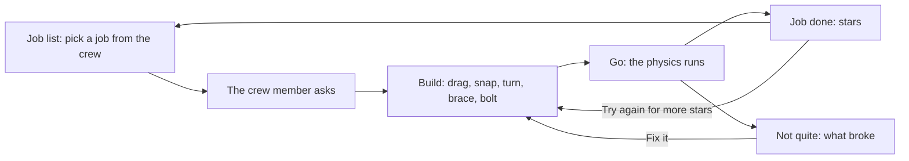
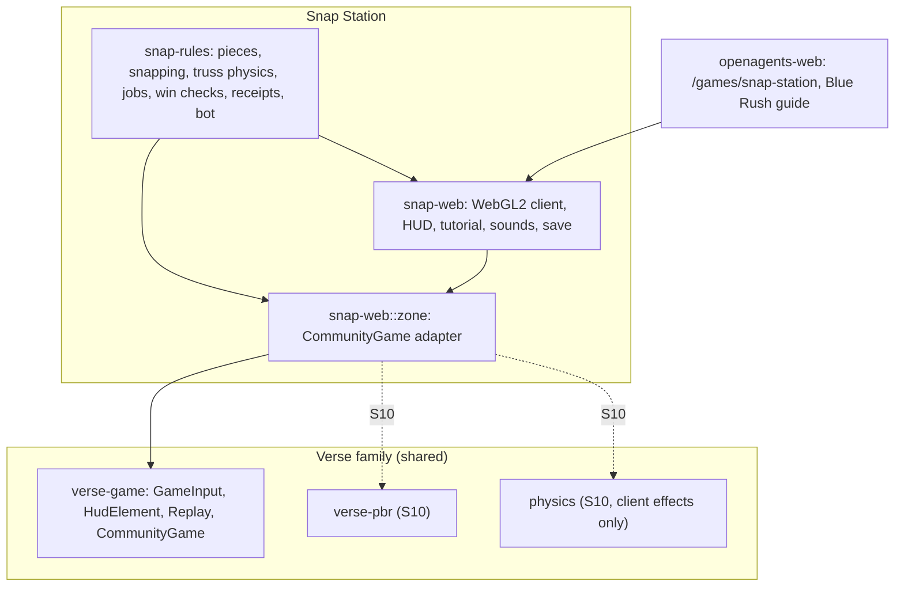

# Snap Station

Source status, 2026-10-15: the browser game has twenty checked jobs, the Crew
Deck, controller input, and accessibility choices (see
[Implementation status](#implementation-status)). Newer builds still need
deployment as recorded in `NEEDS_OWNER.md`. Numbers marked *tunable* are
starting values for playtests, not measured results.

Snap Station is a building game for kids about 5 to 12. They snap
together colourful magnetic pieces (squares, triangles, panels, struts,
thrusters, solar wings and bolts) to build stations, ships and docks in
space, where things float, spin and drift. Then they press **Go**, and
simple, honest physics runs: thrusters push, spinning makes gravity,
wobbly builds shake apart and braced ones hold, triangles stay stiff and
squares lean, heavy parts belong in the middle, pushing off-centre spins
things, and magnets grab but strong joins need a bolt.

Jobs come from an original robot crew: build a dock big enough for a
cargo ship, spin a garden so plants can grow, connect two modules before
a solar storm. No reading is needed to play, the pieces are big and
bright, and the sounds are gentle. Saves stay on the device; sharing
comes later.

It is the third Blue Rush Studios game, after
[Grow Little Bunny](grow-little-bunny.md) and
[The Ice Cream Man](the-ice-cream-man.md), and it is built the same way:
a deterministic rules crate, a WebGL2 browser client, a page at
`/games/snap-station`, and a guide on the studio's site. Its engine is the
Verse family's (the community-game contract in `verse-game`, and later
`verse-pbr` near Lagrange 1), simplified to a flat build plane.

Everything in it is original: the name, the art, the robot crew. The
pieces are generic magnetic tiles; the game names no toy brand and uses
no one else's characters.

## Contents

- [Overview and pillars](#overview-and-pillars)
- [Player fantasy](#player-fantasy)
- [Core loop](#core-loop)
- [The robot crew](#the-robot-crew)
- [The build space](#the-build-space)
- [Pieces](#pieces)
- [Snapping](#snapping)
- [Go: the physics](#go-the-physics)
- [Jobs and win checks](#jobs-and-win-checks)
- [Controls](#controls)
- [Progression: stars and job sets](#progression-stars-and-job-sets)
- [Difficulty and level list](#difficulty-and-level-list)
- [Art direction](#art-direction)
- [Animation, effects, and audio](#animation-effects-and-audio)
- [UI and HUD](#ui-and-hud)
- [Technical architecture](#technical-architecture)
- [Performance budgets](#performance-budgets)
- [Saves and sharing](#saves-and-sharing)
- [Telemetry and testing](#telemetry-and-testing)
- [Milestones](#milestones)
- [Implementation status](#implementation-status)
- [Out of scope](#out-of-scope)
- [Engine gaps](#engine-gaps)
- [Open questions](#open-questions)

## Overview and pillars

| | |
| --- | --- |
| Genre | Physics building puzzle |
| Session | 1 to 5 minutes a job; a run after Go lasts 4 to 11 seconds |
| Players | One builder a job; sharing builds later |
| Platforms | Browser (WebGL2) on desktop, tablet and phone; later Verse on desktop and phones |
| Audience | Kids about 5 to 12; no reading needed to play |
| Engine | `snap-rules` (deterministic truss physics), `verse-game`, a WebGL2 client; later `verse-pbr` |

Pillars:

1. **Build, then test.** Building is calm and has no clock (except the
   storm job's). Go is the experiment. A failed run is a result to learn
   from, never a punishment.
2. **Honest physics, kid-simple.** Every rule a child learns here is true
   of real structures: triangles are rigid, rectangles rack, a push off
   the centre of mass makes torque, centripetal pull grows with mass and
   radius, joints have strengths. The model is simplified, never wrong in
   direction.
3. **No reading required.** Pieces differ by shape as well as colour; the
   crew's jobs show their goal in the scene (a ring to push into, a ship's
   outline to fit, a gravity meter with a green band); results show what
   broke where.
4. **Big, bright, gentle.** Big touch targets, bright pieces on a dark
   sky, soft sounds, nothing scary. Breaking is sparks and a pop, not an
   explosion.
5. **Deterministic, so it can be shared.** A build and its run are a pure
   function of the job and the inputs, so a shared build replays the same
   everywhere and a best can be checked by running it again.

## Player fantasy

You are the builder a cheerful robot crew calls when they need
something made in space. You pick up a magnetic square, it clicks onto
the station, and you add another. You press Go: your bridge holds, the
crate flies straight into the ring, the garden spins and the plants feel
heavy again. When it doesn't, you see exactly where the magnets let go,
add a strut and a bolt, and try again. You're the engineer.

## Core loop

Inside a job the loop is short: look at the job (a gap to bridge, a ring,
a ship's outline), snap pieces on, press Go, watch, fix, go again.

## The robot crew

Five original robots, each a simple shape a child can draw:

| Crew member | Role | Look | Jobs they give |
| --- | --- | --- | --- |
| Captain Cog | The captain | A round orange robot with gear teeth all around and a red antenna light | Docks and the big jobs |
| Pip | The helper drone | A small blue ball with one big eye and two little rotors | First jobs, snapping |
| Rivet | The builder | A tall green box robot with a square head and waving arms | Rings, gardens |
| Nova | The scientist | A purple ring with an eye in the middle and three orbiting dots | Storms, solar power |
| Tock | The cargo bot | A yellow box with a clock face on its tummy | Pushing and moving cargo |

A crew member floats beside the job while you build, cheers (hops,
waves) when the job is done, and tilts its eyes when it isn't. The crew
speak in the first person ("Can you join my two modules?"); the game's
own words are short.

## The build space

- **A plane in space.** Everything lies in one flat plane, seen from the
  front with a perspective camera (2.5D): pieces are flat tiles with some
  thickness. One plane keeps building readable for young children and
  keeps every snap exact; 3D builds are a later set's idea.
- **Units.** Metres; every snapping side is 1 m (a half square's long side
  is the square's diagonal).
- **The job area.** Each job has an area pieces must stay inside. The
  camera frames the build, the job's places (the beacon, the ship's
  berth) and room to build, and follows the build during a run.
- **The tray.** Each job gives a tray of pieces with counts. The counts
  are the puzzle: three struts for four squares means one square must be
  made another way.
- **Given pieces.** Jobs start with the crew's own modules, crates and
  pods; they can't be taken off, and their joins to each other come
  bolted.

## Pieces

| Piece | Shape | Mass (kg) | Sail (m²) | Behaviour |
| --- | --- | --- | --- | --- |
| Square | 1 × 1 frame: four rods, magnets in the corners | 1.0 | 0.1 | Leans under a sideways load; pops apart past 20° |
| Triangle | Equilateral, side 1 | 0.6 | 0.05 | Can't lean |
| Half square | Right triangle, legs 1, long side √2 | 0.6 | 0.05 | Can't lean; two make a braced square |
| Panel | Solid 1 × 1 | 2.0 | 1.0 | Stiff and heavy |
| Solar wing | 1 × 2, six 1 m sides | 0.8 | 2.0 | Stiff, light, catches the solar wind |
| Thruster | Cone on a 1 m base | 1.0 | 0.3 | Snaps on by its base only; pushes the build away from its nozzle while it burns |
| Strut | A rod | 0.3 | 0 | Dropped on a square: braces it corner to corner |
| Bolt | A hex nut | 0 | 0 | Dropped on a join: the magnets can't let go |
| Crate | 1 × 1 | 6.0 | 1.0 | Heavy cargo |
| Plant pod | 1 × 1 with a plant | 3.0 | 1.0 | Needs gravity in a band |
| Module | 1 × 1 crew module | 4.0 | 1.0 | Given by jobs only |

All values *tunable*. Colours are bright and distinct (sky-blue squares,
yellow triangles, coral half squares, green panels, deep-blue wings with
gold rims, orange thrusters), and each piece also has its own outline, so
nothing depends on telling two colours apart.

## Snapping

Pieces snap like magnets: **close and lined up**.

- A held piece snaps when one of its sides comes within **0.7 m** (middle
  to middle) of a free side of the build, and the two sides line up within
  **50°** (*tunable*). The nearest such side wins.
- It is pulled exactly onto that side, facing out. If it would overlap
  another piece or leave the job's area, the next-nearest side is tried;
  with none, it doesn't snap, and goes back to the tray with a soft boop.
- Sides snap only to sides of the same length (a half square's long side
  only to another long side).
- Once placed, every side of the new piece whose corners land on a free
  side's corners (within 6 cm) joins it too, so a piece dropped into a
  corner joins both neighbours and a ring closes by itself.
- **50° is a real rule.** A square always has a side within 45° of any
  direction, so squares always snap; a triangle's sides point every 120°,
  so sometimes it needs a turn first. That is the "lined up" part of
  magnets, felt rather than read.
- A **strut** dropped within 0.75 m of an unbraced square's middle braces
  its diagonal nearest the strut's direction. A **bolt** dropped within
  0.6 m of a join's middle locks it.
- Taking a piece off returns it, its strut, and the bolts on its joins to
  the tray.

While a piece is held, a glowing outline shows where it would snap.

## Go: the physics

The build becomes a **truss**: every corner of every piece is a point
mass (the piece's mass shared among its corners), every side and inner
stiffener is a stiff damped spring ("bar"), and every magnet join is two
stiff springs of rest length zero between matching corners. Nothing
collides with anything else: in space, a loose piece just drifts. Each
tick (60 a second) is 12 steps of semi-implicit Euler.

| What kids see | Rule in the model |
| --- | --- |
| Thrusters push | A thruster pushes 4 N along its axis while it burns (ramping up over 0.25 s), split between its two base corners |
| Pushing off-centre spins things | Nothing special: a force whose line misses the centre of mass makes torque, so the build turns |
| Spinning rings make "gravity" | A pod's felt gravity is ω²r: the build's spin (angular momentum over moment of inertia about its centre of mass) squared, times the pod's distance from that centre |
| Heavy parts belong in the middle | Nothing special: a heavy piece far out pulls hard on its joins (m ω² r) and slows the spin-up (more inertia) |
| Triangles stay stiff | A triangle of bars can't change shape |
| Squares lean ("rack") | A square frame has only weak springs across its diagonals (3 N/m, standing in for its corner magnets' grip); a sideways load makes it lean in proportion |
| Wobbly builds shake apart | A square leaning past 20° pops: its joins let go and it drifts off |
| Braced builds hold | A strut is a stiff bar across a square's diagonal; a half-square pair has one built in; a panel has both |
| Magnets grab, but strong joins need a bolt | A magnet join lets go when either of its springs carries more than 3 N; a bolted join never does |
| The solar storm | Gusts push each piece by its sail area, up then down, every half second |
| The cargo ship | Flies in on its own track; stops short if it runs into a piece; in its berth, ties to the nearest corners of the dock and tugs on them |
| A hinge | Holds the middle of the joined sides together and turns freely, with soft stops at 90° each way |
| A spring | A softer, damped join absorbs a bump instead of locking both sides rigidly |
| A tether | Has 0.25 m of slack and exerts tension only; compression never pushes |
| A reaction wheel | Spins on a central axle; the motor applies equal opposite torque to the wheel and its hull |
| A cargo arm | A stiff two-metre boom with a damped pivot holds its rest angle; while towing, the ship’s 40 kg is carried at its two mooring points |

Values are *tunable*. They are in `crates/snap-rules/src/sim.rs` and `mechanism.rs`,
and in the rules digest, so a change shows up in every receipt.

**Why a truss, not rigid bodies.** The shared `physics` crate is a 3D
rigid-body engine with contacts and limited joints. A rigid
body can't rack, and racking is the lesson; a truss gets it, and triangle
stiffness and the bracing that fixes it, with no special cases. It is
kept in `snap-rules` and needs no renderer. When a Verse
host draws the game (S10), the truss stays the authority and drives
`physics` bodies for the client's debris effects only.

**Determinism.** The simulation uses `f64` with only addition,
subtraction, multiplication, division and square roots, which IEEE 754
rounds the same way on every target Rust builds here, with no
trigonometry, library maths or fused multiply-add, and loops in a fixed
order. Angles come from a table of exact constants (twelve turns of 30°).
So the same inputs give the same bits on native and wasm32, which
`scripts/snap-wasm-test.sh` checks against a pinned digest.

## Jobs and win checks

A job file (`snap.level.v1`) names one of four job kinds, and the run is
judged by the rules, not the client:

| Kind | Asks | Won when | Lost when |
| --- | --- | --- | --- |
| `connect A B` | Join two tagged pieces | At the end of the run, A and B are joined through joins that held | They came apart |
| `push C` | Push a tagged piece into a beacon ring | Its centre enters the ring while the build spins slower than the limit | It spun too fast, or the run ended short of the ring |
| `spin H` | Spin so every pod feels gravity in a band | Every pod is joined to the hub and in the band for the hold time after the burn | A pod came off; the pods felt too little or too much |
| `dock B` | Give the cargo ship a berth | The ship got in, tied up to the dock, tugged, and nothing in the dock broke or popped | It ran into the build; it found nothing to tie to; the dock broke |

A job may also carry nudges (a gentle push on a tagged piece, for the
first job's "shake"), a storm (with a building clock: when it runs out,
the storm comes by itself), a beacon, a gravity band, and a ship.

## Controls

| Action | Mouse and keyboard | Touch (tablet and phone) | Keyboard only (a gamepad, through the contract) |
| --- | --- | --- | --- |
| Pick up a piece | Press it in the tray | Touch it in the tray | ← → pick a slot, Enter picks it up |
| Snap it on | Drag it to the station and let go | Drag and lift, or tap it in the tray then tap where it goes | Arrows move it half a metre, Enter snaps it (turned whichever way fits there) |
| Turn it | R (Shift+R back) or the mouse wheel | The Turn button | Not needed |
| Take a piece back | Drag it off the station; Undo | The same | X or Backspace takes the last one off |
| Go and Stop | Go, or G | Go | Go is the tray's last slot |
| Menu | Esc | The menu button | Esc |
| Tutorial | ? | The ? button | ? |

Pointer drags send the rules' own inputs (a piece held at a point, turned
so many steps); keyboards and gamepads go through the community-game
contract's generic channel (`verse_game::GameInput`), so a host with no
pointer can play every job.

## Progression: stars and job sets

- **Stars.** A job done earns 1 to 3 stars: three for using no more
  pieces than par (struts and bolts count), two for up to three more, one
  otherwise. Each job's par is the bot's own build, so three stars are
  always reachable.
- **Opening jobs.** The first job is open; finishing a job opens the next.
  Jobs stay open once opened.
- **Job sets.** Twenty jobs in four sets of five, each set a place on the
  station with its own crew member and a new piece or force.
- **No lives, no timers** except the storm's building clock, and no way to
  lose progress.

## Difficulty and level list

Four sets of five jobs. Values are *tunable*. All twenty jobs ship in the source build.

| # | Job | Crew | New idea | Pieces |
| --- | --- | --- | --- | --- |
| 1 | Hello, Magnets | Pip | Snapping: join two modules | Squares, triangles |
| 2 | Straight Push | Tock | Thrusters; push through the middle or it spins | Thrusters, squares, panels, struts |
| 3 | Storm Bridge | Nova | Squares lean and pop; struts brace; bolts hold; the storm clock | Squares, half squares, struts, bolts |
| 4 | Garden Spin | Rivet | Spin makes gravity; pods pull on their joins | Squares, struts, bolts, thrusters |
| 5 | Cargo Dock | Captain Cog | A berth that fits, and holds when the ship tugs | Squares, triangles, struts, bolts |
| 6 | Two Rings | Tock | Push a crate through two beacons: turn with an off-centre burn | Thrusters, panels |
| 7 | Heavy Middle | Rivet | Spin with crates aboard: heavy in the middle spins faster and holds | Crates, bolts |
| 8 | Solar Farm | Nova | Wings catch the wind; lock a long array together | Solar wings, bolts |
| 9 | Full Ring | Rivet | A closed ring of squares and triangles that spins | Triangles, squares |
| 10 | Tug Boat | Captain Cog | Dock with cargo arms, then push the moored ship | Cargo arms, thrusters |
| 11 | Counter Spin | Tock | Transfer the hull’s spin into a reaction wheel | Reaction wheel |
| 12 | Long Bridge | Pip | Span eight metres with the fewest pieces | Triangles, half squares |
| 13 | Storm Season | Nova | Three storms in a row; repair between them | Bolts |
| 14 | Greenhouse Wheel | Rivet | Four pods, one band, two speeds | Pods, thrusters |
| 15 | Berth Two | Captain Cog | Two ships, two berths | Struts, bolts |
| 16 | Hinge Door | Pip | New piece: hinges that turn on purpose | Hinges |
| 17 | Spring Catch | Tock | New piece: springs that soak up a bump | Springs |
| 18 | Tether Line | Nova | New piece: a tether that only pulls | Tethers |
| 19 | Station Core | Captain Cog | Build a station that spins, docks and survives a storm | Everything |
| 20 | Grand Station | The whole crew | Free build judged on all four job kinds | Everything |

The target is a first-try success of about 70% on job 1, 40% on job 5,
and 20% on job 20, measured in playtests; the bot's runs give the floor
(every job solvable with its tray) and par.

## Art direction

- **The look.** Low-poly, flat-shaded pieces made in code, with chunky
  edges, on a dark space backdrop: a starfield, a big blue planet in the
  corner, a pale sun. Frames are four coloured rods around a pale window,
  with red magnet dots in the corners. Panels are solid with a raised
  plate; wings are deep blue cells in a gold rim; thrusters are orange
  cones with a dark nozzle and a flame while they burn; bolts are silver
  hex nuts; struts are white rods with silver ends.
- **Readable at a glance.** The pieces are the only bright things in the
  frame. A popped square turns gray. The beacon is a glowing ring; the
  cargo ship's outline waits, see-through, in its berth while you build.
- **Accessibility.**
  - *Colour.* Every piece has its own outline; no rule depends on colour.
  - *High contrast.* A setting (menu, or `#contrast=high`) drops the
    backdrop to black and draws a white rim around every piece.
  - *Reading.* Nothing needs reading to play; words are short and the
    crew's cards have their faces.
  - *Motor.* Tap-to-pick and tap-to-place for children who can't drag;
    big targets (72 px tray buttons, 60 px on phones); generous snapping;
    keyboard and gamepad play without a pointer.
  - *Sound.* Every sound is paired with something visible, and the sound
    can be turned off.

## Animation, effects, and audio

- **Crew.** Each robot bobs gently; cheers by hopping and waving on a
  win; tilts its eyes on a fail. Cog's gear teeth turn; Nova's dots orbit;
  Tock's clock hand moves.
- **Effects.** A ring of white sparks when a piece snaps; yellow sparks
  where a join lets go; red sparks when a square pops; flickering flames
  on burning thrusters; streaks of solar wind during the storm; a held
  piece lifted toward the camera, see-through, with a glowing outline
  where it would snap.
- **Audio.** Made with Web Audio, no files: a two-note click for a snap, a
  soft clunk for a bolt, a rising tick for a strut, a boop when a piece
  can't go there, a rising chime for Go, a whoosh while thrusters burn,
  wind for the storm, a twang when magnets let go, a pop, a bump for the
  ship, and short gentle tunes for a job done or not quite.

## UI and HUD

| Element | Where | Shows |
| --- | --- | --- |
| Job card | Top left | The crew member's face, the job's goal in a few words, who gave it; tap to hear the job again |
| Pieces | Under the job card | Pieces used so far (struts and bolts count) |
| Storm clock | Under the job card, storm jobs | Time left before the storm comes |
| Plant gravity | Under the job card, spin jobs, during a run | A meter with the green band the pods need, a needle, and a bar filling while they stay in it |
| Tray | Bottom | Each piece with its count, then Turn, Undo, and Go (Stop during a run) |
| Hint line | Over the tray | What to do first, the held piece's name, or why it didn't snap |
| Help and menu | Top right | The tutorial; the menu (back to building, start again, sound, high contrast, all jobs, back to OpenAgents) |
| Cards | Middle | The job list, the crew's ask, the tutorial, and results: stars and pieces on a win; what broke and what to try otherwise, with Fix it |

The HUD is drawn from the community-game contract's elements
(`verse_game::HudElement`): a counter for pieces, a ring for the storm
clock, pips with a bar for gravity, and a map of the build for hosts that
show one.

## Technical architecture

### Where it sits

### Crates

| Crate | Owns | Depends on | Must not depend on |
| --- | --- | --- | --- |
| `snap-rules` | Piece shapes and masses; snapping, joining, struts, bolts; the truss simulation, thrusters, storm, ship and spin gravity; `snap.level.v1` job files and the shipped jobs; win checks and stars; `snap.run-receipt.v1` receipts; `snap.progress.v1` saves; the bot | `sha2` | Any `verse-*` crate, a renderer, I/O, clocks, randomness |
| `snap-web` | The browser client: meshes made in code (`mesh`, `kit`), the frame (`scene`), the HUD and cards (`hud`), the tutorial, sounds, options, the app loop, and the `verse-game` adapter (`zone`) | `snap-rules`, `verse-game`, `glam`, `wasm-bindgen`, `web-sys` | `verse`, `verse-pbr`, Everglade or other games |

`snap-rules` builds for `wasm32-unknown-unknown` and `wasm32-wasip1`
unchanged. As with Grow Little Bunny, the browser client draws with WebGL2
directly rather than through `verse-pbr` (which brings wgpu, naga and
glTF, several megabytes of wasm, for a few hundred flat shapes): the whole
game is about 190 KB of compressed wasm.

### The page

`/games/snap-station` on openagents.com serves the `snap-web` build
(`scripts/build-snap-web.sh`) from the directory the server was started
with (`--snap DIR`, or `/srv/snap` in the image), like the other two
games: a full-window canvas, one start script, and the games' content
policy (scripts and the module from the site only, WebAssembly
compilation, no inline script or style). On the studio's own domain the
same page is `/games/snap-station`, and the guide is
`/snap-station/how-to-play`.

### Agents and the bot

The rules take inputs, not key presses, so an agent builds through the
same API a child uses: a piece held at a point, turned, and let go. The
bot (`snap_rules::bot`) grows braced cells toward a job's target,
bolts joins while bolts last, adds thrusters where they push hardest
toward the beacon or turn the build hardest, and runs each candidate
build before it keeps it, as a player tries a build with Go. It solves
every shipped job, and its piece count is each job's par.

## Performance budgets

| Budget (*tunable*) | Phones | Desktop |
| --- | --- | --- |
| Frame rate | 60, never below 30 | 60 or the display rate |
| Triangles drawn a frame | 40,000 | 40,000 |
| Rules tick (12 substeps, a 30-piece build) | ≤ 0.5 ms | ≤ 0.2 ms |
| Download, compressed | ≤ 200 KB | ≤ 200 KB |
| Draw calls a frame | 7 | 7 |

Every frame rebuilds the build's meshes on the CPU (a few thousand
triangles) and draws three dynamic and two static meshes.

## Saves and sharing

- **Saves** are local: `snap.progress.v1` in the browser's storage (each
  job's most stars and fewest pieces, sound and contrast settings). Merging
  two saves keeps each job's best. The tutorial's seen mark is
  `snap.tutorial.v1`, apart from the save.
- **Receipts.** `snap.run-receipt.v1` records the rules and job digests,
  every input by tick, the outcome, the stars, and the final state's
  digest; verifying one plays it again. `verse.game-replay.v1` does the
  same through the generic contract.
- **Sharing (S9).** A build travels as its receipt: short, and checkable
  by replay, so a shared "three stars" can't be faked. A gallery shows
  only builds whose receipts verify.

## Telemetry and testing

### Telemetry

None in the MVP: nothing leaves the browser. Playtest builds may record
receipts locally for the playtest program
([`docs/game/playtesting.md`](../../game/playtesting.md)) after consent.

### Tests

| Test | Crate | Checks |
| --- | --- | --- |
| Outlines | `snap-rules` | Every piece anticlockwise, convex, snapping sides 1 m (or a square's diagonal) |
| Snapping | `snap-rules` | Snaps flush within reach and angle; refuses far, misaligned, overlapping and out-of-area; long sides only to long sides; corners join both neighbours; struts, bolts, and taking pieces off |
| Physics | `snap-rules` | A build left alone stays put; a push through the middle goes straight and off it spins; a shove makes a square lean and pop and a braced one hold; magnets let go under a big pull and bolts hold; spin gravity |
| Lessons | `snap-rules` | Each job taught wrong and right through real inputs: three squares join job 1; an off-centre thruster spins in job 2; bare squares pop and unbolted magnets let go in job 3's storm while braced and bolted holds; unbolted pods fly off and one thruster is too little in job 4; short arms, weak arms, and a piece in the berth fail job 5 |
| Bot | `snap-rules` | Solves all five jobs with three stars, one input a tick |
| Receipts | `snap-rules` | Round trip, replay verification, tampering refused, a pinned final state |
| wasm32 | `scripts/snap-wasm-test.sh` | The whole suite as wasm32 under Node gives the same pinned digest |
| Jobs and saves | `snap-rules` | Every shipped job parses and its given pieces fit; bad files refused with a reason; saves round-trip and merge |
| Contract | `snap-web` | Job 1 done with the cursor through `GameInput`, and its `verse.game-replay.v1` verifies and is refused on another job; the HUD elements |
| Client | `snap-web` | Meshes face out; every piece within its triangle budget and colour; every job draws within budget building and running; the snap preview; copy passes `oa-copy`; the tutorial |
| Site | `openagents-web` | The page serves the build with the games' policy, or says it can't be played; the Blue Rush card and guide; every route a screen or in `NOT_SCREENS` |

### Captures

`scripts/snap-capture.mjs` plays the real page in headless Chrome at
desktop and phone sizes with real drags (mouse or touch) and writes
screenshots: for example job 1 from the tutorial to "Job done!". The
`autoplay` build (`SNAP_FEATURES=autoplay scripts/build-snap-web.sh`)
lets the bot build each job for captures; `#kit` shows every model.

## Milestones

Each phase is one issue and leaves the game playable.

| Phase | Work | Blocked by | Acceptance |
| --- | --- | --- | --- |
| S0 | This document | none | Reviewed by the owner |
| S1 | `snap-rules`: pieces, snapping, bolts and struts, truss physics, thrusters, storm, ship, spin gravity, jobs 1 to 5 as data, win checks, receipts, bot | S0 | The tests above; determinism on native and wasm32; the bot solves all five |
| S2 | The look: bright pieces on the space backdrop, leaning drawn from the simulation, sparks, flames, high contrast | S0 | Captures of each job building and running |
| S3 | Game contract: `CommunityGame`, generic inputs with the cursor, HUD elements, replays | S1 | A job done through `GameInput` replays and verifies |
| S4 | Kits: every piece, modules, the ship, the beacon, the crew, made in code; `#kit` | S2 | Budgets and colour tests; the kit sheet |
| S5 | Jobs 1 to 5 playable: drag and snap, turn, undo, Go and Stop, HUD, results and stars, touch, sounds, tutorial, save; the page and the Blue Rush guide | S1 to S4 | Job 1 completed on the live page at desktop and phone sizes |
| S6 | The Crew Deck hub: a station to float around, the crew, job boards, a star board, saved builds on show | S5 | Hub to job and back; boards from the save |
| S7 | Phones and tablets on real devices, gamepad, accessibility passes | S5 | Device runs in `NEEDS_OWNER.md` |
| S8 | Jobs 6 to 20 and new pieces (hinges, springs, tethers) | S5 | The bot solves all twenty; a job validator |
| S9 | Sharing builds: codes, signed receipts, a gallery | S5 | A shared build replays the same on another device; a tampered one is refused |
| S10 | In Verse: drawn through `verse-pbr` near Lagrange 1, entered from an arch, the `verse` host driving `CommunityGame` | S3, #11206 | A job played in the desktop Verse app |

## Implementation status

The MVP is playable at `/games/snap-station` on openagents.com and on the
Blue Rush Studios domain. Epic:
[#11668](https://github.com/OpenAgentsInc/openagents/issues/11668).

| Phase | Issue | Status |
| --- | --- | --- |
| S1 | [#11669](https://github.com/OpenAgentsInc/openagents/issues/11669) | Done, 38357711ac |
| S2 | [#11670](https://github.com/OpenAgentsInc/openagents/issues/11670) | Done, 38357711ac |
| S3 | [#11671](https://github.com/OpenAgentsInc/openagents/issues/11671) | Done, 38357711ac |
| S4 | [#11672](https://github.com/OpenAgentsInc/openagents/issues/11672) | Done, 38357711ac |
| S5 | [#11673](https://github.com/OpenAgentsInc/openagents/issues/11673) | Done, 38357711ac and fcb6cf7b51 |
| S6 | [#11674](https://github.com/OpenAgentsInc/openagents/issues/11674) | Done: Crew Deck, four boards, stars, and saved builds |
| S7 | [#11675](https://github.com/OpenAgentsInc/openagents/issues/11675) | Implemented; physical devices need the owner |
| S8 | [#11676](https://github.com/OpenAgentsInc/openagents/issues/11676) | Done: twenty checked jobs and moving pieces |
| S9 | [#11677](https://github.com/OpenAgentsInc/openagents/issues/11677) | Implemented; deployment needs the owner |
| S10 | [#11678](https://github.com/OpenAgentsInc/openagents/issues/11678) | Implemented |

### S1: the rules

`crates/snap-rules`: `kinds.rs` (pieces), `build.rs` (snapping, joins,
struts, bolts, taking off), `sim.rs` (the truss, thrusters, storm, ship,
spin gravity), `level.rs` and `jobs/` (jobs 1 to 5), `game.rs` (building,
Go, Stop, the verdicts, stars), `receipt.rs`, `progress.rs`, `bot.rs`, and
`lessons.rs` (each job taught wrong and right).

Checks: `cargo test -p snap-rules`; `scripts/snap-wasm-test.sh` runs the
whole suite as wasm32 under Node and gets the native digest.

Deviations, and why:

- **2D, not 3D.** One plane keeps building and snapping exact for young
  children, and racking is a 2D effect; later sets can stack planes.
- **Its own truss, not `crates/physics`.** See
  [Go: the physics](#go-the-physics).
- **`f64` with exact operations, not integers.** Square roots of spring
  lengths every substep are simpler and as reproducible in `f64` limited
  to IEEE-exact operations; the wasm32 test pins it.
- **The crew's own joins come bolted**, so the storm's push lands on the
  player's bridge, not on the given wings.
- **The storm is strong (10 N a square metre).** Weaker gusts didn't load
  a bare square bridge enough to show the lesson; at this strength bare
  squares pop, unbolted magnets let go, and only braced and bolted holds.
- **The ship doesn't shove pieces**: it stops when it runs into one, which
  reads clearly as "no room".

### S2 to S5: the client, the contract, the kits, and the page

`crates/snap-web`: `mesh.rs` and `kit.rs` (every piece, the ship, the
beacon, the crew, the backdrop), `scene.rs` (each frame from the game,
with leaning squares drawn from the simulation), `hud.rs`, `tutorial.rs`
(five cards), `sound.rs`, `options.rs` (`#job=N`, `#kit`,
`#contrast=high`, `#quiet`), `zone.rs` (the `verse-game` adapter with the
keyboard and gamepad cursor), and `app.rs`. The page is
`crates/openagents-web/src/pages/snap.rs`; the guide and the homepage
card are in `pages/blue_rush.rs`, with screenshots from the real game in
`static/bluerush/snap-*.jpg`.

Checked in the browser (headless Chrome, `scripts/snap-capture.mjs`): job
1 from the tutorial through the job list to "Job done!" with real drags at
1440 × 900 and with touch at 390 × 844; job 4 built by hand with struts,
bolts and turned thrusters to "Job done!"; jobs 2 to 5 built by the bot
in the autoplay build.

Deviations, and why:

- **Made in code, no asset pack**, as Grow Little Bunny's browser build:
  a few hundred flat shapes need no Blender pipeline or pinned pack.
- **The camera looks straight at the plane**, so a screen point maps
  exactly to the build; depth comes from the pieces' thickness and the
  perspective.

### S6: the Crew Deck

The game opens on the Crew Deck. Tap to float or steer with the arrow keys;
visit the crew's four boards to choose a job. The star board reads the saved
progress. **Save and visit Crew Deck** keeps one build per job on this device;
miniatures appear on the deck, and **Your builds** reopens them with their
piece counts. The camera leaves room for the buttons on narrow screens.

Checked with mouse input at 1440 × 900 and touch at 390 × 844: float, choose
job one, build and win, read its stars, return to the deck, reload, reopen
the build, and win again. Native tests cover board membership, movement
bounds, save parsing, inventory, and the reopened build's run. Physical
phone and tablet checks remain part of S7. Captures show the
[phone deck with a saved build](../captures/snap-deck/phone-saved.png) and
[earned stars](../captures/snap-deck/desktop-stars.png); the
[browser results](../captures/snap-deck/browser.json) record both sizes.

### S7: controllers and accessibility

A standard gamepad uses the stick or D-pad for the cursor, A to pick up or
place a piece, X to turn it, B to put it down or undo, and Start for the menu. Menus use
the same directions and A; B closes them. Held directions repeat; A, B,
and Start act once per press. Disconnecting clears held controls.

**Options** has **Big buttons**, **Less motion**, and **Piece marks**. These
choices stay on the device. Less motion initially follows the system setting;
it removes camera easing, robot bobbing, sparks, and decorative movement while
keeping the physical run. Piece marks use the same black-and-white dot patterns
in the tray and on the build. Big buttons have at least 64 × 64 CSS pixels.
The phone tray puts tools on a second row. Open cards keep the controls behind
them out of keyboard navigation.

Native checks pass (31 rules tests and 20 client tests). Local Chrome checks
at 390 × 844, 1024 × 768, and 1440 × 900 cover settings, 64-pixel targets,
the phone tray, still frames with Less motion, and a virtual controller
turning, building, winning, and returning to edit. The
[results](../captures/snap-access/browser.json) distinguish these fixtures
from physical devices; captures show the [phone tray](../captures/snap-access/phone-access.png),
[matching piece marks](../captures/snap-access/phone-marked-build.png), and
[tablet](../captures/snap-access/tablet-access.png). Physical phone, tablet,
and controller checks are in `NEEDS_OWNER.md`.

### S8: twenty jobs and moving joins

All twenty jobs have three-star reference builds that the validator runs and
replays. `cargo run -p snap-rules --bin snap-validate` checks them; pass a job
file path to check a draft. Job files can contain a route of beacons or several
tests of the same build. The game waits for Go between tests, allows repairs,
and awards stars after the last test. Ships visit their berths in turn.
Storms in a sequence apply during the connecting tests. Towing uses fixed ship
axes and adds the ship’s mass at the moorings; it is not a separate rigid hull.

Hinges, springs, and tethers drop onto an existing join. Removing its piece
returns the tool. Reaction wheels use one central axle and cargo arms have
one pivot at their base. Needed parts must stay in their named group; dropping
cargo or a wheel cannot satisfy that job. The Full Ring must close even when
the hub is removed from its connection graph. The Crew Deck has five jobs per
board and space for all twenty saved builds; miniature meshes are made when
the build is saved, rather than rebuilding each frame.

The rules version is 2. Earlier run receipts are refused because the rules
and state changed; device-local construction saves still reopen. Native and
WASM tests pin the same state and cover wrong and right builds, wheel momentum,
ship mass, spring settling, and all twenty solutions and replays. The checks
pass with 44 rules tests on native and WASM, 21 client tests, and three web
page/guide tests. [Bot results](../captures/snap-station-jobs/bot-check.txt)
and [browser results](../captures/snap-station-jobs/browser.json) are kept.
Browser captures cover nine distinct later jobs and every stage of the
multi-test jobs; production-build pointer checks cover the door, spring catch,
and both steps of towing. Stills show the
[hinge](../captures/snap-station-jobs/hinge.png),
[phone spring catch](../captures/snap-station-jobs/spring-phone.png),
[towing](../captures/snap-station-jobs/towing.png),
[reaction wheel](../captures/snap-station-jobs/reaction-wheel.png),
[ring](../captures/snap-station-jobs/ring.png), and
[Grand Station result](../captures/snap-station-jobs/grand-station.png).

### Sharing (S9)

After a run, **Share build** downloads a signed build file or saves a
12-character code. A friend can open the link, enter the code in **Shared
builds**, or choose the downloaded file. **Build from this** opens the parts
in the editor; stars still require playing the job. The public gallery is
opt-in and shows a thumbnail only after both the server and browser replay
the run successfully. The signature identifies this browser's sharing key,
not a person's account. Unlisted codes and downloaded files can be forwarded.

`snap-share` binds the job, run receipt, browser public key, random nonce, and
gallery choice with Ed25519. `snap-rules` bounds input count, file size,
physics ticks, and total ticks before replay. Finished receipts freeze when
the run ends, so waiting at the result screen does not change them. Shares
use the web store's local or Cloud Storage adapter and survive a restart.
The game stylesheet is a same-origin file, including the phone tray and
piece marks, so it works under the game's existing security policy.

Checks pass with 45 rules tests, two signing tests, 22 client tests, and the
focused web tests. Two fresh browser profiles used the served production
build and its security policy: one played, downloaded, and published a run;
the other opened the link and file, won with the imported parts, and refused
a modified file. The phone tray and big sharing buttons also passed under
that policy. [Results](../captures/snap-sharing/browser.json), the
[gallery](../captures/snap-sharing/gallery.png), the
[friend's phone](../captures/snap-sharing/friend-phone.png), and the
[changed-file refusal](../captures/snap-sharing/changed-file-refused.png)
are retained.

### In Verse (S10)

In Lagrange 1, approach the **Snap Station** arch near the arrival point.
Fly through it, press **F**, or choose **Play Snap**. The local game pauses
the astronaut and Lagrange construction while it is open. **Leave** or **F**
returns to the same station. Returning from Lagrange 1 still leaves the zone.

Arrows choose a tray piece or move it after picking it up; **E** picks or
places it, **X** puts it down or undoes a piece, and **R** turns it. Select
**Go** in the tray to start the test. **P** or Escape pauses. The panel also
has every control; **Prev** and **Next** choose among all twenty jobs, and
**Reset** starts that job again. Each visit starts a fresh game.

The Verse host steps `CommunityGame` at the rules' rate and records its generic
inputs, including Turn, in a verified replay. The shared scene's lit models
and glow render through `verse-pbr`; physics remains in `snap-rules`.
The native offscreen acceptance plays job one, wins, verifies its rotated
build replay, and returns to Lagrange 1. It retains the
[arch](../captures/snap-verse/arch.png),
[build](../captures/snap-verse/built.png),
[result](../captures/snap-verse/won.png), and
[replay](../captures/snap-verse/run.txt).

## Out of scope

- 3D building, free-form placement off the snapping grid, and pieces that
  bend.
- Collisions between pieces, gravity from planets, orbital mechanics (the
  Lagrange zone has those).
- Chat, accounts, or anything social beyond sharing receipts (S9).
- Trademarked toy names, licensed characters, or third-party art.
- Scoring by time; competitive leaderboards for children.
- Ads, purchases, or rewards outside the game.

## Engine gaps

1. **A host that drives `CommunityGame`.** As for Grow Little Bunny, the
   `verse` host doesn't register community games yet (#11206).
2. **A pointer in `GameInput`.** The generic channel has directions only;
   a building game wants a pointer (a point and a press). The cursor
   scheme works without it; a `Point(x, y)` input would let any host send
   drags.
3. **A truss mechanism in `physics`.** If a second game wants racking
   frames, the truss belongs in the shared crate.
4. **Signed save sync and a gallery** for shared builds (S9).

## Open questions

1. **Ages.** Is 5 to 12 one game, or should the youngest get a simpler
   mode (no storm clock, no bolts)?
2. **Stars by pieces.** Is fewest pieces the right thing to reward, or
   should stars also come from strength (a build that holds with margin)?
3. **The storm clock.** It's the only timer. Keep it, or let the storm
   come only on Go?
4. **Sharing.** Who sees shared builds: friends by code only, or a
   moderated public gallery?
5. **3D later.** Should later sets stack planes (a station with depth), or
   stay flat?
6. **Verse.** Should the game be entered from Lagrange 1 in Verse, or stay
   a web game with Verse as one host among others?
