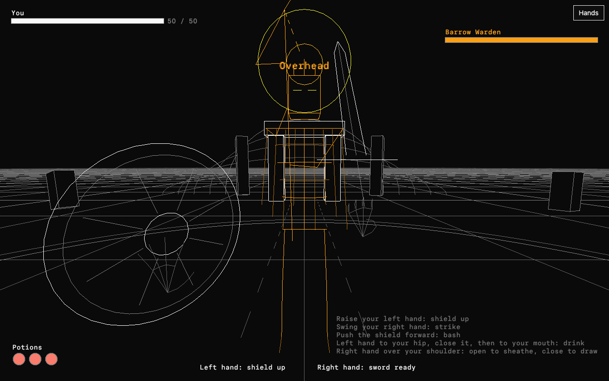

# Hand Duel

The Hand Duel is the hand-tracked companion to the
[Prussian duel](duel.md): a sword-and-shield fight played with your hands in
front of a camera. Your left hand holds a round shield, your right hand a
sword, and a belt of three potions hangs at your left hip. The Barrow Warden,
a skeletal revenant with a hooked glaive, walks out of his barrow and swings
at you with a long, readable windup. Everything is drawn in the Grid's line
style: your gear in white light, the Warden in amber.

Open it at `/hand-duel` on a site started with the Everglade web build and the
hand landmarker, press **Hands**, and hold up both hands. The camera's
picture stays in the browser; only the 21 points of each hand reach the
module. The code is in
[`verse-zone-handduel`](../../crates/verse-zone-handduel/src/lib.rs).

## Run it locally

```sh
scripts/build-everglade-web.sh OUT/web          # the wasm build
scripts/fetch-hand-landmarker.sh OUT/lander9/hands
OPENAGENTS_WEB_FEATURES=all cargo run -p openagents-web-site --bin openagents-web -- \
  --store OUT/store --listen 127.0.0.1:4391 --everglade OUT/web --lander9 OUT/lander9
```

Then open `http://127.0.0.1:4391/hand-duel` and press **Hands**. `?gl` forces
WebGL2.

## Gestures

There is no keyboard or mouse control. Every action is a gesture.

| Gesture | Action |
| --- | --- |
| Raise your left hand to chest height or above | Raises the shield. It covers the direction from your chest to your hand. |
| Push the raised shield toward the screen fast | Shield bash. During the Warden's windup it staggers him; otherwise it shoves him back. |
| Swing your right hand fast | Strikes. The blade's path has to cross the Warden's body while he is in reach. |
| Close your left hand at your left hip, or reach below the picture on the left and come back with a closed hand | Takes a potion. The shield drops while the hand holds it. |
| Hold the potion at your mouth for about half a second | Drinks it. Open your hand anywhere else to put it back. |
| Reach over your right shoulder and hold an open hand there | Sheathes the sword. |
| Reach over your right shoulder and close your hand | Draws the sword. |
| Sheathe after a fight ends | Starts the next fight. |

## Rules

- **Blocking.** Each of the Warden's blows has a line: overhead, from the
  left, from the right, or a thrust. During the windup, an amber ring marks
  where it will land and tightens as the blow nears, and the blow's name
  shows at the top of the screen. A raised shield blocks when the angle
  between its cover direction and the blow's line is 40 degrees or less. A
  blocked blow does no damage and leaves him a longer recovery.
- **Swings.** A swing starts above 1.4 m/s of hand speed and ends below
  0.55 m/s; it needs at least 0.22 m of travel and less than 0.9 s. Faster
  swings add up to +4 to hit and up to 1.6 times the damage; a longer contact
  through his body adds up to 1.2 times more. A heavy hit during his windup
  interrupts it.
- **Dice.** Hits, damage, and potions roll behind the scenes from a seed
  (`docs/verse/combat-model.md`): your attack is a d20 plus 4 and the speed
  bonus against his armour class 13 (15 while he waits on guard), for 1d8 + 2
  scaled by speed and contact. His attack is a d20 plus 6 against your 13, for
  1d10 + 3. A natural 20 doubles the dice. A potion restores 2d4 + 4.

## How the hands are read

The page runs the same MediaPipe hand landmarker as `/verse` and `/lander9`
([`apps/openagents/web/hands`](../../apps/openagents/web/hands/README.md)).
The zone keeps one smoothed tracker per hand. A new hand on the picture's left
is your right hand, and a tracked hand keeps its side as it moves. Each hand
is placed in body space: height and side from the palm's position in the
picture (one picture height is about 1.3 m), and reach from how big the palm
looks. A hand that grows toward the camera is pushed forward. A fist or a
pinch is a closed hand, and spread fingers are an open one.

The gesture layer (`gesture.rs`) reads only these body-space hands, so its
tests replay made-up hands without a camera.

## Design notes

The interaction follows a VR dungeon-crawler video studied as reference
only. No art, characters, names, or interface from it are used:

- The shield sits at the bottom left of the view and rises to fill it when
  held up; a stopped blow flashes on its rim.
- The weapon moves one-to-one with the right hand, and hits show as a burst
  at the contact point with a floating number.
- Potions live in belt slots shown at the bottom left; the hand that reaches
  for them lights the slots, and a potion is drunk by bringing it to the
  mouth.
- The screen stays sparse: two health bars, the belt, what each hand is
  doing, and short words for blocks and misses.

## Verification

Captured on 2026-10-21 from `/hand-duel` in headless Chrome with WebGL2, fed
by the page's made-up hands (`verseHands.synth`) instead of a camera:

- [The Warden winds up an overhead blow](verification/2026-10-21-hand-duel/telegraph.png):
  the amber ring marks where it will land, the shield is up in the left hand,
  and the sword is in the right.
- [A swing lands short](verification/2026-10-21-hand-duel/swing.png): the
  sword's trail, sparks at the contact point, and "Miss".


