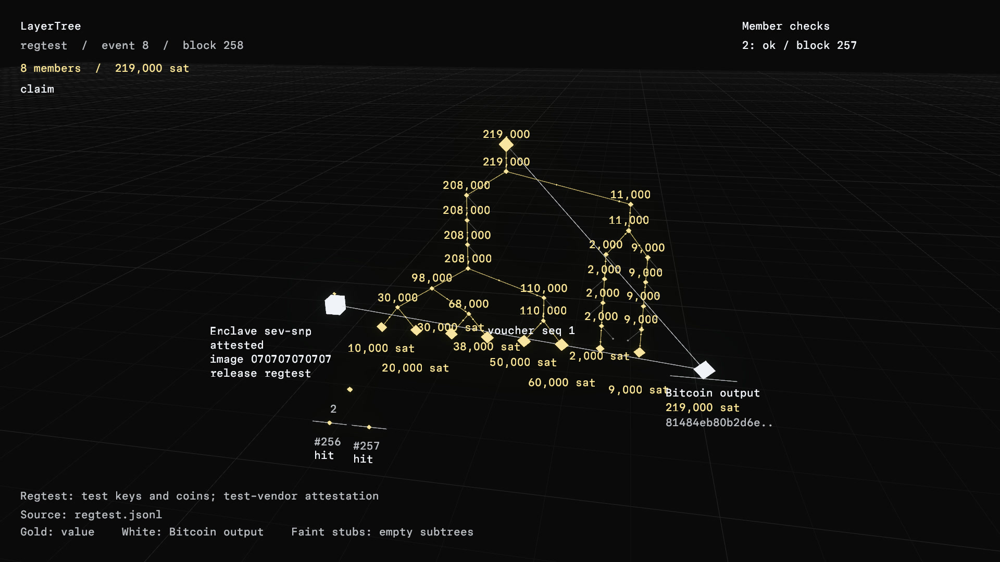

# LayerTree visualizer

The `layertree` Verse example shows a tree of balances from a
`layertree.events.v1` file. It uses the engine Grid floor, gold for value,
and white for the Bitcoin output. Leaves grow with their balance; small
stubs mark empty subtrees. Gold dots carry the sums toward the root.



Run these commands from the repository root:

```sh
# Open the scene. Arrow keys orbit and zoom; hover a leaf for its exit key.
cargo run -p verse --no-default-features --features imported-desktop \
  --example layertree -- \
  --events crates/layertree-tee-lab/fixtures/events/regtest.jsonl --at 8 --visual

# Write a 1080p frame without opening a window.
layertree_scratch="$(openagents scratch)"
cargo run -p verse --no-default-features --features imported-desktop \
  --example layertree -- \
  --events crates/layertree-tee-lab/fixtures/events/regtest.jsonl --at 8 \
  --size 1920x1080 --scale 1.5 --capture "$layertree_scratch/layertree-tree.png"

# Render the five-second orbit to a 1080p film clip.
cargo run -p verse --no-default-features --features imported-desktop,crypt-fight \
  --example film_shot -- docs/verse/film/verse-shots/layertree-tree.json \
  --out "$HOME/work/film-out/verse/layertree-tree.mp4"
```

`--at N` selects the state after event N; omitting it selects the final
state. `--size WIDTHxHEIGHT` sets physical pixels, and `--scale` sets text
scale from 1 to 4. Captures do not open a window. The image above uses
`fixtures/events/regtest.jsonl`, event 8, with test keys and regtest coins.

The viewer supports depths from 1 to 16. It collapses empty subtrees and
shows groups for large trees. The layout checks every parent sum against
its children; the root's displayed balance must equal the run's output
balance. The reader refuses skipped events, mixed networks, mismatched
leaves, and inconsistent balances. It reads public JSON only and does not
perform Bitcoin or hardware-attestation verification. There is no Cargo
dependency on the excluded lab crate.

The example and film scene share the same replay, layout, geometry, and
palette. They are development examples and do not ship in a Coder binary.

## Playback

Add `--play --from 0 --to 17 --rate 0.6` to step through a run. The rate
is events per second, including block and client events. A single PNG with
`--play` shows the final selected event; add `--capture-every 1` to write
numbered frames to the directory passed to `--capture`.

The transition animation drops joining leaves into place, resizes updated
leaves with two signature pulses, sends exits to their exit keys, shows a
lease-expiry pause before eviction, and draws voucher arcs with their new
sequence number. Heartbeats move the output along the rail. Refused
operations flash red and leave the balances unchanged. Displayed balances
always belong to the checked destination event; only geometry interpolates.

`docs/verse/film/verse-shots/layertree-simulated-transitions.json` renders a
24-second demonstration of every move. Its source,
`docs/verse/fixtures/layertree-transitions.jsonl`, is simulated throughout.
The viewer's `simulation` event extends the public log for illustration:
it requires `synthetic: true`, uses the same old/new leaves and balances
as a transition, and also accepts `split`, `merge`, `rewrite`, and `detach`.
The lab does not accept this illustration format as a signed record. The
scene labels it **simulated**; its hashes and transactions are illustrative.
For confirmed transactions, select the regtest log instead:

```sh
cargo run -p verse --no-default-features --features imported-desktop \
  --example layertree -- \
  --events crates/layertree-tee-lab/fixtures/events/regtest.jsonl \
  --play --from 0 --to 17 --rate 0.6 --visual
```

## Attestation and member checks

The box beside the tree is its enclave signer. It shows the platform,
image digest, release entry, and the logged attestation result. A passed
check adds a gold light; a failed check turns the box red and keeps the
error name. White pulses connect signed transitions to the Bitcoin output.
Migration events can include `old_enclave_key`, `new_enclave_key`, and
`notice_until` to show both signers and the notice deadline.

Member nodes show gray before a check, gold after `ok`, and red after an
alarm. The list at the top right gives each logged result and its block.
A block ribbon marks spends of tracked outputs and the associated record
check. An alarm connects the reporting member to the signer. Only logged
member results change status; a single report does not invent results for
other clients. When a transition includes `observed_output_amount`, the coin shows that
on-chain amount separately from the claimed root sum, turning red on a
mismatch. The viewer reads results; it does not verify attestations,
filters, or records itself.

`layertree-alarm.json` renders a 20-second film from the real
`regtest-light.jsonl` run: three followers, withheld data, a forged record,
and a mined broken-enclave theft. The lab's `theft-caught.jsonl` can also
be viewed directly; it contains one observer. Regtest attestation uses a test vendor
key. Neither fixture demonstrates hardware attestation or a mined theft
on signet. P1 logs can replace the input when those runs finish.

For failed attestation views, select events 2, 3, or 4 of
`docs/verse/fixtures/layertree-attestation-errors.jsonl`. They illustrate
`UnknownMeasurement`, `ReportDataMismatch`, and `VendorSignature` with
public test data. A `tree_open` event can include an `observers` array to
name the clients in a multi-observer recording; otherwise the scene uses
the clients recorded anywhere in the run, falling back to the tree's members
when there are no observations. This selects participants, never future results.

## Timed unroll

The unroll view makes the signer dark, counts blocks toward the current
output's CSV deadline, shows broadcasts and confirmations by level, and
sends each payout to its exit key. Member amounts stay intact; the fee
counter counts external anchor fees separately. When logs skip waiting
blocks, playback compresses the interval and labels the interpolated wait
counter. The event header continues to name the recorded event and block.

The reader matches every payout to an unpaid leaf's exact amount and exit
key. It rejects early broadcasts or confirmations, unknown exit keys,
changed amounts, and repeated payouts. Group nodes summarize the logged
transactions at each level; the log does not identify each group's inputs,
so this diagram does not reconstruct their precise transaction graph.
Large trees collapse groups and show eight sample payouts with the full
paid total and count.

`layertree-unroll.json` renders the two-level regtest run in 30 seconds.
For a one-level view, select `regtest.jsonl` instead. Add
`--compare-progress` to show the prior output's spent unroll beside the
current tree; the equivalent film field is `compare_progress: true`.

The three-level capacity check uses 16,385 simulated members, generated
outside the repository to avoid committing a large, repetitive log:

```sh
layertree_scratch="$(openagents scratch)"
scripts/layertree-viz-fixtures.py "$layertree_scratch/three-level.jsonl"
cargo run -p verse --no-default-features --features imported-desktop \
  --example layertree -- --events "$layertree_scratch/three-level.jsonl" \
  --capture "$layertree_scratch/three-level.png"
```

Every generated event is labelled `synthetic: true`, and the scene says
**simulated**. These hashes and transactions are illustrative; the log is
not evidence of Bitcoin execution or hardware attestation.


## Research stills and Video Lab

The [research gallery](../research/layertree/captures/README.md) records each
source event, source-file hash, and transaction where applicable. `--caption TEXT` and
the film scene's `caption` field keep the test-data note visible in exported
images and clips. Reproduce
all stills and the four CRF-12 1080p clips using the already built examples
in your existing `CARGO_TARGET_DIR`:

```sh
layertree_scratch="$(openagents scratch)"
scripts/layertree-captures.py \
  --viewer "$CARGO_TARGET_DIR/debug/examples/layertree" \
  --film-shot "$CARGO_TARGET_DIR/debug/examples/film_shot" \
  --scratch "$layertree_scratch/layertree-captures"
```

The four `docs/verse/film/layertree-*-scene.json` documents contain the same
shots as the direct renderer. Video Lab imports repository scene documents
on first use and accepts their path as an alias:

```sh
VERSE_FILM_SHOT="$CARGO_TARGET_DIR/debug/examples/film_shot" \
  scripts/film/lab.py render docs/verse/film/layertree-tree-scene.json --quality review
```

`VERSE_FILM_SHOT` selects an existing build; omitting it uses the normal
release Cargo command. Video Lab includes the event log's content hash in
the scene version and excludes the output video from its inputs. Later
edits in Video Lab keep their versions; importing does not overwrite them.

The transitions clip uses confirmed regtest activity. The complete later
operations demo remains in `layertree-simulated-transitions.json`. The alarm
clip uses `regtest-light.jsonl`, written by the real three-follower test;
the unroll clip uses `regtest-two-level.jsonl`.

Confirmed signet creation, join, update, exit, and refresh now have their
own checked log, seven labelled stills, and two 1080p CRF-12 clips:
`~/work/film-out/verse/layertree-signet-tree.mp4` (6 seconds) and
`layertree-signet-transitions.mp4` (20 seconds). The separate negative-policy
view changes the expected tree ID for a real captured token; it does not
report a live service failure. The exporter rechecks historical Google
tokens, release/Rekor evidence, actual Core confirmations, output scripts
and sums, on-chain record hashes, fees, and the exited member's payout.
Its sources file keeps authorization and confirmation heights separate.

```sh
scripts/layertree-captures.py --signet \
  --viewer "$CARGO_TARGET_DIR/debug/examples/layertree" \
  --film-shot "$CARGO_TARGET_DIR/debug/examples/film_shot" \
  --scratch "$(openagents scratch)/layertree-signet-captures"
```

The corresponding Video Lab documents are
`docs/verse/film/layertree-signet-tree-scene.json` and
`docs/verse/film/layertree-signet-transitions-scene.json`. The staged signet
alarm is recorded below; the primary unroll still waits for #11793.


The separate `signet-halt-waiting.jsonl` records the real guardian HALT at
height 326605 and the actual early `non-BIP68-final` refusal. At the observed
tip 326607, all five members remain owed their full amounts; the escape is
first valid in block 326616. Its still and eight-second clip are explicitly
labelled as waiting, with no payout or physical VM-kill claim. Re-render
with `scripts/layertree-captures.py --signet-halt` and the same viewer,
film-shot, and scratch arguments above. Final recovery footage still
requires the actual confirmed escape and fee child.

The [HALT waiting evidence](../research/layertree/evidence/signet-halt-waiting-2026-10-16.tar.gz)
contains 43 selected public files plus its manifest, including historical
Google tokens, release/Rekor and rebuild signatures, the saved escape, and
the observed HALT/refusal. SHA-256:
`6edd198a5440c0299c706f0ae72e824eed2e90cbdf2b6e72592cb2c62d67f365`.
The exporter also refused changed refusal and delay fields and an unsupported
payout claim without writing events. Re-exporting the original normal run
produced the identical 21-event fixture.

The later `signet-halt-paid.jsonl` records the original saved escape and
fee child confirmed at block 326616: five exact 1,000-sat payouts and
934 sats paid externally in fees. Re-render its final still and eight-second
clip with `scripts/layertree-captures.py --signet-halt-paid`. The shot and
Video Lab scene are `layertree-signet-halt-paid.json` and
`layertree-signet-halt-paid-scene.json` under the same film directories.
The [final recovery report](../research/layertree/2026-10-16-signet-verification.md)
links the public archive and refusal checks. This is the separate guardian
HALT experiment; the primary tree's scheduled physical-loss run is still active.

The `signet-staged-alarms.jsonl` log records the separate software test tree's
withheld record, hash mismatch, and mined theft, with nine delivered alarms.
All three followers detect the theft at its mined block, 326640. The tree
claims 60,000 sats while its actual output holds 55,000 sats. The
[public records](../research/layertree/evidence/signet-staged-alarm-records-2026-10-16.tar.gz)
contain transactions, follower logs, receiver records, and instructions for
fetching the four full blocks from a synced signet node. The complete capture
is also available through the authenticated artifact bucket's
[restore manifest](../research/layertree/evidence/bench-artifacts.json).
Re-export the extracted archive after filling those blocks with:

```sh
cargo run --locked --manifest-path crates/layertree-tee-lab/Cargo.toml \
  --no-default-features --features events --bin layertree-export-stage -- \
  --input "$layertree_scratch/stage-public" \
  --primary-log "$layertree_scratch/stage-public/primary/events.jsonl" \
  --output "$layertree_scratch/signet-staged-alarms.jsonl"
```

Use `scripts/layertree-captures.py --signet-alarm` for the still and matching
`layertree-signet-alarm` film shot and Video Lab scene. The caption identifies
the software test signer; this capture makes no hardware-attestation or
completed-soak claim.
