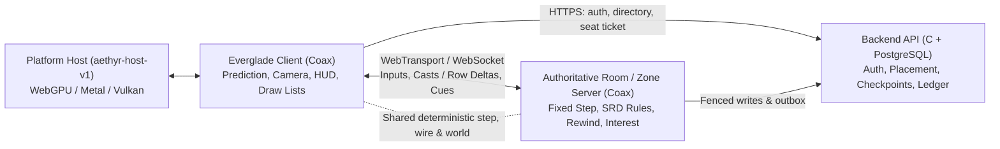

# Everglade and Aethyr architecture

Everglade is a real-time action MMORPG on the D&D 5E System Reference Document (SRD 5.2.1), written in Coax on the Aethyr engine. This page maps every system today and the target shape from the [AAA audit](../docs/audits/2026-11-11-everglade-aethyr-aaa-audit.md) (tracker `#13257`). Bounded contexts and service contracts across the monorepo live in [docs/architecture/contexts.md](../docs/architecture/contexts.md). Program decisions live in [docs/decisions/](../docs/decisions/).

## Systems

- **Client.** Compiles to WebAssembly for the browser and native code for Apple/Linux hosts. Runs local input prediction and reconciliation against server snapshots, drives the follow camera and HUD, and emits draw lists. The client is `everglade/client/` (its entry `client.coax`); the web app keeps only the page's C face (`apps/openagents-web/everglade2-face.c`) and builds it as `build/everglade2.wasm` ([0001](../docs/decisions/0001-one-game.md)).
- **Server (room / zone).** Authoritative fixed-step simulation (`coax/web/room/`). Clamps and steps player inputs with server-clock input credit, runs SRD combat and AI, rewinds hit tests within a bounded history, and replicates state. Today Everglade runs as `.e2` inside the 16-seat room binary (`EG_SEATS :: 16`); P1 extracts `everglade/server/` and P2 scales zones to 150 players on dynamic tables ([0003](../docs/decisions/0003-150-a-zone.md)).
- **Backend API.** Single C service (`coax/web/api/`) backed by PostgreSQL. Authenticates players, tracks live room shards, signs seat tickets, and stores character state and analytics.
- **Host contract (`aethyr-host-v1`).** Versioned C boundary (`aethyr/host/README.md`) between a deterministic Coax realm and platform effects (GPU, audio, input, sockets, asset packs). Browser WebGPU (`coax/web/host.js`), Apple Metal (`aethyr/host/apple/PageHost.m`) and Linux Vulkan (`aethyr/host/vulkan/`) implement the same contract; P6 moves pass ordering onto `aethyr/render/passes.coax`.
- **World model and engine.** Integer-nanosecond fixed loop (`aethyr/loop.coax`), deterministic math/RNG, generation-checked entity store (`aethyr/entity.coax`), broadphase (`aethyr/sim/broad.coax`), 64 m streaming cells (`aethyr/world/cells.coax`), terrain tiles (`aethyr/terrain-tile.coax`), and paged VPK3 asset packs (`aethyr/forge/`). Zones become streamed data rather than separate Wasm pages ([0002](../docs/decisions/0002-zones-as-data.md)).
- **Rules and abilities.** SRD 5.2.1 rules and timing profile (`rules/srd/`). Spells execute bounded effect steps; P3 unifies spells, class features, resources and lasting effects on `Ability` and `Aura` records with stable content IDs ([0004](../docs/decisions/0004-abilities-as-records.md)).
- **Replication.** Row replication (`aethyr/net/` and `coax/web/room/room-interest.coax`) uses acknowledged delta baselines, priority accumulators, per-link congestion budgets, 110 m / 130 m interest hysteresis, and class-aware backpressure over WebTransport datagrams (`wt.c`) or WebSocket (`ws.c`). P2 moves remaining bespoke text frames (`h2`, `g2`, `m2`) onto packed binary rows.
- **Persistence.** Rooms fence stale writers with owner generations and exact receipts (`room-checkpoint.coax`), pausing play if persistence lag hits 30 s. P4 expands vitals-only checkpoints into the full server character record and wires rewards through the idempotent item ledger (`0130_item_ledger.sql`).

## Where it lives

| System | Folder | Key files |
| --- | --- | --- |
| Game modules, HUD & shared zones | `everglade/` | `everglade/zone.coax`, `everglade/features.coax`, `everglade/hud/class-bar.coax`, `everglade/mounts.coax` |
| Client & shared step | `everglade/client/`, `everglade/shared/`, `everglade/scene/`, `verse/everglade2/` | `everglade/client/client.coax`, `everglade/client/net.coax`, `everglade/shared/everglade-step.coax`, `everglade/shared/everglade-wire.coax`, `verse/everglade2/meadow.coax` |
| Authoritative room server (moving in P1) | `everglade/server/` (the game), `coax/web/room/` (host, transport, relay) | `everglade/server/seat.coax`, `everglade/server/seats.coax`, `everglade/server/input.coax`, `everglade/server/casts.coax`, `everglade/server/tick.coax`, `everglade/server/send.coax`, `everglade/server/creatures.coax`, `coax/web/room/room.coax`, `coax/web/room/wt.c` |
| Backend API & SQL schema | `coax/web/api/` | `coax/web/api/api.c`, `coax/web/api/rooms.c`, `coax/web/api/seats.c`, `coax/web/api/player.c`, `coax/web/api/npc.c`, `coax/web/api/migrations/0130_item_ledger.sql` |
| Host contract & platform hosts | `aethyr/host/`, `coax/web/`, `apps/everglade-desktop/` | `aethyr/host/README.md`, `aethyr/host/conformance.coax`, `coax/web/host.js`, `aethyr/host/apple/PageHost.m`, `apps/everglade-desktop/desktop.coax` |
| Engine core, physics & world streaming | `aethyr/`, `aethyr/world/`, `aethyr/sim/` | `aethyr/loop.coax`, `aethyr/entity.coax`, `aethyr/walk.coax`, `aethyr/sim/broad.coax`, `aethyr/world/cells.coax`, `aethyr/terrain-tile.coax` |
| Renderer, shaders & asset packs | `aethyr/render/`, `verse/gpu/`, `aethyr/forge/` | `aethyr/render/passes.coax`, `aethyr/forge/pack.coax` |
| Replication, wire & lag compensation | `aethyr/net/`, `coax/web/room/` | `aethyr/net/README.md`, `aethyr/net/grid.coax`, `aethyr/net/latency.coax`, `coax/web/room/room-interest.coax`, `coax/web/room/room-ticket.coax` |
| SRD rules & combat | `rules/srd/` | `rules/srd/engine.coax`, `rules/srd/battle.coax`, `rules/srd/more.coax` |
| Persistence & checkpoints | `coax/web/room/`, `coax/web/api/` | `coax/web/room/room-checkpoint.coax`, `coax/web/room/room-vitals.coax`, `coax/web/api/player.c` |
| Architecture gates | `coax/web/` | `coax/web/tools-check.coax`, `coax/web/release.sh` (`tools-check`, `everglade-parity`, `wire-check`, `layer-check`) |
