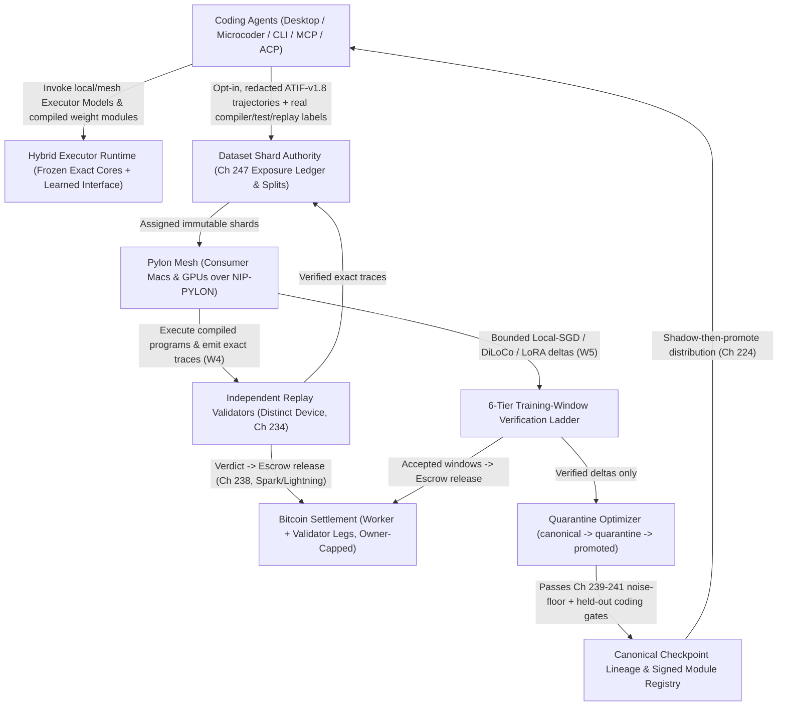
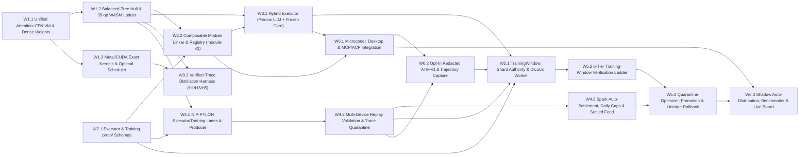

# OpenAgents Executor Network: Master Specification

**Date:** 2026-11-20  
**Status:** Master specification & execution plan (supersedes ad-hoc notes; extends [exact-computation.md](exact-computation.md) and Part XXIII of [the Psionic book](../book/PLAN.md#xxiii-programs-compiled-into-weights))  
**Scope:** End-to-end architecture and workstreams uniting **Tassadar / Percepta compiled exact-computation transformers**, **Pylon decentralized trace verification and training**, **Bitcoin/Spark receipt-first settlement**, and **OpenAgents coding agents** (Microcoder, OpenAgents Desktop, CLI, MCP/ACP) into a verifiable AI network-effect flywheel.

> **Honesty notice (2026-11-20):** Nothing in this document is qualified merely by specifying it. Chapters 226–237 of Psionic currently run bounded CPU `binary64` prototypes, and Chapter 238 runs an in-process buyer escrow without live Spark settlement. Every claim below separates **what exists today** from **what must be built and verified** under the repository's *"Done means the real thing works"* rule (`AGENTS.md`).

---

## 1. The Vision: Bringing Network Effects to AI

Frontier coding models today improve in closed labs between discrete releases: users pay tokens, encounter the same deterministic failure modes (broken edits, miscounted line offsets, invalid schemas, drifted state, failed constraint solving, repeated tool round-trips), and their usage neither improves their own agent immediately nor rewards them for verifying or contributing compute.

OpenAgents closes that loop across four owned systems already built in Coax:

1. **Exact computation compiled into weights (Psionic Part XXIII — Percepta / Tassadar):** Programs and deterministic subroutines are compiled—not approximated by gradient descent—into transformer weights (`W_Q/W_K/W_V/FFN`) whose attention reads exact memory on a parabola `(2k, -k²)` in `O(log t)` time, whose ReLU/ReGLU layers compute exact arithmetic and branches, and whose token trace is a replay-verifiable receipt.
2. **Hybrid executor models (Frozen exact core + learned interface):** Empirical evidence from both pre-reset Tassadar (103.6M-token sweep: `0.0` exact rollout for pure next-token students vs. `1.0` for frozen core + learned interface) and Psionic Chapters 235–236 proves the winning architecture: **keep exact computation deterministic inside digest-pinned compiled weight cores and composable weight modules, and train neural routing, tool-program synthesis, and control interfaces around them.**
3. **Pylon decentralized trace factory & training network (`NIP-PYLON` + Part XII/XX/XXIII):** Users contribute idle Apple Silicon (Metal) and NVIDIA (CUDA) machines as Pylons. Pylons earn Bitcoin (Spark/Lightning) for two independently verified classes of work:
   - **Verified exact-trace execution & validation:** Generating and independently replaying deterministic execution traces on distinct devices to mint provably correct training corpora and verify real workloads.
   - **Bounded decentralized training windows:** Downloading a pinned executor checkpoint + assigned verified dataset shard, executing bounded Local-SGD / DiLoCo / LoRA updates locally, and submitting compact signed weight deltas that enter a **quarantine optimizer**—never mutating canonical weights without passing independent verification, canary checks, and held-out promotion gates.
4. **Immediate inclusion in the world's best coding agents (OpenAgents Desktop, Microcoder, CLI, MCP/ACP):** Newly promoted executor models, learned routing adapters, and composable digest-pinned weight modules (`module-v2`) ship automatically to every user's coding agent via signed manifests and shadow-to-promote rollouts (Chapter 224). Opt-in, secret-redacted coding sessions (captured in `ATIF-v1.8` with real compiler/test/replay verifier labels—never LLM self-summaries) continuously feed real-world failure cases back into the Pylon shard authority.

### Core Standing Rules

Every contributor and agent implementing this specification is bound by these non-negotiable rules (carried from [exact-computation.md](exact-computation.md), pre-reset `RESEARCH_PLAN.md`, `INVARIANTS.md`, and `AGENTS.md`):

1. **A CPU is faster for standalone batch execution—state it beside every benchmark.** Compiled transformer execution ran ~0.00075× native CPU speed in pre-reset Tassadar (9,321 vs. 12.46M steps/s on 9×9 Sudoku). The goal is **zero-cost replay verification, composable weight-space software modules, and exact cores native to neural/agentic systems**, never claiming transformers beat bare CPUs at raw loops.
2. **Name the exact path that ran.** Never report a CPU reference interpreter's speed as model speed, and never pass a fixture or mock as a real run.
3. **Done means the real thing works.** No vocabulary-of-4 models, no CPU functions named "metal", no fake manifest files, no toy 5-instruction programs claimed as general execution, and no simulated payments counted in settled totals.
4. **No public gradient mutates canonical weights directly.** Public updates enter a **quarantine checkpoint** only; canonical weights advance strictly through atomic, digest-pinned promotion after passing independent held-out gates.
5. **Coax first, `proto/` first, `#authority` zero-mutant.** All policy, verification, escrow, scheduling, admission, and wire logic lives in Coax with `#authority` files at zero surviving mutants (`coax mutate`). Every wire/stored shape is registered in `proto/registry.json` (`wire-check` clean). Platform hosts (C, Swift, Metal, CUDA) perform platform effects only.
6. **Bitcoin-only money.** Settlement uses Spark / Lightning through `pay/` (`pay/wallet.coax`, `pay/wallet-policy.coax`). No alternative coins or tokens.
7. **Ship the falsifier with every claim.** Every workstream ships tamper fixtures, planted bugs, or held-out regressions that prove the verification gate actually catches lies.
8. **Privacy by construction.** Coding-session telemetry is **default OFF**, explicitly opt-in, secret/PII-redacted with user preview before upload, and bound to an exposure ledger so held-out evaluation suites are never contaminated.

---

## 2. Current Baseline Audit (2026-11-20)

This inventory records what is actually implemented on `main` today and the exact gaps that this master spec closes.

### 2.1 Part XXIII (Psionic Book Chapters 226–238)

| Chapter | Coax Library | Current Profile & Capability | Concrete Gap to Production |
| :--- | :--- | :--- | :--- |
| [226](../book/ch226-a-machine-whose-state-is-a-trace.md) | `psionic/lib/trace-machine.coax` | Runnable CPU stack VM (10 ops, 64 memory cells, locals, 4-int trace & digest). | Small 10-op toy ISA; needs Percepta 35-op WASM/bytecode ladder & real program benchmarks. |
| [227](../book/ch227-attention-as-exact-memory.md) | `psionic/lib/exact-memory.coax` | Runnable parabolic keys `(2k, -k²)`, hard-max read, uniform prefix sums, `O(n)` scan. | Separate from Ch 229 compiled blocks; integer scan only, not fused into dense transformer weights. |
| [228](../book/ch228-arithmetic-and-branches-from-relu.md) | `psionic/lib/relu-arith.coax` | Runnable ReLU/ReGLU gadgets (`mul`, `step`, `eq0`, `select`) exact in `binary64` within `2^53`. | Single-layer hand-placed gadgets; operands capped at `2^26`. |
| [229](../book/ch229-compile-a-gate-graph-into-a-block.md) | `psionic/lib/gate-graph.coax` | Runnable gate-graph compiler to straight-line ReLU residual blocks (`binary64`). | Capped at **16 inputs / 128 nodes**, no attention layers, greedy scheduler only, no standard dense checkpoint export. |
| [230](../book/ch230-a-harness-that-catches-the-compiler.md) | `psionic/lib/compiler-harness.coax` | Runnable 3-way differential harness with 4 planted compiler bug families. | Scoped to Ch 229's 16-node straight-line blocks; must expand to attention+FFN blocks, WASM ladder, and GPU kernels. |
| [231](../book/ch231-an-interpreter-in-weights-or-one-program-in-weights.md) | `psionic/lib/interpreter-weights.coax` | Runnable `iw-v1`: universal interpreter (25,086 weights, 7 layers, width 37) vs. specialized single-program block on a **3-register, 4-op, ≤5-instruction** toy. | **Biggest technical gap:** does not run Ch 226's stack+memory VM or real programs (Sudoku, Hungarian, Coder tool programs); CPU-only. |
| [232](../book/ch232-decode-in-logarithmic-time.md) | `psionic/lib/hull-memory.coax` | Runnable `hull-v1`: binary search over sorted parabolic keys (~44× fewer reads on 512 writes). | Flat 64-entry shifted array (`O(n)` inserts); needs balanced tree / Li Chao hull for `≥ 1M` steps and wide address spaces. |
| [233](../book/ch233-from-hard-max-to-softmax.md) | `psionic/lib/soft-memory.coax` | Runnable `β ≥ ln(4V)` bound & precision study (`f64` holds to 65,536 writes; `f32`/`bf16` fail early). | CPU analysis only; needs GPU `f64`/exact-emulated runtime verification under real attention kernels. |
| [234](../book/ch234-exact-replay-as-a-verification-class.md) | `psionic/lib/replay.coax` | Runnable `replay-v1`: full & windowed replay (≤65,536 steps), first-divergent-step verdicts. | Local/in-process only; not wired to Pylon mesh receipts, signed third-party verification, or `proto/` schemas. |
| [235](../book/ch235-can-gradient-descent-learn-exact-execution.md) | `psionic/lib/students.coax` | Runnable `students-v1`: full-batch CPU GD over tiny affine/gated/table models (confirms H1). | Tiny CPU linear/gated students only; no real GPU transformer student / distillation sweep harness. |
| [236](../book/ch236-a-frozen-exact-core-with-a-learned-interface.md) | `psionic/lib/core-interface.coax` | Runnable `core-v1`: frozen Ch 229 core + 12-source softmax controller (`19/20` exact, `1` clean refusal, `0` wrong). | Toy per-instruction lookup table; not connected to real Psionic LLMs, LoRA adapters, or Coder Ch 8 tool programs. |
| [237](../book/ch237-composable-weight-modules.md) | `psionic/lib/weight-module.coax` | Runnable `module-v1`: digest-pinned Ch 229 block linker with verification labels. | Capped at **64 slots / 32 layers / 4 seams**; FFN-only (no attention); no package/registry format or real coding-agent modules. |
| [238](../book/ch238-pay-for-verified-work.md) | `psionic/lib/peer/pay.coax` | **Partly implemented:** in-process buyer escrow, cap checks, idempotent intents, log recount, wallet boundary. | No real Spark payout, no worker self-test admission, no separate paid validator device, wired to Ch 195 `f32` stage instead of Ch 234 replay, no signed `proto/` receipts, no daily cap reset. |

### 2.2 Adjacent Owned Infrastructure Ready to Reuse (`docs/reuse.md`)

| Subsystem | Existing Files | How This Spec Reuses & Extends It |
| :--- | :--- | :--- |
| **Pylon Mesh & Nostr** | `nostr/nips/openagents/NIP-PYLON.md`, `psionic/lib/pylon/{beacon,decision,queue,run,selfcheck}.coax`, `psionic/lib/peer/{audit,link,policy,trust,pay}.coax`, `apps/openagents-cli/pylon.coax` | Add executor-trace, replay-validator, and training-window lanes on top of existing NIP-PYLON `30200` beacons, `3201` receipts, `1985` NIP-32 verdicts, and `30201` pool aggregates. |
| **Psionic Training & GPU** | `psionic/lib/{module,module-train,autodiff,tensor-ir,trainer}.coax`, `psionic/lib/checkpoint/`, `ch129` (CUDA 10.8M-param 237k tok/s BF16 / 108k FP32), `ch140` (LoRA), `ch132`–`ch135` | Reuse existing tensor IR, autodiff, AdamW/Muon, LoRA, checkpoint record, and CUDA/Metal backends for W3 hybrid interfaces and W5 Local-SGD / DiLoCo training windows. |
| **Evaluation & Gating** | `psionic/lib/{suite,noise,verdict,training-rows}.coax` (Ch 239–241, 247), Ch 224 (`shadow`) | Reuse `#authority` three-digest suites, noise-floor bootstrap, three-way verdicts (`passed`/`failed`/`unverifiable`), exposure ledger, and shadow-then-promote rollouts. |
| **Payments (Bitcoin/Spark)** | `pay/{wallet,wallet-policy,wallet-vault,wallet-backup}.coax`, `apps/openagents-desktop/Window+Wallet*.swift` | Reuse `#authority` Spark wallet & policy rules for Ch 238 receipt-first payouts under owner caps in `NEEDS_OWNER.md`. |
| **Coding Agents & Evals** | `psionic/lib/harness/program.coax` (Coder Ch 8), `coax/lib/microcoder/`, `apps/openagents-desktop/` (`Window+Providers.swift`, `Window+Settings.swift`, `settings.coax`, `LocalModelStore`/`LocalModelServer`), `apps/openagents-cli/mcp.coax`, `evals/session-history/` (`ATIF-v1.8` `ingest.coax`, `mine.coax`, `compare.coax`) | Integrate promoted executor models & compiled weight modules directly into Microcoder, OpenAgents Desktop, and universal MCP/ACP tools; capture opt-in redacted `ATIF-v1.8` outcomes into W5 shards. |

---

## 3. Architecture & Technical Specification by Workstream

Work is organized into **six sequential/overlapping workstreams (W1–W6)** comprising **17 engineering deliverables**. No downstream workstream may mock an unfinished upstream contract as "complete."

---

### Workstream 1 (W1): Full Compiled Transformer VM Substrate

**Objective:** Replace the 5-instruction register toy (`iw-v1`) and 16-input straight-line block with a real, hardware-accelerated compiled transformer VM that executes full programs (9×9 Sudoku, 10×10 Hungarian assignment, and real Coder tool programs) bit-for-bit against a reference interpreter.

#### W1.1 — Unified Attention+FFN Compiled Transformer Block & Dense Weight Materialization (`exec-vm-v1`)
- **Problem today:** Ch 227/232 (attention memory) and Ch 229 (ReLU FFN blocks) are separate, and Ch 229 caps out at 16 inputs / 128 nodes with custom scalar-lane arrays instead of standard loadable weight matrices.
- **Specification:**
  - Define profile `exec-vm-v1`: a standard multi-layer causal transformer block alternating **parabolic hard-max attention heads** (2D key projections `(2k, -k²)`, recency-weighted tie-breaking, uniform prefix-sum heads) and **ReLU/ReGLU residual FFN layers** (no RMSNorm, no SiLU, explicit `binary64` exactness envelope).
  - Remove the hard 16-input / 128-node static ceiling via caller-allocated bounded arenas sized by admission preflight.
  - Materialize dense, engine-loadable weight tensors (`W_Q`, `W_K`, `W_V`, `W_O`, `W_gate`, `W_up`, `W_down`, head masks, and exact metadata) into Psionic's native safetensors/checkpoint format (`psionic/lib/checkpoint/`), pinned by SHA-256 artifact digest.
  - Compile the **entire Ch 226 stack+memory VM** (locals, operand stack, 64+ linear memory cells, conditional branches, output, return) into one loadable `exec-vm-v1` transformer artifact whose token-by-token autoregressive rollout reproduces Ch 226's trace digest bit-for-bit.
- **Verification:** Ch 230 differential harness extended to attention+FFN blocks with planted bugs in both attention routing and FFN slot reuse; independent Python oracle (`psionic/tests/`) verifying dense matmul execution matches Coax bit-for-bit.

#### W1.2 — Balanced-Tree `O(log t)` Convex-Hull Attention & Percepta WASM Window Ladder (`wasm-exec-v1`)
- **Problem today:** Ch 232 uses a 64-entry array shift (`O(n)` insert), and Ch 226's 10-op ISA cannot express non-trivial software.
- **Specification:**
  - Replace Ch 232's flat shifted array with a deterministic, caller-allocated **balanced search tree / Li Chao upper-convex-hull index** giving `O(log t)` reads AND `O(log t)` inserts for up to `≥ 1,048,576` trace writes and key range `±2^20` (and wider segmented ranges). Retain exact comparison-count receipts proving bit-identical equivalence to the `O(t)` linear scan.
  - Implement the versioned **Percepta-aligned WASM/bytecode window ladder** (`wasm-exec-v1`):
    - **Profile `wasm-core-i32-v1`:** ~35 deterministic `i32` opcodes — constants, locals, globals, structured control (`block`, `loop`, `if`/`else`, `br`, `br_if`, `call`, `return`), arithmetic/bitwise/comparisons (`add`, `sub`, `mul`, `div_s`, `rem_s`, `and`, `or`, `xor`, `shl`, `shr_s`, `eq`, `ne`, `lt_s`, `le_s`, `gt_s`, `ge_s`), linear memory (`i32.load`, `i32.store` with bounds checks), and typed traps (divide-by-zero, out-of-bounds memory, stack overflow, step-budget exhaustion).
    - Every trace pins `(profile_id, compiler_hash, executor_artifact_hash, program_hash)`.
  - **Real benchmark suite (no toy stand-ins):** Compile and execute:
    1. **9×9 Sudoku solver** (non-trivial backtracking puzzles, 4+ distinct held-out instances),
    2. **10×10 Hungarian assignment solver** (4+ held-out cost matrices),
    3. **Real Coder Ch 8 tool-program evaluator** (extending `psionic/lib/harness/program.coax`).
  - Report native CPU interpreter steps/s beside compiled-weight steps/s on every run.

#### W1.3 — Hardware-Accelerated Exact Execution on Metal & CUDA (`exec-gpu-v1`) + Optimal Slot-Reuse Scheduler
- **Problem today:** All compiled-block forward passes run single-threaded on CPU, and Ch 229 uses a simple greedy slot allocator.
- **Specification:**
  - Implement **CUDA (`f64` native)** and **Metal (Apple Silicon: explicit compensated double-single `f32×2` or exact 64-bit integer/fixed-point arithmetic where native `f64` is absent)** execution kernels for `exec-vm-v1` / `wasm-exec-v1` dense FFN layers and hull/batched attention steps, reusing Psionic's device execution and kernel qualification rules (Ch 37, 43–44).
  - Verify **bit-for-bit trace digest equality** across CPU `binary64`, CUDA, and Metal on the full W1.2 benchmark suite (Sudoku, Hungarian, WASM conformance, Coder programs), plus explicit Ch 233 softmax-vs-hard-max precision-boundary tests on device.
  - Upgrade Ch 229's scheduler with a formal **liveness + interval-coloring / optimal branch-and-bound slot-reuse optimizer** that minimizes residual width and layer depth, formally validated by Ch 230's differential harness + planted scheduling bugs, reporting width/depth/weight-count/steps-per-second deltas against the greedy baseline.

---

### Workstream 2 (W2): Composable Weight Modules & Protocol Contracts ("Agentic npm")

**Objective:** Make compiled weight programs first-class, versioned, composable, cryptographically pinned software artifacts with single-codec `proto/` contracts across the entire OpenAgents stack.

#### W2.1 — Protocol Schemas & Single-Codec Wire Contracts (`proto/openagents/executor/v1alpha1/`)
- **Specification:** Define `.proto` schemas (and JSON profiles where hand-packed/hashed bytes are signed) under `proto/openagents/executor/v1alpha1/` and register every row in `proto/registry.json` (`coax/web/tool.sh wire-check` clean):
  - `CompiledModuleManifest`: `module_id`, `version`, `profile_id`, `compiler_hash`, `weight_sha256`, `input_abi`, `output_abi`, `conformance_suite_sha256`, `verification_class` (`E_EXACT_REPLAY` | `D_DETERMINISTIC_TEST` | `S_STATISTICAL` | `N_UNVERIFIED`), `max_steps`, `memory_bytes`.
  - `ExecutionTraceReceipt` & `ReplayVerdict`: signed Nostr/proto envelope binding `job_id`, `program_hash`, `executor_artifact_hash`, `worker_pubkey`, `worker_device_ref`, `step_count`, `output_digest`, `trace_digest`, `chunk_merkle_root`, and independent `validator_pubkey`, `validator_device_ref`, `verdict` (`EXACT_REPLAY` | `FAILED` | `UNVERIFIABLE`), `first_divergent_step`.
  - `TrainingWindowClaim`, `TrainingWindowVerdict`, `CheckpointLineageRecord`: binding `parent_checkpoint_sha256`, `optimizer_state_sha256`, `dataset_shard_sha256`, `training_config_sha256`, `seed`, `step_range`, `delta_sha256`, `loss_stats`, `tier_results`, `promotion_verdict`.
  - `VerifiedPayoutIntent` & `SettlementReceipt`: binding `receipt_digest`, `leg` (`WORKER` | `VALIDATOR`), `amount_msat`, `network`, `settlement_commitment`, `real_bitcoin_moved`, `period_id`.
- Every codec lives in one `#authority` Coax file with zero surviving mutants and golden round-trip fixtures in `proto/psionic/`.

#### W2.2 — Production Composable Weight-Module Linker, Conformance Gate & Coding-Agent Module Library (`module-v2`)
- **Problem today:** Ch 237 (`module-v1`) caps at 64 residual slots, 32 layers, 4 seams, and FFN-only blocks with no package layout or real-world modules.
- **Specification:**
  - Upgrade `psionic/lib/weight-module.coax` to `module-v2`: links arbitrary `exec-vm-v1` (attention + FFN) modules without recompiling either source, preserving exact bit-for-bit replay equivalence across arbitrary seam counts within caller-admitted memory budgets.
  - Define the local & mesh artifact store at `~/.openagents/modules/<sha256>/` (`manifest.pb`/`json`, `weights.safetensors`, `conformance.json`). A module is refused on load unless its SHA-256 matches, its conformance suite passes deterministically, and its verification class (`E`/`D`/`S`/`N`) is explicitly displayed to callers.
  - Build and ship the **first four real coding-agent utility weight modules** (compiled to `exec-vm-v1` weights, verified class `E`):
    1. **`oa-exec-diff-verify`**: exact hunk/line-range & unified-patch applicability checker (directly targeting Microcoder's 23% edit-failure problem documented in `docs/coder/2026-11-12-microcoder-plan.md`).
    2. **`oa-exec-json-schema`**: exact bounded JSON & protocol-schema validator for tool-call arguments and wire records.
    3. **`oa-exec-dep-sched`**: exact DAG topological sort, cycle detection, and task-dependency scheduler.
    4. **`oa-exec-arith-budget`**: exact 64-bit integer arithmetic, unit conversion, and token/satoshi budget accounting with overflow refusal.
  - Demonstrate linking two modules (e.g., `oa-exec-json-schema` → `oa-exec-diff-verify`) into a single composite weight artifact that replays bit-for-bit identically to sequential execution and to the native Coax reference.

---

### Workstream 3 (W3): Hybrid Executor Models — Frozen Exact Cores + Learned Interfaces & Falsifiable Distillation

**Objective:** Bridge exact compiled weights to real Psionic neural language models so agents actually *use* exact execution natively—and run an honest, falsifiable GPU experiment on how far verified traces can improve neural models themselves.

#### W3.1 — Hybrid Executor Architecture: Real Psionic Transformer Routing to Frozen Compiled Cores (`hybrid-exec-v1`)
- **Specification:**
  - Build a real hybrid runtime connecting an owned Psionic transformer backbone (starting with our Qwen3.5 / Elephant / nanochat / Inkling-scale checkpoints using Ch 117 `Module` and Ch 140 LoRA adapters) to one or more frozen, digest-pinned `exec-vm-v1` / `module-v2` compiled cores behind explicit **ABI control tokens** (`<exec_call>`, `<exec_arg>`, `<exec_trace>`, `<exec_refuse>`, `<exec_return>`).
  - Combine Ch 53 constrained grammar decoding (from Coder Ch 8 `program.coax`) with learned routing/LoRA heads so the backbone decides *when* to invoke a frozen compiled core, marshals arguments cleanly, executes deterministic steps inside the compiled core (zero approximation), and continues generation conditioned on the exact result or typed refusal.
  - Support **pluggable LoRA/router adapter hot-swapping** pinned to `(base_model_sha256, core_module_sha256)` so W5 decentralized training updates only compact, auditable routing/interface adapters while keeping the compiled core bit-exact and immutable.
  - **Acceptance gate:** End-to-end real inference on held-out multi-step coding/verification tasks (patching, constraint scheduling, exact math/accounting, schema validation) beating the same base model without the frozen core on Ch 234 exact-replay acceptance AND Ch 240/241 statistical gates, with **zero silent arithmetic hallucinations** (out-of-range inputs must produce typed refusals).

#### W3.2 — Verified-Trace Distillation & Learned-Exactness Research Harness (`trace-distill-v1`, Falsifiable H1/H3/H5 Track)
- **Specification:**
  - Build a repeatable GPU training & evaluation harness (on Ch 129 CUDA / Metal + Ch 136 SFT + Ch 139 on-policy RL + Ch 247 exposure ledger) consuming verified exact traces from W1/W4.
  - Enforce the strict scoring discipline from Ch 235: **every student is scored exclusively by autoregressive self-rollout replayed by Ch 234**, reporting (a) **first divergent step** and (b) **exact pass@1 at 2×, 4×, and 8× training length on held-out program families**. Training loss is printed for diagnostics only and never counts as a pass.
  - Execute three controlled, pre-registered experiments on real GPU checkpoints (not tiny linear tables):
    1. **Baseline A (H1 check):** Next-token SFT on verified exact traces.
    2. **Variant B (H5 check):** Auxiliary intermediate-state supervision + RL with Ch 234 exact-replay reward.
    3. **Variant C (H3 check):** Analytic parabolic-key initialization + max-margin attention lookup loss + sharpness (`β`) annealing.
  - Publish full, unedited receipts in `docs/verification/` regardless of outcome. If H3/H5 fail to achieve length extrapolation, record the falsification cleanly and keep W5 focused exclusively on H2 (routing/interface/tool-synthesis LoRA & controller training around frozen exact cores).

---

### Workstream 4 (W4): Pylon Verified Trace Factory & Paid Distributed Verification

**Objective:** Turn the Pylon mesh (`NIP-PYLON`) into a live, self-serve, multi-device verified execution and validation network that pays real Bitcoin (Spark/Lightning) for replay-verified work—closing every remaining gap in Chapter 238.

#### W4.1 — NIP-PYLON Executor & Training Lanes, Capability Self-Test Admission & Diverse Open-Window Producer
- **Specification:**
  - Extend `nostr/nips/openagents/NIP-PYLON.md` and `psionic/lib/pylon/` with three new CAP services & lanes (preserving backwards compatibility with existing v1/v2 beacons):
    - `pylon/executor-trace` (`cj-executor` lane): executes digest-pinned `exec-vm-v1` / `wasm-exec-v1` jobs and returns `ExecutionTraceReceipt`.
    - `pylon/executor-validate` (`cj-validate` lane): independently replays submitted traces and publishes NIP-32 kind `1985` + `ReplayVerdict`.
    - `pylon/training-window` (`cj-training` lane): claims and executes bounded W5 training windows.
  - Extend `psionic/lib/pylon/selfcheck.coax` (Ch 218) so a Pylon **cannot advertise** any executor, validator, or training slot until it passes a digest-checked local self-test (reproducing shipped reference trace digests on its declared CPU/Metal/CUDA backend, refusing any silent toy fallback).
  - Build the **Open-Window Producer** and **`next-unpaired` discovery** (`openagents pylon executor start`, `openagents pylon validate --auto`):
    - Maintains a bounded rolling pool of claimable executor workloads drawn from diverse program families, real benchmarks, and W6 coding-agent verification jobs.
    - Hard diversity & deduplication rule (lesson from pre-reset Tassadar): **refuse to re-issue identical `(program_hash, input_hash)` windows within a season**; cap total open windows per period.

#### W4.2 — Independent Multi-Device Replay Validation, Quarantine & Trace-Factory Admission Policy
- **Specification:**
  - Wire Ch 234's exact replay verifier (`psionic/lib/replay.coax`) into `psionic/lib/peer/audit.coax` and `openagents pylon validate`.
  - Enforce `#authority` pairing & integrity rules (0 surviving mutants):
    - **Distinct key AND distinct device ref:** refuse closeout whenever `validator_pubkey == worker_pubkey`, same NIP-OA owner (for public pools), or `validator_device_ref == worker_device_ref`.
    - **First-divergence output:** every `FAILED` verdict names the exact step index and expected vs. observed token/state tuple.
    - **Tamper-fixture gate:** automated conformance suite alters program digest, trace row, output digest, device ref, and signatures and asserts 100% rejection.
  - Implement the **4-tier Trace-Factory Validator Ladder** and **Quarantine-Before-Admission** policy into Ch 247 (`psionic/lib/training-rows.coax`):
    - **Tier 0:** Schema, signature, and profile-version check.
    - **Tier 1:** Digest & Merkle-root self-consistency check.
    - **Tier 2:** Independent device replay (windowed spot-check or full Ch 234 replay).
    - **Tier 3:** Redundant second validator check for high-value or anomalous workloads.
    - Submitted traces stay in **quarantine** until a validator transitions them to `Verified`. Corpus counts, shard builders, and public boards rebuild strictly from validated transitions—never from raw uploads. **"Never train from unverified artifacts."**

#### W4.3 — Receipt-First Bitcoin (Spark/Lightning) Auto-Settlement, Daily Caps & Public Settled Feed (Completing Ch 238)
- **Specification:**
  - Upgrade `psionic/lib/peer/pay.coax` (`#authority`, 0 surviving mutants) to consume W4.2 `ReplayVerdict` and W5.2 `TrainingWindowVerdict` events (replacing the in-process Ch 195 `binary32` placeholder) and emit idempotent `VerifiedPayoutIntent` records for **both worker and validator legs** (one settlement per `(receipt_digest, leg)`).
  - Add rolling **24-hour UTC period accounting** with automatic cap reset, per-payout caps, per-worker rate caps, and global daily spend ceilings.
  - Wire the wallet boundary to the real Breez Spark wallet stack (`pay/wallet.coax`, `pay/wallet-policy.coax`, `spark-helper`), enforcing **owner-signed arming** (`NEEDS_OWNER.md`) before any mainnet sats move:
    - Full end-to-end automated qualification runs on **regtest / signet / testnet** first, proving a fully hands-off autonomous external `worker ≠ validator` pair (`trace_submitted → verification_verified → real_bitcoin_moved → settlement_recorded`, with tampered digests withheld and duplicate submissions deduplicated).
    - Mainnet arming remains an explicit owner action with explicit satoshi caps.
  - Publish a **reconciled public settled feed** and Grid Pylon pool projection (`NIP-PYLON` kind `30201`) recomputed from the append-only event log, strictly separating test-network sats from `bitcoin` mainnet and **excluding all `real_bitcoin_moved == false` rows from paid totals**.

---

### Workstream 5 (W5): Decentralized Training of Executor Models on Pylons

**Objective:** Enable hundreds/thousands of user Pylons to collaboratively train and improve executor models (routing/interface adapters, tool-program synthesizers, and experimental student backbones) without trusting any single contributor and without requiring datacenter interconnects.

#### W5.1 — Bounded Training-Window Protocol, Dataset Shard Authority & Bandwidth-Aware Local-SGD / DiLoCo Worker
- **Specification:**
  - **The work unit (`TrainingWindow`):** Pylons are paid for *accepted training windows*, never raw GPU hours. Every window cryptographically binds:
    - `model_checkpoint_sha256` (exact canonical parent),
    - `optimizer_state_sha256` (outer/inner optimizer snapshot),
    - `dataset_shard_sha256` (assigned verified shard),
    - `training_config_sha256` (hyperparameters, LoRA rank/targets, precision policy, step count),
    - `random_seed`, `worker_pubkey`, `worker_device_ref`, `start_step..end_step`,
    - `weight_delta_sha256` (compact quantized/compressed pseudo-gradient or LoRA diff), and `loss_stats`.
  - **Dataset Shard Authority:** Builds immutable, decontaminated binary shards exclusively from (a) W4.2 `Verified` exact traces and (b) W6.2 `Verified` redacted `ATIF-v1.8` coding trajectories. Splits strictly by **program family / repository / time** (never by random row) and enforces Ch 247's **exposure ledger** so held-out eval tasks can never leak into a training shard.
  - **Bandwidth-Aware Worker (`openagents pylon train`):** Implements **windowed Local-SGD / DiLoCo (Distributed Low-Communication) + LoRA-delta** training in Psionic (reusing Ch 121–125, 129, 132–135, 140) on Apple Silicon (Metal) and NVIDIA (CUDA):
    1. Claim an open `TrainingWindow` lease over NIP-PYLON.
    2. Fetch/verify the pinned base checkpoint + assigned shard (resumable, SHA-256 verified, cached in `~/.openagents/models/`).
    3. Run `H` local inner optimizer steps (e.g., `H = 50–500` AdamW/Muon steps) locally with exact resume checkpoints.
    4. Compute the compact pseudo-gradient delta (`Δθ = θ_parent - θ_local`, or LoRA `(ΔA, ΔB)`), sign and upload via content-addressed storage, and publish `TrainingWindowClaim`.
    - Zero synchronous all-reduce over home internet; tolerant of consumer disconnects, heterogeneous speeds, and dynamic joins/leaves.

#### W5.2 — 6-Tier Training-Window Verification Ladder & Byzantine/Outlier Rejection
- **Specification:** Implement `#authority` verification policy (`psionic/lib/peer/train-verify.coax`, 0 surviving mutants) to defend against lazy, noisy, or malicious (Byzantine/poisoning) Pylons:
  - **Tier 0 (Admission):** Valid signature, fresh lease, exact match on `model_checkpoint_sha256`, `dataset_shard_sha256`, `training_config_sha256`, finite tensors (zero NaN/Inf).
  - **Tier 1 (Deterministic Step Spot-Check):** An independent validator Pylon on a distinct device re-runs a deterministic subset of steps (using the bound seed, shard slice, and config) and checks delta/loss agreement within backend-calibrated honest distance tolerances (Ch 219 `distance.coax`). Catches fabricated or random deltas immediately.
  - **Tier 2 (Redundant Replication):** For untrusted or newly admitted workers (or high-weight windows), assign the same `(checkpoint, shard, seed)` window to 2–3 distinct devices and require pairwise agreement.
  - **Tier 3 (Statistical & Byzantine Filtering):** Reject outlier updates by per-layer L2 norm caps, loss-improvement sanity bounds, cosine similarity against the round's cohort median, and coordinate-wise trimmed-mean / geometric-median aggregation (Krum / trimmed-mean outer step).
  - **Tier 4 (Quarantine Canary Eval):** Apply the aggregated round delta to the **quarantine checkpoint** and run fast deterministic canaries (Ch 234 replay exactness, refusal preservation, calibration check).
  - **Tier 5 (Downstream Survival Bonus):** Optional bonus satoshi payout released only if the promoted checkpoint survives `K` subsequent canonical rounds without rollback.
  - **Falsifier suite:** Planted attacks (zero-delta freerider, random noise, inverted-sign poisoning, backdoor trigger injection, stale checkpoint replay) must be 100% caught and rejected with zero payouts.

#### W5.3 — Quarantine Optimizer, Three-Checkpoint Promotion (`canonical → quarantine → promoted`) & Lineage Rollback
- **Specification:**
  - Enforce the strict **three-checkpoint state machine** (`psionic/lib/peer/quarantine-opt.coax`, `#authority`):
    1. **`canonical`**: The active immutable production checkpoint served to users and used as parent for new windows.
    2. **`quarantine`**: Receives outer-optimizer (Nesterov/DiLoCo momentum) merges of Tier 0–3 verified `TrainingWindow` deltas. Never distributed to users.
    3. **`promoted`**: Quarantine advances to canonical **only** when it passes **all** frozen promotion gates:
       - Ch 239–241 **Decision Gate (`decision-v1`)**: held-out pass rate improves beyond the measured 2σ noise floor (or non-regression on retention suites while gaining on target suites).
       - Ch 241 **Probability Gate (`probability-v2`)**: log loss and confident-error rate do not regress (explicitly preventing the pre-reset LoRA failure mode where accuracy rose from 0.77→0.90 while log loss worsened from 1.95→2.32).
       - Ch 234 **Exactness Gate**: 100% bit-exact replay preserved on all frozen compiled core interfaces; 0 silent wrong answers on out-of-range inputs.
       - **Cost/Latency Guard (`ext-eval-v2`)**: inference latency and memory stay within budget.
  - **Immutable Checkpoint Lineage:** Every canonical checkpoint publishes a signed `CheckpointLineageRecord` naming `parent_sha256`, every included `TrainingWindow` ID, every `dataset_shard_sha256`, every eval suite digest (items/questions/gate), promotion verdict, and settlement refs.
  - **One-command Atomic Rollback:** If shadow monitoring (W6.3) or a post-promotion audit detects regression, canonical rolls back atomically to `parent_sha256`, quarantines the suspect window IDs, and slashes/suspends offending Pylons' trust standing.

---

### Workstream 6 (W6): Coding-Agent Integration & The Network-Effect Flywheel

**Objective:** Make every promoted executor model and compiled weight module immediately usable inside OpenAgents Desktop, Microcoder, CLI, and external coding agents (Claude Code, Codex, Cursor, Antigravity), and close the privacy-safe feedback loop that turns real user coding sessions into continuously improving models.

#### W6.1 — First-Class Executor & Weight-Module Tooling in Microcoder, OpenAgents Desktop & MCP/ACP
- **Specification:**
  - **Microcoder (`coax/lib/microcoder/`, `coder/tui/mcworker.coax`):**
    - Add local/Pylon **hybrid executor calls** and **compiled weight-module invocation** (`oa-exec-diff-verify`, `oa-exec-json-schema`, `oa-exec-dep-sched`, `oa-exec-arith-budget`) directly into Microcoder's edit/plan/tool loop (extending Coder Ch 8 `program.coax` and Ch 12 Psionic-served models).
    - Pre-verify multi-file edits and structured tool arguments through compiled exact modules before touching disk—measuring edit-failure rate reduction directly.
  - **OpenAgents Desktop (`apps/openagents-desktop/`):**
    - Extend `LocalModelStore` / `LocalModelServer` (`Window+Settings.swift`, `Window+Providers.swift`, `psionic/lib/inkling-desktop.coax`) to discover, verify (SHA-256 + signature), download, delta-update, and serve **Executor Models & Weight Modules** locally on Metal GPU (or seamlessly burst to verified Pylons over `NIP-PYLON`).
    - Show explicit verification class badges (`Exact Replay [E]`, `Deterministic [D]`, `Statistical [S]`) and checkpoint lineage in the Desktop UI—never lying about installation or readiness.
  - **Universal MCP & ACP Bridge (`apps/openagents-cli/mcp.coax`):**
    - Expose compiled weight modules and promoted hybrid executor tools via standard MCP and ACP endpoints so **Claude Code, Codex, Cursor, and Antigravity** (already wired in Desktop `Window+Providers.swift`) can immediately leverage the community-trained executor layer.

#### W6.2 — Opt-In Redacted Coding-Agent Trajectory Capture (`ATIF-v1.8` → Verified Training Shards)
- **Specification:**
  - Build on `evals/session-history/` (`ATIF-v1.8` `ingest.coax`, `mine.coax`) and Coder Ch 18 (`consent-before-sharing`) to let users voluntarily improve the shared executor models from real coding work:
    - **Default OFF, explicit opt-in:** Never uploads a single byte without explicit per-workspace or global user opt-in and a human-inspectable redaction preview.
    - **Deterministic `#authority` redaction pipeline:** Strips API keys, tokens, `.env` secrets, private keys, emails, absolute local paths, proprietary identifiers, and non-consented file bodies before packaging. Refuses upload if secret-scanner heuristics flag unresolved material.
    - **Objective verifier labels only:** Every captured trajectory must carry machine-checked outcomes—`coax check` / compiler diagnostics, unit test exit codes, git patch-apply verdicts, or Ch 234 exact-replay verdicts. LLM self-assessments or unverified chat endings are refused.
    - **Direct feed into W5:** Admitted redacted trajectories enter W5.1's Dataset Shard Authority (quarantined, decontaminated against held-out eval repos/tasks via Ch 247 exposure ledger) and generate real coding-agent training shards for Pylon workers.

#### W6.3 — Shadow-to-Promote Auto-Distribution, Held-Out Coding Benchmarks & Live Network-Effect Dashboard
- **Specification:**
  - **Signed Auto-Distribution & Shadow Rollout (Ch 224):** When W5.3 promotes a new canonical executor checkpoint or LoRA interface adapter, publish a signed update manifest (`openagents.executor-release.v1`). Opted-in Desktop clients and Pylons fetch compact deltas automatically, run new candidates in **shadow mode** beside the current active checkpoint on local tasks, and activate atomically only when shadow disagreement and failure rates stay inside policy bounds (automatic rollback otherwise).
  - **Proving the Network Effect on Real Coding Benchmarks (H7 Qualification):**
    - Seal a frozen, held-out coding benchmark combining **Terminal-Bench** tasks and **real OpenAgents multi-file repository tasks** (building on `docs/coder/2026-11-12-microcoder-plan.md` and `evals/session-history/tools/compare.coax`).
    - Run paired evaluations across **Round 0 (base model)** → **Round 1 (base + compiled modules + initial hybrid interface)** → **Round N (after decentralized Pylon training rounds on verified traces + redacted coding trajectories)**.
    - Publish full, paired receipts: pass rate, edit-failure rate, tool round-trips, wall-clock time, dollar cost, and Ch 240/241 statistical verdicts.
  - **Truthful Live Surfaces (Desktop + `openagents.com/pylon` + Grid):**
    - Add a clean **Pylon & Executor Training** panel in OpenAgents Desktop (`apps/openagents-desktop/`) showing real local Pylon status (idle/executing/validating/training), verified windows contributed, real Spark sats earned, and active executor checkpoint lineage.
    - Project verified training rounds, checkpoint lineage progression, held-out benchmark curves, and reconciled settled Bitcoin totals onto `/pylon` and the Grid wellspring (`NIP-PYLON` `30201`), strictly bound to verified events (never synthetic counters).

---

## 4. Security, Threat Model & Abuse Controls

| Attack / Failure Mode | Concrete Mitigation & `#authority` Enforcement |
| :--- | :--- |
| **Fake or spoofed execution trace** | Independent validator on distinct key + distinct `device_ref` replays trace via Ch 234; digest mismatch triggers `FAILED` verdict naming first divergent step, zero payout, and strike against worker standing. |
| **Wash trading / self-validation** | `NIP-PYLON` + W4.2 refuse any validation where `validator == worker`, same NIP-OA owner, or same `device_ref`. Public pools count receipts only from policy-trusted buyers/checkers. |
| **Re-verifying one trivial program forever** | W4.1 Open-Window Producer enforces per-season deduplication of `(program_hash, input_hash)`, mandatory family diversity quotas, and hard daily window budgets. |
| **Free-riding or poisoned gradients (Byzantine Pylons)** | W5.2 6-tier ladder: Tier 1 deterministic step recompute catches fake deltas; Tier 3 norm/cosine/trimmed-mean filters reject outliers; Tier 4 Quarantine Optimizer prevents any public update from touching canonical weights before passing held-out gates. |
| **Held-out benchmark contamination** | Ch 247 exposure ledger + W5.1 Dataset Shard Authority forbid any task/repo hash present in held-out suites from entering training shards; splits are strictly by family/repo/time, never by row. |
| **Secret / private code leakage from coding agents** | W6.2 capture is default OFF, opt-in per workspace, runs deterministic `#authority` secret/path redaction with user preview, and fails closed on any suspected secret. |
| **Precision spoofing (running `bf16`/`f32` claiming exact)** | Ch 218/W4.1 self-test + Ch 233/W1.3 bit-exact trace digest verification immediately catches any non-exact precision downgrade on exact workloads; Ch 219 distance bounds catch silent quantization on learned workloads. |
| **Treasury drain or duplicate settlement** | Ch 238 / W4.3 `#authority` escrow (`pay.coax`, 0 surviving mutants): one payment intent per `(receipt_digest, leg)`, rolling daily UTC caps + per-payout caps, owner-signed arming in `NEEDS_OWNER.md`, full log-recount reconciliation. |

---

## 5. Hypotheses, Falsifiers & Kill Conditions

Every claim in this program carries an explicit falsifier:

| ID | Hypothesis | Falsifier / Kill Condition |
| :--- | :--- | :--- |
| **H1** | Pure next-token gradient descent on execution traces fails length extrapolation. | Falsified if W3.2 Baseline A achieves high exact-replay pass@1 at 4×–8× training length on held-out program families. |
| **H2** | **Frozen compiled exact cores + learned routing/control interfaces** generalize cleanly with zero silent arithmetic errors. | Falsified if W3.1 hybrid runtime fails to beat the base model on held-out multi-step coding/verification tasks or produces silent wrong answers instead of typed refusals. |
| **H3** | Parabolic 2D attention geometry can be preserved or learned with analytic initialization & max-margin losses. | Tested cheaply in W3.2. If falsified, close the pure-learned-exactness track and keep W5 100% focused on H2/H4. |
| **H4** | Compiled programs-in-weights become a reusable composable module system ("agentic npm"). | Falsified if W2.2 linked `module-v2` artifacts break bit-exactness, exceed practical memory/latency envelopes on coding-agent tasks, or offer no measurable reliability advantage over direct Coax/WASM tools. |
| **H5** | Verified exact traces + auxiliary state supervision improve neural reasoning beyond standard CoT SFT. | Tested in W3.2 against matched-budget controls on held-out tasks. Keep only if Ch 240/241 gates show a real gain above noise. |
| **H6** | Zero-cost replay verification creates viable Pylon compute economics (`worker ≠ validator` paid in Bitcoin). | Falsified if validation + transport overhead exceeds useful work value or external demand never materializes; if so, keep the verification harness for internal quality and stop public paid trace minting. |
| **H7** | **The AI Network-Effect Flywheel:** Decentralized Pylon training over verified traces + opt-in redacted coding trajectories measurably improves coding agents round over round. | Falsified if W6.3 frozen held-out coding benchmarks fail to show statistically significant (≥2σ, Ch 240/241) improvements in pass rate, edit-failure rate, or cost-per-pass after ≥3 decentralized rounds without quality/calibration regressions. |

---

## 6. Sequenced Workstream & Issue Map

All 17 engineering work packages below are tracked under the Master Epic and sequenced by hard technical dependencies. Each package maps 1-to-1 to a detailed GitHub issue with explicit non-toy acceptance criteria.

| ID | Workstream | Priority | Depends On | Deliverable Summary | GitHub Issue |
| :--- | :--- | :--- | :--- | :--- | :--- |
| **EPIC** | Program Tracker | `P0` | — | Master Tracker: Executor Network (Tassadar × Pylon × Coding Agents) | *(linked on creation)* |
| **W1.1** | W1 Substrate | `P0` | — | Unified Attention+FFN Compiled Transformer VM & Dense Weight Materialization (`exec-vm-v1`) | *(linked on creation)* |
| **W1.2** | W1 Substrate | `P0` | W1.1 | Balanced-Tree `O(log t)` Hull Attention, 35-Op WASM Ladder & Sudoku/Hungarian/Coder Benchmarks (`wasm-exec-v1`) | *(linked on creation)* |
| **W1.3** | W1 Substrate | `P1` | W1.1 | Metal & CUDA Exact Execution Kernels (`exec-gpu-v1`) + Optimal Slot-Reuse Scheduler | *(linked on creation)* |
| **W2.1** | W2 Modules & Proto | `P0` | — | Protocol Schemas (`proto/openagents/executor/v1alpha1/`) & Zero-Mutant `#authority` Codecs | *(linked on creation)* |
| **W2.2** | W2 Modules & Proto | `P1` | W1.2, W2.1 | Production Composable Weight-Module Linker (`module-v2`), Registry & First 4 Coding-Agent Modules | *(linked on creation)* |
| **W3.1** | W3 Hybrid Models | `P0` | W1.2, W2.2 | Hybrid Executor Runtime: Real Psionic Transformer Routing to Frozen Compiled Weight Cores (`hybrid-exec-v1`) | *(linked on creation)* |
| **W3.2** | W3 Hybrid Models | `P2` | W1.2, W1.3 | GPU Verified-Trace Distillation & Learned-Exactness Research Harness (`trace-distill-v1`, H1/H3/H5) | *(linked on creation)* |
| **W4.1** | W4 Pylon Factory | `P0` | W1.2, W2.1 | NIP-PYLON Executor/Validator/Training Lanes, Digest Self-Test Admission & Diverse Open-Window Producer | *(linked on creation)* |
| **W4.2** | W4 Pylon Factory | `P0` | W4.1 | Multi-Device Independent Replay Validation, 4-Tier Ladder & Trace-Factory Quarantine Admission | *(linked on creation)* |
| **W4.3** | W4 Pylon Factory | `P1` | W4.2 | Receipt-First Spark/Lightning Auto-Settlement, Rolling Daily Caps & Reconciled Settled Feed (Completes Ch 238) | *(linked on creation)* |
| **W5.1** | W5 Decentralized Train | `P0` | W2.1, W3.1, W4.2 | `TrainingWindow` Protocol, Dataset Shard Authority & Bandwidth-Aware Local-SGD/DiLoCo Pylon Worker | *(linked on creation)* |
| **W5.2** | W5 Decentralized Train | `P0` | W5.1 | 6-Tier Training-Window Verification Ladder & Byzantine/Outlier Rejection (`#authority`) | *(linked on creation)* |
| **W5.3** | W5 Decentralized Train | `P0` | W5.2, W4.3 | Quarantine Optimizer (`canonical → quarantine → promoted`), Ch 239–241 Gates & Checkpoint Lineage Rollback | *(linked on creation)* |
| **W6.1** | W6 Coding Agents | `P0` | W2.2, W3.1 | Executor & Compiled Weight-Module Integration in Microcoder, OpenAgents Desktop & MCP/ACP | *(linked on creation)* |
| **W6.2** | W6 Coding Agents | `P1` | W4.2, W6.1 | Opt-In, Secret-Redacted `ATIF-v1.8` Coding Trajectory Capture Feeding Dataset Shard Authority | *(linked on creation)* |
| **W6.3** | W6 Coding Agents | `P1` | W5.3, W6.1 | Signed Shadow-to-Promote Auto-Distribution, Held-Out Coding Benchmark Qualification (H7) & Live Dashboards | *(linked on creation)* |

---

## 7. Critical Path to First End-to-End Working Flywheel

To avoid building pieces in isolation without proving the real loop, execute along this critical path:

1. **Milestone M1 — Real Compiled VM & Modules (`W1.1` → `W1.2` + `W2.1` → `W2.2`):** Real 9×9 Sudoku, 10×10 Hungarian, and the 4 coding-agent utility modules execute inside dense compiled transformer weights with `O(log t)` hull attention and pass bit-for-bit differential + replay verification.
2. **Milestone M2 — Real Hybrid Coding Agent (`W3.1` → `W6.1`):** A real Psionic transformer + frozen compiled modules run inside Microcoder, OpenAgents Desktop, and MCP/ACP, cutting edit/schema failures on real repo tasks.
3. **Milestone M3 — Live Paid Pylon Verification Loop (`W4.1` → `W4.2` → `W4.3`):** Two independent consumer devices execute and replay-verify diverse executor workloads over `NIP-PYLON` and auto-settle testnet/regtest Spark payments (mainnet behind explicit owner arming).
4. **Milestone M4 — Decentralized Training & Network Effect Proven (`W5.1` → `W5.2` → `W5.3` + `W6.2` → `W6.3`):** Community Pylons train bounded DiLoCo/LoRA windows over verified traces + opt-in redacted coding trajectories; the Quarantine Optimizer promotes a verified checkpoint that beats Round 0 beyond 2σ on frozen held-out coding tasks and auto-ships via shadow rollout to every Desktop user.

---

## 8. Sources & Cross-References

- [Programs compiled into weights: pre-reset lessons](exact-computation.md)
- [Psionic Book Plan — Part XXIII (Chapters 226–238)](../book/PLAN.md#xxiii-programs-compiled-into-weights)
- [NIP-PYLON — Compute Pylons and Pools](../../nostr/nips/openagents/NIP-PYLON.md)
- [Connect a Pylon](../../docs/connect-a-pylon.md)
- [Measure, then improve (Part XXIV)](self-improvement.md)
- [Microcoder plan & transcript analysis](../../docs/coder/2026-11-12-microcoder-plan.md)
- [Coder Chapter 8: Programs as tool calls](../../coder/book/ch008-programs-as-tool-calls.md)
- [OpenAgents Protocol & Wire Registry](../../proto/README.md)
- [Shared reuse catalog](../../docs/reuse.md)
- Pre-reset historical records (read-only via git): `git show 0b401561a0^:docs/history/2026-09-28-tassadar-percepta.md`, `git show 0b401561a0^:docs/roadmap/2026-09-28-tassadar-revival.md`, `git show e1fbd1c185^:docs/tassadar/RESEARCH_PLAN.md`.
