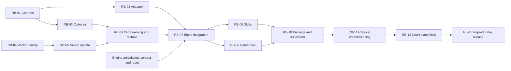

# Implementing the small-robot pipeline in Psionic

**Date:** November 15, 2026. **Status:** coding-agent implementation brief.
Design baseline: `5ed34eedcb`. RB-00, the complete RB-01 CPU query/record
profile and RB-02 scalar actuator now have source and CPU component evidence.
The remaining packages are plans; no
hardware authorization or purchase is recorded here.

Start with [chapter 256](../../book/ch256-build-and-teach-a-small-robot.md) and
the [pipeline specification](../../../docs/nvidia/microduck-pipeline-2026-11-15.md).
Chapters 257–258 now run the contract and scalar servo. Chapters 259–265 draft
the calculations,
boundaries, refusals and outcomes still to implement. RB numbers below are work-package
labels, not published protocol IDs or newly created GitHub issues.

## What an agent should implement first

Continue **RB-03** next: the bounded analytic-plant collector and frozen/staged
normalizer lifecycle. RB-02 implements requested/limited actuator force,
explicit delay/restore and independently checked scalar motion, with
illustrative passive loss, voltage scaling and a separate observation-play
precursor; its [contract](actuator-contract-rb02.md) and
[receipt](../../../docs/verification/robotics-actuator-rb02-2026-11-15.md) state
that CPU boundary. RB-01a and RB-01b now
implement decoded admission, action mapping and a registered identity-bound
RXE1 record with one codec. Preserve its expected-embodiment comparison,
quantity semantics and canonical active-record encoding. The
[freeze and inventory](experiment-contract-rb01.md),
[query receipt](../../../docs/verification/robotics-experiment-rb01-2026-11-15.md)
and [record receipt](../../../docs/verification/robotics-experiment-wire-2026-11-15.md)
state that CPU component boundary. Do not begin with a new simulator, a large
model, an online asset fetcher or an experiment on motors.

Deliver RB-03 against independent analytic fixtures.
Build vector policy scores and the shared neural update in RB-04/05, and
train on the existing owned oscillator in RB-06. This produces a complete
new neural actor/critic training route while the general biped articulation
and contact work proceeds in the engine. It is deliberately labeled an
analytic-plant learning profile. RB-07 is where it first becomes robot learning.

## Existing source inventory and the missing integration

| Reuse owner | Existing source | Keep its boundary |
| --- | --- | --- |
| Return targets and scalar PPO | `psionic/lib/robotics/locomotion/gae.coax`, `ppo-surrogate.coax` | GAE currently admits 1–16 worlds, horizon 1–128, at most 2,048 rows; scalar objective is not a neural learner |
| Scalar Gaussian and ratio | `locomotion/gaussian-density.coax`, `gaussian-sampling.coax`, `gaussian-ratio.coax` | Extend to a joint vector distribution; preserve its finite/range and knot conventions |
| Scalar learning experiment | `locomotion/lqr-policy.coax`, `lqr-rollout.coax`, `lqr-update.coax` | Carry passing scalar evidence; do not copy its optimizer into a new neural training loop |
| Model and reverse execution | `psionic/lib/module.coax`, `module-train.coax`, `autodiff.coax`, `tensor-ir.coax` | Separate actor/critic fit 32-node programs only after real admission; seeded backward may need a shared runner extension |
| Trainer and optimizer | `psionic/lib/trainer.coax` and existing AdamW components | Reuse batch/update/clip/refusal semantics; caller supplies genuine PPO gradients |
| Checkpoint/interchange | `psionic/lib/checkpoint/record.coax`, `checkpoint/resume.coax`, `interchange.coax`, `onnx.coax`, `onnx-write.coax` | Core checkpoint holds at most 4,096 values; add versioned robotics companions, never repurpose tokenizer fields |
| Small owned physical plant | `psionic/lib/physics/oscillator.coax`, its clock/replay/function companions | Useful collector/learner fixture, not a biped model or contact solver |
| Control and supervision | `psionic/lib/robotics/panda-control.coax` and chapter 170's supervisor/clock components | Preserve the source-bound Panda profile while extracting only reusable interfaces |
| Geometry/physics | `metaverse-engine/physics/sim/scene.coax`, `rigid.coax`, `broad.coax`, `narrow.coax`, `contact.coax` | Existing CPU components are partial; generic articulation and robot constraint/contact integration remain separate engine work |
| Images and observations | `psionic/lib/pixels.coax`, `pixels-ir.coax`, `observe.coax` | Model-image preprocessing does not supply a calibrated physical depth sensor |
| Evaluation and rows | `psionic/lib/suite.coax`, `noise.coax`, `verdict.coax`, `training-rows.coax` | Frozen task groups, exposure and three-way outcomes apply to actual robot trials |

Paths not linked above are source inventory names relative to the repository.
Inspect current headers/checks before editing: fixed capacities and source
ownership may have changed since this baseline.

## First numerical profile and capacity budget

The proposed small CPU profile uses four environments, eight collected steps,
four PPO epochs, minibatches of eight, hidden width 16 and separate actor and
critic programs. Start with four observation channels and two latent actions;
the compatibility-shape extension is 61 observations and 14 actions. Proposed
learning settings are gamma 0.99, lambda 0.95, epsilon 0.2, AdamW rate 0.0003,
zero weight decay, zero entropy coefficient and a declared gradient-norm cap.
Freeze the actual rounding and scalar ranges before generating expected values.

At the compatibility shape the actor/critic have 2,253 parameters including
14 log-standard-deviations. That fits the 4,096-value checkpoint limit but
does not establish any graph, module-entry, tensor-arena or execution bound.
Admit both programs and the complete workspace before a run. Store F32 neural
activations with the explicitly checked gradient/master-state profile; do not
advertise an all-F64 or mixed-precision guarantee by inference.

The sampled Gaussian action and the bounded physical target are separate.
PPO evaluates the joint likelihood of the original sample; saturation belongs
to the recorded environment/action map. Freeze normalization during collection
and all updates over those rows. Target/advantage/old-policy data are detached.

Qualification starts with pure queries, one backward/update and one collected
batch. The proposed first learning experiment then uses seeds 7, 19 and 43,
256 rollout/update cycles per seed and evaluation every 16 cycles. Each cycle
contains 16 minibatch optimizer transactions, so the prescribed total is
4,096 optimizer transactions per seed. Seal the analytic-plant
tasks and prospective quality criterion before running; a suggested criterion
is at least 20% lower held-out cumulative quadratic state cost than a zero-force
baseline in every seed. Also report the initial actor and conventional
controller, without requiring a learned controller to beat an optimal reference.
If the criterion misses, retain the miss; do not increase the budget or change
the suite inside that experiment. This is an experiment proposal, not a forecast.

For biped work, first qualify one environment and a small 16-by-32 rollout.
Larger 4,096-by-32 collection, device kernels and efficient GPU learning are
later measured profiles. Never infer their support from an array dimension,
CUDA decoder training or Vulkan rendering.

## Dependency graph and completion states



RB-04 can start after its immutable action contract is fixed. A package's
pure codec/fake-device work can begin before every learned skill is complete;
physical release still requires the exact selected skill/perception profile.
No code depends on a future chapter merely because its draft links ahead.

For each package record: not started, source/checks implemented, component
qualified, integrated, and product adopted, with its evidence paths. These are
work-tracking states, not substitutes for the book's existing chapter statuses.
Finish one reviewable commit per package or smaller independent slice.

## RB-00: inventory and experiment freeze

**State:** complete for the decoded CPU slice; see the
[inventory and frozen input/oracle](experiment-contract-rb01.md). Later
plant, neural and hardware packages need their own experiment freezes.

Read current AGENTS, relevant invariants, glossary, reuse catalog, source
headers and chapter registries. Identify the existing entry points above and
confirm capacity/target limitations. Prepare the exact fixture/experiment
descriptors and independent expectations before product code.

Deliver an inventory naming reused procedures, missing operations, proposed
files, schema ownership, fixture rights and bounded commands. Record whether
an upstream profile is reference-only or intended for compatibility. Do not
download large weights, execute cloned scripts, or add arbitrary dependencies.

Acceptance: a reviewer can identify every next slice's input/output, oracle,
refusal and target. No expected numerical result comes only from the new code.

## RB-01: experiment and embodiment admission

**Chapter 257. Dependencies:** RB-00. **State:** RB-01a and RB-01b are
component qualified on CPU and integrated in the runnable example. Shared
`experiment-types.coax`, `experiment-policy.coax` and `experiment-wire.coax`
now exist under `psionic/lib/robotics/`. The focused suites are
`robotics/experiment-policy` and `robotics/experiment-wire`; the registered
persistent identity is `psionic.robotics.experiment.v1`. No product adoption
or hardware qualification is recorded.

Implement decoded bounded contract admission and the two-joint action map.
Then add the versioned inert record and its one codec using shared formats.
Admission and mapping publish whole results or preserve the caller's bytes.

Checks first: hand home/sign/scale calculations; exact caps; duplicates;
unknown units/frame/calibration; nonfinite values; wrong assembly identity;
short buffers and complete atomic refusal. Independent table evaluation and
wire round trips must not share the product's admission branches.

Done: runnable valid/refused example, native debug/release/sanitizer records,
sharp `#authority` checks and a registered suite. No XML importer or hardware.

## RB-02: actuator response and delay

**Chapter 258. Dependencies:** RB-01. Implemented CPU component:
`psionic/lib/robotics/actuator.coax` and its type/check/fixture companions,
using the extracted shared `coax/lib/clip.coax` primitive. Its illustrative
`scalar-servo-play-f64-v1` profile is qualified; physical identification and
mechanical gearbox fidelity remain later work.

Split into requested/limited force, explicit delay state and later identified
friction/voltage/backlash profiles. The initial torque/inertia/delay fixture
must run without a simulator SDK. Add each physical term with its own equation,
parameter origin and reference. Never call a simple PD surrogate a complete
vendor actuator implementation.

Check the chapter's 0.20-to-0.15 N·m cap and 0.002-second step independently;
delay-zero and queue-boundary cases; reversed motion; invalid inertia; pending
queue restore and failed-step atomicity. Generalized-force exchange into the
engine respects the context map; engine code must not load these Psionic units.

Done: qualified CPU numerical profile with a fully inventoried state. Actual
motor identification and physical conclusions remain RB-11 work.

## RB-03: bounded collector and normalizer

**Chapter 259. Dependencies:** RB-01. Proposed collector units in
`psionic/lib/robotics/locomotion/collector-*.coax`; running-statistics support
goes in a shared Psionic owner after the inventory rules out an equivalent.

Implement a bounded transition adapter and collector on the existing oscillator.
Capture final-before-reset observations, latent/applied actions, old joint
log probability, values, flags, logical episode/step identity and frozen stats.
Reuse `rga_returns`; do not fork GAE. Define active versus staged normalizer
statistics and a counter allocation that is independent of worker order.

Checks: delta 2.3 versus terminal 0.5; reset observation deliberately poisoned
with value 100; solo/batch identity; resetting A preserves B; every queue/cursor
in restore; row overflow; inconsistent actor/stats versions; nonfinite masked
data; callback failure after an external effect. Use independent finite traces.

Done: one complete batch and interrupted/resumed collection match the declared
profile. The output is analytic-plant evidence only.

## RB-04: vector policy density

**Chapter 260. Dependencies:** immutable RB-01 action contract. Proposed units
`psionic/lib/robotics/locomotion/gaussian-vector-*.coax` extending the scalar
Gaussian owner, not another distribution/RNG implementation.

Compose fixed-order scalar log densities/scores into a 1–16-coordinate diagonal
distribution and one joint-action ratio/objective. Admit every coordinate
before publication; propagate range refusals. New vector log-ratio limits need
an independently checked range argument; do not silently enlarge the existing
scalar ratio's domain or clamp a ratio to make PPO succeed.

Checks: two-dimensional score example; one active/one inactive coordinate;
positive/negative advantages; clipping knots; detached-action semantics;
zero/NaN/range cases; underflow/overflow and counter exhaustion. Compare full
joint densities/gradients with independent analytical/Decimal references.

Done: vector query and public example pass without a neural network, optimizer
or environment. Existing scalar checks/evidence remain unchanged.

## RB-05: shared neural actor/critic backward

**Chapter 260. Dependencies:** RB-04. Extend `module-train.coax`/autodiff's
shared seeded-output gradient support if needed; compose new policy-specific
units under the existing locomotion owner.

Build separate small actor/critic through public module constructors. Seed
the actor output with density/objective sensitivities and the critic with
half-squared-error sensitivity. A detached weighted-output sum built from
existing multiply/sum IR nodes is an independent bridge/reference. Preserve
frozen old actions/log probabilities/advantages/targets. Do not introduce
another optimizer, tape or trainer, and do not substitute behavior cloning.

Checks: hand two-output mean gradients [−2.2, +2.2]; critic derivative −1;
selected full-network finite differences away from ReLU/clipping knots;
separate graph capacities; parameter naming/sharing and full failed-update
preservation. First prove one gradient and one `tr_apply`, then the full shape.

Done: independently checked neural update through the public trainer, with
no claim that useful learning or walking occurred.

## RB-06: CPU learning and complete resume

**Chapters 259–260. Dependencies:** RB-03/05. Compose an experiment tool in
Coax under `psionic/tools/` and an example under `psionic/examples/`; reuse
the existing checkpoint/interchange owners with registered robotics companions.

Run the sealed analytic-plant experiment described above. Checkpoint parameters,
optimizer moments/step, collector and plant, queue, normalizers, counters,
shuffle and pending work. Compare uninterrupted/resumed runs at a nonempty
mid-rollout and mid-epoch boundary. Preserve parameter precision explicitly.

Done: all prescribed curves/failed outcomes, comparisons and timings retained;
no cherry-picking or follow-up budget expansion. Portable recorded fixtures
verify ordinary gates without repeating training. This is a new reusable
learner integration; chapter 171's old LQR experiment is carried unchanged.

## RB-07: biped integration

**Chapter 260. Dependencies:** RB-02/06 and the engine work below. Admit one
pinned robot and actuator profile; extend existing simulator owners for
articulated dynamics, constraints, full foot/body contacts, limits and reset.

Deliver single-environment geometry/dynamics references, then a conventional
stand/control baseline, then small batched collection and fresh policy
training. A reference SDK may supply independent comparisons while the owned
engine is built. SDK and owned-backend runs have different profile identities.
No Psionic-local replacement scene or copied contact solver is allowed.

Done: actual biped learning on the named backend with held-out command/terrain/
parameter criteria, complete seeds and resets. Claim the owned pipeline only
after the owned scene, solver and observation path pass. Device acceleration
is a separate slice following CPU correctness and a measured bottleneck.

## RB-08: skill training and transition policy

**Chapter 261. Dependencies:** RB-07. Train sit/stand and controlled rest/
recovery using complete body contacts; add the roll as a separate dynamic
skill. Generalize current supervision into a shared skill-policy boundary
with prospective entry/exit/window and abort criteria.

Check stale/duplicate/expired/wrong-epoch cues, wrong posture, package mismatch,
history/recurrent reset and interrupted dispatch. Independent state-machine
traces check selector semantics; actual simulated episodes check physical
transitions. Mutation of an entry check must fail a scenario.

Done: skill and transition success reported separately, with every cue's
source retained. An animation graph is presentation, not motor authority.

## RB-09: sensors, perception and courses

**Chapter 262. Dependencies:** admitted robot and engine sensors/rendering;
RB-07 for locomotion integration. Implement calibrated depth geometry first,
then a local planner and only then an optional learned encoder/student.

Check the chapter's back-projection; axial depth versus range; frame/time/
calibration; missing pixels; blocked routes and sensor loss. Reuse image and
geometry owners. Keep privileged teacher data outside student deployment.
Freeze course groups and prevent agent tuning from exposing final tests.

Done: independently scored course completion, perception error, collisions,
balance and interventions, with a geometric baseline and full failure ledger.
Rendering a course or replaying known actions is insufficient.

## RB-10: policy package and supervised execution

**Chapter 263. Dependencies:** RB-01/05; physical release requires the selected
RB-08/09 capabilities. Add versioned package metadata and supported ONNX
operators to the existing reader/writer/executor; native packages reuse
authenticated model admission and shared tensor execution.

Check normalization folding independently, native/ONNX action vectors,
unsupported operators, identity/assembly/calibration mismatches and staged
load refusal. Exercise fake-device delays, cancellation, epochs and dispatch
failures with complete asynchronous ownership.

Done: one offline package and fake-device execution route, plus explicit
operator/precision/target support. No motor port is opened by the default gate.

## RB-11: authorized physical commissioning

**Chapter 264. Dependencies:** RB-10 and exact hardware/stop authorization.
Propose the device-adapter/context ownership in the context map before adding
product runtime files. C performs device effects; Coax decides admission,
control and recovery. Reuse existing platform, clock and file/identity helpers.

Prepare a reviewable bench plan, assembly/calibration/BOM/process identities,
timing allocation and fault procedure before owner action. Record actual
required actions in `NEEDS_OWNER.md`. Progress from disconnected outputs to
isolated actuator, qualified support and bounded physical trials.

Done: named-target timing, stale-state and actual fault/stop behavior, plus
predeclared physical task repeatability with all trials/interventions. No
cross-unit or universal timing claim follows from a single tested unit.

## RB-12: course and four-robot coordination

**Chapter 265. Dependencies:** RB-08/09/11. Use four isolated simulated robots,
then an actually shared collision/separation scene, then smaller physical
groups before the proposed four-unit showcase.

The coordinator sends bounded cues; each robot retains its own epoch,
deadline, policy/normalizer/history and local supervisor. Test reconnect,
partial acceptance, lost/reordered cues, collision separation and one failed
unit while others continue their permitted local behavior.

Done: owned training lineage, course results and cue origins/interventions are
visible. Scripted, teleoperated and autonomous decisions remain labeled. The
showcase and held-out evaluation suite are distinct records.

## RB-13: reproducible release

**Chapter 265. Dependencies:** selected complete route. Package clean-machine
build/run instructions, permitted source/artifacts, fixtures and offline
readers. Qualify at least one complete non-NVIDIA execution target independently;
porting full training is a further profile, not implied by inference.

For physical products add commercially usable editable geometry, manufacturing
process/BOM, calibration/QA, repairs and support records. Preserve separate
licenses for upstream code, weights and noncommercial meshes.

Done: a second builder reproduces the selected software/assembly route with
explicit results and limits. Archive source, failures and inputs without
depending on a private model/asset server or vendor service.

## Engine and compiler work that must not be hidden in Psionic

| Required owner | Concrete integration needed | Smallest gate |
| --- | --- | --- |
| Engine 19 | Admitted articulated tree and generalized dynamics beyond fixed Panda queries | Two-link hand geometry/inertia/force comparisons before a whole robot |
| Engine 22 | Coupled contact/limits/friction and bounded residual reporting | Supported foot/body contact with analytic/independent cases; nonconvergence refuses |
| Engine 31/35/36 | Exact model import, reset/batching and complete state inventory | One admitted robot, solo-versus-batch identity, reset isolation and mid-episode restore |
| Engine 33/34 | Stamped sensors and calibrated observations | Tiny analytic depth case before a policy camera or thousands of rendered worlds |
| Coax R12–R20 | Frame/clock/region/effect/bounded-control and provenance contracts | Actual collector/controller consumers and named refusal witnesses; no timing claim from fixed arrays |
| Coax R21–R24 | Layout, graph/interop and kernel derivatives where profiling requires them | One measured solver/training bottleneck, CPU oracle and real device evidence |

The engine cannot load Psionic. Either callers supply values through an
explicit boundary or a reusable numerical primitive is extracted downward
with carried checks. No new layer allowlist line is part of this plan.

## Verification, publication and agent handoff

For each slice, write Coax checks before product code. Admission/experiment/
authority/selection rules use `#authority`; first mutation reaches zero
survivors or reviewed equivalents. New oracles are independent and inert;
any new non-Coax tool has a permitted Firm reason. Reuse current robotics
dispatchers rather than creating another suite runner.

Register the actual suite before using a future path in a command. For
example, after RB-01 exists and is registered, the targeted remote pattern is:

```shell
coax/remote/remote.sh run -- bash psionic/check.sh --only robotics/experiment-policy
```

Psionic uses its dedicated dispatcher: generic `check.sh only` currently
selects no Psionic suite and its empty pass is not evidence.

Use targeted native/debug/release/sanitizer and independent fixture checks
through their existing dispatchers on the build hosts. Mutation covers the
touched procedures. Cap each command at 15 minutes, shard/checkpoint an
experiment prospectively, and retain its complete counters. Do not run big
units or training on the Mac, rerun passing unchanged gates, or repeat a
whole trained-policy episode to validate a pure codec edit.

Every handoff names the commit, files, registered suite, profile/targets,
actual checks/mutation sites, frozen inputs, outputs and unresolved limitations.
Generated outputs are not fabricated fixtures. A failed quality result can
close a valid experiment implementation but cannot promote a useful walking
policy. Stop after three failed rounds on one problem and change approach.

Book publication updates status, registry, README and contents together.
Review changed capability-evidence bindings, refresh only those bindings,
regenerate chapter 250's matrix if needed, then run the structural book check.
Rebase onto current main before final verification, commit only the slice's
files with model/Agent trailers and push through the tracked hooks.

The next agent can start RB-03 immediately. Later physical owner actions do
not block the pure contract, numerical, collector or neural-training work.
